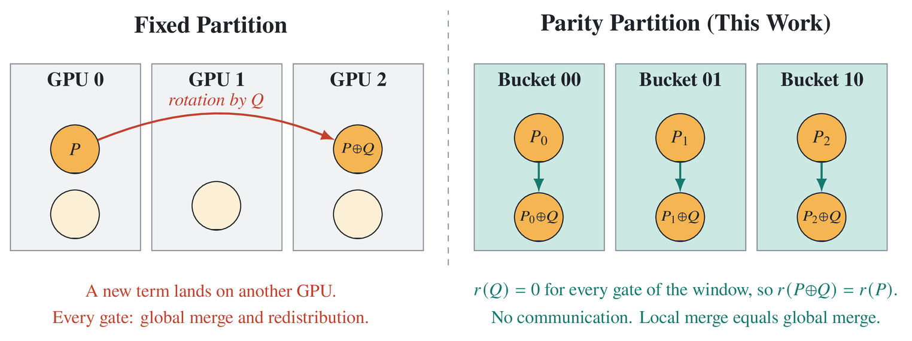
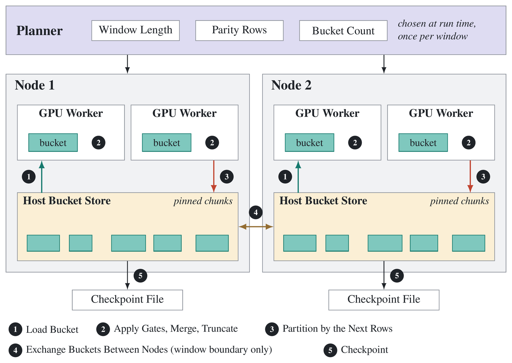
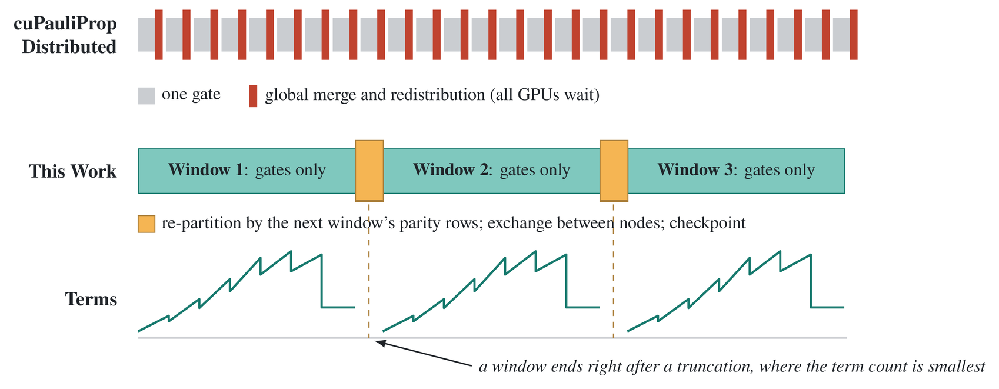
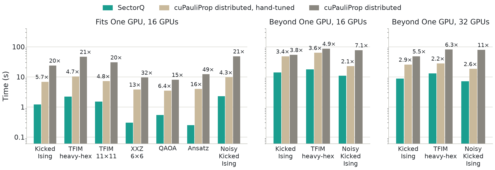
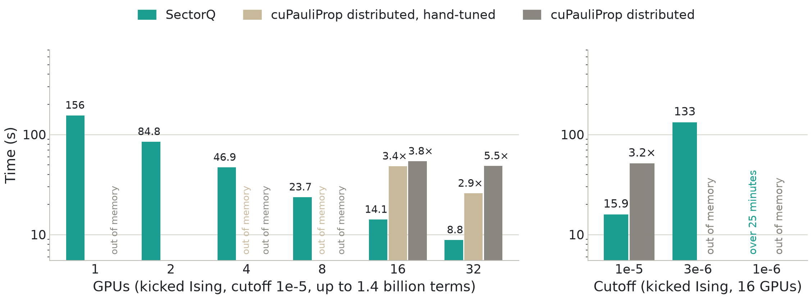

# SectorQ: 보존 parity sector로 확장하는 Pauli propagation

*SectorQ: Scalable Pauli Propagation with Communication-Avoiding Parity Sectors*

SectorQ는 100 qubit이 넘는 양자 회로의 기대값을 여러 GPU와 여러 노드에서 계산하는 Pauli propagation 실행 엔진이다. Pauli propagation의 정확도는 유지하는 항(term)의 수가 정한다. 그런데 항은 gate마다 새로 생기고 같은 항끼리 합쳐야 하므로, 지금의 분산 구현은 gate마다 모든 GPU가 조율한다. SectorQ는 항 집합을 구간 동안 보존되는 parity의 값으로 나눈 sector로 다룬다. sector는 그 구간 동안 서로 항을 주고받지도 합쳐지지도 않는다. 그래서 구간이 도는 동안 통신이 없고(통신은 구간이 바뀔 때만 한다), sector를 host memory에 두고 GPU에 하나씩 올려 GPU memory보다 많은 항을 다룬다. 답은 전부 합쳐 계산한 것과 같다.

sector는 물리에서 보존량의 값으로 나뉘어 서로 섞이지 않는 구역을 부르는 말이다. 비교 대상은 NVIDIA cuPauliProp v0.5.0의 분산 모드이다. SectorQ는 gate 적용, merge, truncation에 cuPauliProp의 단일 GPU 연산을 그대로 쓰고, 그 위의 분할, 배치, 통신을 바꾼다. 코드와 로그에서는 sector를 bucket, 실행 파일을 `pp_engine`이라고 부른다.

- 코드: SectorQ [src/engine/](src/engine/), cuPauliProp 계측 [src/driver/](src/driver/)와 [src/plugin/](src/plugin/)
- 원시 로그: [logs/](logs/) (실험별 대응은 6.3절)
- 그림: 설계 그림은 `figures/src/*.tex`, 평가 그림은 `figures/make_eval_figures.py`가 로그를 읽어 그린다
- 논문 계획과 남은 실험: 8절

목차: [1. 서론](#1-서론) | [2. 배경](#2-배경) | [3. 설계](#3-설계) |
[4. 평가](#4-평가) | [5. 한계](#5-한계) | [6. 구성물과 재현](#6-구성물과-재현) |
[7. 사용법](#7-사용법) | [8. 논문 계획](#8-논문-계획)

## 1. 서론

### 1.1 연구의 필요성

양자 프로세서는 100 qubit을 넘어섰다. 이 크기에서 고전 시뮬레이션은 세 가지 일을 한다.

- **검증.** 양자 하드웨어가 낸 값이 맞는지 판단하는 기준이 된다.
- **설계와 시험.** 회로, 오류 완화 기법, 변분 알고리즘을 하드웨어에 올리기 전에 시험한다.
- **경계 설정.** 어떤 계산이 고전 컴퓨터로 가능한지를 정한다. 2023년 127-qubit 프로세서의 kicked Ising 실험은 고전 컴퓨터로 계산하기 어려운 크기로 제시되었고, 곧 tensor network와 Pauli propagation 계열의 고전 방법이 같은 회로를 계산하였다.

고전 시뮬레이션이 닿는 범위가 넓을수록 이 세 가지 일을 더 큰 회로에서 할 수 있다.

100 qubit이 넘는 회로는 상태 벡터로 다룰 수 없다. amplitude가 2^n개이므로 가장 큰 슈퍼컴퓨터로도 50 qubit 안팎이 한계이다. Pauli propagation은 상태 대신 관측량을 다룬다. 관측량을 계수가 붙은 Pauli string의 합으로 두고, 회로의 gate를 뒤에서부터 적용하며, 계수가 작은 항을 버려(truncation) 기대값을 근사한다. 비용은 qubit 수가 아니라 유지하는 항의 수가 정한다.

따라서 이 방법에서는 계산 자원이 곧 정확도이다. 유지하는 항이 많을수록 답이 정확해진다.

| 측정 | 유지하는 항을 늘렸을 때 |
|---|---|
| 127-qubit kicked Ising의 기대값 (θ=π/4, 20 step) | cutoff 1e-4, 1e-5, 3e-6에서 0.153, 0.229, 0.289. 항 수는 최대 2,250만, 14억, 그 이상이다 |
| 30-qubit TFIM의 exact 값 대비 오차 (4 step) | cutoff 1e-3에서 1e-7로 낮추면 0.019에서 0.00007로 줄어든다. 이때 구간 경계의 항이 82억 개이다 |

Pauli propagation이 풀 수 있는 문제의 범위는 얼마나 많은 항을 얼마나 빨리 다루는가로 정해진다. 127 qubit의 항 하나는 40 byte이고, 위 kicked Ising 회로의 cutoff 1e-5에서는 항이 14억 개(56 GB)이다. GPU 한 장에 담을 수 없다. 이 연구의 문제는 Pauli propagation을 여러 GPU와 여러 노드로 확장하는 것이다.

### 1.2 문제: 갈라지고, 합치고, 잘라내는 계산은 나누기 어렵다

Pauli propagation의 gate 하나는 세 가지 일을 한다. 항을 둘로 가르고(branch), 같은 Pauli string을 가진 항의 계수를 합치고(merge), 계수가 작은 항을 버린다(truncate). 이 계산을 여러 GPU로 나누는 데에는 세 가지 구조적인 어려움이 있다.

1. **합친 뒤에 잘라야 한다.** truncation은 합쳐진 계수를 보아야 한다. 그런데 같은 항이 서로 다른 GPU에서 생긴다. 합치지 않고 GPU마다 따로 자르면 답이 틀린다(kicked Ising에서 0.1675–0.283, 정답 0.1531). 따라서 원칙적으로 gate마다 모든 GPU가 조율해야 한다.
2. **데이터가 실행 중에 정해진다.** 어떤 항이 생기고 살아남는지는 실행해야 안다. 상태 벡터처럼 index로 위치를 미리 알 수 없다. 항 수는 한 층 안에서 2.9–36배로 늘었다가 줄어들고, 고정된 bit로 나누면 GPU 사이의 항 수가 1.4–4.9배 차이 난다.
3. **용량이 GPU memory에 묶인다.** 정확도를 정하는 것은 항 수인데, 항을 담는 GPU memory는 장당 40–80 GB이다. 지금의 GPU 구현은 40 GB에 약 1억 항을 담는다.

1번과 3번은 서로 맞물려 있다. gate마다 합치면 통신이 많아지고, 합치기를 미루면 합쳐지지 않은 항을 들고 있어야 해서 메모리가 모자란다. 통신과 메모리 가운데 하나를 내주어야 한다.

이 구조는 Pauli propagation에만 있는 것이 아니다. 갈라진 결과를 같은 key끼리 합쳐야 하는 계산은 같은 문제를 가진다. 양자 화학의 FCIQMC에서 walker의 소멸, database의 분산 집계가 그 예이다. 이런 계산은 보통 key를 hash로 프로세스에 나누고 step마다 교환한다.

### 1.3 기존 방법의 한계

기존 방법은 위의 맞교환에서 한쪽을 고른다. 근거는 2.4절과 4절에 있다.

| 방법 | 같은 항을 합치는 방식 | 한계 |
|---|---|---|
| cuPauliProp 분산 모드 (GPU) | gate마다, 모든 GPU에 걸쳐 | GPU를 늘릴수록 느려진다. 2,250만 항 설정이 GPU 1장에서 2.9초, 16장에서 71초이다. 모든 GPU가 gate마다 22번의 전원 통신에 참여하고, 항이 움직이지 않는 gate에서도 같은 비용을 낸다 |
| 합치기를 미루는 조정 | truncation 직전에만, 모든 GPU에 걸쳐 | 통신은 줄지만 합쳐지지 않은 항을 들고 있어야 한다. 14억 항 설정은 32 GPU가 있어야 들어간다 |
| ORQA (CPU 분산) | 고정된 분배 함수로 나누고 새 항을 보낸다 | 가지치는 gate마다 통신한다. GPU를 쓰지 않는다 |
| 단일 노드 구현 (PauliPropagation.jl 등) | 한 장치 안에서 | 메모리가 한계이다 |
| GPU마다 따로 계산 | 합치지 않는다 | 답이 틀린다(0.1675–0.189, 정답 0.1531) |

통신도 메모리도 내주지 않는 분할은 조사한 범위에서 찾지 못하였다.

### 1.4 핵심 관찰과 접근

gate가 항의 Pauli string을 바꾸는 방식에는 구조가 있다. rotation exp(-iθQ/2)는 항 P를 P와 P⊕Q로 만든다. 새 항의 bit 벡터는 원래 bit 벡터에 정해진 벡터 Q를 XOR한 것이다. 따라서 bit 벡터의 parity r 가운데 r(Q)=0인 것은 새 항에서도 값이 같다. r(P⊕Q)=r(P)이다. 예를 들어 X rotation은 x bit만 뒤집으므로, z bit로 만든 parity는 X rotation이 몇 개 이어져도 변하지 않는다.

SectorQ는 이 관찰에서 다음 규칙을 세운다.

> 항 집합을 지금 구간의 모든 gate가 보존하는 parity의 값으로 나눈다. 이렇게 나눈 sector는 그 구간 동안 항을 주고받지도 합쳐지지도 않는다. 따라서 sector마다 따로 merge하고 truncation해도 전체를 합쳐 계산한 것과 답이 같다. 구간, parity, sector 수는 실행 중에 정하고, 통신은 구간이 바뀔 때만 한다.

이 규칙은 1.2절의 세 가지 어려움에 하나씩 답한다.

- **합친 뒤에 잘라야 한다 → sector 안에서 합친다.** 합쳐질 상대가 항상 같은 sector 안에 있다. gate마다 합치면서도 구간(kicked Ising에서는 rotation 127개)이 도는 동안 MPI 호출이 없다. 통신이 없어지는 것은 아니다. gate 2,540번마다 하던 것이 구간 20개의 경계로 모인다(communication-avoiding).
- **데이터가 실행 중에 정해진다 → 실행 중에 정한다.** 구간의 길이, 쓸 parity, sector 수를 구간마다 현재 항의 표본을 보고 정한다. 미리 세운 계획이 없다.
- **용량이 GPU memory에 묶인다 → sector를 하나씩 올린다.** sector는 서로 독립이므로 host memory에 두고 GPU에는 처리 중인 것만 올린다. 구간 안에서 GPU보다 커진 sector는 parity를 하나 더 써서 그 자리에서 나눈다.

같은 성질에서 두 가지가 더 나온다. Clifford gate는 데이터에 적용하지 않고 뒤따르는 rotation의 생성자에 흡수한다. 구간 경계에서 sector 집합을 checkpoint로 쓰고, 회로 전체에서 보존되는 parity로 모든 항을 검산한다.

그 결과 SectorQ는 통신과 메모리를 맞바꾸지 않는다.

| 방식 | 같은 항을 합치는 때 | 통신 | GPU가 들고 있는 항 |
|---|---|---|---|
| cuPauliProp 분산 (기본) | gate마다, 모든 GPU에 걸쳐 | gate마다 | 합쳐진 항 |
| cuPauliProp 분산 (손으로 조정) | truncation 직전에만, 모든 GPU에 걸쳐 | truncation마다 | 합쳐지지 않은 항까지. 14억 항 설정은 32 GPU가 있어야 들어간다 |
| SectorQ | gate마다, sector 안에서 | 구간이 바뀔 때만 | 합쳐진 항. 그것도 처리 중인 sector 하나 |

### 1.5 주요 결과

회로 7종(30–127 qubit), Perlmutter A100, 최대 8 노드 32 GPU. 세 방식에 같은 연산 목록을 주었다. 측정은 설정마다 1회이다.

| 항목 | cuPauliProp 분산 (기본) | cuPauliProp 분산 (손으로 조정) | SectorQ |
|---|---:|---:|---:|
| 회로 7종의 기대값 | 기준 | 기준과 동일 | 모두 12자리까지 동일 |
| 16 GPU, 한 GPU에 들어가는 설정 7종 | 8.1–48.5초 | 3.5–10.4초 | 0.25–2.3초 (기본의 15–49배, 조정의 4.3–16배) |
| 16 GPU, 한 GPU를 넘는 설정 3종 (최대 14억 항) | 54.1–86.8초 | 22.7–63.3초 | 10.9–17.7초 (기본의 3.8–7.1배, 조정의 2.1–3.6배) |
| 32 GPU, 같은 3종 | 48.5–81.3초 | 18.5–28.0초 | 7.2–13.0초 (기본의 5.5–11배, 조정의 2.2–2.9배) |
| Kicked Ising cutoff 1e-5(14억 항)를 도는 데 필요한 GPU 수 | 16 | 16. dedup을 truncation 직전까지 미루려면 32 | 1 |
| 같은 설정의 1 / 2 / 4 / 8 / 16 / 32 GPU 시간 | 16장 54.1초, 32장 48.5초 | 16장 48.2초, 32장 25.8초 | 155.5 / 84.8 / 46.9 / 23.7 / 14.1 / 8.8초 |
| Kicked Ising cutoff 3e-6 | 메모리 부족 (32 GPU에서도, 16 GPU에 80 GB를 모두 주어도) | 메모리 부족 | 16 GPU 133초, 32 GPU 65.7초 (GPU당 36 GB) |
| 다룬 가장 큰 크기 (구간 경계의 항 수) | GPU당 약 1억 | 같음 | 121억 |
| gate를 적용하는 동안의 전원 통신 | rank마다 gate당 allgather 22회 | 전역 dedup을 truncation 직전에만 수행 | 구간 동안 없음. 구간이 바뀔 때 교환 |
| exact 값 대비 오차 (30 qubit, cutoff 1e-7) | 측정하지 않음 | 측정하지 않음 | 0.00007 |

손으로 조정한 cuPauliProp은 이 연구가 구성한 가장 강한 기준선이다. 연산을 rank 안에서만 적용하고 전역 dedup을 truncation 직전에만 수행한다(4절).

어떤 요소가 어떤 이득을 내는지를 kicked Ising 16 GPU에서 단계별로 나누면 다음과 같다. 아래로 갈수록 요소를 하나씩 더한다.

| 단계 | 2,250만 항 설정 | 14억 항 설정 | 요소의 출처 |
|---|---:|---:|---|
| cuPauliProp 분산, 원래 회로 | 71.2초 | 메모리 부족 | 출발점 |
| + Clifford gate를 데이터에 적용하지 않는다 | 24.0초 | 54.1초 | 이 연구가 넣었다. 비교에서는 기준선에도 준다 |
| + 전역 dedup을 truncation 직전에만 한다 | 6.9초 | 48.2초 (간격 3까지만 들어간다) | 누구나 할 수 있는 조정. 가장 강한 기준선 |
| + **보존 parity sector로 나눈다 (SectorQ)** | **1.2초** | **14.1초** | 이 연구의 핵심 |
| SectorQ, 32 GPU | 1.2초 | 8.8초 | |
| SectorQ, 1 GPU | 1.6초 | 155.5초 | sector를 GPU에 하나씩 올린다 |

### 1.6 기여와 적용 범위

기여는 다음과 같다.

1. cuPauliProp v0.5.0의 분산 모드를 gate 단위로 계측하여, GPU를 늘릴수록 느려지는 원인과 GPU당 용량 한계를 수치로 보였다(2.4절).
2. 구간 동안 보존되는 parity로 나눈 sector는 독립이라는 성질, 그 성질의 보장과 한계, Clifford gate를 데이터에 적용하지 않는 방법을 제시하였다(3.1–3.5절, 3.8절).
3. 이 성질에서 구간 동안 통신하지 않는 다중 GPU 실행, GPU memory를 넘는 실행, 넘치는 sector의 분할, 구간 경계 checkpoint를 끌어내어 하나의 SectorQ로 구현하였다(3.6–3.7절).
4. 회로 7종에서 단일 GPU 실행, cuPauliProp 분산 모드와 같은 답을 내는 것을 확인하고, 속도, 필요한 GPU 수, 도달 범위를 비교하였다. exact 값을 아는 30 qubit 회로에서 cutoff에 따른 오차를 재었다(4절).

적용 범위는 다음과 같다. 한 GPU에 들어가는 문제는 GPU를 늘려도 빨라지지 않는다(2,250만 항 설정: 1 GPU 1.64초, 16 GPU와 32 GPU 1.2초, 이유는 4.3절). 이런 문제에서 SectorQ의 이득은 cuPauliProp 분산 모드가 내는 조율 비용이 없다는 데 있다. GPU를 늘려 시간이 줄어드는 것은 한 GPU를 넘는 문제이다. 측정은 32 GPU까지이고, 관측량은 Z 하나 또는 edge의 합이다. 가장 강한 기준선과의 속도 차이는 한 GPU를 넘는 설정에서 2.1–3.6배이며, 더 큰 차이는 필요한 GPU 수와 도달 범위에 있다. kicked Ising(θ=π/4)의 값은 측정한 cutoff 범위에서 수렴하지 않았다. 이 회로에서 주장하는 것은 같은 cutoff에서 같은 답을 더 빠르게, 더 적은 GPU로, 더 낮은 cutoff까지 낸다는 것이다. sector 단위 처리, out-of-core 실행, checkpoint는 각각 database의 분할 실행에 원형이 있다(2.5절). 이 연구가 제시하는 것은 gate가 key를 계속 바꾸는 데이터에서 분할이 유지되는 key이다.

## 2. 배경

이 절은 다음을 다룬다.

1. 100 qubit 이상의 고전 시뮬레이션 방법과 Pauli propagation의 위치(2.1절)
2. Pauli propagation의 연산과 정확성 조건(2.2절)
3. 분산 실행이 구조적으로 어려운 이유(2.3절)
4. 최신 GPU 구현에서 그 어려움이 나타나는 모습(2.4절)
5. 선행 연구가 다루는 범위(2.5절)

2.6절은 여기에서 도출되는 설계 요구사항을 정리한다.

### 2.1 100 qubit 이상의 고전 시뮬레이션

| 방법 | 저장하는 것 | 비용을 정하는 것 | 100 qubit 이상에서 |
|---|---|---|---|
| State vector | amplitude 2^n개 | qubit 수 | 쓸 수 없다. 50 qubit 안팎이 한계이다 |
| Tensor network | 연결된 tensor들 | 얽힘의 양(bond dimension) | 얕은 회로와 1차원에 가까운 연결에서 쓴다. 2차원 연결의 깊은 회로에서는 비용이 급격히 커진다 |
| Pauli propagation | 관측량의 Pauli 항 | 유지하는 항 수(cutoff) | 기대값을 구하는 문제에 쓴다. 정확도와 비용을 cutoff 하나로 조절한다 |

Pauli propagation은 기대값을 구하는 문제에 맞는다. 관측량이 몇 개의 qubit에만 걸려 있으면 처음에는 항이 적고, 회로를 거슬러 올라가며 늘어난다. 잡음이 있는 회로에서는 잡음이 항의 계수를 줄여 주어 더 적은 항으로 충분하다. NVIDIA cuQuantum은 25.11부터 GPU 구현인 cuPauliProp을 제공한다.

세 방법은 확장하는 축이 다르다. 상태 벡터 시뮬레이터는 qubit 수를 늘리려고 확장한다. Pauli propagation은 항 수, 곧 더 낮은 cutoff를 얻으려고 확장한다. 이 문서의 비교 축은 qubit 수가 아니라 항 수와 GPU 수이다.

### 2.2 Pauli propagation의 연산

관측량을 Pauli string의 합으로 두고 회로의 gate를 뒤에서부터 하나씩 적용한다. 마지막에 초기 상태에 대한 기대값을 구한다. 저장하는 것은 항의 목록이다.

- **항(term).** Pauli string 하나와 계수이다. Pauli string은 bit 벡터 (x | z)로 저장한다. qubit마다 I=(0,0), X=(1,0), Z=(0,1), Y=(1,1)이다. 127 qubit이면 254 bit이다.
- **Rotation (branch).** exp(-iθQ/2)는 생성자 Q와 commute하는 항을 그대로 두고, anticommute하는 항 P를 P와 P⊕Q 두 항으로 만든다. ⊕는 bit 벡터의 XOR이다. 예를 들어 Z에 X rotation을 적용하면 cos θ·Z + sin θ·Y가 된다. Z=(0,1)에 X=(1,0)을 XOR한 것이 Y=(1,1)이다.
- **Merge (dedup).** 서로 다른 항에서 같은 Pauli string이 만들어지면 계수를 더해 한 항으로 만든다.
- **Truncation.** 계수의 크기가 cutoff 이하인 항을 버린다. cutoff가 정확도와 항 수를 정한다.
- **Clifford gate.** Pauli string 하나를 다른 Pauli string 하나로 바꾼다. bit 벡터의 선형 변환이며 항 수가 변하지 않는다.

정확성 조건은 하나이다. truncation은 merge한 계수를 보아야 한다. 같은 항이 조각으로 나뉘어 있으면 조각마다 cutoff 아래로 떨어져 버려질 수 있다. kicked Ising 2,250만 항 설정에서 merge하지 않고 truncation하면 기대값이 0.194–0.283으로 나온다(정답 0.1531). 이 문서에서 "답이 같다"는 전부 합친 뒤 자른 단일 장치 실행과 기대값이 같다는 뜻이다.

### 2.3 분산 실행의 구조적 어려움

상태 벡터의 분산과 비교하면 어려움의 성격이 드러난다.

| | 상태 벡터 | Pauli propagation |
|---|---|---|
| 데이터 | amplitude 2^n개, 크기 고정 | 항의 집합, gate마다 늘고 준다 |
| 데이터가 놓인 곳 | index로 미리 안다 | 어떤 항이 생길지 실행해야 안다 |
| gate가 하는 일 | 정해진 위치의 값을 갱신 | 새 key를 만들고, 같은 key를 합치고, 작은 값을 버린다 |
| 통신이 생기는 곳 | global qubit에 걸린 gate | 새 항이 다른 프로세스의 항과 같을 수 있는 모든 gate |
| 한계를 정하는 것 | 메모리 2^n | 유지할 수 있는 항 수 |

Pauli propagation에서 새 항 P⊕Q가 어느 프로세스의 항과 합쳐질지는 P가 놓인 곳과 무관하다. 항을 hash나 고정된 bit로 나누면 P⊕Q의 배정은 P의 배정과 달라진다. 그래서 가지치는 gate마다 새 항을 보내거나, 모든 프로세스가 전역으로 합쳐야 한다.

합치기를 미루면 통신은 줄어든다. 그러나 미루는 동안 같은 항의 조각들이 여러 프로세스에 남아 메모리를 차지한다. 항 수는 gate마다 최대 두 배가 되므로 조각은 빠르게 늘어난다. 미룰 수 있는 길이는 남은 메모리가 정한다.

정리하면 분산 Pauli propagation은 세 가지를 동시에 풀어야 한다. truncation 전에 같은 항을 모두 합쳐야 하고, 그 과정에서 gate마다 통신하지 않아야 하며, 합쳐지지 않은 항을 쌓아 두지 않아야 한다.

### 2.4 최신 GPU 구현의 측정

대상은 cuPauliProp v0.5.0(cuQuantum 26.09)이다. 분산 모드에서는 MPI rank마다 GPU 하나를 쓰고, 통신은 공개된 MPI plugin을 통해 이루어진다. 라이브러리 내부는 공개되어 있지 않다. 계측으로 본 동작은 다음과 같다. 연산 하나를 적용할 때마다 각 rank가 자기 항에 gate를 적용하고, 이어서 모든 rank가 전역 merge와 재분배에 참여한다.

플랫폼은 NERSC Perlmutter의 GPU 노드이다(노드당 A100 4장, 40 GB 또는 80 GB, Cray MPICH). 계측은 두 가지로 하였다. MPI plugin을 호출 횟수, 시간, byte 수를 세는 판으로 바꾸었고(`src/plugin/prof_mpi.c`), gate별 시간과 항 수는 driver에서 재었다(`src/driver/ki_prof.cpp`). 실험 회로는 127-qubit kicked Ising(IBM Eagle heavy-hex, θ=π/4, 20 step, 관측량 Z_62)이다.

| 설정 이름 | cutoff | weight truncation | 최대 항 수 |
|---|---|---|---:|
| 예제 설정 (NVIDIA 예제 기본값) | 1e-4 | 8 | 12만 |
| 2,250만 항 설정 | 1e-4 | 없음 | 2,250만 |
| 14억 항 설정 | 1e-5 | 없음 | 약 14억 (구간 경계에서는 1.6억) |
| cutoff 3e-6 설정 | 3e-6 | 없음 | 구간 경계에서 15억 |

<p align="center">  </p>
<p align="center"><b>그림 1.</b> cuPauliProp v0.5.0 분산 모드의 측정. (a) 2,250만 항 설정의 실행 시간. GPU를 늘릴수록 느려진다. (b) gate 하나에 드는 고정 비용. (c) 메모리 부족으로 멈춘 지점의 GPU당 항 수. GPU 수와 무관하게 약 1억이다.</p>

| 성질 | 측정값 |
|---|---|
| GPU를 늘리면 느려진다 | 2,250만 항 설정: 1 GPU 2.9–3.2초, 4 / 8 / 16 GPU 33–48 / 65 / 71초 |
| 작은 문제일수록 심하다 | 예제 설정: 1 GPU 0.42초, 4 GPU 32–47초 |
| gate마다 고정 비용이 든다 | 4 / 8 / 16 GPU에서 gate당 5.9 / 22.5 / 29.8 ms. 단일 GPU는 0.05–0.8 ms |
| 항이 움직이지 않아도 비용을 낸다 | rank마다 gate당 allgather 22회. gate의 57%는 교환할 항이 없다 |
| GPU는 대부분 쉰다 | GPU 사용률 9%. rank 0 CPU 시간의 47%가 MPI polling, 20%가 GPU memory 할당과 해제, 1.5%가 kernel |
| 부하 불균형이 원인이 아니다 | rank별 항 수의 최대/평균 1.001, 느린 rank를 기다리는 시간 0.2% |
| GPU당 용량은 약 1억 항이다 | 실패 지점: 1 GPU 9,600만, 4 / 8 / 16 GPU에서 rank당 9,580만 / 1억 370만 / 8,790만 |
| 전역 merge 횟수를 줄여도 단일 GPU보다 느리다 | 원래 회로에서 10 gate마다 전역 dedup: 4 GPU 9.3초, 16 GPU 14.6초 (1 GPU 2.9초) |

**전역 merge를 없앤 실행.** 항을 GPU에 나누어 주고 끝까지 따로 계산하면 통신이 없지만 답이 틀린다. 4개로 나누면 0.1675, 16개로 나누면 0.189가 나온다(정답 0.1531). 같은 항이 여러 GPU에 조각으로 남아 truncation이 조각을 버리기 때문이다.

이 측정은 2.3절의 어려움이 최신 구현에서 그대로 나타남을 보인다. gate마다 합치는 방식은 GPU 수와 함께 느려지고, GPU 한 장이 담는 항은 약 1억 개이다.

### 2.5 선행 연구

| 연구 | 하는 일 | 다루지 않는 것 |
|---|---|---|
| cuPauliProp (NVIDIA) | GPU의 Pauli propagation, MPI 분산 모드 | 여러 gate를 통신 없이 진행하는 실행, GPU memory를 넘는 항 수. 내부 비공개, 논문 없음 |
| ORQA (Fugaku, 1조 항) | CPU 분산, 고정 분배 함수 | GPU. 가지치는 gate마다 통신한다 |
| PauliPropagation.jl, sparse Pauli dynamics | 알고리즘과 단일 노드 구현 | 분산 실행. 메모리가 한계라고 밝힌다 |
| ScaleQsim, Atlas, HyQuas, BMQSim, cusvaer | 상태 벡터(amplitude 2^n개)의 분산과 압축 | 100 qubit 이상. 실행 중에 크기가 변하는 데이터 |
| SWIFTN, cuTensorNet | tensor network 축약 | 같은 회로를 겨냥하는 다른 근사법이다. 비교하지 않는다 |
| Grace hash join, 분할 집계, buffer pool, checkpoint | 분할한 sector를 하나씩 처리하는 database 실행 | 연산이 key를 계속 바꾸는 데이터 |

state-vector 시뮬레이터는 이 연구와 푸는 문제가 다르며 비교 대상이 아니다(2.1절, 2.3절). 정확성의 기준도 다르다. 상태 벡터는 exact 상태와의 fidelity로 판단하고, Pauli propagation은 전부 합친 단일 장치 실행과 같은 답을 내는지와 cutoff에 따라 수렴하는지로 판단한다.

이 연구가 주장하지 않는 것은 Pauli propagation 알고리즘 자체, Clifford gate를 생성자에 흡수하는 방법 자체, 분할한 sector를 하나씩 처리하는 실행 방식 자체이다. 주장하는 것은 구간 동안 보존되는 parity가 Pauli propagation의 분할 key가 된다는 것, 이 key로 통신을 구간 경계로 모으고 GPU memory를 넘는 항을 다룬다는 것, 그리고 구간과 key를 실행 중에 정한다는 것이다.

### 2.6 설계 요구사항

| # | 요구사항 | 근거 | SectorQ의 답 |
|---|---|---|---|
| R1 | truncation 전에 같은 항은 모두 합쳐져 있어야 한다 | 합치지 않으면 답이 틀린다(2.2절, 2.4절) | 합쳐질 상대가 같은 sector 안에 있도록 나눈다(3.2절) |
| R2 | gate를 적용하는 동안 GPU 사이의 조율이 없어야 한다 | gate당 고정 비용이 GPU 수와 함께 늘어난다(2.4절) | 구간 동안 통신하지 않고, 구간이 바뀔 때만 교환한다(3.3절) |
| R3 | 합쳐지지 않은 항을 쌓아 두지 않아야 한다 | 합치기를 미루면 14억 항 설정이 16 GPU에 들어가지 않는다(4.2절) | sector 안에서 gate마다 합친다(3.2절) |
| R4 | 분할은 실행 중에 정한다 | 어떤 항이 생길지는 실행해야 안다. 고정 bit로 16분할하면 최대/평균이 1.4–4.9배이다(4.6절) | 구간, parity, sector 수를 표본을 보고 정한다(3.4절) |
| R5 | 담는 항 수가 GPU memory에 묶이지 않아야 한다 | GPU당 약 1억 항에서 멈춘다(2.4절) | sector를 host memory에 두고 GPU에 하나씩 올린다(3.6절) |
| R6 | 작은 문제에서 여러 GPU가 손해가 아니어야 한다 | 예제 설정이 4 GPU에서 0.42초에서 32–47초로 느려진다(2.4절) | 항이 적은 동안은 sector 하나, GPU 하나로 돈다(3.4절) |

## 3. 설계

### 3.1 핵심 관찰, 설계 규칙, 전체 구조

**관찰.** gate는 항의 bit 벡터를 정해진 방식으로만 바꾼다. rotation은 정해진 벡터 Q를 XOR하고, Clifford gate는 선형 변환을 한다. 따라서 연속된 gate들이 공통으로 보존하는 parity가 있다. TFIM 회로의 두 가지 층을 예로 들면 다음과 같다.

| 층 | 생성자 Q의 bit 벡터 | 이 층이 보존하는 parity |
|---|---|---|
| X rotation 층 | X_q: x bit q만 1 | z bit로 만든 모든 parity |
| ZZ rotation 층 | Z_iZ_j: z bit i와 j만 1 | x bit로 만든 모든 parity |

X rotation 층에서는 z bit의 parity로, ZZ rotation 층에서는 x bit의 parity로 항을 나누면 된다. 층이 바뀌면 보존되는 parity가 달라진다. 한 가지 분할을 끝까지 쓸 수 없으며, 층이 바뀔 때 다시 나눈다. SectorQ는 이 "같은 parity를 쓸 수 있는 연속된 gate들"을 구간(window)이라고 부른다.

**설계 규칙.** 2.6절의 요구사항을 하나로 묶은 것이다.

> 항 집합을 지금 구간의 모든 gate가 보존하는 parity의 값으로 나눈다. 이렇게 나눈 sector는 그 구간 동안 항을 주고받지도 합쳐지지도 않는다. 따라서 sector마다 따로 merge하고 truncation해도 전체를 합쳐 계산한 것과 답이 같다. 구간, parity, sector 수는 실행 중에 정하고, 통신은 구간이 바뀔 때만 한다.

<p align="center"></p>
<p align="center"><b>그림 2.</b> 분할 방식의 차이. 왼쪽: 분할이 고정되어 있으면 rotation이 만든 새 항이 다른 GPU에 놓인다. 오른쪽: 구간의 모든 생성자 Q에 대해 r(Q)=0인 parity로 나누면 새 항과 그 항이 합쳐질 상대가 같은 sector에 있다.</p>

**전체 구조.**

<p align="center"></p>
<p align="center"><b>그림 3.</b> SectorQ의 전체 구조. Planner가 구간마다 구간 길이, parity, sector 수를 정한다. 각 노드는 sector를 host memory에 두고, GPU worker가 sector를 하나씩 꺼내 처리한다. (1) sector 적재, (2) 구간의 gate 적용과 merge, truncation, (3) 다음 구간의 parity로 다시 나누기, (4) 노드 사이 교환, (5) checkpoint.</p>

그림 3은 세 부분으로 구성된다. 위는 planner이다. rank 0이 구간이 시작될 때마다 현재 항의 표본을 보고 구간 길이, parity, sector 수를 정해 모든 노드에 알린다. 가운데는 노드이며 노드마다 프로세스 하나, GPU마다 worker thread 하나가 있다. 아래는 노드의 host sector 저장소이다. GPU에는 처리 중인 sector만 올라가고, GPU끼리는 데이터를 주고받지 않는다. 노드 사이의 교환은 구간이 끝날 때 host memory에서 이루어진다.

설계 요소와 요구사항의 대응은 다음과 같다.

| 설계 요소 | 절 | 답하는 요구사항 |
|---|---|---|
| Sector: 보존 parity로 나눈 항의 모음 | 3.2 | R1, R2, R3 |
| 구간과 재분배 | 3.3 | R2 |
| 실행 중에 정하는 구간, parity, sector 수 | 3.4 | R4, R6 |
| Clifford frame | 3.5 | 데이터를 훑기만 하는 gate를 없앤다 |
| Sector 단위 실행 | 3.6 | R5 |
| Checkpoint와 검산 | 3.7 | 긴 실행의 재개와 답의 신뢰 |

### 3.2 Sector: 보존 parity로 나눈 항의 모음

- **행(row).** bit 벡터에 대한 parity 함수 하나이다. r(P)는 P와 mask를 AND한 결과에서 1의 개수의 홀짝이다.
- **Sector.** 행 g개의 값이 같은 항들의 모음이다. 최대 2^g개이다.
- **구간(window).** 같은 행을 쓰는 연속된 연산들이다. kicked Ising에서는 층 하나(rotation 127개)이다.

sector가 구간 동안 닫혀 있는 이유는 다음과 같다.

1. rotation이 만드는 새 항은 P⊕Q이다. r(Q)=0이면 r(P⊕Q)=r(P)이다.
2. 구간의 모든 생성자 Q에 대해 r(Q)=0인 행으로 sector를 정하면 새 항은 원래 항과 같은 sector에 놓인다. 같은 Pauli string은 행의 값이 같으므로, 합쳐질 상대도 같은 sector에 있다.
3. 따라서 sector 안에서 merge하고 truncation한 결과는 전체를 merge하고 truncation한 결과와 같다.

이 성질이 R1, R2, R3을 함께 만족시킨다. sector 안에서 gate마다 합치므로 truncation은 항상 합쳐진 계수를 본다(R1). 다른 sector와 주고받을 것이 없으므로 구간 동안 통신하지 않는다(R2). 합치기를 미루지 않으므로 합쳐지지 않은 항이 쌓이지 않는다(R3).

hash 분할과의 차이는 무엇을 key로 삼는가에 있다. hash는 Pauli string 전체를 key로 삼아, gate가 string을 바꾸면 배정도 바뀐다. sector는 string 가운데 구간의 gate가 바꾸지 않는 부분만 key로 삼는다.

### 3.3 구간과 재분배

<p align="center"></p>
<p align="center"><b>그림 4.</b> 통신 시점의 차이. cuPauliProp 분산 모드는 gate마다 전역 merge와 재분배를 수행한다. SectorQ는 구간이 도는 동안 통신하지 않고, 구간이 바뀔 때 한 번 다음 구간의 parity로 다시 나눈다. 구간은 항 수가 줄어든 truncation 직후에서 끝낸다.</p>

- **구간의 자동 결정.** SectorQ는 연산 목록을 앞에서부터 읽으며 rotation 생성자가 만드는 공간을 GF(2) 소거로 추적한다(`gf2.hpp`). 생성자 공간이 d차원이면 유효한 행의 공간은 2n−d차원이다. 이 공간이 n차원 이상 남아 있는 동안 구간을 늘린다. 구간 안의 Clifford 연산은 행을 bit 변환으로 따라가게 한다. 회로마다 규칙을 넣지 않으며, 회로 7종에서 구간 6–45개가 자동으로 잡힌다.
- **재분배(re-key).** 구간이 끝나면 각 sector의 출력을 다음 구간의 행으로 다시 나눈다. GPU에서 행의 값을 계산해 sector별로 모은 뒤(`shuffle.cu`) host 저장소의 다음 sector에 붙인다. 이때 모든 항이 한 번 이동한다. 회로 전체에서 유효한 행은 모든 항에서 값이 같아 분할에 쓸 수 없으므로(3.8절 성질 4) 재분배는 없앨 수 없다.
- **재분배 시점.** 구간 안에서 항 수는 경계의 2.9–36배까지 늘었다가 truncation에서 줄어든다. SectorQ는 구간을 truncation 직후에서 끝낸다(`--snap`, 기본). 옮기는 양이 가장 적은 때이다.

### 3.4 실행 중에 정하는 것

어떤 항이 생길지는 실행해야 알 수 있으므로(R4), 다음 세 가지를 구간마다 정한다.

- **행 고르기.** 유효한 행은 여러 개이며, 어느 행을 쓰는지에 따라 sector의 크기가 달라진다. 유효한 행들 가운데 현재 항의 표본을 가장 고르게 나누는 행을 하나씩 고른다. 16분할에서 고정 bit는 최대/평균이 1.4–4.9배이고 고른 행은 1.00–1.01배이다.
- **Sector 수.** 구간이 시작될 때의 항 수를 sector당 목표 항 수(`--target`)로 나누어 정한다. 구간 하나에 최대 256개이다.
- **작게 시작하고 일찍 퍼뜨린다.** 항이 아주 적은 동안은 sector 하나, GPU 하나로 돈다(R6). sector 하나가 2,000항을 넘을 만큼 되면 노드마다 sector를 하나씩 준다(`--early-per-node`). 초반 구간은 항 수가 가장 빠르게 늘어나는 곳이어서, sector 하나로 두면 GPU 한 장이 일하는 동안 나머지가 기다린다(4.5절).

### 3.5 Clifford frame

Clifford gate와 Clifford 각도의 rotation은 항 수를 바꾸지 않고 bit만 바꾼다. 그런데도 데이터에 적용하면 모든 항을 한 번 훑어야 한다. SectorQ는 이 연산을 데이터에 적용하지 않고 frame에 모은다. 뒤따르는 rotation은 생성자를 frame으로 변환하여(부호 포함) 적용한다. frame은 noise 연산 앞과 회로 끝에서만 데이터에 적용하고, frame에 Pauli gate만 남아 있으면 단일 qubit Pauli gate로 적용한다. kicked Ising은 gate 5,420개가 데이터 연산 2,540개가 된다. 임의의 H, S, CZ, Pauli gate와 π/2 rotation을 지원한다(`circuit.hpp`). 이 방법은 parity 분할과 독립이며, 평가에서는 기준선에도 같은 연산 목록을 준다.

### 3.6 Sector 단위 실행

sector는 서로 독립이므로 하나씩 따로 처리할 수 있다. 이것이 GPU memory의 한계를 없앤다(R5).

- **Host sector 저장소.** sector는 고정 크기 chunk의 목록이다. chunk는 한 번 고정(pin)하여 계속 재사용한다. GPU와의 복사와 노드 사이의 전송이 같은 메모리를 쓴다.
- **GPU worker.** worker는 저장소에서 sector를 꺼내 GPU에 올리고, 구간의 연산을 적용하며 merge와 truncation을 수행하고, 출력을 다음 구간의 행으로 나누어 저장소에 내린다. sector가 작업 단위이므로 먼저 끝난 GPU가 남은 sector를 가져간다.
- **GPU memory를 넘는 실행.** GPU에는 처리 중인 sector만 올라간다. 담을 수 있는 항 수는 GPU memory가 아니라 모든 노드의 host memory가 정한다.
- **넘치면 분할.** 구간 안에서 sector가 GPU 버퍼보다 커지면 그 자리에서 행을 하나 더 써서 둘로 나누고, 남은 연산을 각각 이어서 적용한다. 추가하는 행도 구간의 남은 생성자에 대해 r(Q)=0이므로 답이 변하지 않는다.
- **여러 노드.** sector d는 노드 (d mod 노드 수)가 맡는다. 구간이 끝나면 각 노드가 다른 노드 몫의 조각을 host memory에서 sector 통째로 보낸다. 구간이 도는 동안에는 MPI 호출이 없다.

### 3.7 Checkpoint와 검산

- **Checkpoint.** 구간 경계에서 sector 집합과 그 구간의 행을 노드별 파일로 쓴다. kicked Ising에서 구간 경계의 항 수는 구간 안 최대의 약 10분의 1이다. 같은 노드 수 또는 한 노드로 재개한다.
- **보존 parity 검산.** 회로의 모든 생성자에 대해 r(Q)=0인 행은 모든 항에서 값이 같아야 한다. heavy-hex kicked Ising에는 이런 행이 19개 있다. SectorQ는 sector를 GPU에 올릴 때마다 모든 항을 이 행으로 검사한다(`--verify`, 기본).
- **기준 모드.** 같은 연산 목록을 sector 하나와 GPU 하나로(`--mode ref`), 또는 cuPauliProp 분산 모드로(`--mode cupp`) 실행하여 답과 시간을 대조한다.

### 3.8 보장과 한계

원리에서 따라 나오는 성질이다. 1–4는 증명할 수 있고, 5–6은 측정으로 확인하였다.

| # | 성질 | 뜻 |
|---|---|---|
| 1 | **존재 보장.** 구간의 생성자가 만드는 공간이 2n−g차원 이하이면 유효한 행 g개가 있다 | 어떤 회로든 rotation 2n−g개까지는 중간에 통신하지 않고 한 구간으로 돈다. 127 qubit, sector 256개이면 246개이다 |
| 2 | **길게 잡는 것이 최적이다.** 구간을 가능한 한 길게 잡으면 구간 수가 최소이다 | 차원 조건은 부분 구간에서도 성립한다. 미리 계획하지 않고 실행하면서 늘려도 손해가 없다 |
| 3 | **나눌 수 있는 한계.** sector는 생성자 공간의 coset들의 합집합이다 | coset 하나에 항이 몰려 있으면 어떤 행으로도 고르게 나눌 수 없다. 표본으로 미리 알 수 있다. 측정한 회로에서는 가장 큰 coset의 비율이 0.0000이었다 |
| 4 | **재분배는 피할 수 없다.** 회로 전체에서 유효한 행은 모든 항에서 값이 같다 | 그런 행은 분할에 쓸 수 없고 검산에 쓴다 |
| 5 | **sector는 축소판이다.** 한 구간에서 모든 sector는 같은 연산을 독립으로 받는다 | sector 하나를 먼저 돌리면 전체의 항 수 변화를 알 수 있다(pilot, 4.8절) |
| 6 | **쌍은 같은 sector에 있다.** rotation은 {P, P⊕Q} 쌍 위의 2×2 회전이고, 쌍의 두 항은 같은 sector에 있다 | 정렬, dedup, 출력 버퍼 없이 제자리에서 갱신할 수 있다. 구현하지 않았다 |

### 3.9 구현

| 구성 요소 | 위치 |
|---|---|
| SectorQ 본체 | `src/engine/pp_engine.cpp` (1,400여 줄): 구간 결정, sector 저장소, GPU worker, 노드 사이 교환, 넘치는 sector의 분할, checkpoint, 검산, 기준 모드 |
| 회로와 Clifford frame | `src/engine/circuit.hpp` (451줄): 회로 7종, frame, 연산의 bit 변환 |
| GF(2) 소거 | `src/engine/gf2.hpp` (87줄): 생성자 공간, 유효한 행의 공간 |
| 행 계산과 분할 kernel | `src/proto/shuffle.cu` (125줄) |
| gate 적용, merge, truncation | cuPauliProp v0.5.0의 단일 GPU 연산을 그대로 호출한다 |

동작은 실행 옵션으로 선택한다(7절). `--mode ref`는 sector 하나를 GPU 하나에서 처리하므로 cuPauliProp 단일 GPU 실행과 같다. 코드, 옵션 이름, 로그에서는 sector를 bucket이라고 부른다.

## 4. 평가

플랫폼은 Perlmutter GPU 노드이며 최대 8 노드 32 GPU를 썼다. 40 GB 노드와 80 GB 노드가 섞여 있고, 80 GB 노드에서는 GPU당 36 GB만 쓰도록 제한하였다(`--vram-frac 0.45`). 측정은 설정마다 1회이며 반복하지 않았다. 기대값은 12자리까지 출력하여 비교하였다.

| # | 회로 | 크기와 연결 | gate 구성 | 시험하는 것 | `--circuit` 이름 |
|---|---|---|---|---|---|
| 1 | Kicked Ising (IBM 실험 회로) | 127 qubit, heavy-hex | X rotation + ZZ(π/2, Clifford) | 기준 회로, Clifford frame | `ki`, `ki_lab` |
| 2 | TFIM Trotter, 일반 각도 | 127 qubit, heavy-hex | X rotation + ZZ rotation | Clifford가 없는 회로 | `tfim_hh` |
| 3 | 2D TFIM Trotter | 정사각 격자 5×6(30 qubit), 11×11(121 qubit) | 2번과 같음 | 더 촘촘한 연결. 30 qubit은 exact 값과 대조 | `tfim_sq` |
| 4 | Heisenberg (XXZ) Trotter | 정사각 격자, Néel 상태 | XX, YY, ZZ rotation | X와 Z bit를 함께 뒤집는 gate | `xxz` |
| 5 | QAOA MaxCut | 3-regular 무작위 그래프 | H + ZZ rotation + X rotation | 격자가 아닌 연결. 관측량이 edge의 합 | `qaoa` |
| 6 | Hardware-efficient ansatz | 선형 배치 | 층마다 RY, RZ + CZ | 한 층이 구간 둘. Clifford 얽힘 층 | `hea` |
| 7 | 잡음 있는 kicked Ising | 1번과 같음 | 1번 + qubit마다 depolarizing 잡음 | unitary가 아닌 연산 | `ki_noisy` |

| 비교 대상 | 구성 |
|---|---|
| cuPauliProp 단일 GPU | 정답 기준. `--mode ref` |
| cuPauliProp 분산 (기본) | rank마다 GPU 하나, 연산마다 전역 dedup. `--mode cupp` |
| cuPauliProp 분산 (손으로 조정) | 연산을 rank 안에서만 적용하고, 전역 dedup은 truncation 직전에만 수행한다. 메모리가 부족하면 dedup 간격을 줄인다. 이 연구가 구성한 것이다. `--mode cupp --cupp-tuned 1 [--cupp-dedup-every k]` |

세 방식 모두 Clifford frame으로 줄인 같은 연산 목록을 받는다. cuPauliProp에 가장 유리한 입력이다.

### 4.1 답의 일치

SectorQ의 기대값은 회로 7종 모두에서 단일 GPU 기준과 12자리까지 같다. 아래는 한 GPU에 들어가는 설정이며, SectorQ 쪽은 sector를 작게 잡아 분할과 재분배가 실제로 일어나게 하였다.

| 회로 | 설정 | 기대값 (기준 = SectorQ) | 구간 수 | sector 실행 횟수 |
|---|---|---|---:|---:|
| 1 `ki_lab` | θ=π/4, 20 step, cutoff 1e-4 | 0.153108187591 | 20 | 94 |
| 2 `tfim_hh` | θ=0.2π, ZZ −0.3π, 20 step, cutoff 1e-4 | 0.324547666766 | 40 | 444 |
| 3 `tfim_sq` 5×6 | 8 step, cutoff 1e-4 | 0.822306395555 | 16 | 279 |
| 3 `tfim_sq` 11×11 | 10 step, cutoff 1e-4 | 0.798821812544 | 20 | 291 |
| 4 `xxz` 6×6 | 4 step, cutoff 1e-3 | −0.000927434911496 | 14 | 80 |
| 5 `qaoa` 60 qubit | p=3, cutoff 1e-4 | 47.4783067466 (edge 90개의 합) | 6 | 69 |
| 6 `hea` 60 qubit | 8층, cutoff 1e-5 | 0.198250860182 | 16 | 59 |
| 7 `ki_noisy` | 잡음 0.005, cutoff 1e-4 | 0.156114065827 | 20 | 116 |

한 GPU를 넘는 설정에는 단일 GPU 기준이 없다. 이 설정에서는 SectorQ의 값이 cuPauliProp 분산 모드의 값과 12자리까지 같다(4.2절). SectorQ는 GPU 수, sector 수, 구간을 잡는 규칙을 바꾸어도 같은 값을 낸다.

### 4.2 cuPauliProp 분산 모드와의 속도 비교

세 방식에 같은 연산 목록을 주었다. 기대값은 완료한 모든 실행에서 SectorQ와 같다.

<p align="center"></p>
<p align="center"><b>그림 5.</b> 실행 시간(로그 축). 막대 위의 배수는 SectorQ 대비이다. 왼쪽: 한 GPU에 들어가는 설정, 16 GPU. 가운데와 오른쪽: 한 GPU를 넘는 설정을 같은 노드의 16 GPU와 32 GPU에서 잰 것.</p>

한 GPU에 들어가는 설정이다(16 GPU). SectorQ는 최종 설정으로 잰 값이고(`logs/pp_e10-59483161.out`), 기준선은 같은 종류의 노드를 쓴 다른 할당의 값이다(`logs/inter_run5.out`, `inter_run6.out`).

| 회로 | 설정 | SectorQ | cuPauliProp 손으로 조정 | cuPauliProp 기본 |
|---|---|---:|---:|---:|
| Kicked Ising | cutoff 1e-4 | 1.21초 | 6.91초 (5.7배) | 24.0초 (20배) |
| TFIM heavy-hex | 1e-4 | 2.22초 | 10.4초 (4.7배) | 46.8초 (21배) |
| 2D TFIM 11×11 | 1e-4 | 1.52초 | 7.26초 (4.8배) | 30.6초 (20배) |
| XXZ 6×6 | 1e-3 | 0.30초 | 3.82초 (13배) | 9.55초 (32배) |
| QAOA 60 qubit | 1e-4 | 0.55초 | 3.49초 (6.4배) | 8.10초 (15배) |
| Ansatz 60 qubit | 1e-5 | 0.25초 | 3.98초 (16배) | 12.2초 (49배) |
| 잡음 있는 kicked Ising | 1e-4 | 2.27초 | 9.71초 (4.3배) | 48.5초 (21배) |

한 GPU를 넘는 설정이다(cutoff 1e-5). 세 방식을 같은 8 노드에서 16 GPU와 32 GPU로 재었다(`logs/pp_e10-59483161.out`). 손으로 조정한 방식은 메모리에 들어가는 가장 긴 dedup 간격을 썼다.

| 회로 | 기대값 | GPU | SectorQ | cuPauliProp 손으로 조정 | cuPauliProp 기본 |
|---|---|---:|---:|---:|---:|
| Kicked Ising (최대 14억 항) | 0.228607441423 | 16 | 14.1초 | 48.2초 (3.4배, 간격 3) | 54.1초 (3.8배) |
| | | 32 | 8.8초 | 25.8초 (2.9배, 간격 10) | 48.5초 (5.5배) |
| TFIM heavy-hex | 0.451392373925 | 16 | 17.7초 | 63.3초 (3.6배, 간격 2) | 86.8초 (4.9배) |
| | | 32 | 13.0초 | 28.0초 (2.2배, 간격 10) | 81.3초 (6.3배) |
| 잡음 있는 kicked Ising | 0.173318829841 | 16 | 10.9초 | 22.7초 (2.1배, 간격 10) | 77.4초 (7.1배) |
| | | 32 | 7.2초 | 18.5초 (2.6배, 간격 10) | 79.3초 (11배) |
| 2D TFIM 11×11 (이전 설정의 SectorQ, `logs/inter_run5.out`) | 0.824629850051 | 16 | 15.1초 | 48.6초 (3.2배, 간격 2) | 53.5초 (3.6배) |

한 GPU에 들어가는 설정에서 SectorQ는 기본 모드의 15–49배, 손으로 조정한 방식의 4.3–16배 빠르다. 이 설정에서 SectorQ의 시간은 단일 GPU 실행과 비슷하다(kicked Ising 1.21초, 단일 GPU 1.64초). 차이는 분산 모드가 내는 조율 비용에서 나온다.

한 GPU를 넘는 설정에서 SectorQ는 16 GPU일 때 기본 모드의 3.8–7.1배, 손으로 조정한 방식의 2.1–3.6배 빠르고, 32 GPU일 때 5.5–11배와 2.2–2.9배 빠르다.

GPU를 16장에서 32장으로 늘리면 세 방식이 다르게 움직인다.

- SectorQ는 줄어든다(14.1 → 8.8초, 17.7 → 13.0초, 10.9 → 7.2초).
- 기본 모드는 거의 그대로이다(54.1 → 48.5초, 86.8 → 81.3초, 77.4 → 79.3초). gate마다의 전역 조율이 시간을 정하기 때문이다.
- 손으로 조정한 방식은 줄어든다(48.2 → 25.8초, 63.3 → 28.0초). 이 방식은 dedup을 미루는 동안 합쳐지지 않은 항을 들고 있어야 한다. 16장에서는 간격 10이 메모리 부족이어서 2–3으로 줄여야 하고, 32장이 되어 메모리가 넉넉해지면 간격 10으로 돌 수 있다. kicked Ising 16장에서는 간격 10, 5, 2가 메모리 부족으로 멈추고 3만 완료하였다.

40 GB 노드에서 이전 설정의 SectorQ와 기본 모드를 잰 값(`logs/pp_e3-59475516.out`)은 SectorQ 0.11–2.41초, 기본 모드 13.3–76.8초이다.

아래는 SectorQ만 돌린 더 큰 설정이다(16 GPU).

| 회로 | 설정 | 기대값 | SectorQ |
|---|---|---|---:|
| 2D TFIM 11×11 | cutoff 3e-6 | 0.780394015937 | 159초 |
| XXZ 8×8 | 6 step, cutoff 1e-4 | 0.00558248729487 | 1.3초 |
| QAOA 100 qubit | p=4, cutoff 1e-4 | 81.8841164502 (edge 150개의 합) | 1.2초 |
| Ansatz 100 qubit | 16층, cutoff 1e-5 | −0.165478238238 | 3.0초 |

### 4.3 GPU 수와 도달 범위

<p align="center"></p>
<p align="center"><b>그림 6.</b> Kicked Ising. 왼쪽: cutoff 1e-5(최대 14억 항)에서 GPU 수에 따른 세 방식의 실행 시간. SectorQ는 1장부터 돌고, cuPauliProp은 16장부터, dedup을 끝까지 미루는 조정은 32장에서만 돈다. 오른쪽: 16 GPU에서 cutoff에 따른 실행 시간(이전 설정의 SectorQ, `logs/inter_run4.out`).</p>

Kicked Ising cutoff 1e-5(최대 14억 항)를 GPU당 36 GB로 실행하였다. 1 GPU는 `logs/inter_run5.out`, 나머지는 `logs/pp_e10-59483161.out`의 값이다.

| GPU 수 | SectorQ | SectorQ의 host memory (가장 많이 쓴 노드) | cuPauliProp 기본 | cuPauliProp 손으로 조정 |
|---:|---:|---:|---:|---:|
| 1 | 155.5초 | 8.8 GiB | 메모리 부족 (9,600만 항에서 멈춘다, 2.4절) | 돌리지 않음 |
| 2 | 84.8초 | 10.9 GiB | 돌리지 않음 | 돌리지 않음 |
| 4 | 46.9초 | 13.2 GiB | 메모리 부족 | 메모리 부족 |
| 8 | 23.7초 | 5.6 GiB | 메모리 부족 | 메모리 부족 |
| 16 | 14.1초 | 4.4 GiB | 54.1초 | 48.2초 (간격 3) |
| 32 | 8.8초 | 2.3 GiB | 48.5초 | 25.8초 (간격 10) |

SectorQ는 GPU 1장에서 32장까지 같은 기대값(0.228607441423)을 낸다. cuPauliProp은 16장이 있어야 이 설정을 돈다. SectorQ의 시간은 1장에서 32장으로 17.6배 줄어든다.

한 GPU에 들어가는 설정은 GPU를 늘려도 시간이 줄지 않는다. 일의 양이 GPU 한 장을 채우지 못하기 때문이다.

| Kicked Ising | 최대 항 수 | 1 GPU | 16 GPU | 모든 GPU의 gate 적용 시간 합, 1 GPU → 16 GPU |
|---|---:|---:|---:|---:|
| cutoff 1e-4 | 2,250만 | 1.64초 | 1.21초 | 약 1.6초 → 3.4초 |
| cutoff 1e-5 | 14억 | 155.5초 | 14.1초 | 143초 → 138초 |

sector를 나누어도 각 sector는 구간의 gate를 모두 적용해야 하고, gate 하나에는 항 수와 무관한 고정 비용이 있다. 2,250만 항 설정은 이 고정 비용이 대부분이어서, 16개 GPU에 나누면 gate 적용 시간의 합이 약 2배로 늘고 GPU는 실행 시간의 약 17%만 일한다. 또 항 수는 1에서 시작하므로 처음 구간들은 나눌 만큼의 항이 없다. 14억 항 설정은 gate 적용 시간이 항 수에 비례하므로 나누어도 합이 같고, 그 합이 GPU 수만큼 나뉜다. 같은 2,250만 항 설정에서 cuPauliProp 분산 모드는 16장일 때 24.0초가 걸린다.

16 GPU에서 cutoff를 낮춘 결과이다.

| cutoff | 구간 경계의 항 수 | SectorQ | cuPauliProp 기본 | cuPauliProp 손으로 조정 |
|---|---:|---|---|---|
| 1e-5 | 1.6억 | 15.9초 | 51.4초 | 47.1초 |
| 3e-6 | 15억 | 132.7초 (GPU당 36 GB, host memory 노드당 26 GiB). 32 GPU에서는 65.7초. 기대값 0.289217470624 | 메모리 부족. GPU당 80 GB를 모두 써도 연산 2,540개 가운데 830번째에서 rank당 2.2억 항으로 멈춘다. 32 GPU(GPU당 36 GB)에서도 같은 연산에서 멈춘다 | 메모리 부족 (36 GB, 80 GB 모두) |
| 1e-6 | 재지 못함 | 25분 안에 끝나지 않았다 (GPU당 80 GB) | 메모리 부족 (GPU당 80 GB, 808번째 연산) | 돌리지 않음 |

SectorQ가 다룬 가장 큰 크기는 다음과 같다. cuPauliProp은 GPU 한 장(40 GB)에 약 1억 항을 담으므로 16장의 한계는 약 16억 항이다.

| 실행 (16 GPU) | 구간 경계의 항 수 | 시간 |
|---|---:|---:|
| 5×6 격자 6 step, cutoff 1e-6 | 121억 | 341초 |
| 5×6 격자 4 step, cutoff 1e-7 | 82억 | 92초 |
| Kicked Ising, cutoff 3e-6 | 15억 | 133초 |

### 4.4 exact 값과의 대조

5×6 정사각 격자 TFIM(30 qubit, θ=0.2π, ZZ −0.3π, 가운데 qubit의 Z)의 exact 값을 cuStateVec 상태 벡터로 구하였다(`analysis/exact_sv.py`). 이 스크립트는 3×3과 4×3 격자에서 truncation 없는 Pauli propagation과 12자리까지 일치한다.

<p align="center"></p>
<p align="center"><b>그림 7.</b> cutoff에 따른 기대값의 오차(30 qubit TFIM). cutoff를 낮추어 항을 더 유지하면 오차가 줄어든다.</p>

| 깊이 | exact | cutoff 1e-3 | 1e-4 | 1e-5 | 1e-6 | 1e-7 |
|---|---|---|---|---|---|---|
| 4 step | 0.802867 | 0.78343 (오차 0.019) | 0.79018 (0.013) | 0.79905 (0.0038) | 0.80155 (0.0013) | 0.80280 (0.00007) |
| 6 step | 0.790133 | 0.72858 (0.062) | 0.74777 (0.042) | 0.78088 (0.0093) | 0.78341 (0.0067) | 측정하지 않음 |
| 8 step | 0.698035 | 0.70650 (0.008) | 0.82231 (0.124) | 측정하지 않음 | 측정하지 않음 | 측정하지 않음 |

4 step에서는 cutoff를 10배 낮출 때마다 오차가 줄어 1e-7에서 0.00007이 된다. 이 실행은 구간 경계에서 82억 항을 다룬다. 6 step도 줄어들지만 고르지 않다(3e-6에서 0.0115). 8 step은 1e-4까지에서 오차가 단조롭게 줄지 않으며 더 낮은 cutoff가 필요하다. 30 qubit은 상태 벡터가 17초에 끝나는 크기이다. 이 실험의 목적은 정확도 추세를 참값으로 확인하는 것이며 속도 비교가 아니다.

### 4.5 시간 분해

<p align="center"></p>
<p align="center"><b>그림 8.</b> 실행 시간의 구성(최종 설정의 SectorQ, <code>logs/pp_e10-59483161.out</code>).</p>

| 실행 | 전체 | gate 적용 | 노드 사이 교환 | GPU↔host 복사 | 분할 | GPU 대기 | 다른 노드 대기 | 그 밖 |
|---|---:|---:|---:|---:|---:|---:|---:|---:|
| Kicked Ising cutoff 1e-5, 16 GPU | 14.1초 | 60% | 22% | 6% | 2% | 5% | 3% | 4% |
| 같은 설정, 32 GPU | 8.8초 | 51% | 17% | 7% | 2% | 8% | 9% | 6% |
| TFIM heavy-hex 1e-5, 32 GPU | 13.0초 | 39% | 26% | 10% | 3% | 2% | 7% | 13% |
| 잡음 있는 kicked Ising 1e-5, 32 GPU | 7.2초 | 57% | 8% | 3% | 1% | 10% | 10% | 10% |

gate 적용이 39–60%를 차지한다. 이 부분은 cuPauliProp의 단일 GPU 연산이며 14억 항 설정에서 GPU 1장일 때 143초이다. 따라서 이 연산을 그대로 쓰는 한 16 GPU에서의 하한은 9.0초, 32 GPU에서는 4.5초이다. 다음으로 큰 것은 노드 사이의 교환(8–26%)이다. 구간이 바뀔 때마다 모든 항이 한 번 이동하며, 지금은 노드마다 thread 하나가 보낸다. 구간이 많은 TFIM(45개)에서 비중이 가장 크다.

노드별로 재어 보니 이전 설정에서는 32 GPU의 10.4초 가운데 2.5초가 sector가 하나뿐인 초반 구간이었다. 그동안 GPU 한 장만 일하고 31장이 기다렸다. 초반부터 노드마다 sector를 하나씩 주도록 바꾼 뒤 이 구간은 0.4초가 되었다(4.6절).

### 4.6 설계 요소별 측정

| 요소 | 측정 | 결과 |
|---|---|---|
| Clifford frame | kicked Ising, 단일 GPU | gate 5,420 → 2,540개, 2.92 → 1.64초, 답 동일 |
| 실행 중에 고른 행 | 16분할의 최대/평균 | 고정 bit 1.4–4.9배, 고른 행 1.00–1.01배 |
| 구간을 truncation 직후에서 끝내기 | 재분배 때 옮기는 항 | XXZ에서 2.8배 감소 |
| 고정(pinned) chunk 풀 | GPU→host 복사 속도 | 새 vector 1.1 GB/s, 미리 쓴 pageable 11 GB/s, 고정 22–25 GB/s. 고정하는 데 1.6 GB/s가 들어 한 번만 고정한다 |
| sector 통째 교환 | 0.55 GB 재분배 | 1.2–1.4초 → 0.06–0.09초 |
| GPU당 sector 수 1 / 2 / 4 / 8 | kicked Ising cutoff 1e-5, 16 GPU | 16.0 / 15.5 / 16.5 / 18.7초. 기본값 2 |
| 초반부터 노드마다 sector 하나 (`--early-per-node`) | 같은 노드에서 켬과 끔 (`logs/pp_e9-59483080.out`) | Kicked Ising cutoff 1e-5: 32 GPU 10.4 → 8.1초, 16 GPU 16.6 → 14.2초. 잡음 있는 kicked Ising 32 GPU 10.0 → 7.1초. 2,250만 항 설정은 1.31 → 1.37초로 같다. XXZ, QAOA, ansatz 같은 아주 작은 회로는 0.1–0.2초 늘어난다 |
| 전원 통신 횟수 (프로토타입) | 2,250만 항 설정, rank당 | collective 51회. cuPauliProp은 allgather 119,785회 |
| 이동 데이터 (프로토타입) | 같은 설정, 4 GPU | 0.57 GB. cuPauliProp은 20.3 GB |

구간을 어디에서 끝내는지가 재분배 비용을 정한다. 아래는 연산마다의 항 수를 기록하여(`--profile`) 계산한 것이다(`analysis/rekey_timing.py`).

| 회로 | 고정 규칙이 옮긴 항 / 근처의 가장 좋은 지점 | 구간 안 최대 항 수 / 경계 항 수 |
|---|---|---|
| Kicked Ising, 잡음 있는 kicked Ising, ansatz | 1.07–1.14배 | 2.9–7.3배 |
| TFIM (heavy-hex, 정사각) | 1.28–1.38배 | 2.9–4.0배 |
| XXZ | 3.40배 | 5.5배 |
| QAOA | 4.32배 | 35.9배 |

오른쪽 열은 sector를 하나씩 처리할 때 GPU가 동시에 담지 않아도 되는 양이다.

### 4.7 Checkpoint와 검산

- 한 노드에서 checkpoint를 쓰고 다른 sector 구성으로 재개하면 기대값이 0.153108187591로 같다. 119만 항의 checkpoint는 48 MB이다.
- 4 노드에서 쓰고 4 노드에서 재개하였다. 1.09억 항을 저장하였고 재개한 뒤의 기대값이 같다.
- 보존 parity 검산은 kicked Ising cutoff 1e-5 실행에서 항을 19.9억 번 검사하여 위반이 0건이다. 검사 시간은 전체의 1% 미만이다. 잡음 있는 kicked Ising에서는 보존 parity 8개로 5.7억 번 검사하여 위반이 0건이다.

### 4.8 데이터로 기각한 설계

| 시도 | 결과 |
|---|---|
| 합치지 않는 독립 chunk | 4개 0.1675, 16개 0.189 (정답 0.1531). 답이 틀린다 |
| 재분배 때 덜 움직이는 행 고르기 | 탐색해도 항의 60–91%가 움직인다 |
| 구간을 coset 기준으로 최대한 늘리기 (`--window coset`) | kicked Ising에서 구간이 20개에서 17개로 줄지만 구간 끝이 항 수가 가장 많은 지점에 걸려 2.6배 느리다. 재분배 횟수보다 시점이 중요하다 |
| Pilot sector로 구간 끝 정하기 (`--pilot 1`) | 작은 설정에서 17–26% 빠르고, 16 GPU의 큰 설정에서 2–10% 느리다. 기본에서 뺐다 |
| 교환을 계산과 겹치기 (`--stream 1`) | 16.2초 대 15.9초. sector의 출력이 구간 끝에 몰려 이득이 없다 |
| 아무 일도 하지 않는 gate 건너뛰기 | 이득이 없다 |
| 앞 구간이 오래 걸리면 그때부터 잘게 나누기 | 초반의 성장이 너무 빨라 늦게 반응한다(32 GPU 10.8 → 10.2초). 2,250만 항 설정은 1.3 → 2.0초로 느려진다. 코드에서 뺐다 (`logs/pp_e8-59482607.out`) |
| 노드 안에서 큰 sector를 반으로 나누어 쉬는 GPU에 주기 (`--share-above`) | 32 GPU 8.8초 대 8.1초(끔), 한 노드 4 GPU 48.3초 대 48.1초. 나눈 조각이 host를 거치는 비용이 이득보다 크다. 기본에서 껐다 |
| 성장률 상한을 올려 sector 수를 미리 늘리기 (`--growth-cap 64`) | sector가 256개까지 늘어 chunk를 고정하는 비용이 커진다. 32 GPU 12.2초 대 11.0초 |
| sector 안에서 dedup을 truncation 직전까지 미루기 (`--defer-dedup k`) | 한 노드 4 GPU, kicked Ising cutoff 1e-5: 미루지 않으면 48.6초, 간격 10이면 50.3초, 간격 3이면 70.8초. TFIM 52.5초 대 52.7초. 답은 같다. cuPauliProp의 gate 적용은 dedup을 포함해도 이미 빠르고, 미루면 들고 있는 항만 늘어난다. 손으로 조정한 cuPauliProp이 빨라지는 것은 전역 dedup이 줄어서이며 계산이 줄어서가 아니다 |

### 4.9 초기 프로토타입의 측정

SectorQ 이전에 기능별 프로토타입(`src/proto/lo_*`)으로 잰 값이다. 최종 수치는 4.2–4.3절을 쓴다.

| 프로토타입 | 측정 | 결과 |
|---|---|---|
| `lo_mpi` (rank마다 GPU 하나, MPI 재분배) | 2,250만 항 설정, Clifford frame을 양쪽에 적용 | 4 GPU 2.29초 대 17.1초, 16 GPU 2.39초 대 41.2초 |
| | 원래 회로 | 4 GPU 2.43초 대 32.9초, 16 GPU 3.29초 대 71.2초 |
| | 14억 항 설정, 16 GPU | 11.8초 (sector가 GPU에 머무름) |
| `lo_ooc` (GPU 1장 out-of-core) | 14억 항 설정 | 1 GPU 212초, host memory 7 GiB |
| | GPU memory의 2%만 쓰는 실행 | 분할 61회, 기대값 동일 |
| `lo_pool` (한 노드, sector task) | 14억 항 설정 1 / 2 / 4 GPU | 212 / 116 / 64초 |
| | cutoff 3e-6 설정 | 한 노드 4 GPU 676초, 4 노드 16 GPU 221초. 기대값 0.289217470624 일치 |
| `lo_virtual` (한 GPU 안의 가상 rank) | θ=0.15π, cutoff 1e-5 | 0.771759253455 일치 |

## 5. 한계

- 측정은 8 노드 32 GPU까지이다. 64 GPU 이상에서는 돌리지 않았다.
- 가장 강한 기준선(손으로 조정한 cuPauliProp)과의 속도 차이는 한 GPU를 넘는 설정에서 2.1–3.6배이다. 이 기준선은 GPU가 늘어 메모리가 넉넉해질수록 dedup을 더 미룰 수 있다. SectorQ의 gate 적용은 cuPauliProp의 단일 GPU 연산이므로 그 시간이 하한이다(4.5절).
- 구간이 도는 동안에는 통신이 없지만 구간이 바뀔 때마다 모든 항이 노드 사이를 이동한다. 통신이 없는 방식이 아니라 통신을 구간 경계로 모으는 방식이다.
- 모든 측정은 1회이다. 40 GB 노드와 80 GB 노드(36 GB로 제한)의 결과가 섞여 있다.
- 한 GPU에 들어가는 문제는 GPU를 늘려도 빨라지지 않는다(4.3절). SectorQ는 항 수가 sector 목표보다 적은 동안 GPU 하나만 쓴다.
- kicked Ising(θ=π/4, 20 step)의 값은 cutoff 1e-4, 1e-5, 3e-6에서 0.153, 0.229, 0.289이며 수렴하지 않았다. cutoff 1e-6은 16 GPU에서 25분 안에 끝나지 않았다. 참값으로의 수렴은 exact 값을 아는 30 qubit 회로에서만 보였다.
- GPU 한 장이 한 번에 다루는 항 수(40 GB에 약 1억)는 cuPauliProp의 단일 GPU 연산이 정한다. 제자리 rotation kernel(3.8절 성질 6)은 구현하지 않았다.
- 노드 사이의 교환이 실행 시간의 8–26%를 차지한다. 노드마다 thread 하나가 보낸다.
- SectorQ은 구간이 끝날 때마다 sector를 host로 내린다. sector가 모두 GPU에 들어가는 경우 내리지 않는 방식은 프로토타입에만 있다(14억 항 설정 16 GPU에서 11.8초, SectorQ 14.1초).
- 관측량은 QAOA의 edge 합을 제외하면 Z 하나이다.
- 비교는 cuPauliProp v0.5.0 하나에 대한 것이다. 라이브러리 내부가 공개되어 있지 않으므로 원인 분석은 MPI plugin 계측과 perf에 근거한다. 손으로 조정한 기준선은 이 연구가 구성한 것이며 NVIDIA가 제공한 설정이 아니다.
- ORQA 방식(고정 분배 함수)의 기준선은 구현하지 않았다.
- coset 하나에 항이 몰리는 회로는 고르게 나눌 수 없다(3.8절 성질 3). 측정한 회로에서는 나타나지 않았다.

## 6. 구성물과 재현

### 6.1 파일 구성

| 파일 | 역할 |
|---|---|
| `build.sh` | 전부 빌드한다 (PrgEnv-gnu, cray-mpich, cudatoolkit) |
| `env/` | cuQuantum 26.09 (cuPauliProp 0.5.0)의 Python 환경. 저장소에 포함되지 않는다 |
| `src/engine/pp_engine.cpp` | SectorQ과 기준 모드 |
| `src/engine/circuit.hpp` | 회로 7종, Clifford frame, 연산의 bit 변환 |
| `src/engine/gf2.hpp` | GF(2) 소거, 유효한 행의 공간 |
| `src/proto/shuffle.cu` | 행 계산과 분할 kernel |
| `src/proto/lo_mpi.cpp`, `lo_ooc.cpp`, `lo_pool.cpp`, `lo_virtual.cpp` | 초기 프로토타입(4.9절) |
| `src/plugin/prof_mpi.c` | cuPauliProp MPI plugin의 계측판 |
| `src/plugin/orig_mpi.c`, `src/driver/ibm_eagle.hpp` | NVIDIA cuQuantum(BSD-3-Clause)에서 가져온 것이며 원래 저작권 표기를 그대로 둔다 |
| `src/driver/ki_prof.cpp`, `ki_split.cpp` | cuPauliProp의 gate별 계측(단일, 분산), 단일 GPU 단계 분해 |
| `analysis/exact_sv.py` | 30 qubit 회로의 exact 값 (cuStateVec) |
| `analysis/rekey_timing.py` | 재분배 시점 분석 |
| `analysis/summarize.py`, `ownership.py`, `balance_rows.py` | cuPauliProp 계측 요약, 행의 균형 |
| `jobs/` | 실험 스크립트(6.3절) |
| `logs/` | 실험의 원시 로그 |
| `figures/` | 이 문서의 그림. `figures/build.sh`가 TikZ 소스(`figures/src/`)와 `make_eval_figures.py`로 PNG를 만든다 |

`bin/`, `results/`(gate별 원자료 약 480 MB), `third_party/`는 저장소에 포함되지 않는다. 원자료는 Perlmutter의 `/pscratch/sd/s/sgkim/kcj/pauliprop/results`에 있다.

### 6.2 빌드

```bash
# Perlmutter 로그인 노드의 기본 환경 (PrgEnv-gnu, cray-mpich, cudatoolkit)
python -m venv env && env/bin/pip install cuquantum-python-cu13==26.9.0 cupy-cuda13x matplotlib   # cupauliprop-cu13 0.5.0 포함
./build.sh                      # bin/pp_engine, 프로토타입, 계측 plugin과 driver
figures/build.sh                # 그림 (texlive module 필요)
```

thrust 코드는 `-gencode arch=compute_80,code=sm_80`로 빌드한다. 실행할 때는 `jobs/env.sh`가 Cray MPICH와 libfabric의 경로를 `LD_LIBRARY_PATH`에 넣는다.

### 6.3 실험과 로그

| 스크립트 | 측정 내용 | 로그 | 절 |
|---|---|---|---|
| `jobs/prof_1node.sh` | cuPauliProp 분산 모드, 1 노드 1–4 GPU | `logs/pp_prof1-59470347.out` | 2.4 |
| `jobs/prof_1node_b.sh` | 전역 dedup 간격 조정, perf, 용량 | `logs/pp_prof2-59470887.out` | 2.4 |
| `jobs/prof_4node.sh` | cuPauliProp 분산 모드, 8과 16 GPU | `logs/pp_prof4n-59470888.out` | 2.4 |
| `jobs/lo_4node.sh`, `lo_frame_4node.sh` | MPI 프로토타입, Clifford frame | `logs/pp_lo-59471256.out`, `pp_lofr-59472166.out` | 4.9 |
| `jobs/ooc_1gpu.sh`, `pool_1node.sh` | GPU 1장 out-of-core, 한 노드 sector task | `logs/pp_ooc-59472272.out`, `pp_pool-59472385.out` | 4.9 |
| `jobs/engine_4node.sh` | SectorQ 첫 판, 1 / 2 / 4 노드 | `logs/pp_engine-59474122.out` | 4.1 |
| `jobs/e2a_ki.sh` | kicked Ising 노드 수별, 4 노드 checkpoint와 재개 | `logs/pp_e2a-59475513.out` | 4.7 |
| `jobs/e2b_circuits.sh` | 회로 7종의 큰 설정, exact 값 대조 | `logs/pp_e2b-59475514.out` | 4.1, 4.4 |
| `jobs/e3_baseline.sh` | SectorQ 대 cuPauliProp 분산(기본), 회로 7종 | `logs/pp_e3-59475516.out` | 4.2 |
| `jobs/inter_run1.sh`–`inter_run3.sh` | SectorQ 설정 실험(GPU당 sector 수, pilot, 교환 겹치기) | `logs/inter_run1.out`–`inter_run3.out` | 4.6, 4.8 |
| `jobs/inter_run4.sh` | 최종 SectorQ: GPU 수별, cutoff별, cuPauliProp 분산(기본)과의 비교 | `logs/inter_run4.out` | 4.2, 4.3, 4.5 |
| `jobs/inter_run5.sh`, `inter_run6.sh` | 손으로 조정한 cuPauliProp, SectorQ 1과 2 GPU, 같은 노드에서의 재측정 | `logs/inter_run5.out`, `inter_run6.out` | 4.2, 4.3 |
| `jobs/e4_32gpu.sh` | 32 GPU(8 노드)와 16 GPU, SectorQ와 두 기준선 | `logs/pp_e4-59481070.out` | 4.3 |
| `jobs/e5_defer.sh` | sector 안에서 dedup 미루기 | `logs/pp_e5-59481309.out` | 4.8 |
| `jobs/e6_overhead.sh`, `e7_early.sh` | 노드별 시간 계측, 초반 구간을 일찍 나누기 | `logs/pp_e6-59481492.out`, `pp_e7-59482484.out` | 4.5 |
| `jobs/e8_busy.sh` | 앞 구간 시간을 보고 나누는 규칙(기각), 같은 노드의 두 기준선 | `logs/pp_e8-59482607.out` | 4.8 |
| `jobs/e9_share.sh` | 초반부터 노드마다 sector 하나, 노드 안에서 sector 나누기 | `logs/pp_e9-59483080.out` | 4.6, 4.8 |
| `jobs/e10_final.sh` | 최종 설정의 SectorQ와 두 기준선(16과 32 GPU), GPU 수별, 회로 7종 | `logs/pp_e10-59483161.out` | 4.2, 4.3, 4.5 |

작업은 `sbatch jobs/*.sh`로 낸다(`-A m5320_g -C gpu -q debug`). `e5`–`e10`은 측정 당시의 시험용 binary(`bin/pp_engine_dd*`)를 가리킨다. 최종 소스로 빌드한 SectorQ로 다시 돌리려면 `PP_BIN=bin/pp_engine`을 준다. `e8`의 `--busy-window`는 기각하여 최종 소스에 없다. `inter_run*.sh`는 interactive 할당 안에서 `PP_JOB=<할당 번호> bash jobs/inter_runN.sh`로 실행한다.

## 7. 사용법

```bash
# 단일 GPU 기준 (sector 하나, cuPauliProp 연산 그대로)
bin/pp_engine --circuit tfim_sq --lx 11 --ly 11 --steps 10 --coef 1e-4 --mode ref
# 한 노드 4 GPU
bin/pp_engine --circuit tfim_sq --lx 11 --ly 11 --steps 10 --coef 1e-5 --gpus 4 --target 4000000
# 4 노드 (노드마다 프로세스 하나)
srun -N 4 -n 4 --ntasks-per-node=1 -c 128 --gpus-per-node=4 \
  bin/pp_engine --circuit ki_lab --coef 1e-5 --gpus 4 --target 6000000
# 같은 연산 목록을 cuPauliProp 분산 모드로 (rank마다 GPU 하나), 기본과 손으로 조정한 것
srun -N 4 -n 16 --ntasks-per-node=4 --gpus-per-node=4 bin/pp_engine --mode cupp --circuit ki_lab --coef 1e-5
srun -N 4 -n 16 --ntasks-per-node=4 --gpus-per-node=4 bin/pp_engine --mode cupp --cupp-tuned 1 --circuit ki_lab --coef 1e-4
```

| 옵션 | 뜻 | 기본 |
|---|---|---|
| `--circuit` | `ki`, `ki_lab`, `tfim_hh`, `tfim_sq`, `xxz`, `qaoa`, `hea`, `ki_noisy` | `ki` |
| `--mode` | `engine`, `ref`(sector 하나와 GPU 하나), `cupp`(cuPauliProp 분산 모드) | `engine` |
| `--coef`, `--weight`, `--trunc-every` | cutoff, weight truncation(0은 끔), truncation 간격 | 1e-4, 0, 10 |
| `--gpus` | 노드당 GPU 수 | 1 |
| `--target` | 구간이 시작될 때 sector 하나의 항 수. 구간 안에서 약 10배로 늘어나므로 GPU 버퍼의 20분의 1 정도로 둔다 | 4,000,000 |
| `--per-gpu` | GPU당 최소 sector 수 | 2 |
| `--min-bucket`, `--early-per-node`, `--min-bucket-early` | sector의 최소 항 수, 초반에 노드마다 줄 sector 수, 그때의 최소 항 수 | 200,000, 1, 2,000 |
| `--frame` | Clifford gate를 데이터에 적용하지 않는다 | 1 |
| `--snap`, `--pilot` | 구간을 truncation 직후에서 끝낸다, pilot sector로 구간 끝을 정한다 | 1, 0 |
| `--verify` | 보존 parity 검산 | 1 |
| `--ckpt-window k --ckpt-file f [--stop-at-ckpt 1]`, `--resume f` | k번째 구간 뒤에 checkpoint를 쓴다, 재개한다 | 없음 |
| `--profile f` | 연산마다의 항 수를 파일로 쓴다 | 없음 |
| `--vram-frac` | GPU memory 가운데 쓸 비율 | 0.9 |
| `--defer-dedup k`, `--share-above k`, `--growth-cap x` | 기각한 설계를 다시 재는 옵션(4.8절) | 0, 0, 8 |
| `--cupp-tuned 1`, `--cupp-dedup-every k` | `--mode cupp`에서 연산을 rank 안에서만 적용하고 전역 dedup은 truncation 직전에만, 그리고 k개 연산마다 수행한다 | 0, 0 |

interactive 할당 안에서는 `jobs/inter.sh`를 source한 뒤 `eng <노드 수> <제한 시간> <옵션...>`, `cupp <노드 수> <제한 시간> <옵션...>`으로 실행한다.

실행할 때 주의할 점은 다음과 같다.

- `--gpus-per-task=1`로 GPU를 rank별로 격리하면 Cray MPICH의 GPU 전송이 멈춘다. `--gpus-per-node=4`로 모든 GPU가 보이게 한다.
- debug 큐는 사용자당 동시 2개이다.
- cuPauliProp은 최근 세 버전 모두 correctness 수정이 있었다. 새 설정은 작은 회로에서 답을 먼저 대조한다.

## 8. 논문 계획

논문은 "측정으로 찾은 원인 → 원리 하나 → 그 원리에서 나오는 기능"의 순서로 쓴다. state-vector 시뮬레이터 논문의 구성(분할 설계 → 속도 → 확장성)을 따르지 않는다. 비교 축은 qubit 수가 아니라 항 수(cutoff)와 GPU 수이다.

| 논문의 절 | 내용 | 이 문서 |
|---|---|---|
| 1. 서론 | 고전 시뮬레이션의 필요, 항 수가 정확도를 정한다, 나누기 어려운 세 가지 이유, 관찰과 규칙, 결과 | 1절 |
| 2. 배경 | 100 qubit 이상의 고전 시뮬레이션, Pauli propagation의 연산, 분산이 어려운 이유 | 2.1–2.3절 |
| 3. 지금 방식의 해부 | cuPauliProp 분산 모드의 측정 | 2.4절, 그림 1 |
| 4. 원리 | 보존 parity sector, 보장과 한계(정리와 증명 스케치) | 3.1–3.2절, 3.8절, 그림 2 |
| 5. 설계 | 구간, 실행 중 결정, Clifford frame, sector 단위 실행, checkpoint | 3.3–3.7절, 그림 3–4 |
| 6. 평가 | 답의 일치, 속도, GPU 수와 도달 범위, 정확도, 시간 분해 | 4절, 그림 5–8 |
| 7. 관련 연구 | Pauli propagation 계열, state-vector 계열, database의 분할 실행 | 2.5절 |
| 8. 한계 | | 5절 |

| 순서 | 남은 실험 | 받치는 주장 |
|---|---|---|
| 1 | 64–1,024 GPU (지금은 32 GPU까지) | 규모. 기본 모드와의 차이는 GPU 수와 함께 벌어진다(16 GPU 3.8–7.1배, 32 GPU 5.5–11배) |
| 2 | 노드 사이 교환을 여러 thread로, sector가 GPU에 들어가면 host로 내리지 않기 | 남은 비용 |
| 3 | 제자리 rotation kernel | GPU당 항 수(약 7배는 추정치이다) |
| 4 | 회로 7종의 논문용 크기와 관측량 확정(IBM 실험의 weight-10, weight-17, 자화). XXZ, QAOA, ansatz는 지금의 큰 설정도 1–3초에 끝난다 | 일반성 |
| 5 | ORQA 방식의 기준선 | 비교 |
| 6 | kicked Ising의 수렴 곡선(cutoff 1e-6 이하), 수렴이 쉬운 θ | 정확도 |
| 7 | 3–5회 반복, 노드 종류 통일 | 신뢰도(뒤로 미루었다) |

- 이름: **SectorQ** (2026-10-07 확정). sector는 보존량의 값으로 나뉘어 서로 섞이지 않는 구역이다. 검토한 다른 이름은 ORBIT-Q, Decouple, Modal, Syndrome, Coset, Walsh, Confine, Cleave, ScalePauli이다.
- 제목(작업 제목): *SectorQ: Scalable Pauli Propagation with Communication-Avoiding Parity Sectors*. 다른 후보: *SectorQ: Communication-Avoiding Pauli Propagation for Scalable Quantum Circuit Simulation*, *SectorQ: Scalable Pauli Propagation via Conserved-Parity Sectors*
- 제목에 쓰는 말: "communication-free"는 쓰지 않는다(구간 경계에서 교환한다). "Highly Scalable"은 64 GPU 이상의 측정이 있어야 쓴다.
- 학회: SC'27이 1순위이다(마감은 보통 4월 초이며 공지를 확인해야 한다). 규모 실험과 수렴 곡선이 필요하다. 해부의 비중을 키우면 SIGMETRICS도 맞는다.
- 연구실의 계보에서는 ScaleQsim(state vector), SWIFTN(tensor network)에 이은 세 번째 방법(operator 공간)이다.
