# SectorQ: 보존 parity sector로 확장하는 Pauli propagation

*SectorQ: Scalable Pauli Propagation with Communication-Avoiding Parity Sectors*

SectorQ는 100 qubit이 넘는 양자 회로의 기대값을 여러 GPU와 여러 노드에서 계산하는 Pauli propagation 실행 엔진이다. Pauli propagation의 정확도는 유지하는 항(term)의 수가 정한다. 그런데 항은 gate마다 새로 생기고 같은 항끼리 합쳐야 하므로, 지금의 분산 구현은 gate마다 모든 GPU가 조율한다. SectorQ는 항 집합을 구간 동안 보존되는 parity의 값으로 나눈 sector로 다룬다. sector는 그 구간 동안 서로 항을 주고받지도 합쳐지지도 않는다. 그래서 구간이 도는 동안 항이 GPU 사이를 오가지 않고(항의 교환은 구간이 바뀔 때만 한다), sector를 host memory에 두고 GPU에 하나씩 올려 GPU memory보다 많은 항을 다룬다. 답은 전부 합쳐 계산한 것과 같다.

sector는 물리에서 보존량의 값으로 나뉘어 서로 섞이지 않는 구역을 부르는 말이다. 주 비교 대상은 NVIDIA cuPauliProp v0.5.0의 분산 모드이며, 여러 GPU로 도는 다른 구현은 조사한 범위에서 이것뿐이다. CPU 분산 구현, 단일 노드 구현, 단일 GPU 구현 여섯 가지와도 비교하였다(4.2–4.3절). SectorQ는 gate 적용, merge, truncation에 cuPauliProp의 단일 GPU 연산을 그대로 쓰고, 그 위의 분할, 배치, 통신을 바꾼다. 코드와 로그에서는 sector를 bucket, 실행 파일을 `pp_engine`이라고 부른다.

- 코드: SectorQ [src/engine/](src/engine/), cuPauliProp 계측 [src/driver/](src/driver/)와 [src/plugin/](src/plugin/)
- 원시 로그: [logs/](logs/) (실험별 대응은 6.3절)
- 그림: 설계 그림과 개념 그림은 `figures/src/*.tex`, 평가 그림은 `figures/make_eval_figures.py`와 `figures/make_deck_figures.py`가 로그를 읽어 그린다
- 논문 계획과 남은 실험: 8절

목차: [1. 서론](#1-서론) | [2. 배경](#2-배경) | [3. 설계](#3-설계) |
[4. 평가](#4-평가) | [5. 한계](#5-한계) | [6. 구성물과 재현](#6-구성물과-재현) |
[7. 사용법](#7-사용법) | [8. 논문 계획](#8-논문-계획)

**읽는 법.** 절마다 요지를 먼저 적고, 그림과 그림 설명, 표, 결과와 이유의 순서로 쓴다. 용어(항, cutoff, 행, sector, 구간)는 2.2절의 그림 7에 모았다. 수치는 측정값이며, 두 측정값으로 계산한 값은 그렇게 적었다. 비교에는 항상 상대와 조건을 함께 적는다.

## 1. 서론

### 1.1 연구의 필요성

**요지.** Pauli propagation은 양자 상태 대신 관측량을 항의 목록으로 추적한다. 비용은 qubit 수가 아니라 유지하는 항의 수가 정하고, 유지하는 항이 많을수록 답이 정확하다. 이 연구의 문제는 그 항을 여러 GPU와 여러 노드에서 다루는 것이다.

양자 프로세서는 100 qubit을 넘어섰다. 이 크기에서 고전 시뮬레이션은 세 가지 일을 한다.

- **검증.** 양자 하드웨어가 낸 값이 맞는지 판단하는 기준이 된다.
- **설계와 시험.** 회로, 오류 완화 기법, 변분 알고리즘을 하드웨어에 올리기 전에 시험한다.
- **경계 설정.** 어떤 계산이 고전 컴퓨터로 가능한지를 정한다. 2023년 127-qubit 프로세서의 kicked Ising 실험은 고전 컴퓨터로 계산하기 어려운 크기로 제시되었고, 곧 tensor network와 Pauli propagation 계열의 고전 방법이 같은 회로를 계산하였다.

고전 시뮬레이션이 닿는 범위가 넓을수록 이 세 가지 일을 더 큰 회로에서 할 수 있다.

<p align="center">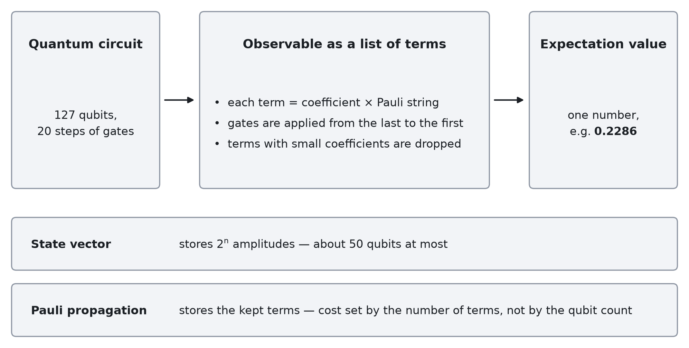</p>
<p align="center"><b>그림 1.</b> Pauli propagation이 계산하는 것.</p>

**그림 설명.** 위는 왼쪽부터 양자 회로, 항의 목록으로 쓴 관측량, 계산 결과인 기대값 하나이다. 회로의 gate를 마지막 것부터 첫 것까지 관측량에 적용하고, 그 과정에서 계수가 작은 항을 버린다. 아래 표는 상태 벡터 시뮬레이터가 저장하는 것과 Pauli propagation이 저장하는 것을 비교한다.

100 qubit이 넘는 회로는 상태 벡터로 다룰 수 없다. amplitude가 2^n개이므로 가장 큰 슈퍼컴퓨터로도 50 qubit 안팎이 한계이다. Pauli propagation은 상태 대신 관측량을 다룬다. 관측량을 계수가 붙은 Pauli string의 합으로 두고, 회로의 gate를 뒤에서부터 적용하며, 계수가 작은 항을 버려(truncation) 기대값을 근사한다. 버리는 기준이 cutoff이다. 계수의 크기가 cutoff 이하인 항을 버리므로, cutoff가 낮을수록 항을 더 많이 유지한다. 비용은 qubit 수가 아니라 유지하는 항의 수가 정한다.

따라서 이 방법에서는 계산 자원이 곧 정확도이다. 유지하는 항이 많을수록 답이 정확해진다.

<p align="center">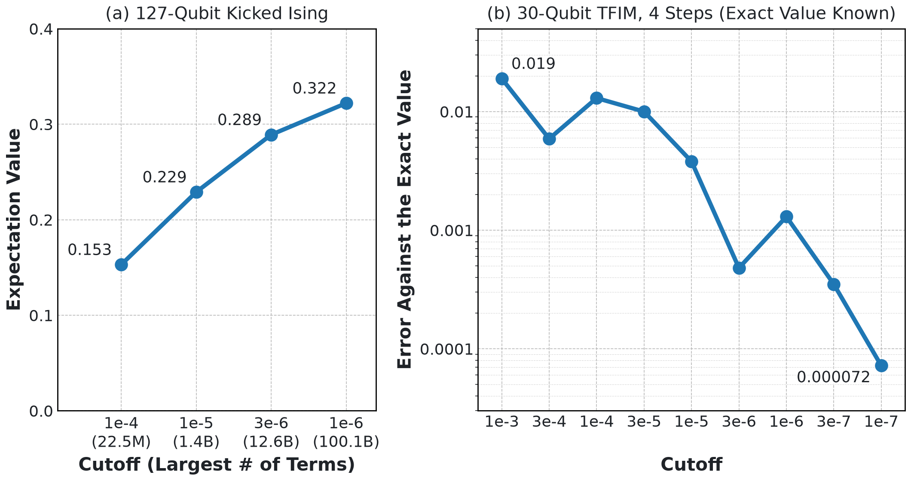</p>
<p align="center"><b>그림 2.</b> 유지하는 항을 늘리면 답이 달라지고 오차가 줄어든다.</p>

**그림 설명.** (a) 127-qubit kicked Ising(θ=π/4, 20 step)의 기대값을 cutoff마다 그린 것이다. 가로축의 괄호는 그 cutoff에서 다룬 최대 항 수이다. (b) exact 값을 아는 30-qubit TFIM(4 step)에서 cutoff에 따른 오차이며, 세로는 로그 축이다.

- **(a) 값이 cutoff를 따라 움직인다.** cutoff 1e-4, 1e-5, 3e-6, 1e-6에서 기대값은 0.153, 0.229, 0.289, 0.322이다. 최대 항 수는 2,250만, 14억, 126억, 1,001억이다. 값이 아직 움직이므로 이 회로를 풀려면 더 많은 항을 다루어야 한다(5절).
- **(b) 항을 늘리면 오차가 줄어든다.** cutoff를 1e-3에서 1e-7로 낮추면 exact 값과의 오차가 0.019에서 0.00007로 줄어든다. 이때 최대 항 수는 312억이다.

Pauli propagation이 풀 수 있는 문제의 범위는 얼마나 많은 항을 얼마나 빨리 다루는가로 정해진다. 127 qubit의 항 하나는 40 byte이고, 위 kicked Ising 회로의 cutoff 1e-5에서는 항이 14억 개(56 GB)이다. GPU 한 장에 담을 수 없다. 이 연구의 문제는 Pauli propagation을 여러 GPU와 여러 노드로 확장하는 것이다. 이때 지켜야 하는 조건은 답이다. 여러 GPU로 나누어 계산한 기대값이 장치 하나에서 계산한 값과 같아야 하며, 이 문서는 값을 12자리까지 비교한다.

### 1.2 문제: 갈라지고, 합치고, 잘라내는 계산은 나누기 어렵다

**요지.** 같은 항이 서로 다른 GPU에서 생긴다. GPU마다 자기 조각을 따로 자르면 답이 틀리므로, 원칙적으로 gate마다 모든 GPU가 조율해야 한다.

Pauli propagation의 gate 하나는 세 가지 일을 한다. 항을 둘로 가르고(branch), 같은 Pauli string을 가진 항의 계수를 합치고(merge), 계수가 작은 항을 버린다(truncate). 문제는 이 셋의 순서에서 나온다. 버리기 전에 합쳐야 한다.

<p align="center">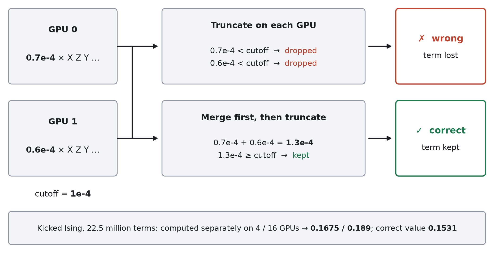</p>
<p align="center"><b>그림 3.</b> 합치기 전에 자르면 항을 잃는다.</p>

**그림 설명.** 두 GPU가 같은 Pauli string(XZYI)의 조각을 하나씩 가지고 있고 cutoff는 1e-4이다. 경로 1에서는 GPU마다 자기 조각(0.7e-4와 0.6e-4)을 cutoff와 비교한다. 둘 다 cutoff 아래이므로 버려지고 항이 사라진다. 경로 2에서는 두 조각을 먼저 합친다. 합은 1.3e-4로 cutoff를 넘으므로 항이 남는다. 아래 표는 GPU 사이에서 전혀 합치지 않고 끝까지 계산한 실행의 측정값이다. 4개로 나누면 0.1675, 16개로 나누면 0.189가 나오고, 정답은 0.1531이다.

이 계산을 여러 GPU로 나누는 데에는 세 가지 구조적인 어려움이 있다.

1. **합친 뒤에 잘라야 한다.** truncation은 합쳐진 계수를 보아야 한다. 그런데 같은 항이 서로 다른 GPU에서 생긴다. 합치지 않고 GPU마다 따로 자르면 답이 틀린다(kicked Ising에서 0.1675–0.283, 정답 0.1531). 따라서 원칙적으로 gate마다 모든 GPU가 조율해야 한다.
2. **데이터가 실행 중에 정해진다.** 어떤 항이 생기고 살아남는지는 실행해야 안다. 상태 벡터처럼 index로 위치를 미리 알 수 없다. 항 수는 한 층 안에서 2.9–36배로 늘었다가 줄어들고, 고정된 bit로 나누면 GPU 사이의 항 수가 1.4–4.9배 차이 난다.
3. **용량이 GPU memory에 묶인다.** 정확도를 정하는 것은 항 수인데, 항을 담는 GPU memory는 장당 40–80 GB이다. 지금의 GPU 구현은 40 GB에 약 1억 항을 담는다.

1번과 3번은 서로 맞물려 있다. gate마다 합치면 통신이 많아지고, 합치기를 미루면 합쳐지지 않은 항을 들고 있어야 해서 메모리가 모자란다. 통신과 메모리 가운데 하나를 내주어야 한다.

이 구조는 Pauli propagation에만 있는 것이 아니다. 갈라진 결과를 같은 key끼리 합쳐야 하는 계산은 같은 문제를 가진다. 양자 화학의 FCIQMC에서 walker의 소멸, database의 분산 집계가 그 예이다. 이런 계산은 보통 key를 hash로 프로세스에 나누고 step마다 교환한다.

### 1.3 기존 방법의 한계

**요지.** 기존 방법은 통신과 메모리 가운데 하나를 내준다. gate마다 모든 GPU에 걸쳐 합치면 통신 비용이 들고, 합치기를 미루면 합쳐지지 않은 항이 GPU memory에 남는다.

<p align="center">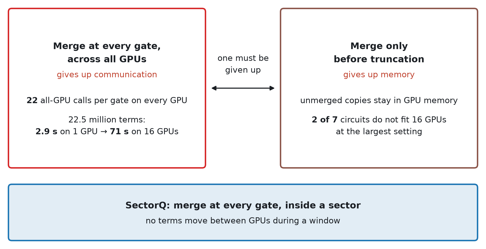</p>
<p align="center"><b>그림 4.</b> 지금의 두 방식과 각각이 내주는 것.</p>

**그림 설명.** 왼쪽 틀은 gate마다 모든 GPU에 걸쳐 합치는 방식이다(cuPauliProp 분산 모드의 기본). gate 하나가 끝날 때마다 모든 GPU가 전역 merge와 재분배를 기다린다. 틀 안의 표는 측정한 비용이다. rank마다 gate당 전원 통신이 22번이고, 2,250만 항 설정이 GPU 1장에서 2.9초, 16장에서 71초이다. 오른쪽 틀은 truncation 직전에만 합치는 방식이다. 빗금은 합쳐지지 않은 채 GPU memory에 남은 항이다. 회로 7종 가운데 둘이 16 GPU에 들어가지 않는다. 아래 띠는 SectorQ가 그 대신 하는 일이다. gate마다 합치되 sector 안에서 합치므로, 구간이 도는 동안 항이 GPU 사이를 옮기지 않는다.

기존 방법은 위의 맞교환에서 한쪽을 고른다. 근거는 2.4절과 4절에 있다.

| 방법 | 같은 항을 합치는 방식 | 한계 |
|---|---|---|
| cuPauliProp 분산 모드 (GPU) | gate마다, 모든 GPU에 걸쳐 | GPU를 늘릴수록 느려진다. 2,250만 항 설정이 GPU 1장에서 2.9초, 16장에서 71초이다. 모든 GPU가 gate마다 22번의 전원 통신에 참여하고, 항이 움직이지 않는 gate에서도 같은 비용을 낸다 |
| 합치기를 미루는 조정 | truncation 직전에만, 모든 GPU에 걸쳐 | 통신은 줄지만 합쳐지지 않은 항을 들고 있어야 한다. 14억 항 설정은 32 GPU가 있어야 들어간다 |
| ORQA (CPU 분산) | 고정된 분배 함수로 나누고 새 항을 보낸다 | 가지치는 gate마다 통신한다. GPU를 쓰지 않는다. 논문을 따라 재현한 것이 같은 4 노드에서 SectorQ보다 18–87배 느리다 |
| 단일 노드와 단일 GPU 구현 (PauliPropagation.jl, ppvm, SPD 등) | 한 장치 안에서 | 메모리가 한계이다. 노드와 GPU를 더 주어도 쓰지 못한다(4.2절) |
| GPU마다 따로 계산 | 합치지 않는다 | 답이 틀린다(0.1675–0.189, 정답 0.1531) |

통신도 메모리도 내주지 않는 분할은 조사한 범위에서 찾지 못하였다.

### 1.4 핵심 관찰과 접근

**요지.** rotation은 원래 항에 정해진 벡터 Q를 XOR하여 새 항을 만든다. r(Q)=0인 parity r은 원래 항과 새 항에서 값이 같다. 이 parity의 값으로 항을 나누면, 나눈 묶음은 그 gate들이 이어지는 동안 닫혀 있다.

<p align="center">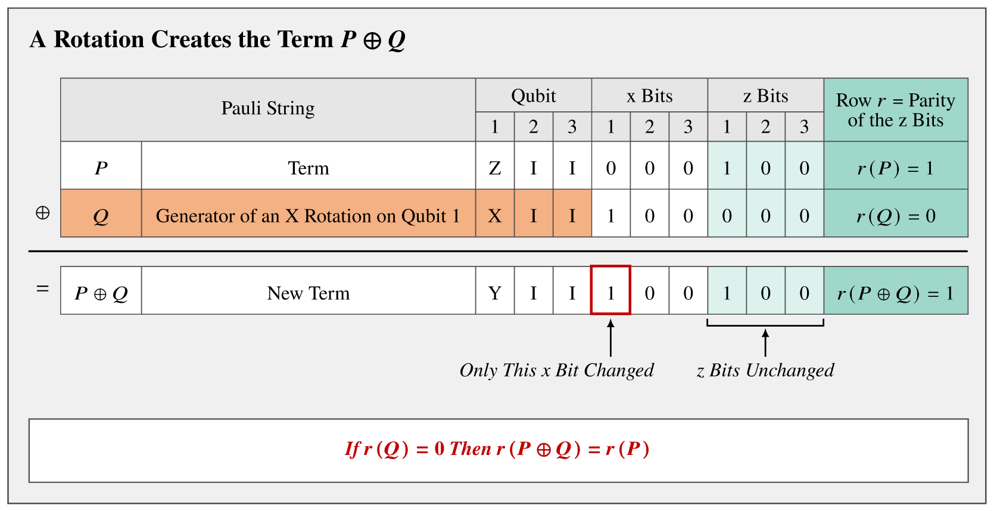</p>
<p align="center"><b>그림 5.</b> rotation이 바꾸지 않는 parity.</p>

**그림 설명.** qubit 3개의 예이다. 줄은 위에서부터 항 P, X rotation의 생성자 Q, 새 항 P⊕Q이다. 열은 Pauli string, x bit, z bit, 그리고 z bit의 parity인 행 r의 값이다. 이 rotation은 x bit 하나(빨간 칸)만 바꾸고 z bit는 그대로 둔다. 그래서 r(Q)=0이고 r(P⊕Q)=r(P)=1이다. 새 항은 원래 항과 같은 r 값을 가진다.

gate가 항의 Pauli string을 바꾸는 방식에는 구조가 있다. rotation exp(-iθQ/2)는 항 P를 P와 P⊕Q로 만든다. 새 항의 bit 벡터는 원래 bit 벡터에 정해진 벡터 Q를 XOR한 것이다. 따라서 bit 벡터의 parity r 가운데 r(Q)=0인 것은 새 항에서도 값이 같다. r(P⊕Q)=r(P)이다. 예를 들어 X rotation은 x bit만 뒤집으므로, z bit로 만든 parity는 X rotation이 몇 개 이어져도 변하지 않는다.

SectorQ는 이 관찰에서 다음 규칙을 세운다.

> 항 집합을 지금 구간의 모든 gate가 보존하는 parity의 값으로 나눈다. 이렇게 나눈 sector는 그 구간 동안 항을 주고받지도 합쳐지지도 않는다. 따라서 sector마다 따로 merge하고 truncation해도 전체를 합쳐 계산한 것과 답이 같다. 구간, parity, sector 수는 실행 중에 정하고, 항의 교환은 구간이 바뀔 때만 한다.

이 규칙은 1.2절의 세 가지 어려움에 하나씩 답한다.

- **합친 뒤에 잘라야 한다 → sector 안에서 합친다.** 합쳐질 상대가 항상 같은 sector 안에 있다. gate마다 합치면서도 구간(kicked Ising에서는 rotation 127개)이 도는 동안 항이 GPU 사이를 오가지 않는다. 통신이 없어지는 것은 아니다. gate 2,540번마다 하던 것이 구간 20개의 경계로 모인다(communication-avoiding).
- **데이터가 실행 중에 정해진다 → 실행 중에 정한다.** 구간의 길이, 쓸 parity, sector 수를 구간마다 현재 항의 표본을 보고 정한다. 미리 세운 계획이 없다.
- **용량이 GPU memory에 묶인다 → sector를 하나씩 올린다.** sector는 서로 독립이므로 host memory에 두고 GPU에는 처리 중인 것만 올린다. 구간 안에서 GPU보다 커진 sector는 parity를 하나 더 써서 그 자리에서 나눈다.

같은 성질에서 두 가지가 더 나온다. Clifford gate는 데이터에 적용하지 않고 뒤따르는 rotation의 생성자에 흡수한다. 구간 경계에서 sector 집합을 checkpoint로 쓰고, 회로 전체에서 보존되는 parity로 모든 항을 검산한다.

그 결과 SectorQ는 통신과 메모리를 맞바꾸지 않는다.

| 방식 | 같은 항을 합치는 때 | 통신 | GPU가 들고 있는 항 |
|---|---|---|---|
| cuPauliProp 분산 (기본) | gate마다, 모든 GPU에 걸쳐 | gate마다 | 합쳐진 항 |
| cuPauliProp 분산 (dedup을 미룸) | truncation 직전에만, 모든 GPU에 걸쳐 | truncation마다 | 합쳐지지 않은 항까지. 14억 항 설정은 32 GPU가 있어야 들어간다 |
| SectorQ | gate마다, sector 안에서 | 항의 교환은 구간이 바뀔 때만. 그 사이에는 다음 구간의 행을 정하는 표본과 행만 오간다 | 합쳐진 항. 그것도 처리 중인 sector 하나 |

### 1.5 주요 결과

**요지.** 같은 16 GPU에서 cuPauliProp 분산 모드의 시간은 SectorQ의 4.2–9.7배이다. SectorQ는 GPU를 늘리면 큰 문제가 GPU 1장의 79–130배(256장), 242배(512장) 빨라지고, 같은 GPU 수로 cuPauliProp의 75–202배 많은 항을 끝낸다(512 GPU에서 2,573억 항).

측정 조건은 다음과 같다. 회로 7종(64–127 qubit), exact 값을 아는 30 qubit 회로, qubit 수를 36–1,024로 키운 정사각 격자를 Perlmutter의 A100 노드에서 실행하였다. 1–16 GPU는 모든 비교 대상과 함께 재었고(4.2–4.4절), 32, 64, 128, 256 GPU는 SectorQ와 cuPauliProp을 재었고, 512 GPU는 kicked Ising 회로에서 두 방식을 재었다(4.4절). 모든 구현에 같은 연산 목록을 주었고 측정은 설정마다 1회이다. 대표 설정을 10회 반복했을 때의 변동 폭은 4.12절에 있다.

대표 결과는 셋이다.

| 질문 | 결과 | 조건 |
|---|---|---|
| 같은 GPU 수에서 얼마나 빠른가 | cuPauliProp 분산 모드(기본)의 시간이 SectorQ의 **4.2–9.7배** | 16 GPU, 회로 7종, 기본 모드가 16 GPU로 끝내는 가장 큰 설정 |
| GPU를 늘리면 빨라지는가 | 256 GPU의 SectorQ가 GPU 1장의 **79–130배**, 512 GPU가 **242배** | 256 GPU는 큰 문제 세 가지(cutoff 3e-6과 5e-6), 512 GPU는 kicked Ising cutoff 3e-6 |
| 얼마나 큰 문제까지 가는가 | 같은 GPU 수로 끝낸 항 수가 cuPauliProp의 **75–202배** | kicked Ising, 구간 경계의 항 수. 16 GPU에서 119억 대 1.6억(75배), 512 GPU에서 2,573억 대 32억(80배). 128 GPU가 202배(1,175억 대 5.8억), 32 GPU가 146배이고 나머지 GPU 수는 75–80배이다. 두 측정값으로 계산한 값이다 |

방식별 결과이다. 주 비교 대상은 cuPauliProp 분산 모드의 기본이다. dedup을 미룬 cuPauliProp은 이 연구가 구성한 가장 강한 기준선이다. 연산을 rank 안에서만 적용하고 전역 dedup을 truncation 직전에만 수행한다(4절).

| 항목 | cuPauliProp 분산 (기본) | cuPauliProp 분산 (dedup을 미룸) | SectorQ |
|---|---:|---:|---:|
| 기대값 | 기준 | 기준과 동일 | 실행이 둘 이상인 모든 설정에서 차이 5e-11 이하 (4.1절) |
| 16 GPU, cuPauliProp이 GPU 1장으로 끝내는 가장 큰 설정 7종 | 12.6–49.1초 | 4.7–11.6초 | 0.68–1.64초 (기본의 18–52배, dedup을 미룬 것의 6.1–10배) |
| 16 GPU, cuPauliProp 분산이 16 GPU로 끝내는 가장 큰 설정 7종 (최대 2.6억 항) | 17.3–71.3초 | 9.2–56.9초, 2종은 메모리 부족 | 2.7–14.8초 (기본의 4.2–9.7배, dedup을 미룬 것의 2.2–4.6배) |
| 32–256 GPU, cutoff 1e-5의 3종 | 34.8–86.8초 | 12.0–27.8초 | 3.0–8.8초 (기본의 7.3–25배, dedup을 미룬 것의 3.2–5.1배) |
| 512 GPU, kicked Ising cutoff 1e-5 | 78.2초 | 재지 않음 | 2.91초 (기본의 27배) |
| Strong scaling, 1 → 16 GPU (cutoff 3e-6, 3종) | 메모리 부족 | 메모리 부족 | 14–15배 (kicked Ising: 1,741초 → 121초) |
| Strong scaling, 1 → 64 / 128 / 256 GPU (cutoff 3e-6과 5e-6, 3종) | cutoff 3e-6은 64, 128 GPU에서 메모리 부족, 256 GPU에서 78.4초 | 메모리 부족 | 45–52 / 61–99 / 79–130배 (kicked Ising 3e-6: 1,741초 → 33.2 / 17.6 / 13.4초) |
| Strong scaling, 1 → 512 GPU (kicked Ising cutoff 3e-6) | 110초 | 재지 않음 | 242배 (1,741초 → 7.21초) |
| Weak scaling, GPU당 처리율 (GPU 1장 대비) | 큰 부하는 모든 GPU 수에서 메모리 부족 | 같음 | 16 / 64 / 128 / 256 GPU에서 80–88 / 72–80 / 53–77 / 26–60% |
| Kicked Ising cutoff 1e-5(1.6억 항)를 끝내는 데 필요한 GPU 수 | 16 | 16 | 1 |
| 같은 설정의 GPU 수별 시간 | 16 / 32 / 64 / 128 / 256 / 512장 54.3 / 47.8 / 46.7 / 34.8 / 39.1 / 78.2초 | 16 / 32 / 64 / 128 / 256장 48.8 / 25.8 / 18.7 / 15.7 / 12.0초 | 1 / 4 / 16 / 32 / 64 / 128 / 256 / 512장 168 / 46.7 / 12.2 / 6.5 / 4.1 / 2.9 / 3.0 / 2.9초 |
| Kicked Ising cutoff 3e-6 (15억 항) | 16, 64, 128 GPU에서 메모리 부족, 256 GPU에서 78.4초, 512 GPU에서 110초 | 메모리 부족 | 1 / 4 / 16 / 64 / 128 / 256 / 512 GPU에서 1,741 / 436 / 122 / 33.2 / 18.9 / 13.4 / 7.21초 |
| Kicked Ising cutoff 1e-6 (119억 항) | 16, 32 GPU는 cutoff 5e-6부터, 64, 128 GPU는 3e-6부터, 256 GPU는 2e-6부터, 512 GPU는 1e-6에서 메모리 부족 | 16–64 GPU는 5e-6부터, 128, 256 GPU는 3e-6부터 메모리 부족 | 16 / 32 / 64 / 128 / 256 / 512 GPU에서 1,518 / 586 / 305 / 174 / 93.3 / 49.1초 |
| 40분 안에 끝낸 가장 큰 크기 (kicked Ising, 구간 경계의 항 수) | 16, 32 GPU로 1.6억, 64, 128 GPU로 5.8억, 256 GPU로 15억, 512 GPU로 32억 | 16–64 GPU로 1.6억, 128, 256 GPU로 5.8억 | GPU 1장으로 15억, 16 GPU로 119억, 32 GPU로 233억, 64 GPU로 443억, 128, 256 GPU로 1,175억(128 GPU는 41.7분), 512 GPU로 2,573억 |
| 16 GPU의 GPU 사용률 (cutoff 1e-5, 3종) | 20–32% | 33–49% | 72–78% |
| 연산마다의 전원 통신 | rank마다 연산당 allgather 22회 | 연산당 2.2–8.6회 | 없음. 구간마다 표본과 행을 나누고, 구간이 바뀔 때 항을 교환한다 |
| 1,024 qubit의 전체 자화 (2D TFIM 32×32, cutoff 1e-3), 16 GPU | 366초 | 131초 | 90.7초 (기본의 4.0배, dedup을 미룬 것의 1.4배) |
| 같은 격자의 cutoff 1e-4에서 16 GPU로 끝낸 가장 큰 qubit 수 | 121 | 121 | 529 (778초) |
| exact 값 대비 가장 작은 오차 (30 qubit, 4 step) | 단일 GPU는 cutoff 3e-5까지 끝낸다 (가장 작은 오차 0.0059) | 측정하지 않음 | 0.00007 (cutoff 1e-7, 16 GPU로 29.2초) |

표를 읽는 법은 다음과 같다. 위의 넷은 같은 GPU 수에서의 속도이다. 가운데는 GPU 수를 늘렸을 때의 변화와 문제를 끝내는 데 필요한 GPU 수이다. 아래는 도달 범위와 그 이유(GPU 사용률, 통신 횟수), 그리고 회로 크기와 정확도이다. cuPauliProp의 칸이 "메모리 부족"인 설정에서는 배수를 적지 않았다.

다른 구현과의 비교이다(4.2–4.3절). 각 구현을 그 구현이 쓸 수 있는 자원에서 돌렸고 SectorQ는 같은 노드의 GPU를 썼다. 값은 두 구현이 모두 끝낸 가장 큰 설정에서 그 구현의 시간을 SectorQ의 시간으로 나눈 것이다.

| 구현 | 자원 | 회로 7종에서 SectorQ 대비 | 비고 |
|---|---|---:|---|
| cuPauliProp 분산 (기본) | 16 GPU | 4.2–9.7배 느리다 | 여러 GPU로 도는 유일한 다른 구현 |
| ORQA (재현) | 4 노드, 256 rank | 18–87배 느리다 | 저자 코드가 아니라 논문을 따라 재현한 것 |
| MonoProp | 4 노드 | 2.0–14배 느리다. 같은 오차에서도 4배 이상 | truncation 규칙이 다르다. 2초 안에 끝나는 작은 설정에서는 MonoProp이 빠르다 |
| PauliPropagation.jl | 1 노드, 64 thread | 108–269배 느리다 | SectorQ는 같은 노드의 4 GPU |
| ppvm | 1 노드, 64 thread | 157–755배 느리다 | 같음 |
| Qiskit pauli-prop | thread 1개 | 1,800배 이상 느리다 | 같음. cutoff 2e-4–3e-4에서 40분 제한에 걸린다 |
| SPD | GPU 1장 | 0.3–1.7배 | GPU 1장 안에서는 SPD가 최대 2.9배 빠르다. cutoff 1e-5부터 메모리 부족 |

어떤 요소가 어떤 이득을 내는지를 kicked Ising 16 GPU에서 단계별로 나누었다.

<p align="center">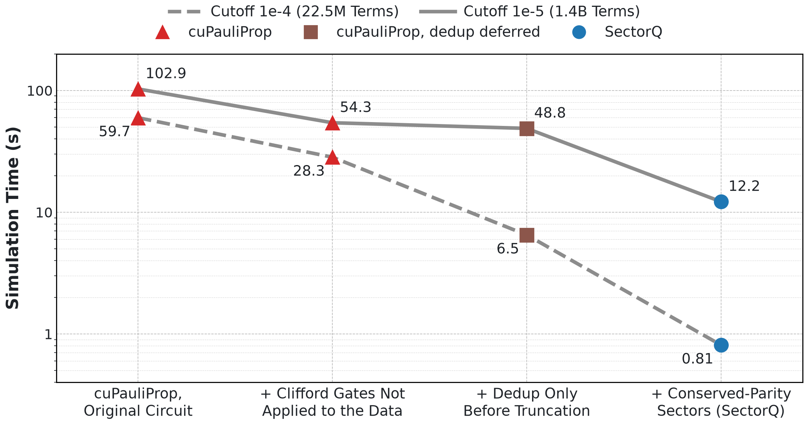</p>
<p align="center"><b>그림 6.</b> 요소를 하나씩 더했을 때의 실행 시간(kicked Ising, 16 GPU).</p>

**그림 설명.** 두 cutoff에서 잰 실행 시간이며 세로는 로그 축이다. 왼쪽부터 점마다 요소를 하나씩 더한다. 원래 회로의 cuPauliProp 분산 모드, Clifford gate를 데이터에 적용하지 않는 것, 전역 dedup을 truncation 직전에만 하는 것, 보존 parity sector로 나누는 것(SectorQ)의 순서이다. 점의 모양과 색은 그 단계의 구현이다. 마지막 단계가 이 연구의 핵심이며, 앞의 두 단계는 비교에서 기준선에도 준다.

| 단계 | cutoff 1e-4 (최대 2,250만 항) | cutoff 1e-5 (최대 14억 항) | 요소의 출처 |
|---|---:|---:|---|
| cuPauliProp 분산, 원래 회로 | 59.7초 | 102.9초 | 출발점 |
| + Clifford gate를 데이터에 적용하지 않는다 | 28.3초 | 54.3초 | 이 연구가 넣었다. 비교에서는 기준선에도 준다 |
| + 전역 dedup을 truncation 직전에만 한다 | 6.5초 | 48.8초 | 누구나 할 수 있는 조정. 가장 강한 기준선 |
| + **보존 parity sector로 나눈다 (SectorQ)** | **0.81초** | **12.2초** | 이 연구의 핵심 |
| SectorQ, 1 GPU | 1.72초 | 168초 | sector를 GPU에 하나씩 올린다 |

- **큰 문제(cutoff 1e-5)에서는 마지막 단계가 가장 크다.** dedup을 미루어도 54.3초가 48.8초가 되는 데 그친다. 합쳐지지 않은 항이 메모리를 채워 3개 연산마다 dedup을 한 번 더 해야 하기 때문이다(4.6절). sector로 나누면 12.2초가 된다.
- **작은 문제(cutoff 1e-4)에서는 dedup을 미루는 것만으로 28.3초가 6.5초가 된다.** 전원 통신이 줄어서이다. sector로 나누면 0.81초가 된다.

### 1.6 기여와 적용 범위

**요지.** 기여는 지금 방식의 측정, 원리, 그 원리로 만든 실행 엔진, 평가의 넷이다. 이득이 나는 범위는 문제가 GPU 한 장보다 큰 경우이다.

기여는 다음과 같다.

1. cuPauliProp v0.5.0의 분산 모드를 gate 단위로 계측하여, GPU를 늘릴수록 느려지는 원인과 GPU당 용량 한계를 수치로 보였다(2.4절).
2. 구간 동안 보존되는 parity로 나눈 sector는 독립이라는 성질, 그 성질의 보장과 한계, Clifford gate를 데이터에 적용하지 않는 방법을 제시하였다(3.1–3.3절, 3.5절, 3.7절).
3. 이 성질에서 구간 동안 항을 주고받지 않는 다중 GPU 실행, GPU memory를 넘는 실행, 넘치는 sector의 분할, 구간 경계 checkpoint를 끌어내어 하나의 SectorQ로 구현하였다(3.4절, 3.6절).
4. 회로 7종에서 단일 GPU 실행, cuPauliProp 분산 모드, 외부 구현 다섯 가지와 같은 답을 내는 것을 확인하고, 속도, 필요한 GPU 수, 도달 범위를 비교하였다. exact 값을 아는 30 qubit 회로에서 cutoff에 따른 오차를 재었다(4절).

적용 범위는 다음과 같다. 작은 문제는 GPU를 늘려도 덜 빨라진다(kicked Ising cutoff 1e-4, 최대 2,250만 항: 1 GPU 1.72초, 16 GPU 0.81초, 이유는 4.4절). 이런 문제에서 SectorQ의 이득은 cuPauliProp 분산 모드가 내는 조율 비용이 없다는 데 있다. GPU 수만큼 시간이 줄어드는 것은 1억 항이 넘는 문제이다(16 GPU에서 13–15배). 측정은 512 GPU까지이다(512 GPU는 kicked Ising 회로). host memory를 채우는 크기의 문제는 16, 32, 64 GPU에서 재었고 128 GPU 이상에서는 아직 재지 않았다(4.4절). 관측량은 Z 하나, edge의 합, 또는 전체 자화이다. 가장 강한 기준선과의 속도 차이는 16 GPU가 있어야 들어가는 설정에서 2.2–4.6배이며, 더 큰 차이는 필요한 GPU 수와 도달 범위에 있다. GPU 1장 안에서는 다른 연산을 쓰는 SPD가 더 빠른 설정이 있다(4.2절). kicked Ising(θ=π/4)의 값은 측정한 cutoff 범위에서 수렴하지 않았다. 이 회로에서 주장하는 것은 같은 cutoff에서 같은 답을 더 빠르게, 더 적은 GPU로, 더 낮은 cutoff까지 낸다는 것이다. sector 단위 처리, out-of-core 실행, checkpoint는 각각 database의 분할 실행에 원형이 있다(2.5절). 이 연구가 제시하는 것은 gate가 key를 계속 바꾸는 데이터에서 분할이 유지되는 key이다.

## 2. 배경

이 절은 다음을 다룬다.

1. 100 qubit 이상의 고전 시뮬레이션 방법과 Pauli propagation의 위치(2.1절)
2. Pauli propagation의 연산과 정확성 조건(2.2절)
3. 분산 실행이 구조적으로 어려운 이유(2.3절)
4. 최신 GPU 구현에서 그 어려움이 나타나는 모습(2.4절)
5. 선행 연구가 다루는 범위(2.5절)

2.6절은 여기에서 도출되는 설계 요구사항을 정리한다.

### 2.1 100 qubit 이상의 고전 시뮬레이션

**요지.** 100 qubit이 넘는 회로의 기대값을 구하는 방법 가운데 Pauli propagation은 비용을 qubit 수가 아니라 유지하는 항 수가 정한다. 그래서 이 연구가 확장하는 축은 qubit 수가 아니라 항 수이다.

| 방법 | 저장하는 것 | 비용을 정하는 것 | 100 qubit 이상에서 |
|---|---|---|---|
| State vector | amplitude 2^n개 | qubit 수 | 쓸 수 없다. 50 qubit 안팎이 한계이다 |
| Tensor network | 연결된 tensor들 | 얽힘의 양(bond dimension) | 얕은 회로와 1차원에 가까운 연결에서 쓴다. 2차원 연결의 깊은 회로에서는 비용이 급격히 커진다 |
| Pauli propagation | 관측량의 Pauli 항 | 유지하는 항 수(cutoff) | 기대값을 구하는 문제에 쓴다. 정확도와 비용을 cutoff 하나로 조절한다 |

Pauli propagation은 기대값을 구하는 문제에 맞는다. 관측량이 몇 개의 qubit에만 걸려 있으면 처음에는 항이 적고, 회로를 거슬러 올라가며 늘어난다. 잡음이 있는 회로에서는 잡음이 항의 계수를 줄여 주어 더 적은 항으로 충분하다. NVIDIA cuQuantum은 25.11부터 GPU 구현인 cuPauliProp을 제공한다.

세 방법은 확장하는 축이 다르다. 상태 벡터 시뮬레이터는 qubit 수를 늘리려고 확장한다. Pauli propagation은 항 수, 곧 더 낮은 cutoff를 얻으려고 확장한다. 이 문서의 비교 축은 qubit 수가 아니라 항 수와 GPU 수이다.

### 2.2 Pauli propagation의 연산

**요지.** 저장하는 것은 항의 목록이다. rotation은 항을 둘로 가르고, merge는 같은 항을 합치고, truncation은 작은 항을 버린다. 정확성 조건은 하나이다. truncation은 합친 계수를 보아야 한다.

관측량을 Pauli string의 합으로 두고 회로의 gate를 뒤에서부터 하나씩 적용한다. 마지막에 초기 상태에 대한 기대값을 구한다. 저장하는 것은 항의 목록이다. 먼저 용어를 정한다.

<p align="center">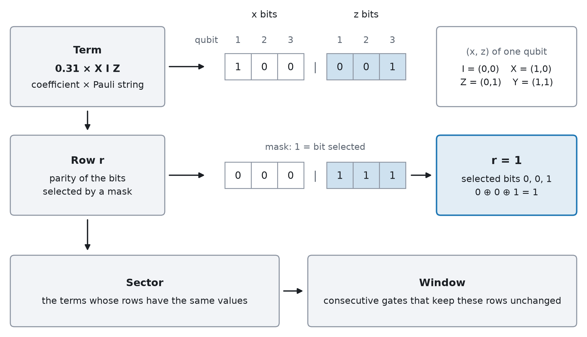</p>
<p align="center"><b>그림 7.</b> 이 문서에서 쓰는 용어: 항, 행, sector, 구간.</p>

**그림 설명.** (1) 항은 계수와 Pauli string이다. Pauli string은 qubit마다 x bit와 z bit를 두어 bit 벡터 (x | z)로 저장한다. 오른쪽 위의 표가 그 대응이다(I=00, X=10, Z=01, Y=11). 그림의 항 XIZ는 x=100, z=001이다. (2) 행 r은 mask가 고른 bit들의 parity이다. 그림에서는 z bit 셋을 골랐고 그 가운데 1이 하나이므로 r=1이다. (3) sector는 고른 행들의 값이 같은 항의 모음이다. 행이 둘이면 sector는 00, 01, 10, 11의 넷이다. (4) 구간은 그 행들을 바꾸지 않는 연속된 gate들이다.

- **항(term).** Pauli string 하나와 계수이다. Pauli string은 bit 벡터 (x | z)로 저장한다. qubit마다 I=(0,0), X=(1,0), Z=(0,1), Y=(1,1)이다. 127 qubit이면 254 bit이고, 계수를 합쳐 항 하나가 40 byte이다.
- **cutoff.** 계수의 크기가 이 값 이하인 항을 버린다. 정확도와 항 수를 정한다.
- **행(row), sector, 구간(window).** 설계에서 쓰는 말이다(3.2절). 행은 bit 벡터의 parity 함수 하나이다. sector는 행 g개의 값이 같은 항들이며 최대 2^g개이다. 구간은 같은 행을 쓰는 연속된 연산들이다. 코드와 로그에서는 sector를 bucket이라고 부른다.
- **rank.** 분산 실행의 프로세스 하나이다. cuPauliProp 분산 모드에서는 rank 하나가 GPU 하나를 쓴다.

gate가 항의 목록에 하는 일은 셋이다.

<p align="center">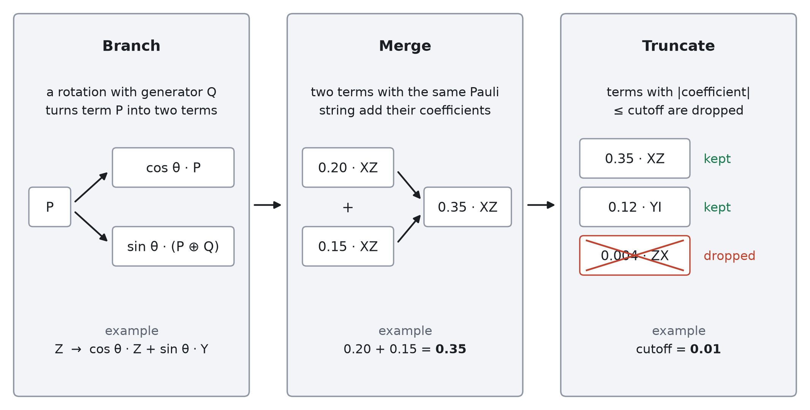</p>
<p align="center"><b>그림 8.</b> gate 하나가 하는 세 가지 일.</p>

**그림 설명.** gate가 동작하는 순서대로 놓은 세 칸이다. (1) Branch: 항 P에 생성자 Q의 rotation을 적용하면 cos θ가 붙은 P와 sin θ가 붙은 P⊕Q의 두 항이 된다. 아래 식은 Z에 X rotation을 적용한 예이다. (2) Merge: Pauli string이 같은 두 항(XZ)의 계수 0.20과 0.15를 더해 한 항 0.35로 만든다. (3) Truncate: cutoff가 0.01이면 계수 0.004인 항을 버린다.

- **Rotation (branch).** exp(-iθQ/2)는 생성자 Q와 commute하는 항을 그대로 두고, anticommute하는 항 P를 P와 P⊕Q 두 항으로 만든다. ⊕는 bit 벡터의 XOR이다. 예를 들어 Z에 X rotation을 적용하면 cos θ·Z + sin θ·Y가 된다. Z=(0,1)에 X=(1,0)을 XOR한 것이 Y=(1,1)이다. 가지치는 gate마다 항 수는 최대 두 배가 된다.
- **Merge (dedup).** 서로 다른 항에서 같은 Pauli string이 만들어지면 계수를 더해 한 항으로 만든다. 항 수가 줄어드는 곳이다.
- **Truncation.** 계수의 크기가 cutoff 이하인 항을 버린다. cutoff가 정확도와 항 수를 정한다.
- **Clifford gate.** Pauli string 하나를 다른 Pauli string 하나로 바꾼다. bit 벡터의 선형 변환이며 항 수가 변하지 않는다.

정확성 조건은 하나이다. truncation은 merge한 계수를 보아야 한다. 같은 항이 조각으로 나뉘어 있으면 조각마다 cutoff 아래로 떨어져 버려질 수 있다(그림 3). kicked Ising 2,250만 항 설정에서 merge하지 않고 truncation하면 기대값이 0.194–0.283으로 나온다(정답 0.1531). 이 문서에서 "답이 같다"는 전부 합친 뒤 자른 단일 장치 실행과 기대값이 같다는 뜻이다.

### 2.3 분산 실행의 구조적 어려움

**요지.** 새 항이 어느 프로세스의 항과 합쳐질지는 원래 항이 놓인 곳과 무관하다. 그래서 gate마다 통신하거나, 합치기를 미루고 메모리를 내주어야 한다(그림 4).

상태 벡터의 분산과 비교하면 어려움의 성격이 드러난다.

| | 상태 벡터 | Pauli propagation |
|---|---|---|
| 데이터 | amplitude 2^n개, 크기 고정 | 항의 집합, gate마다 늘고 준다 |
| 데이터가 놓인 곳 | index로 미리 안다 | 어떤 항이 생길지 실행해야 안다 |
| gate가 하는 일 | 정해진 위치의 값을 갱신 | 새 key를 만들고, 같은 key를 합치고, 작은 값을 버린다 |
| 통신이 생기는 곳 | global qubit에 걸린 gate | 새 항이 다른 프로세스의 항과 같을 수 있는 모든 gate |
| 한계를 정하는 것 | 메모리 2^n | 유지할 수 있는 항 수 |

Pauli propagation에서 새 항 P⊕Q가 어느 프로세스의 항과 합쳐질지는 P가 놓인 곳과 무관하다. 항을 hash나 고정된 bit로 나누면 P⊕Q의 배정은 P의 배정과 달라진다. 그래서 가지치는 gate마다 새 항을 보내거나, 모든 프로세스가 전역으로 합쳐야 한다.

합치기를 미루면 통신은 줄어든다. 그러나 미루는 동안 같은 항의 조각들이 여러 프로세스에 남아 메모리를 차지한다. 항 수는 gate마다 최대 두 배가 되므로 조각은 빠르게 늘어난다. 미룰 수 있는 길이는 남은 메모리가 정한다.

정리하면 분산 Pauli propagation은 세 가지를 동시에 풀어야 한다. truncation 전에 같은 항을 모두 합쳐야 하고, 그 과정에서 gate마다 통신하지 않아야 하며, 합쳐지지 않은 항을 쌓아 두지 않아야 한다.

### 2.4 최신 GPU 구현의 측정

**요지.** cuPauliProp v0.5.0의 분산 모드를 gate 단위로 계측하였다. GPU를 늘릴수록 느려지고, GPU 한 장이 담는 항은 GPU 수와 무관하게 약 1억 개이다.

대상은 cuPauliProp v0.5.0(cuQuantum 26.09)이다. 분산 모드에서는 MPI rank마다 GPU 하나를 쓰고, 통신은 공개된 MPI plugin을 통해 이루어진다. 라이브러리 내부는 공개되어 있지 않다. 계측으로 본 동작은 다음과 같다. 연산 하나를 적용할 때마다 각 rank가 자기 항에 gate를 적용하고, 이어서 모든 rank가 전역 merge와 재분배에 참여한다.

플랫폼은 NERSC Perlmutter의 GPU 노드이다(노드당 A100 4장, 40 GB 또는 80 GB, Cray MPICH). 계측은 두 가지로 하였다. MPI plugin을 호출 횟수, 시간, byte 수를 세는 판으로 바꾸었고(`src/plugin/prof_mpi.c`), gate별 시간과 항 수는 driver에서 재었다(`src/driver/ki_prof.cpp`). 실험 회로는 127-qubit kicked Ising(IBM Eagle heavy-hex, θ=π/4, 20 step, 관측량 Z_62)이다.

| 설정 이름 | cutoff | weight truncation | 최대 항 수 |
|---|---|---|---:|
| 예제 설정 (NVIDIA 예제 기본값) | 1e-4 | 8 | 12만 |
| 2,250만 항 설정 | 1e-4 | 없음 | 2,250만 |
| 14억 항 설정 | 1e-5 | 없음 | 약 14억 (구간 경계에서는 1.6억) |
| cutoff 3e-6 설정 | 3e-6 | 없음 | 구간 경계에서 15억 |

<p align="center">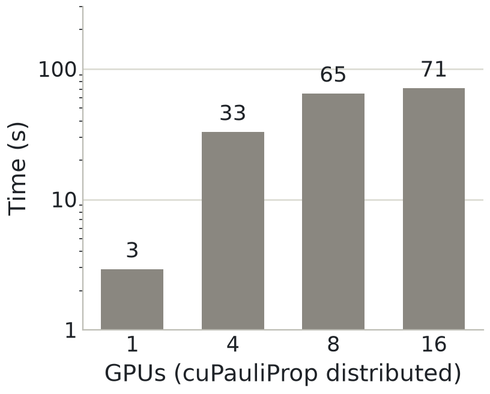 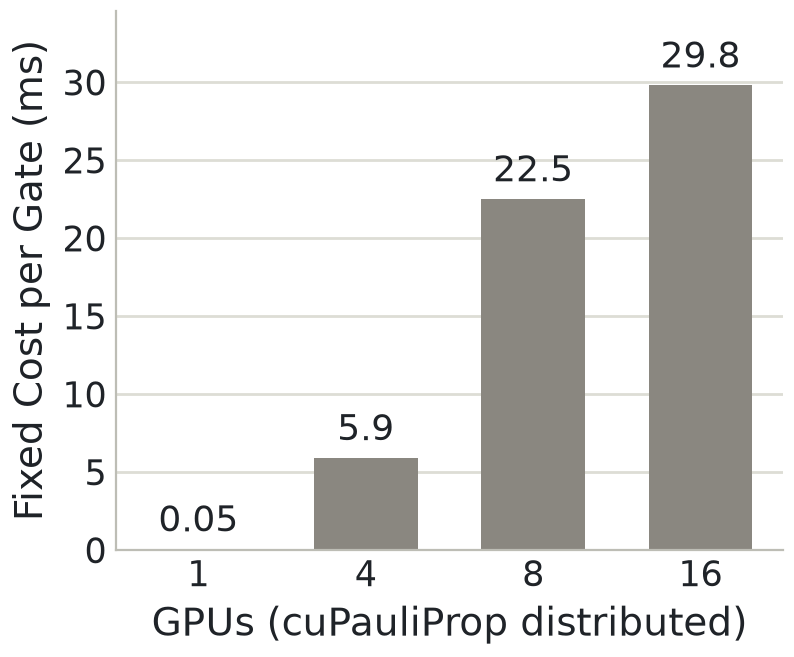 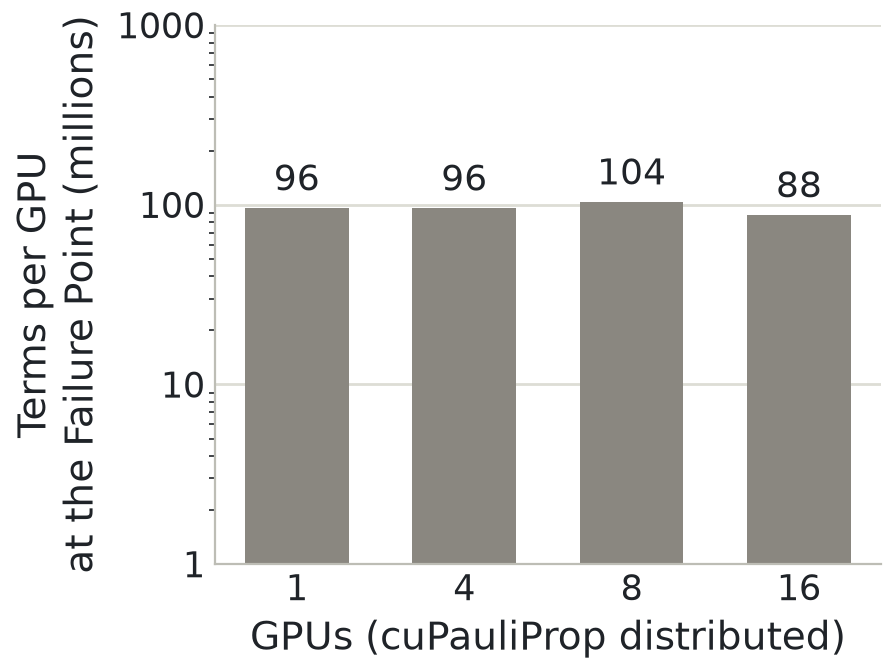</p>
<p align="center"><b>그림 9.</b> cuPauliProp v0.5.0 분산 모드의 측정.</p>

**그림 설명.** 막대 하나가 GPU 수 하나이고 세로는 로그 축이다. (a) 2,250만 항 설정의 실행 시간이다. GPU를 늘릴수록 느려진다. (b) gate 하나에 드는 고정 비용이다. 항 수와 무관하게 gate마다 내는 시간이며 GPU 수와 함께 커진다. (c) 메모리 부족으로 멈춘 지점의 GPU당 항 수이다. GPU 수와 무관하게 약 1억이다.

측정에서 나온 성질이다. 앞의 넷은 속도, 그다음 둘은 원인, 마지막 둘은 용량과 조정의 한계이다.

| 성질 | 측정값 |
|---|---|
| GPU를 늘리면 느려진다 | 2,250만 항 설정: 1 GPU 2.9–3.2초, 4 / 8 / 16 GPU 33–48 / 65 / 71초 |
| 작은 문제일수록 심하다 | 예제 설정: 1 GPU 0.42초, 4 GPU 32–47초 |
| gate마다 고정 비용이 든다 | 4 / 8 / 16 GPU에서 gate당 5.9 / 22.5 / 29.8 ms. 단일 GPU는 0.05–0.8 ms |
| 항이 움직이지 않아도 비용을 낸다 | rank마다 gate당 allgather 22회. gate의 57%는 교환할 항이 없다 |
| GPU는 대부분 쉰다 | GPU 사용률 9%. rank 0 CPU 시간의 47%가 MPI polling, 20%가 GPU memory 할당과 해제, 1.5%가 kernel |
| 부하 불균형이 원인이 아니다 | rank별 항 수의 최대/평균 1.001, 느린 rank를 기다리는 시간 0.2% |
| GPU당 용량은 약 1억 항이다 | 실패 지점: 1 GPU 9,600만, 4 / 8 / 16 GPU에서 rank당 9,580만 / 1억 370만 / 8,790만 |
| 전역 merge 횟수를 줄여도 단일 GPU보다 느리다 | 원래 회로에서 10 gate마다 전역 dedup: 4 GPU 9.3초, 16 GPU 14.6초 (1 GPU 2.9초) |

**전역 merge를 없앤 실행.** 항을 GPU에 나누어 주고 끝까지 따로 계산하면 통신이 없지만 답이 틀린다. 4개로 나누면 0.1675, 16개로 나누면 0.189가 나온다(정답 0.1531). 같은 항이 여러 GPU에 조각으로 남아 truncation이 조각을 버리기 때문이다.

이 측정은 2.3절의 어려움이 최신 구현에서 그대로 나타남을 보인다. gate마다 합치는 방식은 GPU 수와 함께 느려지고, GPU 한 장이 담는 항은 약 1억 개이다.

### 2.5 선행 연구

**요지.** 기존 구현은 장치 하나에 머무르거나, CPU에서 돌거나, gate마다 모든 GPU에 걸쳐 합친다. 여러 GPU에 걸친 Pauli propagation을 다룬 시스템 논문은 조사한 범위에서 찾지 못하였다.

<p align="center">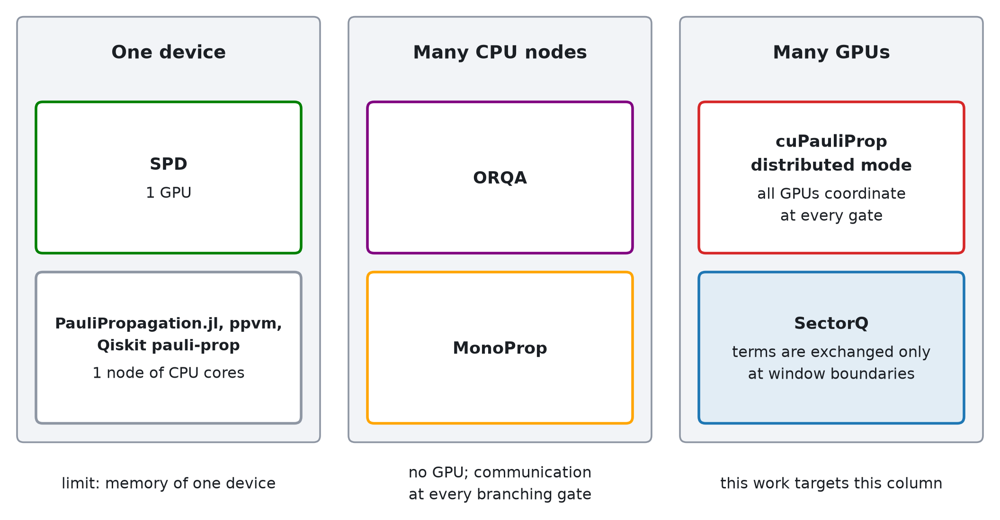</p>
<p align="center"><b>그림 10.</b> 기존 구현이 하는 것과 이 연구가 더하는 것.</p>

**그림 설명.** 줄 하나가 구현 하나이다. 왼쪽 두 열(GPU에서 도는가, 여러 노드에서 도는가)은 기존 연구와 이 연구가 함께 가진 것이다. 오른쪽 세 열은 이 연구가 더하는 것이다. 항이 프로세스 사이를 옮기는 때, GPU memory보다 많은 항을 다루는가, 분할을 실행 중에 정하는가이다. 줄표(—)는 여기서 쓴 자료에 그 내용이 없다는 뜻이다. 아래 표는 같은 연구들을 하는 일과 다루지 않는 것으로 정리한 것이다.

| 연구 | 하는 일 | 다루지 않는 것 |
|---|---|---|
| cuPauliProp (NVIDIA, 2026) | GPU의 Pauli propagation, MPI 분산 모드. 여러 GPU로 도는 구현은 조사한 범위에서 이것뿐이다 | 여러 gate를 통신 없이 진행하는 실행, GPU memory를 넘는 항 수. 내부 비공개, 논문 없음 |
| ORQA (RIKEN, arXiv 2506.13241, 2025) | CPU 분산, 고정 분배 함수. Fugaku에서 2^17 프로세스와 1조 항을 보고하였다 | GPU. 가지치는 gate마다 통신한다. 코드 비공개 |
| MonoProp (Algorithmiq, arXiv 2503.18939, 2025) | CPU 분산 구현 | GPU |
| SPD (Quantinuum, 2026) | 단일 GPU의 sparse Pauli dynamics | 여러 GPU, GPU memory를 넘는 항 수 |
| PauliPropagation.jl (PRX Quantum, 2026), ppvm (QuEra, 2026), Qiskit pauli-prop (Qiskit, 2025) | 알고리즘과 단일 노드 구현 | 분산 실행. 메모리가 한계라고 밝힌다 |
| ScaleQsim, Atlas, HyQuas, BMQSim, cusvaer | 상태 벡터(amplitude 2^n개)의 분산과 압축 | 100 qubit 이상. 실행 중에 크기가 변하는 데이터 |
| SWIFTN, cuTensorNet | tensor network 축약 | 같은 회로를 겨냥하는 다른 근사법이다. 비교하지 않는다 |
| Grace hash join, 분할 집계, buffer pool, checkpoint | 분할한 sector를 하나씩 처리하는 database 실행 | 연산이 key를 계속 바꾸는 데이터 |

괄호 안은 출처와 연도이다. 연도는 논문 또는 소프트웨어 인용의 연도이며, 그것이 없는 코드(cuPauliProp v0.5.0, SPD, ppvm)는 여기서 실행한 버전의 연도이다.

여러 GPU에 걸친 Pauli propagation을 다룬 시스템 논문은 조사한 범위에서 찾지 못하였다. 있는 것은 vendor 구현(cuPauliProp 분산 모드)과 CPU 분산(ORQA, MonoProp)이다. 위의 Pauli propagation 구현들은 모두 4.2–4.3절에서 같은 연산 목록으로 실행하여 비교하였다. ORQA는 코드가 공개되어 있지 않아 논문을 따라 재현한 것을 썼다.

state-vector 시뮬레이터는 이 연구와 푸는 문제가 다르며 비교 대상이 아니다(2.1절, 2.3절). 정확성의 기준도 다르다. 상태 벡터는 exact 상태와의 fidelity로 판단하고, Pauli propagation은 전부 합친 단일 장치 실행과 같은 답을 내는지와 cutoff에 따라 수렴하는지로 판단한다.

이 연구가 주장하지 않는 것은 Pauli propagation 알고리즘 자체, Clifford gate를 생성자에 흡수하는 방법 자체, 분할한 sector를 하나씩 처리하는 실행 방식 자체이다. 주장하는 것은 구간 동안 보존되는 parity가 Pauli propagation의 분할 key가 된다는 것, 이 key로 통신을 구간 경계로 모으고 GPU memory를 넘는 항을 다룬다는 것, 그리고 구간과 key를 실행 중에 정한다는 것이다.

### 2.6 설계 요구사항

**요지.** 앞의 측정에서 요구사항 여섯 가지가 나온다. 표의 가운데 열은 그 요구사항의 근거가 된 측정이고, 오른쪽 열은 SectorQ의 답이다. R1–R3은 "합쳐질 상대가 같은 sector 안에 있다"는 한 가지 성질로 함께 만족된다.

| # | 요구사항 | 근거 | SectorQ의 답 |
|---|---|---|---|
| R1 | truncation 전에 같은 항은 모두 합쳐져 있어야 한다 | 합치지 않으면 답이 틀린다(2.2절, 2.4절) | 합쳐질 상대가 같은 sector 안에 있도록 나눈다(3.2절) |
| R2 | gate를 적용하는 동안 GPU 사이의 조율이 없어야 한다 | gate당 고정 비용이 GPU 수와 함께 늘어난다(2.4절) | 구간 동안 항을 주고받지 않고, 구간이 바뀔 때만 교환한다(3.3절) |
| R3 | 합쳐지지 않은 항을 쌓아 두지 않아야 한다 | 합치기를 미루면 회로 7종 가운데 둘이 16 GPU에 들어가지 않는다(4.4절) | sector 안에서 gate마다 합친다(3.2절) |
| R4 | 분할은 실행 중에 정한다 | 어떤 항이 생길지는 실행해야 안다. 고정 bit로 16분할하면 최대/평균이 1.4–4.9배이다(4.7절) | 구간, parity, sector 수를 표본을 보고 정한다(3.2절, 3.3절) |
| R5 | 담는 항 수가 GPU memory에 묶이지 않아야 한다 | GPU당 약 1억 항에서 멈춘다(2.4절) | sector를 host memory에 두고 GPU에 하나씩 올린다(3.4절) |
| R6 | 작은 문제에서 여러 GPU가 손해가 아니어야 한다 | 예제 설정이 4 GPU에서 0.42초에서 32–47초로 느려진다(2.4절) | 항이 적은 동안은 sector 하나, GPU 하나로 돈다(3.2절) |

## 3. 설계

### 3.1 전체 구조

**요지.** 미리 세운 계획이 없다. 구간 동안 GPU가 sector를 처리하고, 같은 시간에 살아 있는 항을 보고 다음 구간의 행과 sector 수를 정한다. 항은 구간 경계에서만 노드 사이를 옮긴다.

하나의 고리가 구간마다 실행 중에 돈다. 구간의 gate가 보존하는 parity로 항을 sector로 나누고, 노드마다 sector를 GPU에 하나씩 올려 처리한다. GPU가 구간을 계산하는 동안 살아 있는 항을 보고 다음 구간의 parity와 sector 수를 정하고, 구간 경계에서 다음 구간의 sector로 다시 나누어 교환한다. 설계 규칙은 2.6절의 요구사항을 하나로 묶은 것이다.

> 항 집합을 지금 구간의 모든 gate가 보존하는 parity의 값으로 나눈다. 이렇게 나눈 sector는 그 구간 동안 항을 주고받지도 합쳐지지도 않는다. 따라서 sector마다 따로 merge하고 truncation해도 전체를 합쳐 계산한 것과 답이 같다. 구간, parity, sector 수는 실행 중에 정하고, 항의 교환은 구간이 바뀔 때만 한다.

<p align="center">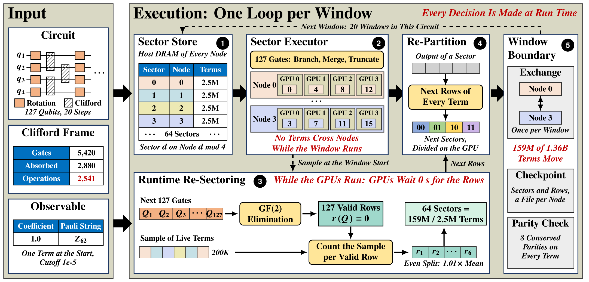</p>
<p align="center"><b>그림 11.</b> SectorQ의 전체 구조.</p>

**그림 설명.** 왼쪽 판(Input)은 들어가는 것이다. 회로, Clifford frame을 거친 연산 목록(gate 5,420개가 연산 2,541개), 관측량이다. 오른쪽 판(Execution)은 구간마다 한 번 도는 고리이며 번호 순서로 읽는다. (1) Sector Store는 각 노드의 host memory에 있는 sector들이다. (2) Sector Executor에서 GPU가 sector를 하나씩 받아 구간의 gate 127개를 적용한다. (3) Runtime Re-Sectoring은 GPU가 도는 동안 표본과 다음 gate로부터 다음 구간의 행과 sector 수를 정한다. GPU가 이 결과를 기다린 시간은 0초이다. (4) Re-Partition은 GPU에서 출력을 그 행으로 나눈다. (5) Window Boundary에서 조각을 맡은 노드로 교환하고 checkpoint를 쓴다. 위의 점선은 다음 구간으로 돌아가는 길이다. 색은 노드를 뜻한다. 숫자는 4 노드 16 GPU에서 도는 127-qubit kicked Ising 회로(cutoff 1e-5)의 구간 9의 것이다(`logs/pp_e11-59488608.out`, `logs/h1/h.h1.ki.1e-5.g16.out`).

**구간 실행.** 노드마다 프로세스 하나, GPU마다 worker 하나가 있다. (1) sector d는 노드 (d mod 노드 수)의 host memory에 있다. (2) worker는 자기 노드의 sector를 하나 꺼내 GPU에 올리고, 구간의 gate를 적용하며 그 sector 안에서 merge와 truncation을 수행한다. (4) 출력은 GPU에서 다음 구간의 행으로 나뉘어 host memory에 내려온다(3.4절). 이 동안 항은 노드 사이를 오가지 않는다. 구간 중간에 GPU보다 커진 sector는 그 자리에서 둘로 나눈다.

**런타임 sector 재구성.** (3) 다음 구간을 어떻게 나눌지는 실행 중에, 살아 있는 항을 보고 정한다. 이 일은 GPU가 지금 구간을 계산하는 동안 노드의 main thread가 한다. 구간이 시작할 때 살아 있는 항의 표본(20만 항)과 항 수를 뜬다. 다음 gate들이 보존하는 행 가운데 표본을 고르게 나누는 것을 고르고, 항 수로 sector 수를 정해 모든 노드의 GPU에 돌려준다(3.2절). GPU는 출력을 나누기 직전에만 이 행을 필요로 하므로 기다리지 않는다. 16 GPU의 kicked Ising cutoff 1e-5에서 행을 고르는 데 0.33초가 들고 GPU가 기다린 시간은 0초이다. 구간이 짧을 때는 GPU마다 sector를 하나만 주어, 연산 호출의 고정 비용을 한 번만 낸다. 그림의 구간에서는 항 1.59억 개를 행 6개로 64 sector로 나누었고, 가장 큰 sector는 평균의 1.01배이다. 구간의 끝도 실행 중에 정한다(3.3절).

**구간 경계.** 각 노드의 출력에는 다음 구간의 모든 sector의 조각이 섞여 있다. (5) 조각을 그 sector를 맡은 노드로 보낸다. 통신은 여기에서만 일어난다. 이 시점의 sector 집합을 checkpoint로 쓰고(3.6절) 다음 구간으로 넘어간다. 마지막 구간이 끝나면 초기 상태에 대한 기대값을 구한다.

| 설계 요소 | 절 | 답하는 요구사항 |
|---|---|---|
| 런타임 sector 재구성 | 3.2 | R1, R2, R3, R4, R6 |
| 통신을 구간 경계로 모으기 | 3.3 | R2, R4 |
| Sector 단위 실행 | 3.4 | R5 |
| Clifford frame | 3.5 | 데이터를 훑기만 하는 gate를 없앤다 |
| Checkpoint와 검산 | 3.6 | 긴 실행의 재개와 답의 신뢰 |

### 3.2 런타임 sector 재구성

**요지.** 어떤 행이 유효한지는 다음 gate가 정하고, 유효한 행 가운데 어떤 행이 항을 고르게 나누는지는 살아 있는 항이 정한다. 둘 다 실행 중에만 알 수 있다. 이렇게 고른 행으로 나눈 sector는 구간 동안 닫혀 있다.

<p align="center">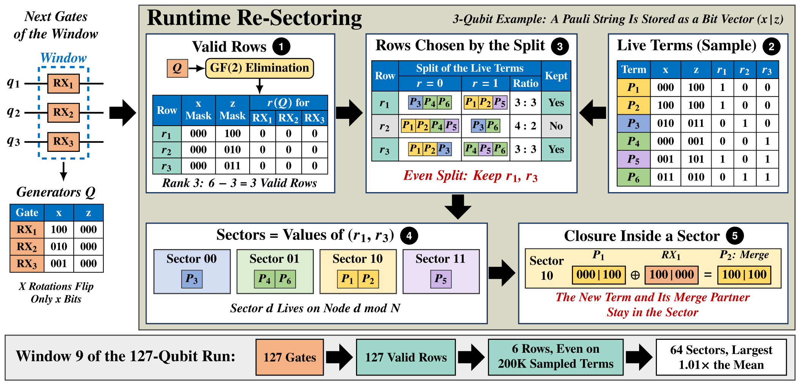</p>
<p align="center"><b>그림 12.</b> 구간 하나의 sector를 실행 중에 정하는 과정.</p>

**그림 설명.** qubit 3개의 예이며 bit 벡터는 (x | z)이다. 왼쪽은 구간의 다음 gate 셋과 그 생성자의 표이다. 오른쪽 판은 번호 순서로 읽는다. (1) 다음 gate의 생성자를 소거하여 유효한 행을 구한다. (2) 살아 있는 항의 표본이다. (3) 유효한 행마다 표본이 어떻게 갈리는지 세어, 고르게 나누는 행을 고른다. 칸의 색은 그 항이 들어갈 sector이다. (4) 고른 행의 값이 sector가 된다. (5) sector 안에서 gate를 적용하면 새 항과 합쳐질 상대가 같은 sector에 있다. 아래 띠는 127-qubit kicked Ising 실행의 구간 9에서의 같은 결정이다.

- **행(row).** bit 벡터에 대한 parity 함수 하나이다. r(P)는 P와 mask를 AND한 결과에서 1의 개수의 홀짝이다.
- **Sector.** 행 g개의 값이 같은 항들의 모음이다. 최대 2^g개이다.
- **구간(window).** 같은 행을 쓰는 연속된 연산들이다.

**입력.** 다음 gate들과 지금 살아 있는 항이다. 그림 12의 왼쪽이 다음 gate이다. X rotation 셋이며 생성자의 x bit 하나만 1이다. (2) 어떤 항이 살아 있는지는 실행해야 안다.

**유효한 행.** (1) 다음 gate의 생성자를 GF(2)로 소거하면 rank가 3이다. 모든 생성자 Q에 대해 r(Q)=0인 행의 공간은 6−3=3차원이다. 이 예에서는 z bit만 보는 행이 모두 유효하다.

**살아 있는 항으로 고르기.** 유효한 행은 여러 개이며, 어느 행을 쓰는지에 따라 sector의 크기가 달라진다. (3) 유효한 행마다 살아 있는 항이 어떻게 나뉘는지 센다. r₁과 r₃은 3:3으로, r₂는 4:2로 나누므로 r₁과 r₃을 쓴다. 실제 실행에서는 항 20만 개의 표본으로 센다. 16분할에서 고정 bit는 최대/평균이 1.4–4.9배이고 이렇게 고른 행은 1.00–1.01배이다.

**Sector.** (4) 고른 행이 항으로 돌아간다. 항의 sector는 그 행들의 값이다. 항 여섯 개가 네 sector로 나뉜다.

**닫힘.** (5) RX₁은 P₁=000|100을 P₁⊕Q₁=100|100으로 만든다. 이 항은 P₂와 같아 계수가 합쳐진다. 새 항도, 합쳐질 상대도 P₁의 sector 안에 있다. 일반적으로는 다음과 같다.

1. rotation이 만드는 새 항은 P⊕Q이다. r(Q)=0이면 r(P⊕Q)=r(P)이다.
2. 구간의 모든 생성자 Q에 대해 r(Q)=0인 행으로 sector를 정하면 새 항은 원래 항과 같은 sector에 놓인다. 같은 Pauli string은 행의 값이 같으므로, 합쳐질 상대도 같은 sector에 있다.
3. 따라서 sector 안에서 merge하고 truncation한 결과는 전체를 merge하고 truncation한 결과와 같다.

이 성질이 R1, R2, R3을 함께 만족시킨다. sector 안에서 gate마다 합치므로 truncation은 항상 합쳐진 계수를 본다(R1). 다른 sector와 주고받을 것이 없으므로 구간 동안 항이 GPU를 옮기지 않는다(R2). 합치기를 미루지 않으므로 합쳐지지 않은 항이 쌓이지 않는다(R3).

**hash 분할과의 차이.** 차이는 무엇을 key로 삼는가에 있다. hash는 Pauli string 전체를 key로 삼아, gate가 string을 바꾸면 배정도 바뀐다. sector는 string 가운데 구간의 gate가 바꾸지 않는 부분만 key로 삼는다.

<p align="center">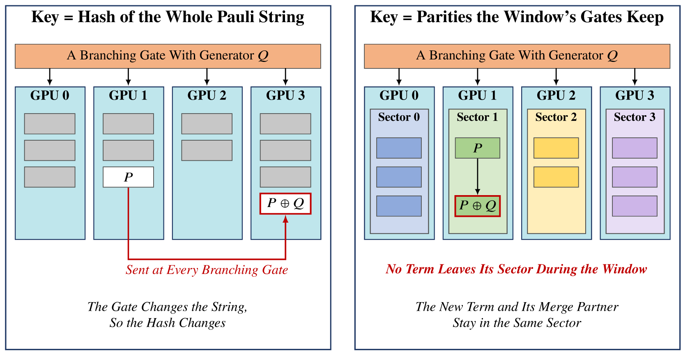</p>
<p align="center"><b>그림 13.</b> 분할의 key: Pauli string 전체의 hash와 구간이 보존하는 parity.</p>

**그림 설명.** 두 틀 모두 GPU 4장에 가지치는 gate 하나(생성자 Q)를 적용한다. 왼쪽은 Pauli string 전체의 hash를 key로 쓴다. gate가 string을 바꾸면 hash가 바뀌므로, GPU 1의 항 P에서 생긴 새 항 P⊕Q는 GPU 3에 놓인다. 가지치는 gate마다 새 항을 보내야 한다. 오른쪽은 구간의 gate가 보존하는 parity를 key로 쓴다. 새 항 P⊕Q와 그것이 합쳐질 상대가 P와 같은 sector에 있으므로, 구간 동안 어떤 항도 자기 sector를 떠나지 않는다.

**Sector 수.** 살아 있는 항의 수와 지난 구간의 증가율로 정한다. 구간이 시작될 때의 항 수를 sector당 목표 항 수(`--target`)로 나누며, 구간 하나에 최대 256개이다(`--gmax`로 4,096개까지 올릴 수 있다). 항이 아주 적은 동안은 sector 하나, GPU 하나로 돈다(R6). sector 하나가 2,000항을 넘을 만큼 되면 노드마다 sector를 하나씩 준다(`--early-per-node`). 초반 구간은 항 수가 가장 빠르게 늘어나는 곳이어서, sector 하나로 두면 GPU 한 장이 일하는 동안 나머지가 기다린다(4.6절). GPU가 한 장뿐이면 sector를 받아 줄 다른 GPU가 없으므로 목표 항 수 규칙만 쓴다. 이때 구간과 다음 구간이 모두 sector 하나이면 결과를 나누지도 host로 내리지도 않고 GPU에 그대로 둔다(4.11절).

### 3.3 통신을 구간 경계로 모으기

**요지.** 구간의 gate는 각 GPU 안에서 자기 sector에만 적용한다. kicked Ising에서 gate 2,540번마다 하던 통신이 구간 20개의 경계로 모인다. 통신을 없앤 것이 아니라 필요한 횟수를 줄인 것이다.

<p align="center">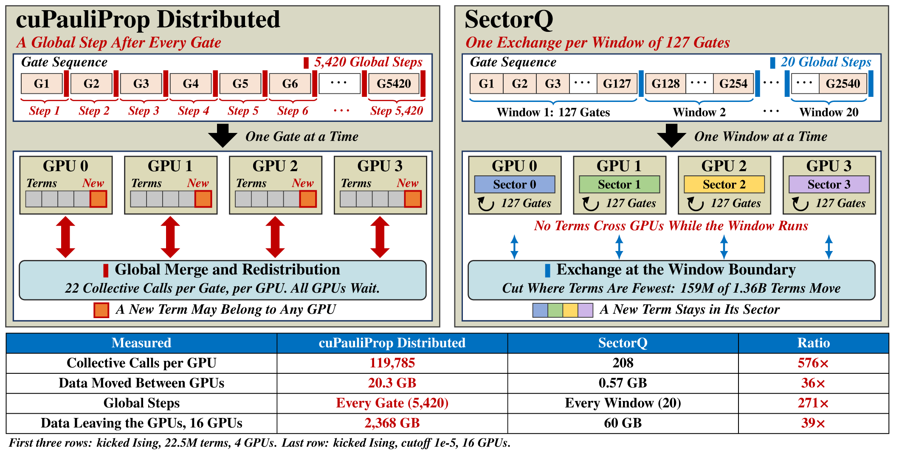</p>
<p align="center"><b>그림 14.</b> 같은 네 GPU가 두 방식에서 하는 일.</p>

**그림 설명.** 두 판은 같은 GPU 네 장이다. 왼쪽은 cuPauliProp 분산 모드이다. 위의 gate 순서 띠에서 gate마다 빨간 표시(전역 단계)가 붙고, 모든 GPU가 전역 merge와 재분배에 묶여 있다. 새 항(주황 칸)이 어느 GPU의 항과 합쳐질지 모르기 때문이다. 오른쪽은 SectorQ이다. gate 127개가 구간 하나로 묶여 구간의 경계에만 파란 표시가 있다. GPU마다 sector 하나를 구간 내내 처리하고, 경계에서 한 번 교환한다. 아래 표는 측정값이다. 앞의 세 줄은 kicked Ising 2,250만 항 설정을 4 GPU에서, 마지막 줄은 cutoff 1e-5를 16 GPU에서 잰 것이다.

**기존 방식.** cuPauliProp 분산 모드는 gate 하나를 적용할 때마다 모든 GPU가 전역 merge와 재분배에 참여한다. 새 항이 어느 GPU의 항과 합쳐질지 알 수 없기 때문이다. gate마다 rank당 22번의 전원 통신을 하고, 그동안 모든 GPU가 기다린다.

**SectorQ.** 구간의 gate 127개가 각 GPU 안에서 자기 sector에만 적용된다. 새 항이 sector를 벗어나지 않으므로(3.2절) 구간이 도는 동안 항은 GPU를 옮기지 않는다. 그동안 노드 사이를 오가는 것은 다음 구간의 행을 고르는 표본(20만 항)과 고른 행뿐이다. 구간이 끝날 때 한 번, 다음 구간의 sector로 다시 나누어 교환한다. kicked Ising에서 통신 시점은 gate 2,540번에서 구간 20개의 경계로 줄어든다.

| 2,250만 항 설정, 4 GPU | cuPauliProp 분산 | SectorQ |
|---|---:|---:|
| GPU당 전원 통신 횟수 | 119,785회 (SectorQ의 576배) | 208회 |
| GPU 사이를 오간 데이터 | 20.3 GB (SectorQ의 36배) | 0.57 GB |
| 전역 단계 | gate마다 | 구간마다 |

SectorQ의 값은 노드 넷에 GPU 하나씩을 둔 실행에서 MPI 호출을 가로채어 센 것이다(`logs/h1/shim.h4.comm.ki.1e-4.n4x1.mpiprof`). 208회는 구간 20개의 경계에서 하는 교환과, 표본과 행을 나누는 호출을 합친 수이다.

**구간을 끊는 곳은 실행 중에 정한다.** SectorQ는 rotation 목록을 앞에서부터 읽으며 생성자가 만드는 공간을 GF(2) 소거로 추적한다(`gf2.hpp`). 생성자 공간이 d차원이면 유효한 행의 공간은 2n−d차원이다. 이 공간이 n차원 이상 남아 있는 동안 구간을 늘리고, truncation 직후에서 끊는다(`--snap`, 기본). 구간 안에서 항 수는 경계의 2.9–36배까지 늘었다가 truncation에서 줄어든다. 16 GPU 실행의 구간 8에서는 최대 13.6억 항이 끊는 곳에서 1.59억 항이다. 옮기는 양이 가장 적은 때이다. 회로마다 규칙을 넣지 않으며, 회로 7종에서 구간 6–45개가 자동으로 잡힌다.

<p align="center">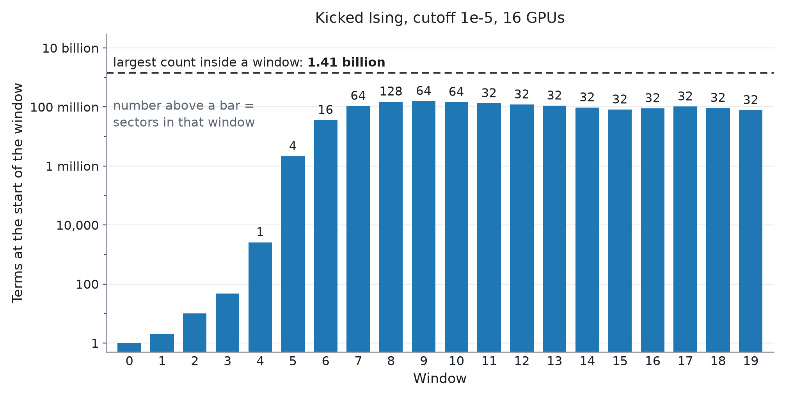</p>
<p align="center"><b>그림 15.</b> 구간이 시작할 때의 항 수(kicked Ising cutoff 1e-5, 16 GPU).</p>

**그림 설명.** 선은 구간 20개 각각이 시작할 때의 항 수이며 세로는 로그 축이다. 가로축의 괄호는 그 구간에서 쓴 sector 수이다. 파선은 구간 안에서 닿은 가장 큰 항 수(14.1억)이다. 구간 경계의 항 수는 최대 1.59억으로, 구간 안 최대의 약 9분의 1이다. 교환은 이 경계에서 하므로 옮기는 항이 가장 적다. sector 수는 항 수를 따라간다. 처음 다섯 구간은 sector 1개이고, 이어서 4, 16, 64, 128개, 그 뒤로는 32–64개이다.

**재분배(re-key).** 층이 바뀌면 보존되는 parity가 달라진다. X rotation 층은 z bit의 parity를, ZZ rotation 층은 x bit의 parity를 보존한다. 따라서 한 가지 분할을 끝까지 쓸 수 없다. GPU는 sector의 출력에서 항마다 다음 구간의 행을 계산한다. 그 값이 다음 sector의 번호이고, sector d는 노드 (d mod 노드 수)가 맡는다. 출력을 다음 sector별로 모아(`shuffle.cu`), 자기 노드가 맡은 sector의 조각은 host memory의 chunk 목록 끝에 붙인다.

**교환.** 다른 노드가 맡은 sector의 조각은 구간 경계에서 한 번 보낸다. 노드 사이의 메시지는 이것뿐이다. 받은 메시지는 복사하지 않고 그 sector의 chunk로 삼는다. 교환은 라운드로 나누어 한다. 한 라운드는 보내는 노드와 sector의 쌍마다 chunk 하나를 나르고, 라운드가 끝나면 보낸 chunk를 반납한다. 그래서 노드가 자기 출력 전체와 받을 항을 한꺼번에 가지지 않는다(4.4절의 host memory 사용량). 회로 전체에서 유효한 행은 모든 항에서 값이 같아 분할에 쓸 수 없으므로(3.7절 성질 4) 재분배는 없앨 수 없다.

**GPU 사이를 직접 잇지 않는 이유.** 한 노드의 GPU들은 NVLink로 이어져 있고(이 플랫폼은 GPU 쌍마다 링크 4개, 각 25 GB/s), GPU끼리 직접 주고받는 길(P2P)은 host를 거치는 길(26 GB/s, 내리고 올리는 두 번)보다 빠르다. 그래도 SectorQ는 GPU 사이의 직접 통신을 쓰지 않는다. 이유는 다음 순서로 따라온다.

1. 직접 통신은 한 GPU의 계산이 다른 GPU의 데이터를 자주, 조금씩 필요로 할 때 값을 한다. 그 비용은 주고받는 횟수에 비례한다.
2. SectorQ에는 구간 안에서 그런 순간이 없다. 합쳐질 항은 모두 같은 sector에 있고(3.2절), sector 하나는 GPU 하나가 구간 끝까지 처리한다. 어떤 GPU도 다른 GPU의 항을 읽지 않는다.
3. 항이 GPU를 옮기는 때는 sector를 정하는 행이 바뀌는 구간 경계뿐이다. 이때는 모든 항을 한 번에 다시 나눈다. 상태 벡터 시뮬레이터가 global qubit을 local로 바꾸려고 한 번 크게 교환한 뒤 이어지는 gate를 통신 없이 적용하는 것과 같은 꼴이다.
4. 이 교환은 드물고 작다. kicked Ising cutoff 1e-5에서 연산 2,541개 가운데 19번이고, operator가 가장 작은 truncation 직후에 일어난다. 실행 전체에서 GPU 밖으로 나가는 양은 60 GB이다. 같은 설정의 cuPauliProp 분산 모드는 연산마다 rank당 allgather 22번과 송신 15번을 하고, 16 rank가 모두 1,733 GB를 보낸다(29배, 4.6절).
5. 드물게 한 번에 크게 옮기는 일의 비용은 지연이 아니라 처리량이 정하고, 그 몫이 이미 작다. 한 노드 4 GPU에서 GPU와 host 사이의 복사는 GPU 시간의 3.7%이다(gate 적용 89%). 링크가 몇 배 빨라져도 줄어드는 것은 이 3.7%이다.
6. host memory를 거치면 대신 얻는 것이 있다. 용량이 GPU memory에 묶이지 않고(R5), 먼저 끝난 GPU가 다음 sector를 가져가며, 노드 안과 노드 사이가 같은 길을 쓴다. 직접 보내려면 받을 GPU를 미리 정하고 계산 중인 GPU에 받을 자리를 비워 두어야 한다.

gate마다 통신하는 방식은 통신을 빠르게 만들어야 한다. SectorQ는 통신이 필요한 횟수를 없앴으므로 링크의 속도에 둔감하다.

### 3.4 Sector 단위 실행

**요지.** sector는 서로 독립이므로 처리 중인 sector만 GPU에 있으면 된다. 담을 수 있는 항 수는 GPU memory가 아니라 모든 노드의 host memory가 정한다.

<p align="center">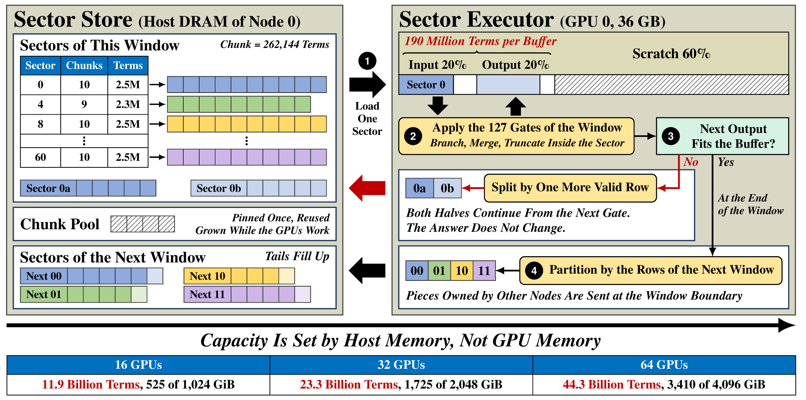</p>
<p align="center"><b>그림 16.</b> 한 노드의 host memory와 GPU 한 장이 구간 동안 하는 일.</p>

**그림 설명.** 왼쪽 판은 노드 하나의 host memory에 있는 sector 저장소이다. sector는 고정 크기 chunk의 목록이며, 표의 한 줄이 sector 하나이다. 오른쪽 판은 GPU 한 장이다. 위의 막대는 GPU memory의 구성이다(입력 버퍼 20%, 출력 버퍼 20%, 작업 공간 60%). 번호 (1)–(4)는 sector 하나를 올리기, 구간의 gate 적용, 다음 출력이 버퍼에 들어가지 않을 때 유효한 행 하나로 sector를 둘로 나누어 host로 돌려보내기(빨간 화살표), 구간이 끝난 뒤 다음 구간의 행으로 나누어 내리기이다. 아래 표는 host memory가 정하는 도달 범위이다(16, 32, 64 GPU에서 구간 경계의 항 수와 쓴 host memory).

sector는 서로 독립이므로 하나씩 따로 처리할 수 있다. 이것이 GPU memory의 한계를 없앤다(R5).

**Host sector 저장소.** sector는 고정 크기 chunk(262,144항)의 목록이다. chunk는 한 번 고정(pin)하여 계속 재사용한다. GPU와의 복사와 노드 사이의 전송이 같은 메모리를 쓴다. 새 chunk는 16개씩 묶어 만든다: 일반 메모리를 받아 한 번 쓴 뒤 CUDA에 등록한다. `cudaHostAlloc`으로 받으면 2 GB/s이고 이 방법은 7 GB/s이며, GPU와의 복사 속도는 같다(26 GB/s, `src/proto/pin_test.cpp`). 교환에서 도착하는 항을 받을 chunk가 모자랐으면, 다음 구간이 도는 동안 main thread가 그만큼을 미리 만든다(4.11절).

**GPU에서의 처리.** GPU memory는 입력 버퍼와 출력 버퍼에 20%씩, 나머지를 작업 공간에 쓴다. 36 GB에서 버퍼 하나가 1.9억 항이다. (1) worker는 저장소에서 sector를 꺼내 입력 버퍼에 올린다. (2) 구간의 gate를 차례로 적용하며 merge와 truncation을 수행한다. gate 적용에는 cuPauliProp의 단일 GPU 연산을 쓴다. sector가 작업 단위이므로 먼저 끝난 GPU가 남은 sector를 가져간다.

**넘치면 분할.** (3) 다음 gate의 출력이 버퍼에 들어가지 않으면, 그 자리에서 행을 하나 더 써서 sector를 둘로 나누고 host로 돌려보낸다. 두 조각은 남은 gate부터 각각 이어서 처리된다. 추가하는 행도 구간의 남은 생성자에 대해 r(Q)=0이므로 답이 변하지 않는다.

**다음 구간으로.** (4) 구간이 끝난 sector의 출력을 다음 구간의 행으로 나누어, 다음 sector의 chunk 끝에 붙인다. 다른 노드가 맡은 sector의 조각은 구간 경계에서 sector 통째로 보낸다.

**용량.** GPU에는 처리 중인 sector만 올라간다. 담을 수 있는 항 수는 GPU memory가 아니라 모든 노드의 host memory가 정한다. 16 GPU에서 구간 경계의 항 119억 개(구간 안에서 최대 1,001억 개)를 다루었고, 이때 4 노드의 host memory 1,024 GiB 가운데 525 GiB를 썼다. 그다음 cutoff(7e-7, 233억 항)는 host memory가 부족하다. 노드를 늘리면 이 한계가 함께 늘어나며, 512 GPU로는 구간 경계의 항 2,573억 개(10.3 TB)까지 끝냈다(4.4절).

### 3.5 Clifford frame

**요지.** Clifford gate는 항의 표기만 바꾸고 항 수는 바꾸지 않는다. 이런 gate는 데이터에 적용하지 않고 뒤따르는 rotation의 생성자에 흡수한다.

<p align="center">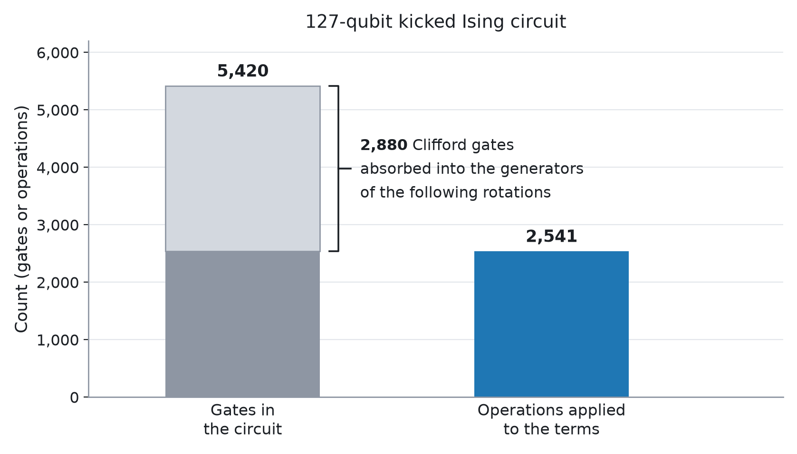</p>
<p align="center"><b>그림 17.</b> Clifford frame: kicked Ising의 한 step.</p>

**그림 설명.** 왼쪽은 kicked Ising 회로의 한 step이다. X rotation 층(주황)과 Clifford인 ZZ 층(빗금)이 이어진다. 오른쪽은 항에 실제로 적용하는 것이다. Clifford 층은 사라지고, 뒤따르는 rotation의 생성자가 X에서 ZXZ처럼 여러 qubit에 걸친 Pauli string으로 바뀐다. 아래 표는 회로 전체(20 step)의 수이다. gate 5,420개 가운데 Clifford gate 2,880개가 흡수되어, 항에 적용하는 연산은 2,541개이다(rotation 2,540개와 truncation만 싣는 연산 1개).

Clifford gate와 Clifford 각도의 rotation은 항 수를 바꾸지 않고 bit만 바꾼다. 그런데도 데이터에 적용하면 모든 항을 한 번 훑어야 한다. SectorQ는 이 연산을 데이터에 적용하지 않고 frame에 모은다. 뒤따르는 rotation은 생성자를 frame으로 변환하여(부호 포함) 적용한다. frame은 noise 연산 앞과 회로 끝에서만 데이터에 적용하고, frame에 Pauli gate만 남아 있으면 단일 qubit Pauli gate로 적용한다. kicked Ising은 gate 5,420개가 데이터 연산 2,541개가 된다(그 가운데 rotation이 2,540개). 임의의 H, S, CZ, Pauli gate와 π/2 rotation을 지원한다(`circuit.hpp`). 이 방법은 parity sector와 독립이며, 평가에서는 기준선에도 같은 연산 목록을 준다.

### 3.6 Checkpoint와 검산

**요지.** 구간 경계의 sector 집합은 그대로 checkpoint가 된다. 회로 전체가 보존하는 parity는 분할에는 쓸 수 없지만 모든 항의 검산에 쓴다.

- **Checkpoint.** 구간 경계에서 sector 집합과 그 구간의 행을 노드별 파일로 쓴다. 이 시점은 항 수가 가장 적은 때이다(3.3절). 같은 노드 수 또는 한 노드로 재개한다.
- **보존 parity 검산.** 회로의 모든 생성자에 대해 r(Q)=0인 행은 모든 항에서 값이 같아야 한다. heavy-hex kicked Ising에는 이런 행이 19개 있고 SectorQ는 그 가운데 8개를 쓴다. sector를 GPU에 올릴 때마다 모든 항을 이 행으로 검사한다(`--verify`, 기본).
- **기준 모드.** 같은 연산 목록을 sector 하나와 GPU 하나로(`--mode ref`), 또는 cuPauliProp 분산 모드로(`--mode cupp`) 실행하여 답과 시간을 대조한다.

### 3.7 보장과 한계

**요지.** 원리에서 여섯 가지 성질이 따라 나온다. 어떤 회로에서도 항을 주고받지 않고 도는 구간이 존재하고, 구간을 길게 잡는 것이 최적이며, 구간 경계의 재분배는 피할 수 없다.

원리에서 따라 나오는 성질이다. 1–4는 증명할 수 있고, 5–6은 측정으로 확인하였다.

| # | 성질 | 뜻 |
|---|---|---|
| 1 | **존재 보장.** 구간의 생성자가 만드는 공간이 2n−g차원 이하이면 유효한 행 g개가 있다 | 어떤 회로든 rotation 2n−g개까지는 중간에 항을 주고받지 않고 한 구간으로 돈다. 127 qubit, sector 256개이면 246개이다 |
| 2 | **길게 잡는 것이 최적이다.** 구간을 가능한 한 길게 잡으면 구간 수가 최소이다 | 차원 조건은 부분 구간에서도 성립한다. 미리 계획하지 않고 실행하면서 늘려도 손해가 없다 |
| 3 | **나눌 수 있는 한계.** sector는 생성자 공간의 coset들의 합집합이다 | coset 하나에 항이 몰려 있으면 어떤 행으로도 고르게 나눌 수 없다. 표본으로 미리 알 수 있다. 측정한 회로에서는 가장 큰 coset의 비율이 0.0000이었다 |
| 4 | **재분배는 피할 수 없다.** 회로 전체에서 유효한 행은 모든 항에서 값이 같다 | 그런 행은 분할에 쓸 수 없고 검산에 쓴다 |
| 5 | **sector는 축소판이다.** 한 구간에서 모든 sector는 같은 연산을 독립으로 받는다 | sector 하나를 먼저 돌리면 전체의 항 수 변화를 알 수 있다(pilot, 4.9절) |
| 6 | **쌍은 같은 sector에 있다.** rotation은 {P, P⊕Q} 쌍 위의 2×2 회전이고, 쌍의 두 항은 같은 sector에 있다 | 정렬, dedup, 출력 버퍼 없이 제자리에서 갱신할 수 있다. 구현하지 않았다 |

### 3.8 구현

**요지.** SectorQ는 gate 적용, merge, truncation에 cuPauliProp의 단일 GPU 연산을 그대로 호출하고, 그 위의 분할, 배치, 통신을 구현한다.

| 구성 요소 | 위치 |
|---|---|
| SectorQ 본체 | `src/engine/pp_engine.cpp` (1,600여 줄): 구간 결정, sector 저장소, GPU worker, 노드 사이 교환, 넘치는 sector의 분할, checkpoint, 검산, 기준 모드 |
| 연속된 noise channel의 묶음 호출 | `src/engine/noise_fusion.hpp` (80줄): noise channel은 항을 늘리지도 합치지도 않으므로 최대 10개를 한 번의 호출로 적용한다. truncation과 구간 경계에서 묶음을 끊는다. cuPauliProp 기준선에도 같이 적용한다 |
| 구간 계산과 겹친 행 고르기 | 구간이 시작할 때 표본만 뜨고 worker를 띄운 뒤, main thread가 표본을 모아 다음 구간의 행을 정한다. worker는 출력을 나누기 직전에만 행을 기다린다. 앞 구간이 0.5초보다 짧으면 GPU당 sector를 하나로 한다(`--long-window`) |
| 회로와 Clifford frame | `src/engine/circuit.hpp` (451줄): 회로 7종, frame, 연산의 bit 변환 |
| GF(2) 소거 | `src/engine/gf2.hpp` (87줄): 생성자 공간, 유효한 행의 공간 |
| 행 계산과 분할 kernel | `src/proto/shuffle.cu` (125줄) |
| gate 적용, merge, truncation | cuPauliProp v0.5.0의 단일 GPU 연산을 그대로 호출한다 |

동작은 실행 옵션으로 선택한다(7절). `--mode ref`는 sector 하나를 GPU 하나에서 처리하므로 cuPauliProp 단일 GPU 실행과 같다. 코드, 옵션 이름, 로그에서는 sector를 bucket이라고 부른다.

## 4. 평가

**요지.** 모든 실행은 NERSC Perlmutter의 GPU 노드에서 하였다. 모든 구현이 같은 연산 목록과 같은 시간 제한을 받았고, 설정마다 한 번 실행하였다. 문제의 크기는 cutoff로 바꾼다.

<p align="center">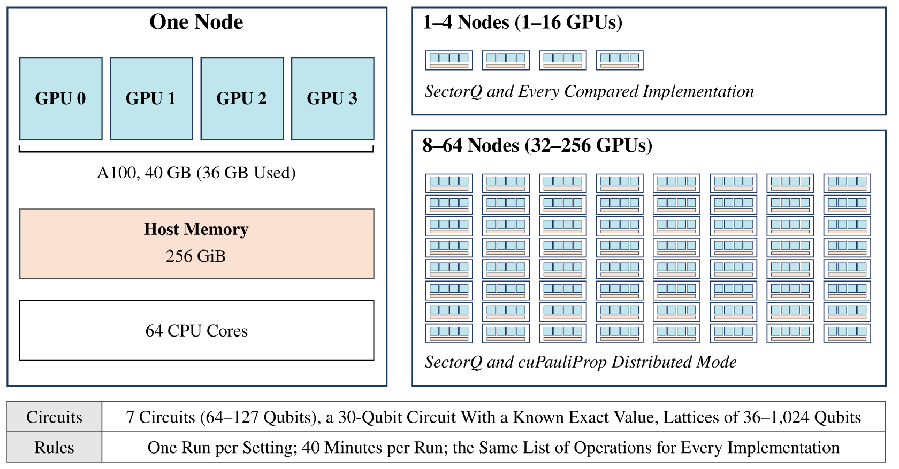</p>
<p align="center"><b>그림 18.</b> 평가 설정.</p>

**그림 설명.** 왼쪽은 노드 하나이다(A100 4장, host memory 256 GiB, CPU 64 코어). 오른쪽 위는 모든 비교 대상을 함께 잰 1–4 노드(1–16 GPU)의 측정이고, 오른쪽 아래는 SectorQ와 cuPauliProp 분산 모드를 잰 8–128 노드(32–512 GPU)의 측정이다. 아래 두 줄은 회로와 규칙이다.

플랫폼은 Perlmutter GPU 노드이다(노드당 A100 4장, CPU 64 코어, DRAM 256 GiB). 평가는 두 묶음의 측정으로 이루어진다.

- **1–16 GPU.** 40 GB 노드 1–4대에서 GPU당 36 GB로(`--vram-frac 0.9`) SectorQ와 모든 비교 대상을 재었다(캠페인 g, 6.3절). 4.1–4.3절, 4.4절의 앞부분, 4.5–4.8절이 이 측정이다. 모든 방식에 실행당 40분의 제한을 같게 두었다. 회로 크기와 정확도의 실험(4.4절의 회로 크기, 4.5절)은 실행당 20분이다. cutoff는 쉬운 설정에서 시작하여 낮추어 가고, 한 방식이 메모리 부족이나 시간 초과로 실패하면 그 방식의 더 낮은 cutoff는 돌리지 않았다.
- **32–512 GPU.** 4.4절의 뒷부분이다. 40 GB 노드 8–128대에서 SectorQ와 cuPauliProp 분산 모드의 두 가지를 재었다. 32, 64, 128, 256 GPU는 세 회로를, 512 GPU는 kicked Ising 회로를 재었다(512 GPU에서 dedup을 미룬 방식은 재지 않았다). host memory의 한계까지 cutoff를 낮추는 측정은 32 GPU에서 한계(cutoff 7e-7)까지, 64 GPU에서 5e-7까지, 128 GPU와 256 GPU에서 3e-7까지, 512 GPU에서 2e-7까지 끝났다. 64 GPU와 128 GPU는 그 아래 단계(3e-7과 2e-7)가 host memory에 들어가지 않으며, 256, 512 GPU의 그 아래 cutoff는 아직 재지 않았다.

**문제 크기를 정하는 법.** Pauli propagation은 항 수를 직접 정할 수 없다. cutoff를 낮추면 유지하는 항이 늘어 문제가 커진다. 그래서 그림의 가로축은 대부분 cutoff이며, 그 아래에 그 cutoff에서 구간 경계의 항 수를 함께 적었다. 구간 안에서는 항 수가 경계의 2.9–36배까지 늘어난다(3.3절).

측정은 설정마다 1회이다. 같은 설정을 반복했을 때의 변동은 대표 설정에서 따로 재었다(4.12절). 기대값은 12자리까지 출력하여 비교하였다. 표에서 "메모리 부족"과 "시간 초과"는 그 실행이 실패한 이유이다. "–"는 같은 방식이 더 쉬운 설정에서 이미 실패하여 돌리지 않은 칸이고, "측정 중"은 아직 끝나지 않은 칸이다. "지원 안 함"은 그 구현이 그 qubit 수를 받지 않는 칸이다.

<!-- g:progress -->
실행 3,269건 가운데 3,269건이 끝났다(완료 1,856, 메모리 부족 142, 시간 초과 54, 더 쉬운 칸에서 실패하여 돌리지 않음 683, qubit 수의 상한에 걸림 43, 캠페인 f에서 가져온 기준선 실행 474).
<!-- /g:progress -->

회로는 일곱 가지이다. 연결 구조, gate 구성, 관측량이 서로 다르게 골랐다.

| # | 회로 | 1–16 GPU 측정의 설정 | gate 구성 | 시험하는 것 | `--circuit` 이름 |
|---|---|---|---|---|---|
| 1 | Kicked Ising (IBM 실험 회로) | 127 qubit heavy-hex, θ=π/4, 20 step | X rotation + ZZ(π/2, Clifford) | 기준 회로, Clifford frame | `ki`, `ki_lab` |
| 2 | TFIM Trotter, 일반 각도 | 127 qubit heavy-hex, θ=0.2π, ZZ −0.3π, 20 step | X rotation + ZZ rotation | Clifford가 없는 회로 | `tfim_hh` |
| 3 | 2D TFIM Trotter | 정사각 격자 11×11(121 qubit), 10 step. 5×6(30 qubit)은 exact 값과 대조하고, 6×6–32×32(36–1,024 qubit)는 qubit 수 실험에 쓴다 | 2번과 같음 | 더 촘촘한 연결 | `tfim_sq` |
| 4 | Heisenberg (XXZ) Trotter | 정사각 격자 8×8(64 qubit), 6 step, Néel 상태 | XX, YY, ZZ rotation | X와 Z bit를 함께 뒤집는 gate | `xxz` |
| 5 | QAOA MaxCut | 3-regular 무작위 그래프 100 qubit, p=4 | H + ZZ rotation + X rotation | 격자가 아닌 연결. 관측량이 edge의 합 | `qaoa` |
| 6 | Hardware-efficient ansatz | 선형 배치 100 qubit, 16층 | 층마다 RY, RZ + CZ | 한 층이 구간 둘. Clifford 얽힘 층 | `hea` |
| 7 | 잡음 있는 kicked Ising | 1번에 qubit마다 depolarizing 잡음 0.005 | 1번 + 잡음 | unitary가 아닌 연산 | `ki_noisy` |

비교 대상은 아홉 가지이다. 각 구현을 그 구현이 쓸 수 있는 자원에서 실행하였다.

| 비교 대상 | 구성 | 준 자원 |
|---|---|---|
| cuPauliProp 단일 GPU | 정답 기준. `--mode ref` | GPU 1장 |
| cuPauliProp 분산 (기본) | rank마다 GPU 하나, 연산마다 전역 dedup. NVIDIA가 제공하는 그대로이며 주 비교 대상이다. `--mode cupp` | 2–16 GPU |
| cuPauliProp 분산 (dedup을 미룸) | 연산을 rank 안에서만 적용하고, 전역 dedup은 truncation 직전에만 수행한다. 메모리가 부족하면 3개 또는 2개 연산마다 한 번 더 하며, 표의 값은 끝난 간격 가운데 가장 빠른 것이다. 이 연구가 구성한 것이다. `--mode cupp --cupp-tuned 1 [--cupp-dedup-every k]` | 2–16 GPU |
| SPD (Quantinuum) | 단일 GPU 구현. 저자 코드 | GPU 1장 |
| ORQA | CPU 분산. 저자 코드가 공개되어 있지 않아 논문의 방식을 따라 재현한 것이다 | 노드당 64 rank, 1 / 2 / 4 노드 |
| MonoProp (Algorithmiq) | CPU 분산. 저자 코드. truncation 규칙이 달라 같은 cutoff에서 값이 다르다 | 노드당 8 rank × 8 thread, 1 / 2 / 4 노드 |
| PauliPropagation.jl | 단일 노드 multithread. 저자 코드 | 64 thread |
| ppvm (QuEra) | 단일 노드 multithread. 저자 코드 | 64 thread |
| Qiskit pauli-prop | 단일 thread. 저자 코드 | 1 thread |

모든 구현이 Clifford frame으로 줄인 같은 연산 목록을 받는다. cuPauliProp에 가장 유리한 입력이다. 외부 구현은 SectorQ가 내보낸 연산 목록을 각 구현의 형식으로 바꾸어 읽는다(`jobs/g_ext_impl.py`). Qiskit addon의 OBP도 실행하였으나 오차 예산 안에서 회로의 일부만 역전파하고 멈추어(15분 제한, 상태 `partial_backpropagation`) 기대값이 없으므로 비교에서 뺐다.

### 4.1 답의 일치

**요지.** truncation 규칙이 같은 구현은 같은 설정에서 같은 값을 낸다. 실행이 둘 이상 끝난 설정 68개 모두에서 기대값의 최대 차이가 4.9e-11이다. SectorQ는 GPU 수, sector 수, 구간을 잡는 규칙을 바꾸어도 같은 값을 낸다.

SectorQ의 기대값은 회로 7종 모두에서 단일 GPU 기준과 12자리까지 같다. 아래는 한 GPU에 들어가는 설정이며, SectorQ 쪽은 sector를 작게 잡아 분할과 재분배가 실제로 일어나게 하였다.

| 회로 | 설정 | 기대값 (기준 = SectorQ) | 구간 수 | sector 실행 횟수 |
|---|---|---|---:|---:|
| 1 `ki_lab` | θ=π/4, 20 step, cutoff 1e-4 | 0.153108187591 | 20 | 94 |
| 2 `tfim_hh` | θ=0.2π, ZZ −0.3π, 20 step, cutoff 1e-4 | 0.324547666766 | 40 | 444 |
| 3 `tfim_sq` 5×6 | 8 step, cutoff 1e-4 | 0.822306395555 | 16 | 279 |
| 3 `tfim_sq` 11×11 | 10 step, cutoff 1e-4 | 0.798821812544 | 20 | 291 |
| 4 `xxz` 6×6 | 4 step, cutoff 1e-3 | −0.000927434911496 | 14 | 80 |
| 5 `qaoa` 60 qubit | p=3, cutoff 1e-4 | 47.4783067466 (edge 90개의 합) | 6 | 69 |
| 6 `hea` 60 qubit | 8층, cutoff 1e-5 | 0.198250860182 | 16 | 59 |
| 7 `ki_noisy` | 잡음 0.005, cutoff 1e-4 | 0.156114065827 | 20 | 116 |

한 GPU를 넘는 설정에는 단일 GPU 기준이 없다. 이 설정에서는 SectorQ의 값이 cuPauliProp 분산 모드의 값과 12자리까지 같다(4.4절). SectorQ는 GPU 수, sector 수, 구간을 잡는 규칙을 바꾸어도 같은 값을 낸다.

**1–16 GPU 측정 전체.** 위 표는 초기 측정의 작은 설정이다. 1–16 GPU 측정에서는 SectorQ의 모든 GPU 수, cuPauliProp의 모든 모드, 같은 truncation 규칙을 쓰는 외부 구현의 값을 모두 대조하였다.

<!-- g:agree -->
같은 truncation 규칙을 쓰는 구현의 완료한 실행을 설정(회로, cutoff)별로 모으면, 실행이 둘 이상인 설정 68개 모두에서 기대값의 최대 차이가 4.9e-11이다.

| 회로 | 설정 수 | 실행 수 | 기대값의 최대 차이 | SectorQ와 대조한 구현 |
|---|---:|---:|---:|---|
| Kicked Ising | 14 | 199 | 4.6e-13 | cupp, defer, defer2, defer3, julia, orqa, ppvm, qiskit, spd |
| TFIM heavy-hex | 14 | 203 | 4.9e-13 | cupp, defer, defer2, defer3, julia, orqa, ppvm, qiskit, spd |
| 2D TFIM 11×11 | 6 | 94 | 4.9e-13 | cupp, defer, julia, orqa, ppvm, qiskit, spd |
| XXZ 8×8 | 6 | 85 | 2.8e-14 | cupp, defer, julia, orqa, ppvm, qiskit, spd |
| QAOA 100 qubit | 7 | 97 | 4.9e-11 | cupp, defer, julia, orqa, ppvm, spd |
| Ansatz 100 qubit | 6 | 75 | 4.5e-13 | cupp, defer, julia, orqa, ppvm, spd |
| 잡음 있는 kicked Ising | 15 | 210 | 4.4e-13 | cupp, defer, defer2, defer3, julia, orqa, ppvm |

표의 구현 이름은 실행 식별자이다: `cupp` cuPauliProp(GPU 1장과 분산 기본), `defer*` dedup을 미룬 cuPauliProp, `spd` SPD, `orqa` ORQA 재현, `julia` PauliPropagation.jl, `ppvm` ppvm, `qiskit` Qiskit pauli-prop.
<!-- /g:agree -->

MonoProp은 truncation 규칙이 달라 이 대조에 넣지 않았다(4.3절).

### 4.2 단일 노드 성능: 다른 구현과의 비교

**요지.** 한 노드에서 10억 항이 넘는 문제를 끝내는 것은 SectorQ뿐이다. cuPauliProp 분산 모드는 한 노드 안에서도 자신의 GPU 1장 실행보다 느리다. GPU 1장 안에서는 다른 연산을 쓰는 SPD가 더 빠른 설정이 있다.

한 노드(A100 4장, CPU 64 코어)에서 모든 구현을 그 구현이 쓸 수 있는 자원으로 실행하였다. 대표 회로는 kicked Ising이다. 같은 truncation 규칙을 쓰는 구현의 기대값은 완료한 모든 실행에서 SectorQ와 같다(4.1절).

<p align="center">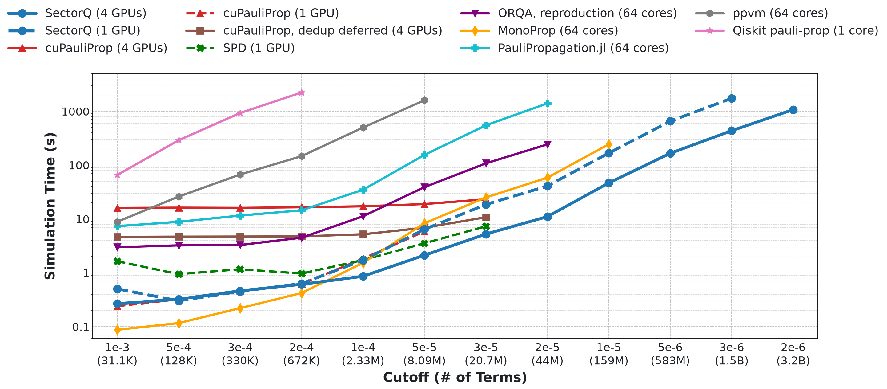</p>
<p align="center"><b>그림 19.</b> 한 노드에서 cutoff에 따른 실행 시간(kicked Ising).</p>

**그림 설명.** 세로는 실행 시간이며 로그 축이다. 가로축은 cutoff이고 오른쪽으로 갈수록 문제가 크다. 괄호는 그 cutoff에서 구간 경계의 항 수이다(127 qubit에서 항 하나는 Pauli string 32 byte와 계수 8 byte이다). 실선은 4 GPU 또는 64 코어, 점선은 GPU 1장이다. 선은 그 구현이 끝낸 마지막 cutoff에서 끝나며, 그다음 cutoff는 메모리 부족이나 시간 초과(40분)이다. 선이 아래에 있을수록 빠르고, 오른쪽으로 길수록 더 큰 문제를 끝낸 것이다.

<!-- g:single_node -->
**Kicked Ising** (한 노드, 실행 시간)

| 구현 | 자원 | 1e-3 | 1e-4 | 3e-5 | 1e-5 | 3e-6 | 1e-6 |
|---|---|---:|---:|---:|---:|---:|---:|
| 구간 경계의 항 수 |  | 3.1만 | 233만 | 2,067만 | 1.6억 | 15억 | 119억 |
| **SectorQ** | 4 GPU | 0.27초 | 0.86초 | 5.25초 | 46.7초 | 436초 | 시간 초과 |
| **SectorQ** | GPU 1장 | 0.50초 | 1.72초 | 18.6초 | 168초 | 1,741초 | – |
| cuPauliProp 분산 (기본) | 4 GPU | 16.0초 | 17.2초 | 23.2초 | 메모리 부족 | 메모리 부족 | – |
| cuPauliProp 분산 (dedup 미룸) | 4 GPU | 4.65초 | 5.20초 | 10.8초 | 메모리 부족 | 메모리 부족 | – |
| cuPauliProp | GPU 1장 | 0.24초 | 1.83초 | 메모리 부족 | 메모리 부족 | 메모리 부족 | – |
| SPD | GPU 1장 | 1.64초 | 1.72초 | 7.32초 | 메모리 부족 | – | – |
| ORQA (재현) | 64 rank | 3.00초 | 11.2초 | 108초 | 메모리 부족 | – | – |
| MonoProp | 8 rank × 8 thread | 0.09초 | 1.53초 | 25.1초 | 244초 | 메모리 부족 | – |
| PauliPropagation.jl | 64 thread | 7.35초 | 34.9초 | 550초 | – | – | – |
| ppvm | 64 thread | 8.87초 | 499초 | 시간 초과 | – | – | – |
| Qiskit pauli-prop | thread 1개 | 65.6초 | 시간 초과 | – | – | – | – |

**TFIM heavy-hex** (한 노드, 실행 시간)

| 구현 | 자원 | 1e-3 | 1e-4 | 3e-5 | 1e-5 | 3e-6 | 1e-6 |
|---|---|---:|---:|---:|---:|---:|---:|
| 구간 경계의 항 수 |  | 4.4만 | 316만 | 3,166만 | 2.5억 | 26억 | 213억 |
| **SectorQ** | 4 GPU | 0.44초 | 1.25초 | 5.86초 | 48.2초 | 467초 | 시간 초과 |
| **SectorQ** | GPU 1장 | 0.64초 | 1.95초 | 21.1초 | 187초 | 1,858초 | – |
| cuPauliProp 분산 (기본) | 4 GPU | 31.5초 | 33.0초 | 39.8초 | 메모리 부족 | – | – |
| cuPauliProp 분산 (dedup 미룸) | 4 GPU | 7.25초 | 7.92초 | 14.3초 | 메모리 부족 | – | – |
| cuPauliProp | GPU 1장 | 0.49초 | 2.08초 | 메모리 부족 | 메모리 부족 | – | – |
| SPD | GPU 1장 | 1.52초 | 1.60초 | 7.21초 | 메모리 부족 | – | – |
| ORQA (재현) | 64 rank | 5.33초 | 12.3초 | 101초 | 메모리 부족 | – | – |
| MonoProp | 8 rank × 8 thread | 0.12초 | 2.00초 | 36.1초 | 359초 | – | – |
| PauliPropagation.jl | 64 thread | 12.2초 | 45.4초 | 723초 | – | – | – |
| ppvm | 64 thread | 2.27초 | 161초 | 1,619초 | – | – | – |
| Qiskit pauli-prop | thread 1개 | 95.4초 | – | – | – | – | – |

**잡음 있는 kicked Ising** (한 노드, 실행 시간)

| 구현 | 자원 | 1e-3 | 1e-4 | 3e-5 | 1e-5 | 3e-6 | 1e-6 |
|---|---|---:|---:|---:|---:|---:|---:|
| 구간 경계의 항 수 |  | 2.2만 | 135만 | 1,034만 | 7,241만 | 6.1억 | 44억 |
| **SectorQ** | 4 GPU | 0.55초 | 2.51초 | 4.81초 | 31.7초 | 272초 | 2,189초 |
| **SectorQ** | GPU 1장 | 0.56초 | 1.93초 | 16.1초 | 116초 | 1,074초 | 시간 초과 |
| cuPauliProp 분산 (기본) | 4 GPU | 32.8초 | 34.1초 | 38.4초 | 메모리 부족 | – | – |
| cuPauliProp 분산 (dedup 미룸) | 4 GPU | 6.33초 | 6.78초 | 9.86초 | 메모리 부족 | – | – |
| cuPauliProp | GPU 1장 | 0.56초 | 1.96초 | 메모리 부족 | – | – | – |
| ORQA (재현) | 64 rank | 5.74초 | 11.4초 | 69.8초 | 574초 | – | – |
| PauliPropagation.jl | 64 thread | 15.4초 | 42.8초 | 437초 | – | – | – |
| ppvm | 64 thread | 14.0초 | 511초 | 시간 초과 | – | – | – |
<!-- /g:single_node -->

두 구현이 모두 끝낸 가장 큰 설정에서 그 구현의 시간을 SectorQ의 시간으로 나눈 값이다. 괄호는 그 설정의 cutoff이다. SectorQ는 같은 노드의 4 GPU를 쓰고, SPD와는 GPU 1장으로 비교하였다.

<!-- g:node_mult -->
| 회로 | cuPauliProp 분산 기본 (4 GPU) | cuPauliProp dedup 미룸 (4 GPU) | ORQA 재현 (64 rank) | MonoProp (64 코어) | PauliPropagation.jl (64 thread) | ppvm (64 thread) | Qiskit pauli-prop (thread 1개) | SPD (GPU 1장, SectorQ도 GPU 1장) |
|---|---:|---:|---:|---:|---:|---:|---:|---:|
| Kicked Ising | 4.4배 (3e-5) | 2.1배 (3e-5) | 22배 (2e-5) | 5.2배 (1e-5) | 127배 (2e-5) | 755배 (5e-5) | 3,654배 (2e-4) | 0.4배 (3e-5) |
| TFIM heavy-hex | 6.8배 (3e-5) | 2.4배 (3e-5) | 19배 (2e-5) | 7.5배 (1e-5) | 185배 (2e-5) | 276배 (3e-5) | 1,810배 (3e-4) | 0.3배 (3e-5) |
| 2D TFIM 11×11 | 6.5배 (3e-5) | 2.1배 (3e-5) | 19배 (1e-5) | 6.5배 (1e-5) | 112배 (3e-5) | 218배 (3e-5) | 2,079배 (3e-4) | 0.4배 (3e-5) |
| XXZ 8×8 | 3.3배 (3e-5) | 4.3배 (1e-4) | 46배 (3e-5) | 2.3배 (1e-5) | 108배 (3e-5) | 334배 (1e-4) | 2,026배 (3e-4) | 1.7배 (1e-4) |
| QAOA 100 qubit | 2.6배 (3e-5) | 1.4배 (3e-5) | 71배 (1e-5) | 12배 (3e-5) | 269배 (1e-4) | 157배 (3e-5) |  | 0.6배 (3e-5) |
| Ansatz 100 qubit | 7.1배 (1e-5) | 5.7배 (3e-5) | 22배 (3e-6) | 3.5배 (1e-6) | 124배 (3e-6) | 445배 (1e-5) |  | 0.5배 (1e-5) |
| 잡음 있는 kicked Ising | 4.8배 (2e-5) | 1.5배 (2e-5) | 18배 (1e-5) |  | 161배 (2e-5) | 525배 (5e-5) |  |  |
<!-- /g:node_mult -->

**결과와 이유.**

- **한 노드에서 10억 항이 넘는 문제를 끝내는 것은 SectorQ뿐이다.** kicked Ising에서 cuPauliProp은 4 GPU로 cutoff 3e-5(2,067만 항)까지, GPU 1장으로 5e-5까지 끝낸다. SPD와 ORQA 재현은 3e-5, MonoProp은 1e-5(1.6억 항)가 끝이다. SectorQ는 4 GPU로 2e-6(32억 항), GPU 1장으로 3e-6(15억 항)을 끝낸다. 다른 GPU 구현이 담는 항 수는 GPU memory가 정하고, SectorQ는 sector를 host memory에 두고 GPU에 하나씩 올리기 때문이다(3.4절).
- **cuPauliProp 분산 모드는 한 노드 안에서도 GPU 1장보다 느리다.** 4 GPU의 기본 모드는 가장 작은 설정에서도 16초가 걸린다(GPU 1장 0.24초). gate마다 모든 GPU가 조율하는 고정 비용이 항 수와 무관하게 들기 때문이다(2.4절). SectorQ는 같은 4 GPU에서 0.27초이고, 두 구현이 모두 끝낸 가장 큰 설정에서 2.6–7.1배 빠르다.
- **CPU 구현.** SectorQ의 4 GPU는 같은 노드의 64 코어를 쓰는 ORQA 재현보다 18–71배, PauliPropagation.jl보다 108–269배, ppvm보다 157–755배, thread 하나를 쓰는 Qiskit pauli-prop보다 1,800배 이상 빠르다. MonoProp보다는 2.3–12배 빠르며, 2초 안에 끝나는 작은 설정에서는 MonoProp이 더 빠르다(cutoff 1e-3: 0.09초 대 0.27초). ORQA는 저자의 구현이 아니라 재현본과의 비교이다.
- **SPD.** GPU 1장 안에서는 SPD가 더 빠른 설정이 있다. kicked Ising cutoff 3e-5에서 SPD 7.32초, GPU 1장의 SectorQ 18.6초이다. SPD는 자체 연산을 쓰고 SectorQ의 gate 적용은 cuPauliProp의 연산이다. SPD는 그다음 cutoff(1e-5)에서 메모리가 부족하다. sector 분할은 gate를 적용하는 연산과 독립이며, 연산 자체를 빠르게 하는 일은 이 연구의 범위가 아니다(3.8절).

**GPU 1장.** GPU 1장에서 SectorQ와 cuPauliProp 단일 GPU는 같은 연산을 호출한다.

<!-- g:single -->
| 회로 | cuPauliProp이 GPU 1장으로 끝내는 가장 작은 cutoff | 구간 경계의 항 수 | cuPauliProp 단일 GPU | SectorQ, GPU 1장 (cuPauliProp 대비) | SectorQ, 16 GPU | SectorQ가 GPU 1장으로 끝내는 가장 작은 cutoff |
|---|---|---:|---:|---:|---:|---|
| Kicked Ising | 5e-5 | 809만 | 5.89초 | 6.42초 (1.1배) | 1.09초 | 3e-6 (15억 항, 1,741초) |
| TFIM heavy-hex | 5e-5 | 1,196만 | 6.08초 | 7.57초 (1.2배) | 1.64초 | 3e-6 (26억 항, 1,858초) |
| 2D TFIM 11×11 | 1e-4 | 322만 | 1.73초 | 1.62초 (0.9배) | 0.82초 | 3e-6 (28억 항, 1,665초) |
| XXZ 8×8 | 1e-4 | 374만 | 2.85초 | 2.67초 (0.9배) | 0.84초 | 1e-5 (3.4억 항, 261초) |
| QAOA 100 qubit | 1e-4 | 1,442만 | 3.28초 | 4.23초 (1.3배) | 0.68초 | 1e-6 (11억 항, 435초) |
| Ansatz 100 qubit | 3e-5 | 1,217만 | 2.86초 | 3.45초 (1.2배) | 0.92초 | 3e-7 (33억 항, 778초) |
| 잡음 있는 kicked Ising | 5e-5 | 423만 | 5.45초 | 5.87초 (1.1배) | 1.56초 | 2e-6 (13억 항, 2,258초) |
<!-- /g:single -->

cuPauliProp이 GPU 1장으로 끝내는 가장 큰 설정에서 SectorQ의 시간은 cuPauliProp 단일 GPU의 0.9–1.3배이다. 이 크기는 sector의 목표 항 수를 넘으므로 SectorQ는 sector를 나누어 host를 거친다. 목표 항 수 아래에서는 두 실행이 같다(4.11절). cuPauliProp 단일 GPU는 그다음 cutoff에서 메모리가 부족하고, SectorQ는 같은 GPU 1장으로 3.4억–33억 항까지 끝낸다.

**자원을 더 주었을 때.** 단일 GPU 구현과 단일 노드 구현에 GPU와 노드를 더 주고 그대로 실행하였다. 시간이 변하지 않는다(SPD: GPU 1 / 2 / 4 / 16장에서 1.72 / 1.46 / 1.37 / 2.03초). 더 받은 자원을 쓰지 못한다.

<!-- g:given -->
| 구현 | 회로 | cutoff | 자기 자원 (SPD는 GPU 1장, 나머지는 1 노드) | 자원을 더 주었을 때 |
|---|---|---|---:|---|
| SPD | Kicked Ising | 1e-4 | 1.72초 | 2 GPU: 1.46초, 4 GPU: 1.37초, 8 GPU: 1.79초, 16 GPU: 2.03초 |
| SPD | Kicked Ising | 3e-5 | 7.32초 | 2 GPU: 6.92초, 4 GPU: 6.91초, 8 GPU: 6.63초, 16 GPU: 6.57초 |
| SPD | TFIM heavy-hex | 1e-4 | 1.60초 | 2 GPU: 1.66초, 4 GPU: 1.68초, 8 GPU: 1.79초, 16 GPU: 1.69초 |
| SPD | TFIM heavy-hex | 3e-5 | 7.21초 | 2 GPU: 7.47초, 4 GPU: 7.49초, 8 GPU: 7.42초, 16 GPU: 7.42초 |
| PauliPropagation.jl | Kicked Ising | 1e-4 | 34.9초 | 2 노드: 34.3초, 4 노드: 35.5초 |
| PauliPropagation.jl | TFIM heavy-hex | 1e-4 | 45.4초 | 2 노드: 46.3초, 4 노드: 46.8초 |
| ppvm | Kicked Ising | 3e-4 | 67.0초 | 2 노드: 66.8초, 4 노드: 67.9초 |
| ppvm | TFIM heavy-hex | 3e-4 | 17.1초 | 2 노드: 17.4초, 4 노드: 17.2초 |
| Qiskit pauli-prop | Kicked Ising | 1e-3 | 65.6초 | 2 노드: 66.1초, 4 노드: 66.2초 |
| Qiskit pauli-prop | TFIM heavy-hex | 1e-3 | 95.4초 | 2 노드: 97.1초, 4 노드: 97.3초 |
<!-- /g:given -->

**코어 수.** CPU 구현을 한 노드에서 코어 수를 바꾸어 실행하였다. MonoProp은 16 코어에서 64 코어로 3.4–3.6배 빨라진다. ORQA 재현과 PauliPropagation.jl은 32 코어에서 포화하고, ppvm과 Qiskit pauli-prop은 코어 수와 무관하다. 비교에는 한 노드의 64 코어를 모두 준 값을 썼다(Qiskit pauli-prop은 thread 1개). 32 코어나 16 코어가 그보다 빠른 경우가 있으며 차이는 최대 23%이다(PauliPropagation.jl, 잡음 있는 kicked Ising: 34.8초 대 42.8초).

<!-- g:threads -->
| 구현 | 회로 | cutoff | 1 코어 | 16 코어 | 32 코어 | 64 코어 |
|---|---|---|---:|---:|---:|---:|
| ORQA (재현) | Kicked Ising | 1e-4 |  | 16.7초 | 12.2초 | 11.2초 |
| ORQA (재현) | Kicked Ising | 3e-5 |  | 182초 | 126초 | 108초 |
| ORQA (재현) | 잡음 있는 kicked Ising | 1e-4 |  | 13.5초 | 10.6초 | 11.4초 |
| ORQA (재현) | 잡음 있는 kicked Ising | 3e-5 |  | 120초 | 83.4초 | 69.8초 |
| ORQA (재현) | TFIM heavy-hex | 1e-4 |  | 16.7초 | 12.5초 | 12.3초 |
| ORQA (재현) | TFIM heavy-hex | 3e-5 |  | 173초 | 118초 | 101초 |
| MonoProp | Kicked Ising | 1e-4 |  | 5.25초 | 2.65초 | 1.53초 |
| MonoProp | Kicked Ising | 3e-5 |  | 64.6초 | 33.5초 | 25.1초 |
| MonoProp | TFIM heavy-hex | 1e-4 |  | 7.14초 | 3.54초 | 2.00초 |
| MonoProp | TFIM heavy-hex | 3e-5 |  | 91.2초 | 46.7초 | 36.1초 |
| PauliPropagation.jl | Kicked Ising | 1e-4 |  | 53.4초 | 36.4초 | 34.9초 |
| PauliPropagation.jl | 잡음 있는 kicked Ising | 1e-4 |  | 45.5초 | 34.8초 | 42.8초 |
| PauliPropagation.jl | TFIM heavy-hex | 1e-4 |  | 56.0초 | 42.2초 | 45.4초 |
| ppvm | Kicked Ising | 3e-4 |  | 69.8초 | 64.1초 | 67.0초 |
| ppvm | 잡음 있는 kicked Ising | 3e-4 |  | 73.2초 | 69.4초 | 73.9초 |
| ppvm | TFIM heavy-hex | 3e-4 |  | 15.2초 | 15.4초 | 17.1초 |
| Qiskit pauli-prop | Kicked Ising | 1e-3 | 65.6초 | 67.6초 |  | 66.5초 |
| Qiskit pauli-prop | TFIM heavy-hex | 1e-3 | 95.4초 | 96.9초 |  | 97.9초 |
<!-- /g:threads -->

### 4.3 다중 노드 확장성

**요지.** 문제를 GPU 수에 맞추어 키우면 SectorQ의 시간은 거의 평평하다(weak scaling, 16 GPU에서 GPU당 처리율이 GPU 1장의 80–88%). GPU 수를 고정하고 문제를 키우면 모든 GPU 수에서 SectorQ가 가장 큰 문제까지 간다(strong scaling). cuPauliProp은 GPU를 늘릴수록 느려진다.

1, 2, 4 노드(4, 8, 16 GPU)에서 여러 노드로 도는 구현을 비교하였다. SectorQ, cuPauliProp 분산 모드의 두 가지, CPU 분산 구현인 ORQA 재현과 MonoProp이다. CPU 구현은 SectorQ와 같은 수의 노드를 쓴다.

#### Weak scaling

<p align="center">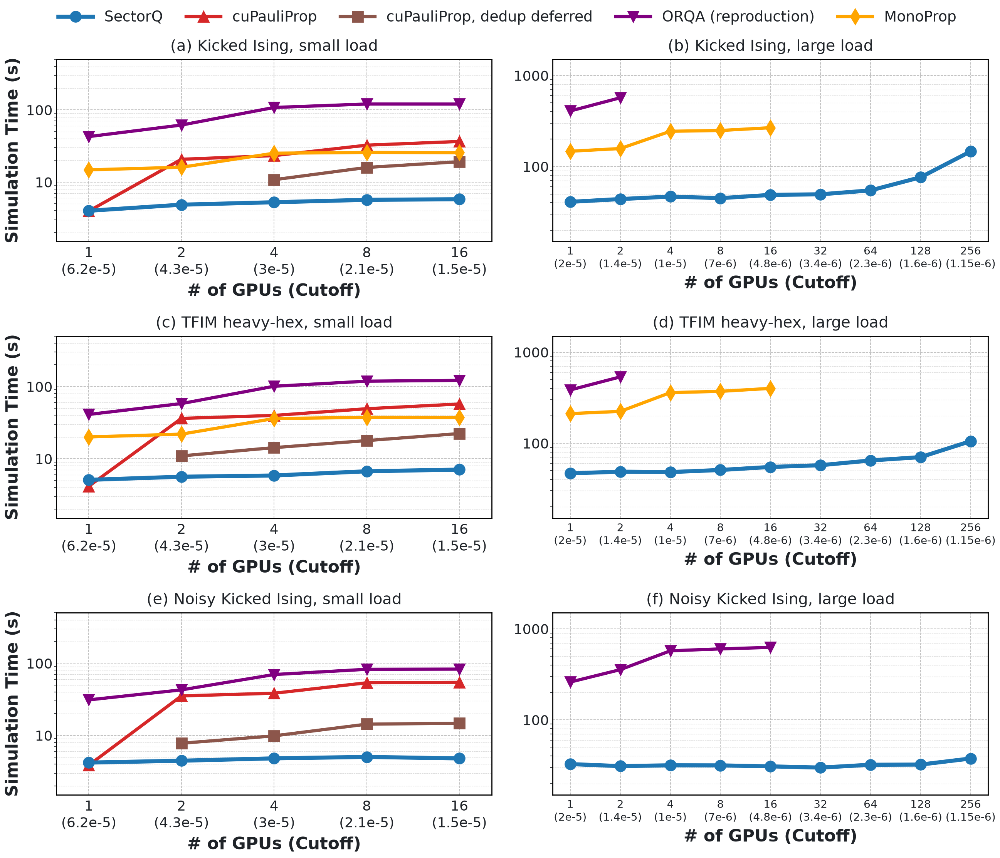</p>
<p align="center"><b>그림 20.</b> Weak scaling.</p>

**그림 설명.** 행 하나가 회로 하나이다. 왼쪽 열은 작은 부하(1–16 GPU, 모든 방식)이고 오른쪽 열은 큰 부하이다(SectorQ는 256 GPU까지, 4.4절). 가로축은 GPU 수이고 괄호는 그 GPU 수에서의 cutoff이다. GPU 수에 맞추어 cutoff를 낮추어 문제를 키웠다. 세로는 실행 시간이며 로그 축이다. 선이 평평할수록 좋다. 큰 부하에서 cuPauliProp의 두 분산 모드는 모든 GPU 수에서 메모리가 부족하여 선이 없다. 선은 그 구현이 끝낸 마지막 GPU 수에서 끝나며, 그다음 GPU 수의 문제는 끝내지 못하였다.

Pauli propagation은 문제 크기를 직접 정할 수 없으므로 cutoff를 낮추어 일의 양을 늘렸다. cutoff는 4 GPU의 값에 (G/4)^(−0.52)를 곱한 것이다(일의 양을 구간 경계의 항 수를 모든 구간에 대해 더한 값으로 잡으면 kicked Ising에서 cutoff 1e-5에서 3e-6으로 갈 때 10.0배가 되며, 지수 −0.52는 이 관계에서 얻었다). 부하는 둘이다. 작은 부하는 4 GPU에서 cutoff 3e-5이고 큰 부하는 4 GPU에서 cutoff 1e-5이다.

<!-- g:weak -->
**작은 부하 (4 GPU에서 cutoff 3e-5).** 값은 실행 시간이다. SectorQ의 괄호는 GPU 한 장이 1초에 처리한 항 수를 1 GPU와 비교한 것이다. CPU 구현은 1 GPU와 2 GPU 자리에서 16 코어와 32 코어를, 4 / 8 / 16 GPU 자리에서 1 / 2 / 4 노드를 쓴다.

| 실행 | 1 GPU | 2 GPU | 4 GPU | 8 GPU | 16 GPU |
|---|---:|---:|---:|---:|---:|
| cutoff | 6.2e-5 | 4.3e-5 | 3e-5 | 2.1e-5 | 1.5e-5 |
| **SectorQ**, Kicked Ising | 4.00초 (100%) | 4.86초 (82%) | 5.25초 (76%) | 5.67초 (70%) | 5.78초 (65%) |
| cuPauliProp 기본, Kicked Ising | 3.96초 | 20.7초 | 23.2초 | 32.5초 | 36.5초 |
| cuPauliProp dedup 미룸, Kicked Ising |  | 메모리 부족 | 10.8초 | 15.9초 | 19.1초 |
| ORQA (재현), Kicked Ising | 42.7초 | 61.7초 | 108초 | 121초 | 120초 |
| MonoProp, Kicked Ising | 14.8초 | 16.0초 | 25.1초 | 25.7초 | 25.6초 |
| **SectorQ**, TFIM heavy-hex | 5.10초 (100%) | 5.63초 (91%) | 5.86초 (87%) | 6.70초 (75%) | 7.07초 (68%) |
| cuPauliProp 기본, TFIM heavy-hex | 4.16초 | 36.2초 | 39.8초 | 49.3초 | 57.3초 |
| cuPauliProp dedup 미룸, TFIM heavy-hex |  | 10.9초 | 14.3초 | 17.8초 | 22.3초 |
| ORQA (재현), TFIM heavy-hex | 41.1초 | 58.1초 | 101초 | 119초 | 122초 |
| MonoProp, TFIM heavy-hex | 20.1초 | 21.9초 | 36.1초 | 37.4초 | 37.3초 |
| **SectorQ**, 잡음 있는 kicked Ising | 4.20초 (100%) | 4.46초 (91%) | 4.81초 (79%) | 5.04초 (73%) | 4.80초 (70%) |
| cuPauliProp 기본, 잡음 있는 kicked Ising | 3.87초 | 35.3초 | 38.4초 | 53.6초 | 54.4초 |
| cuPauliProp dedup 미룸, 잡음 있는 kicked Ising |  | 7.79초 | 9.86초 | 14.3초 | 14.7초 |
| ORQA (재현), 잡음 있는 kicked Ising | 31.1초 | 42.8초 | 69.8초 | 82.5초 | 83.0초 |

**큰 부하 (4 GPU에서 cutoff 1e-5).** 값은 실행 시간이다. SectorQ의 괄호는 GPU 한 장이 1초에 처리한 항 수를 1 GPU와 비교한 것이다. CPU 구현은 1 GPU와 2 GPU 자리에서 16 코어와 32 코어를, 4 / 8 / 16 GPU 자리에서 1 / 2 / 4 노드를 쓴다.

| 실행 | 1 GPU | 2 GPU | 4 GPU | 8 GPU | 16 GPU |
|---|---:|---:|---:|---:|---:|
| cutoff | 2e-5 | 1.4e-5 | 1e-5 | 7e-6 | 4.8e-6 |
| **SectorQ**, Kicked Ising | 40.9초 (100%) | 43.9초 (92%) | 46.7초 (82%) | 44.9초 (85%) | 48.8초 (80%) |
| cuPauliProp 기본, Kicked Ising | – | 메모리 부족 | 메모리 부족 | 메모리 부족 | 메모리 부족 |
| cuPauliProp dedup 미룸, Kicked Ising |  | 메모리 부족 | 메모리 부족 | 메모리 부족 | 메모리 부족 |
| ORQA (재현), Kicked Ising | 408초 | 569초 | 메모리 부족 | 메모리 부족 | 메모리 부족 |
| MonoProp, Kicked Ising | 147초 | 158초 | 244초 | 249초 | 267초 |
| **SectorQ**, TFIM heavy-hex | 46.6초 (100%) | 48.7초 (95%) | 48.2초 (91%) | 50.6초 (86%) | 54.8초 (82%) |
| cuPauliProp 기본, TFIM heavy-hex | – | 메모리 부족 | 메모리 부족 | 메모리 부족 | 메모리 부족 |
| cuPauliProp dedup 미룸, TFIM heavy-hex |  | 메모리 부족 | 메모리 부족 | 메모리 부족 | 메모리 부족 |
| ORQA (재현), TFIM heavy-hex | 385초 | 535초 | 메모리 부족 | 메모리 부족 | 메모리 부족 |
| MonoProp, TFIM heavy-hex | 211초 | 224초 | 359초 | 371초 | 400초 |
| **SectorQ**, 잡음 있는 kicked Ising | 32.7초 (100%) | 31.0초 (101%) | 31.7초 (91%) | 31.7초 (86%) | 30.9초 (88%) |
| cuPauliProp 기본, 잡음 있는 kicked Ising | – | 메모리 부족 | 메모리 부족 | 메모리 부족 | 메모리 부족 |
| cuPauliProp dedup 미룸, 잡음 있는 kicked Ising |  | 메모리 부족 | 메모리 부족 | 메모리 부족 | 메모리 부족 |
| ORQA (재현), 잡음 있는 kicked Ising | 260초 | 356초 | 574초 | 602초 | 626초 |
<!-- /g:weak -->

**결과와 이유.**

- **SectorQ의 시간은 GPU 수가 늘어도 거의 평평하다.** 큰 부하에서 1 GPU의 32.7–46.6초가 16 GPU에서 30.9–54.8초이다. GPU 한 장의 처리율은 1 GPU의 80–88%이다. 작은 부하에서는 4.0–5.1초가 4.8–7.1초가 되고 처리율은 65–70%이다. 실행이 짧아 연산마다의 고정 비용과 교환의 몫이 크기 때문이다.
- **cuPauliProp은 GPU를 늘릴수록 느려진다.** 작은 부하에서 기본 모드는 GPU 1장의 3.9–4.2초에서 16장의 36.5–57.3초가 된다. gate당 고정 비용이 GPU 수와 함께 커지기 때문이다(2.4절). 큰 부하의 cutoff는 어느 GPU 수에서도 끝내지 못한다. GPU당 약 1억 항의 한계에 걸린다.
- **CPU 분산 구현.** ORQA 재현은 SectorQ의 7.4–21배, MonoProp은 3.3–7.4배의 시간이 걸린다. 큰 부하의 kicked Ising과 TFIM은 ORQA 재현이 4 GPU 자리부터 메모리 부족이다.

#### Strong scaling

<p align="center">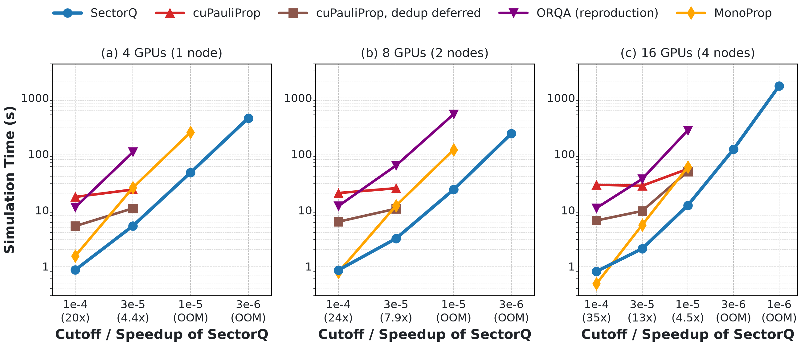</p>
<p align="center"><b>그림 21.</b> GPU 수를 고정하고 문제를 키웠을 때의 실행 시간(kicked Ising).</p>

**그림 설명.** 패널 하나가 GPU 수 하나이다(4, 8, 16 GPU). 가로축은 cutoff이고 세로는 실행 시간이며 로그 축이다. 가로축의 괄호는 같은 GPU에서 cuPauliProp 분산 모드(기본)의 시간이 SectorQ의 몇 배인지이고, OOM은 cuPauliProp이 메모리 부족으로 끝내지 못한 설정이다. 선은 그 구현이 끝낸 마지막 cutoff에서 끝난다.

대표 회로인 kicked Ising을 GPU 수마다 cutoff를 낮추어 가며 실행하였다.

<!-- g:strong_sota -->
**Kicked Ising, 4 GPU (1 노드).** 괄호는 SectorQ 대비이다.

| 구현 | 1e-4 | 3e-5 | 1e-5 | 5e-6 | 3e-6 | 2e-6 | 1e-6 |
|---|---:|---:|---:|---:|---:|---:|---:|
| **SectorQ** | 0.86초 | 5.25초 | 46.7초 | 166초 | 436초 | 1,074초 | 시간 초과 |
| cuPauliProp 분산 (기본) | 17.2초 (20배) | 23.2초 (4.4배) | 메모리 부족 | – | 메모리 부족 | – | – |
| cuPauliProp 분산 (dedup 미룸) | 5.20초 (6.0배) | 10.8초 (2.1배) | 메모리 부족 | – | 메모리 부족 | – | – |
| ORQA (재현) | 11.2초 (13배) | 108초 (21배) | 메모리 부족 | – | – | – | – |
| MonoProp | 1.53초 (1.8배) | 25.1초 (4.8배) | 244초 (5.2배) | 메모리 부족 | 메모리 부족 | – | – |

**Kicked Ising, 8 GPU (2 노드).** 괄호는 SectorQ 대비이다.

| 구현 | 1e-4 | 3e-5 | 1e-5 | 5e-6 | 3e-6 | 2e-6 | 1e-6 |
|---|---:|---:|---:|---:|---:|---:|---:|
| **SectorQ** | 0.85초 | 3.12초 | 23.2초 | 86.9초 | 232초 | 553초 | 메모리 부족 |
| cuPauliProp 분산 (기본) | 20.1초 (24배) | 24.6초 (7.9배) | 메모리 부족 | – | 메모리 부족 | – | – |
| cuPauliProp 분산 (dedup 미룸) | 6.21초 (7.3배) | 10.6초 (3.4배) | 메모리 부족 | – | 메모리 부족 | – | – |
| ORQA (재현) | 11.8초 (14배) | 62.2초 (20배) | 510초 (22배) | 메모리 부족 | 메모리 부족 | – | – |
| MonoProp | 0.78초 (0.9배) | 12.0초 (3.8배) | 119초 (5.1배) | 메모리 부족 | 메모리 부족 | – | – |

**Kicked Ising, 16 GPU (4 노드).** 괄호는 SectorQ 대비이다.

| 구현 | 1e-4 | 3e-5 | 1e-5 | 5e-6 | 3e-6 | 2e-6 | 1e-6 |
|---|---:|---:|---:|---:|---:|---:|---:|
| **SectorQ** | 0.81초 | 2.06초 | 12.2초 | 45.6초 | 121초 | 290초 | 1,518초 |
| cuPauliProp 분산 (기본) | 28.3초 (35배) | 27.2초 (13배) | 54.3초 (4.5배) | 메모리 부족 | 메모리 부족 | – | – |
| cuPauliProp 분산 (dedup 미룸) | 6.54초 (8.1배) | 9.66초 (4.7배) | 48.8초 (4.0배) | 메모리 부족 | 메모리 부족 | – | – |
| ORQA (재현) | 10.9초 (13배) | 35.9초 (17배) | 263초 (22배) | 메모리 부족 | 메모리 부족 | – | – |
| MonoProp | 0.49초 (0.6배) | 5.44초 (2.6배) | 58.7초 (4.8배) | 247초 (5.4배) | 메모리 부족 | – | – |
<!-- /g:strong_sota -->

**결과와 이유.**

- **모든 GPU 수에서 SectorQ가 가장 큰 문제까지 간다.** 16 GPU에서 cuPauliProp의 두 모드와 ORQA 재현은 cutoff 1e-5(1.6억 항), MonoProp은 5e-6(5.8억 항)이 끝이다. SectorQ는 1e-6(119억 항)까지 끝낸다.
- **GPU가 늘면 차이가 벌어진다.** cutoff 3e-5에서 cuPauliProp 기본 모드 대비 SectorQ의 배수는 4 GPU의 4.4배에서 16 GPU의 13배가 된다. cuPauliProp의 시간은 23.2초에서 27.2초로 늘고 SectorQ의 시간은 5.25초에서 2.06초로 준다. cuPauliProp은 GPU가 늘면 조율 비용이 커지고, SectorQ는 구간이 도는 동안 조율이 없어 GPU 수만큼 일을 나눈다.
- **MonoProp.** 4 노드에서 SectorQ(16 GPU)가 2.6–5.4배 빠르다. 1초 안에 끝나는 cutoff 1e-4에서는 MonoProp이 빠르다(0.49초 대 0.81초).

같은 문제를 GPU 수만 바꾸어 실행한 SectorQ의 시간이다. 괄호는 1 GPU 대비이다.

<!-- g:strong -->
| 문제 | 1 GPU | 2 GPU | 4 GPU | 8 GPU | 16 GPU |
|---|---:|---:|---:|---:|---:|
| Kicked Ising, cutoff 3e-6 (15억 항) | 1,741초 | 872초 (2.0배) | 436초 (4.0배) | 232초 (7.5배) | 121초 (14배) |
| TFIM heavy-hex, cutoff 3e-6 (26억 항) | 1,858초 | 931초 (2.0배) | 467초 (4.0배) | 247초 (7.5배) | 131초 (14배) |
| 잡음 있는 kicked Ising, cutoff 3e-6 (6.1억 항) | 1,074초 | 537초 (2.0배) | 272초 (4.0배) | 140초 (7.7배) | 72.2초 (15배) |
| Kicked Ising, cutoff 1e-5 (1.6억 항) | 168초 | 85.3초 (2.0배) | 46.7초 (3.6배) | 23.2초 (7.2배) | 12.2초 (14배) |
| TFIM heavy-hex, cutoff 1e-5 (2.5억 항) | 187초 | 94.6초 (2.0배) | 48.2초 (3.9배) | 26.4초 (7.1배) | 14.8초 (13배) |
| 잡음 있는 kicked Ising, cutoff 1e-5 (7,241만 항) | 116초 | 58.6초 (2.0배) | 31.7초 (3.7배) | 16.4초 (7.1배) | 9.14초 (13배) |
<!-- /g:strong -->

한 노드 안(1 → 4 GPU)에서는 3.6–4.0배, 두 노드(8 GPU)에서는 7.1–7.7배, 네 노드(16 GPU)에서는 13–15배 빨라진다. 한 노드 안에서는 노드 사이의 교환이 없고, 노드를 넘어 덜 줄어드는 몫은 구간 경계의 교환이다(4.6절). 32 GPU 이상은 4.4절에 있다. cuPauliProp의 두 모드는 cutoff 3e-6을 16 GPU로도 끝내지 못하고, cutoff 1e-5는 16 GPU에서만 끝낸다.

회로 7종에서 두 구현이 모두 끝낸 가장 큰 설정의 시간을 SectorQ의 시간으로 나눈 값이다. 괄호는 그 설정의 cutoff이다.

<!-- g:multi_mult -->
| 회로 | cuPauliProp 분산 기본 (8 GPU) | ORQA 재현 (2 노드) | MonoProp (2 노드) | cuPauliProp 분산 기본 (16 GPU) | cuPauliProp dedup 미룸 (16 GPU) | ORQA 재현 (4 노드) | MonoProp (4 노드) |
|---|---:|---:|---:|---:|---:|---:|---:|
| Kicked Ising | 5.3배 (2e-5) | 22배 (1e-5) | 5.1배 (1e-5) | 4.5배 (1e-5) | 4.0배 (1e-5) | 22배 (1e-5) | 5.4배 (5e-6) |
| TFIM heavy-hex | 7.9배 (2e-5) | 19배 (1e-5) | 6.8배 (1e-5) | 4.8배 (1e-5) | 3.8배 (1e-5) | 19배 (5e-6) | 7.2배 (5e-6) |
| 2D TFIM 11×11 | 11배 (3e-5) | 18배 (1e-5) | 5.8배 (1e-5) | 5.2배 (1e-5) | 5.1배 (3e-5) | 18배 (1e-5) | 5.4배 (1e-5) |
| XXZ 8×8 | 6.6배 (3e-5) | 44배 (3e-5) | 2.3배 (1e-5) | 9.7배 (3e-5) | 4.6배 (3e-5) | 39배 (3e-5) | 2.0배 (1e-5) |
| QAOA 100 qubit | 5.5배 (3e-5) | 68배 (1e-5) | 11배 (3e-5) | 4.2배 (1e-5) | 2.2배 (1e-5) | 87배 (3e-6) | 14배 (1e-5) |
| Ansatz 100 qubit | 12배 (1e-5) | 20배 (3e-6) | 3.1배 (1e-6) | 8.2배 (3e-6) | 6.7배 (1e-5) | 20배 (1e-6) | 3.5배 (3e-7) |
| 잡음 있는 kicked Ising | 4.6배 (1e-5) | 20배 (5e-6) |  | 7.0배 (1e-5) | 2.3배 (1e-5) | 20배 (5e-6) |  |
<!-- /g:multi_mult -->

16 GPU에서 SectorQ는 cuPauliProp 기본 모드보다 4.2–9.7배, dedup을 미룬 방식보다 2.2–6.7배, ORQA 재현보다 18–87배, MonoProp보다 2.0–14배 빠르다. 8 GPU에서는 각각 4.6–12배(기본 모드), 18–68배, 2.2–11배이다.

**같은 오차에서의 MonoProp.** MonoProp은 truncation 규칙이 달라 같은 cutoff의 값이 SectorQ와 다르다(kicked Ising cutoff 1e-5에서 0.2336 대 0.2286). 그래서 같은 오차에서도 시간을 비교하였다. 오차의 기준은 SectorQ가 끝낸 가장 작은 cutoff의 값이다(exact 값이 아니다). MonoProp이 끝낸 가장 작은 cutoff의 값이 이 기준과 다른 만큼을 오차로 두고, SectorQ의 sweep에서 그 오차에 해당하는 시간을 앞뒤 두 cutoff 사이의 로그 보간으로 구하였다.

<!-- g:same_error -->
| 회로 | MonoProp이 끝낸 가장 작은 cutoff | 그 값의 오차 | MonoProp (4 노드) | 같은 오차에서의 SectorQ (16 GPU) | 같은 오차에서 SectorQ 대비 | 같은 cutoff에서 SectorQ 대비 |
|---|---|---:|---:|---:|---:|---:|
| Kicked Ising | 5e-6 | 0.0514 | 247초 | 53.6초 | 4.6배 | 5.4배 |
| TFIM heavy-hex | 5e-6 | 0.0820 | 368초 | 36.3초 | 10배 | 7.2배 |
| 2D TFIM 11×11 | 1e-5 | 0.0463 | 66.5초 | 11.0초 | 6.1배 | 5.4배 |
| XXZ 8×8 | 1e-5 | 0.0343 | 38.0초 | 4.02초 | 9.4배 | 2.0배 |
| QAOA 100 qubit | 1e-5 | 0.0998 | 55.9초 | 3.59초 | 16배 | 14배 |
| Ansatz 100 qubit | 3e-7 | 0.0000 | 199초 | 36.3초 | 5.5배 | 3.5배 |
<!-- /g:same_error -->

같은 오차에서 SectorQ(16 GPU)는 MonoProp(4 노드)보다 4배 이상 빠르다. Ansatz는 값이 cutoff에 거의 의존하지 않아(오차 0.0002 이하) 이 비교의 뜻이 작다.

### 4.4 여러 회로, 회로 크기, scale-out

#### 여러 회로 (16 GPU)

**요지.** cuPauliProp 분산 모드가 16 GPU로 끝내는 가장 큰 설정에서 그 시간은 SectorQ의 4.2–9.7배이고, dedup을 미룬 방식은 2.2–4.6배이다. SectorQ는 회로 7종 모두에서 더 낮은 cutoff까지 간다.

<p align="center">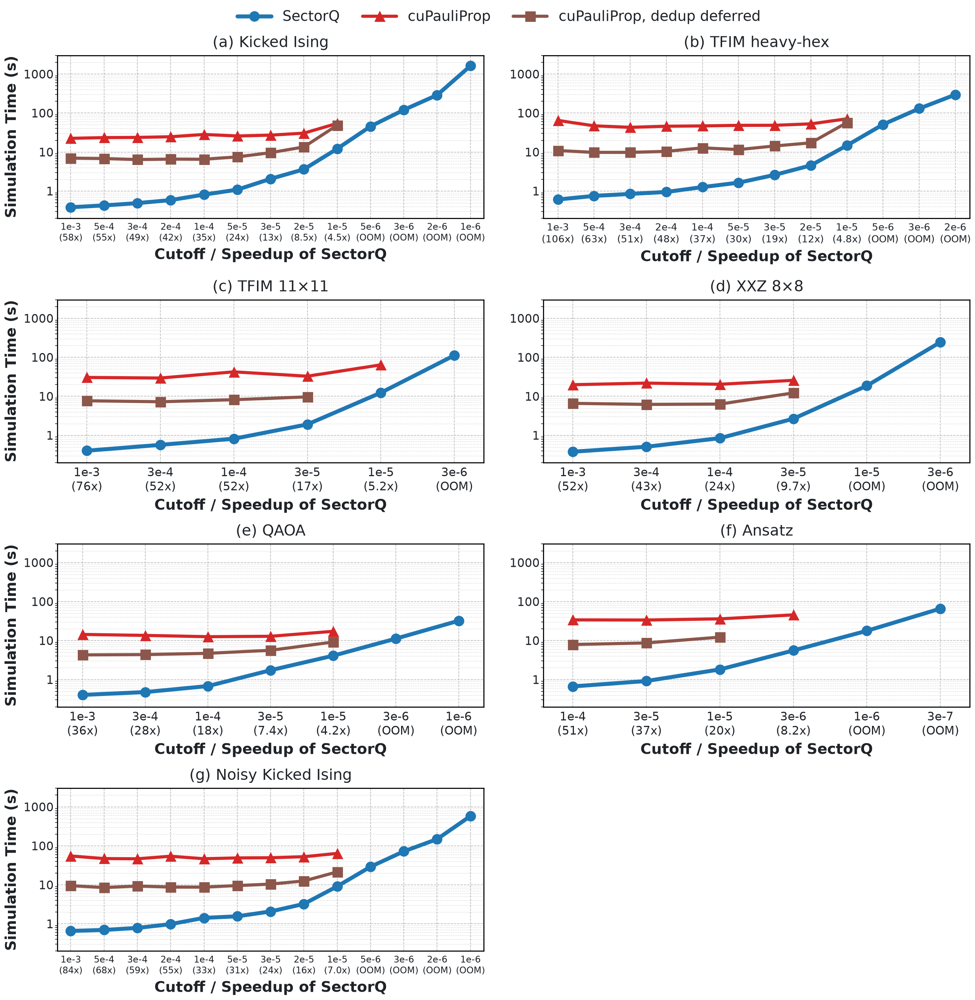</p>
<p align="center"><b>그림 22.</b> 16 GPU에서 회로 7종의 cutoff에 따른 실행 시간.</p>

**그림 설명.** 패널 하나가 회로 하나이다. 가로축은 cutoff이고 세로는 실행 시간이며 로그 축이다. 가로축의 괄호는 cuPauliProp 분산 모드(기본)의 시간이 SectorQ의 몇 배인지이고, OOM은 cuPauliProp이 메모리 부족으로 끝내지 못한 cutoff이다. 선은 그 구현이 끝낸 마지막 cutoff에서 끝난다. 작은 설정에서 cuPauliProp의 선이 평평한 것은 문제가 작아도 연산마다의 조율 비용이 남기 때문이다(4.6절).

회로 7종을 16 GPU에서 cuPauliProp 분산 모드의 두 가지와 비교하였다. 아래 표는 회로마다 두 크기를 고른 것이다. 하나는 cuPauliProp이 GPU 1장으로 끝내는 가장 큰 설정이고, 다른 하나는 cuPauliProp 분산 모드(기본)가 16 GPU로 끝내는 가장 큰 설정이다. 기준선이 끝낸 설정만 고르므로 기준선이 실패한 설정은 이 표에 들어 있지 않다.

<!-- g:speed -->
**cuPauliProp이 GPU 1장으로 끝내는 가장 큰 설정을 16 GPU에서 잰 것.**

| 회로 | cutoff | 구간 경계의 항 수 | 기대값 | SectorQ | cuPauliProp dedup 미룸 | cuPauliProp 기본 |
|---|---|---:|---|---:|---:|---:|
| Kicked Ising | 5e-5 | 809만 | 0.156516404552 | 1.09초 | 7.51초 (6.9배) | 25.9초 (24배) |
| TFIM heavy-hex | 5e-5 | 1,196만 | 0.357153916660 | 1.64초 | 11.6초 (7.1배) | 48.5초 (30배) |
| 2D TFIM 11×11 | 1e-4 | 322만 | 0.798821812544 | 0.82초 | 8.19초 (10배) | 42.4초 (52배) |
| XXZ 8×8 | 1e-4 | 374만 | 0.00558248729487 | 0.84초 | 6.31초 (7.5배) | 20.4초 (24배) |
| QAOA 100 qubit | 1e-4 | 1,442만 | 81.8841164502 | 0.68초 | 4.71초 (6.9배) | 12.6초 (18배) |
| Ansatz 100 qubit | 3e-5 | 1,217만 | −0.167107910599 | 0.92초 | 8.70초 (9.5배) | 33.7초 (37배) |
| 잡음 있는 kicked Ising | 5e-5 | 423만 | 0.152740721573 | 1.56초 | 9.58초 (6.1배) | 49.1초 (31배) |

**cuPauliProp 분산 모드가 16 GPU로 끝내는 가장 큰 설정.**

| 회로 | cutoff | 구간 경계의 항 수 | 기대값 | SectorQ | cuPauliProp dedup 미룸 | cuPauliProp 기본 |
|---|---|---:|---|---:|---:|---:|
| Kicked Ising | 1e-5 | 1.6억 | 0.228607441423 | 12.2초 | 48.8초 (4.0배) | 54.3초 (4.5배) |
| TFIM heavy-hex | 1e-5 | 2.5억 | 0.451392373925 | 14.8초 | 56.9초 (3.8배) | 71.3초 (4.8배) |
| 2D TFIM 11×11 | 1e-5 | 2.6억 | 0.824629850051 | 12.4초 | 메모리 부족 | 64.1초 (5.2배) |
| XXZ 8×8 | 3e-5 | 3,971만 | 0.0278118097169 | 2.66초 | 12.2초 (4.6배) | 25.7초 (9.7배) |
| QAOA 100 qubit | 1e-5 | 1.4억 | 82.2376757838 | 4.10초 | 9.18초 (2.2배) | 17.3초 (4.2배) |
| Ansatz 100 qubit | 3e-6 | 2.2억 | −0.165563817105 | 5.57초 | 메모리 부족 | 45.6초 (8.2배) |
| 잡음 있는 kicked Ising | 1e-5 | 7,241만 | 0.173318829841 | 9.14초 | 21.5초 (2.3배) | 63.9초 (7.0배) |
<!-- /g:speed -->

**결과와 이유.**

- **GPU 1장에 들어가는 크기.** SectorQ는 기본 모드의 18–52배, dedup을 미룬 방식의 6.1–10배 빠르다. 이 크기에서 분산 모드는 자신의 단일 GPU 실행(1.7–6.1초)보다 느리다. SectorQ는 16 GPU에서 0.68–1.64초이다.
- **16 GPU가 있어야 들어가는 크기.** SectorQ는 기본 모드의 4.2–9.7배, dedup을 미룬 방식의 2.2–4.6배 빠르다. dedup을 미룬 방식은 일곱 설정 가운데 둘에서 메모리가 부족하다. 미루는 동안 합쳐지지 않은 항을 들고 있어야 하기 때문이다.
- **그보다 큰 크기.** cuPauliProp의 두 모드는 16 GPU에서 이보다 낮은 cutoff를 끝내지 못한다. SectorQ는 회로 7종 모두에서 더 낮은 cutoff까지 간다(그림 22).

#### 회로 크기: qubit 수와 깊이

**요지.** cutoff를 고정하고 회로를 키웠다. 전체 자화의 1,024 qubit(cutoff 1e-3)을 SectorQ는 16 GPU로 90.7초에 끝내고, cuPauliProp 기본 모드의 시간은 그 4.0배이다. 60 step의 회로에서는 22배이다.

앞의 실험은 회로를 고정하고 cutoff로 문제 크기를 바꾸었다. 여기서는 cutoff를 고정하고 회로를 키운다. 실행당 제한은 20분이다.

**qubit 수.** L×L 정사각 격자의 TFIM(θ=0.2π, ZZ −0.3π, 10 step)을 L = 6, 8, 11, 16, 23, 32(36–1,024 qubit)로 키웠다. 관측량은 전체 자화, 곧 모든 자리의 Z의 합이다(`--obs-all 1`). 관측량의 항이 qubit 수만큼이므로 일의 양이 qubit 수를 따라 늘어난다. 3×3 격자에서 이 관측량의 값은 자리마다 따로 실행한 아홉 값의 합과 같다(7.20241697047).

<p align="center">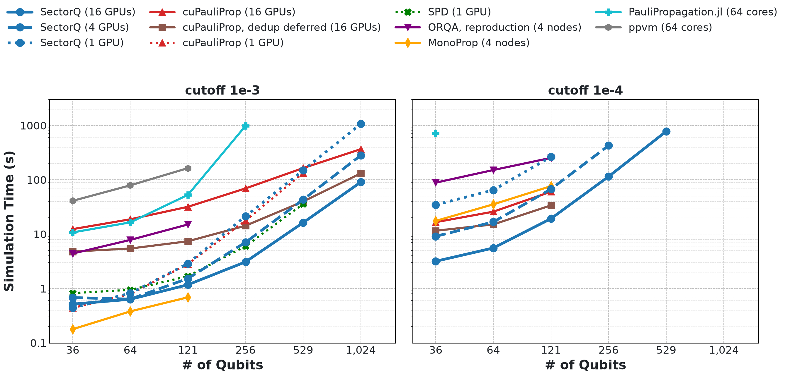</p>
<p align="center"><b>그림 23.</b> qubit 수에 따른 실행 시간(2D TFIM의 전체 자화, 10 step).</p>

**그림 설명.** 왼쪽은 cutoff 1e-3, 오른쪽은 cutoff 1e-4이다. 가로축은 qubit 수(36–1,024)이고 세로는 실행 시간이며 로그 축이다. 실선은 16 GPU 또는 4 노드, 파선은 4 GPU, 점선은 GPU 1장이다. 선은 그 구현이 끝낸 마지막 크기에서 끝난다(그다음 크기는 메모리 부족, 20분 초과, 또는 그 qubit 수를 받지 않음).

괄호는 같은 자원의 SectorQ 대비이다(16 GPU와 4 노드는 SectorQ 16 GPU, 4 GPU와 64 thread는 SectorQ 4 GPU, GPU 1장은 SectorQ GPU 1장).

<!-- g:qubits -->
**cutoff 1e-3.** 실행 시간이다.

| 구현 | 자원 | 36 qubit | 64 qubit | 121 qubit | 256 qubit | 529 qubit | 1,024 qubit |
|---|---|---:|---:|---:|---:|---:|---:|
| 자리당 자화 (합 / qubit 수) |  | 0.8038 | 0.7792 | 0.7570 | 0.7383 | 0.7251 | 0.7164 |
| **SectorQ** | 16 GPU | 0.52초 | 0.63초 | 1.17초 | 3.08초 | 16.3초 | 90.7초 |
| **SectorQ** | 4 GPU | 0.68초 | 0.64초 | 1.52초 | 7.07초 | 43.2초 | 281초 |
| **SectorQ** | GPU 1장 | 0.44초 | 0.81초 | 2.87초 | 21.3초 | 149초 | 1,071초 |
| cuPauliProp 분산 (기본) | 16 GPU | 12.4초 (24배) | 18.7초 (30배) | 31.8초 (27배) | 69.4초 (22배) | 164초 (10배) | 366초 (4.0배) |
| cuPauliProp 분산 (dedup 미룸) | 16 GPU | 4.78초 (9.3배) | 5.43초 (8.6배) | 7.39초 (6.3배) | 14.3초 (4.6배) | 39.9초 (2.4배) | 131초 (1.4배) |
| cuPauliProp 분산 (기본) | 4 GPU | 7.86초 (12배) | 12.6초 (20배) | 23.0초 (15배) | 51.3초 (7.3배) | 154초 (3.6배) | 555초 (2.0배) |
| cuPauliProp 분산 (dedup 미룸) | 4 GPU | 3.26초 (4.8배) | 3.95초 (6.2배) | 6.08초 (4.0배) | 14.0초 (2.0배) | 54.6초 (1.3배) | 356초 (1.3배) |
| cuPauliProp | GPU 1장 | 0.44초 (1.0배) | 0.79초 (1.0배) | 2.81초 (1.0배) | 17.7초 (0.8배) | 133초 (0.9배) | 메모리 부족 |
| SPD | GPU 1장 | 0.82초 (1.9배) | 0.94초 (1.2배) | 1.68초 (0.6배) | 5.99초 (0.3배) | 35.9초 (0.2배) | 메모리 부족 |
| ORQA (재현) | 4 노드 | 4.39초 (8.5배) | 7.83초 (12배) | 15.1초 (13배) | 지원 안 함 | – | – |
| MonoProp | 4 노드 | 0.18초 (0.3배) | 0.38초 (0.6배) | 0.69초 (0.6배) | 지원 안 함 | – | – |
| PauliPropagation.jl | 64 thread | 10.8초 (16배) | 16.4초 (26배) | 52.8초 (35배) | 981초 (139배) | 시간 초과 | – |
| ppvm | 64 thread | 41.0초 (60배) | 79.0초 (124배) | 164초 (107배) | 지원 안 함 | – | – |

**cutoff 1e-4.** 실행 시간이다.

| 구현 | 자원 | 36 qubit | 64 qubit | 121 qubit | 256 qubit | 529 qubit | 1,024 qubit |
|---|---|---:|---:|---:|---:|---:|---:|
| 자리당 자화 (합 / qubit 수) |  | 0.8607 | 0.8789 | 0.8902 | 0.8961 | 0.8985 |  |
| **SectorQ** | 16 GPU | 3.17초 | 5.55초 | 19.3초 | 114초 | 778초 | 시간 초과 |
| **SectorQ** | 4 GPU | 9.11초 | 16.8초 | 67.2초 | 426초 | 시간 초과 | – |
| **SectorQ** | GPU 1장 | 34.6초 | 64.6초 | 264초 | 시간 초과 | – | – |
| cuPauliProp 분산 (기본) | 16 GPU | 16.6초 (5.2배) | 25.9초 (4.7배) | 60.3초 (3.1배) | 메모리 부족 | – | – |
| cuPauliProp 분산 (dedup 미룸) | 16 GPU | 11.5초 (3.6배) | 15.1초 (2.7배) | 33.8초 (1.8배) | 메모리 부족 | – | – |
| cuPauliProp 분산 (기본) | 4 GPU | 20.1초 (2.2배) | 33.0초 (2.0배) | 메모리 부족 | – | – | – |
| cuPauliProp 분산 (dedup 미룸) | 4 GPU | 메모리 부족 | – | – | – | – | – |
| cuPauliProp | GPU 1장 | 메모리 부족 | – | – | – | – | – |
| SPD | GPU 1장 | 메모리 부족 | – | – | – | – | – |
| ORQA (재현) | 4 노드 | 88.5초 (28배) | 151초 (27배) | 253초 (13배) | 지원 안 함 | – | – |
| MonoProp | 4 노드 | 17.5초 (5.5배) | 35.3초 (6.4배) | 76.3초 (4.0배) | 지원 안 함 | – | – |
| PauliPropagation.jl | 64 thread | 719초 (79배) | 시간 초과 | – | – | – | – |
| ppvm | 64 thread | 시간 초과 | – | – | – | – | – |
<!-- /g:qubits -->

**결과와 이유.**

- **cutoff 1e-3.** SectorQ는 1,024 qubit을 16 GPU로 90.7초에 끝낸다. cuPauliProp 분산 모드는 기본이 366초(4.0배), dedup을 미룬 방식이 131초(1.4배)이다. GPU 1장만 쓰는 cuPauliProp과 SPD는 1,024 qubit에서 메모리가 부족하고, SectorQ는 GPU 1장으로도 1,071초에 끝낸다(1 → 16 GPU에서 12배).
- **cutoff 1e-4.** cuPauliProp의 두 분산 모드는 16 GPU에서 256 qubit부터 메모리가 부족하다. SectorQ는 16 GPU로 256 qubit을 115초, 529 qubit을 778초에 끝낸다(구간 경계에서 15억 항). 1,024 qubit은 20분 안에 끝나지 않았다. 모두가 끝낸 121 qubit에서 SectorQ는 cuPauliProp 기본의 3.1배, dedup을 미룬 방식의 1.8배, MonoProp(4 노드)의 4.0배, ORQA 재현(4 노드)의 13배 빠르다.
- **SectorQ가 느린 곳.** cutoff 1e-3의 36–121 qubit은 1초 안팎에 끝나는 크기이며 MonoProp이 더 빠르다(0.18–0.69초 대 0.52–1.17초). SPD는 GPU 1장으로 256 qubit과 529 qubit(cutoff 1e-3)을 SectorQ의 GPU 1장보다 3.6–4.2배 빠르게 끝내며(5.99초 대 21.3초, 35.9초 대 149초) SectorQ의 4 GPU(7.07초, 43.2초)보다도 조금 빠르다. SPD는 1,024 qubit과 cutoff 1e-4에서 메모리가 부족하다.
- **구현이 받는 qubit 수.** MonoProp, ORQA 재현, ppvm은 128 qubit까지 받는다. cuPauliProp 라이브러리는 1,024 qubit까지 받으며 1,056 qubit부터는 연산과 expansion을 만들지 않는다. SectorQ는 gate 적용에 이 라이브러리의 연산을 쓰므로 상한이 같다. SectorQ의 partition kernel은 8 word(256 qubit)의 항까지만 받도록 되어 있었으며, 이 실험을 위해 임의의 폭을 받도록 고쳤다(`src/proto/shuffle.cu`). 고치기 전에 529 qubit에서 멈춘 실행 6건은 다시 재었다.
- **답.** SectorQ, cuPauliProp, ORQA 재현의 값은 세 구현이 끝낸 모든 설정에서 12자리까지 같다.

**관측량이 한 자리일 때.** 같은 격자에서 관측량을 가운데 qubit의 Z 하나로 두면 10 step의 영향이 닿지 않는 자리는 계산에 들어오지 않는다. 그래서 256 qubit부터는 항 수가 늘지 않고 항의 폭(qubit 수에 비례하는 bit 수)만 커진다. 이 실험은 항의 폭에 따른 비용을 보여 준다.

<!-- g:qubits_site -->
**cutoff 1e-4.**

| 구현 | 자원 | 36 qubit | 64 qubit | 121 qubit | 256 qubit | 529 qubit | 1,024 qubit |
|---|---|---:|---:|---:|---:|---:|---:|
| **SectorQ** | 16 GPU | 1.13초 | 0.62초 | 0.82초 | 1.52초 | 3.34초 | 9.06초 |
| **SectorQ** | 4 GPU | 0.61초 | 0.61초 | 0.84초 | 1.81초 | 4.47초 | 12.2초 |
| **SectorQ** | GPU 1장 | 1.32초 | 1.00초 | 1.62초 | 3.86초 | 11.0초 | 34.2초 |
| cuPauliProp 분산 (기본) | 16 GPU | 11.3초 (10배) | 19.5초 (32배) | 42.4초 (52배) | 66.8초 (44배) | 162초 (49배) | 311초 (34배) |
| cuPauliProp 분산 (dedup 미룸) | 16 GPU | 4.55초 (4.0배) | 5.58초 (9.1배) | 8.19초 (10배) | 12.9초 (8.5배) | 28.8초 (8.6배) | 50.4초 (5.6배) |
| cuPauliProp 분산 (기본) | 4 GPU | 7.86초 (13배) | 14.2초 (23배) | 22.0초 (26배) | 46.1초 (25배) | 109초 (24배) | 253초 (21배) |
| cuPauliProp 분산 (dedup 미룸) | 4 GPU | 3.76초 (6.1배) | 4.16초 (6.8배) | 5.81초 (6.9배) | 10.6초 (5.8배) | 22.5초 (5.0배) | 46.7초 (3.8배) |
| cuPauliProp | GPU 1장 | 0.99초 (0.7배) | 0.97초 (1.0배) | 1.73초 (1.1배) | 3.82초 (1.0배) | 11.1초 (1.0배) | 34.1초 (1.0배) |
| SPD | GPU 1장 | 1.66초 (1.3배) | 1.16초 (1.2배) | 1.92초 (1.2배) | 5.00초 (1.3배) | 14.4초 (1.3배) | 73.6초 (2.2배) |
| ORQA (재현) | 4 노드 | 6.17초 (5.5배) | 8.00초 (13배) | 13.2초 (16배) | 지원 안 함 | – | – |
| MonoProp | 4 노드 | 0.45초 (0.4배) | 0.48초 (0.8배) | 0.53초 (0.7배) | 지원 안 함 | – | – |
| PauliPropagation.jl | 64 thread | 22.9초 (37배) | 22.6초 (37배) | 39.5초 (47배) | 88.2초 (49배) | 522초 (117배) | 시간 초과 |
| ppvm | 64 thread | 134초 (218배) | 117초 (191배) | 130초 (155배) | 지원 안 함 | – | – |

**cutoff 1e-5.**

| 구현 | 자원 | 36 qubit | 64 qubit | 121 qubit | 256 qubit | 529 qubit | 1,024 qubit |
|---|---|---:|---:|---:|---:|---:|---:|
| **SectorQ** | 16 GPU | 8.95초 | 7.96초 | 12.4초 | 27.5초 | 71.5초 | 208초 |
| **SectorQ** | 4 GPU | 29.6초 | 26.8초 | 42.9초 | 97.6초 | 260초 | 797초 |
| **SectorQ** | GPU 1장 | 112초 | 101초 | 164초 | 373초 | 1,002초 | 시간 초과 |
| cuPauliProp 분산 (기본) | 16 GPU | 메모리 부족 | – | 64.1초 (5.2배) | – | – | – |
| cuPauliProp 분산 (dedup 미룸) | 16 GPU | 메모리 부족 | – | 메모리 부족 | – | – | – |
| cuPauliProp 분산 (기본) | 4 GPU | 메모리 부족 | – | 메모리 부족 | – | – | – |
| cuPauliProp 분산 (dedup 미룸) | 4 GPU | 메모리 부족 | – | 메모리 부족 | – | – | – |
| cuPauliProp | GPU 1장 | 메모리 부족 | – | 메모리 부족 | – | – | – |
| SPD | GPU 1장 | 메모리 부족 | – | 메모리 부족 | – | – | – |
| ORQA (재현) | 4 노드 | 326초 (36배) | 257초 (32배) | 226초 (18배) | 지원 안 함 | – | – |
| MonoProp | 4 노드 | 62.3초 (7.0배) | 65.3초 (8.2배) | 66.5초 (5.4배) | 지원 안 함 | – | – |
<!-- /g:qubits_site -->

cutoff 1e-4의 1,024 qubit에서 SectorQ는 16 GPU로 9.06초이고 cuPauliProp 기본은 311초(34배), dedup을 미룬 방식은 50.4초(5.6배)이다. cutoff 1e-5는 SectorQ만 1,024 qubit까지 끝낸다(16 GPU로 208초, 4 GPU로 797초). cuPauliProp은 36 qubit에서 이미 메모리가 부족하다(121 qubit의 64.1초는 회로 7종 측정의 값이다).

**깊이.** kicked Ising(127 qubit, cutoff 3e-5)의 step 수를 4에서 60까지 늘렸다. step 수는 4의 배수로 두었다. 그래야 Clifford frame을 거친 연산 목록에 rotation만 남아 모든 구현이 같은 목록을 받는다.

<p align="center">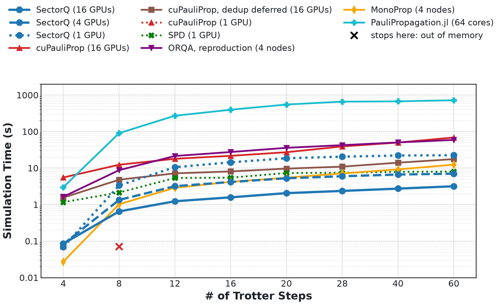</p>
<p align="center"><b>그림 24.</b> step 수에 따른 실행 시간(kicked Ising 127 qubit, cutoff 3e-5).</p>

**그림 설명.** 가로축은 Trotter step 수(4–60)이고 세로는 실행 시간이며 로그 축이다. 선의 종류는 그림 23과 같다. 선이 중간에서 끝난 구현은 그다음 깊이에서 메모리가 부족하다.

<!-- g:depth -->
| 구현 | 자원 | 4 step | 8 step | 12 step | 16 step | 20 step | 28 step | 40 step | 60 step |
|---|---|---:|---:|---:|---:|---:|---:|---:|---:|
| **SectorQ** | 16 GPU | 0.09초 | 0.65초 | 1.23초 | 1.58초 | 2.06초 | 2.37초 | 2.73초 | 3.18초 |
| **SectorQ** | 4 GPU | 0.08초 | 1.34초 | 3.19초 | 4.16초 | 5.25초 | 5.97초 | 6.65초 | 7.03초 |
| **SectorQ** | GPU 1장 | 0.07초 | 3.34초 | 10.6초 | 14.4초 | 18.6초 | 20.5초 | 22.1초 | 22.5초 |
| cuPauliProp 분산 (기본) | 16 GPU | 5.52초 (65배) | 12.3초 (19배) | 18.0초 (15배) | 21.7초 (14배) | 27.2초 (13배) | 39.1초 (17배) | 50.0초 (18배) | 68.8초 (22배) |
| cuPauliProp 분산 (dedup 미룸) | 16 GPU | 1.55초 (18배) | 4.80초 (7.4배) | 7.17초 (5.8배) | 8.08초 (5.1배) | 9.66초 (4.7배) | 11.0초 (4.6배) | 14.0초 (5.1배) | 17.6초 (5.5배) |
| cuPauliProp 분산 (기본) | 4 GPU | 4.95초 (60배) | 10.2초 (7.6배) | 14.7초 (4.6배) | 19.1초 (4.6배) | 23.2초 (4.4배) | 30.4초 (5.1배) | 39.3초 (5.9배) | 61.7초 (8.8배) |
| cuPauliProp 분산 (dedup 미룸) | 4 GPU | 2.57초 (31배) | 4.34초 (3.2배) | 메모리 부족 | – | 10.8초 (2.1배) | – | – | – |
| cuPauliProp | GPU 1장 | 0.07초 (1.0배) | 메모리 부족 | – | – | 메모리 부족 | – | – | – |
| SPD | GPU 1장 | 1.16초 (17배) | 2.14초 (0.6배) | 5.35초 (0.5배) | 5.46초 (0.4배) | 7.32초 (0.4배) | 7.46초 (0.4배) | 7.87초 (0.4배) | 8.04초 (0.4배) |
| ORQA (재현) | 4 노드 | 1.64초 (19배) | 8.76초 (13배) | 21.4초 (17배) | 27.5초 (17배) | 35.9초 (17배) | 42.4초 (18배) | 50.4초 (18배) | 59.0초 (19배) |
| MonoProp | 4 노드 | 0.03초 (0.3배) | 1.02초 (1.6배) | 2.88초 (2.3배) | 4.20초 (2.7배) | 5.44초 (2.6배) | 7.13초 (3.0배) | 9.19초 (3.4배) | 12.4초 (3.9배) |
| PauliPropagation.jl | 64 thread | 2.99초 (36배) | 90.4초 (67배) | 271초 (85배) | 396초 (95배) | 550초 (105배) | 660초 (111배) | 672초 (101배) | 720초 (102배) |
<!-- /g:depth -->

**결과와 이유.**

- 60 step에서 SectorQ는 16 GPU로 3.18초이다. cuPauliProp 기본의 22배, dedup을 미룬 방식의 5.5배, ORQA 재현(4 노드)의 19배, MonoProp(4 노드)의 3.9배 빠르다. cuPauliProp 단일 GPU는 8 step부터 메모리가 부족하다.
- 시간은 20 step 뒤로는 천천히 늘어난다(SectorQ 16 GPU: 20 step 2.06초, 60 step 3.18초). cutoff가 고정이어서 항 수가 계속 늘지 않기 때문이다. 60 step 실행에서 구간 경계의 항 수는 2,067만까지 늘었다가 1,045만, 347만, 114만으로 줄어든다.
- SPD는 GPU 1장으로 60 step을 8.04초에 끝낸다. SectorQ의 GPU 1장(22.5초)보다 2.8배 빠르고 4 GPU(7.03초)와 비슷하다.

#### Scale-out과 도달 범위

**요지.** GPU를 늘리면 같은 문제가 빨라지고 더 큰 문제까지 간다. SectorQ가 담는 항 수는 host memory가 정하므로, GPU 1장의 SectorQ가 16장의 cuPauliProp보다 9배 많은 항을 끝낸다. 16 GPU에서 SectorQ의 한계는 4 노드의 host memory이다.

<p align="center">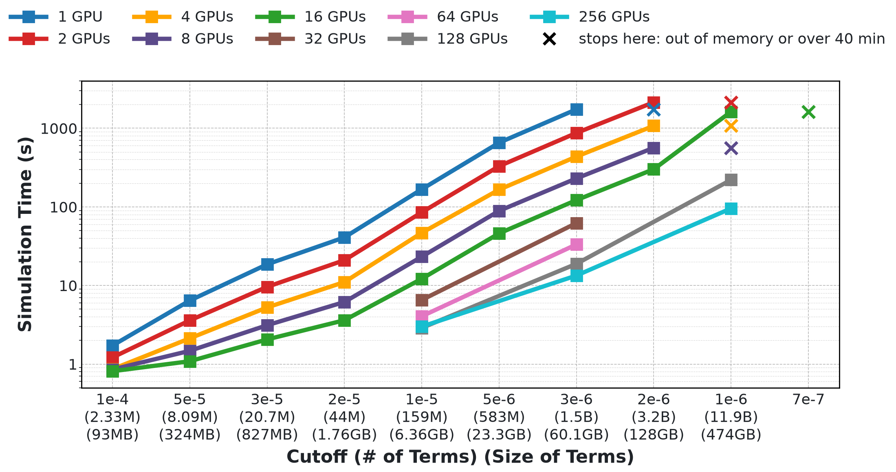</p>
<p align="center"><b>그림 25.</b> GPU 수에 따른 SectorQ의 실행 시간(kicked Ising, 1–512 GPU).</p>

**그림 설명.** 선 하나가 GPU 수 하나이다. 가로축은 cutoff이고, 괄호는 그림 19와 같이 구간 경계의 항 수이다. 세로는 실행 시간이며 로그 축이다. 같은 cutoff에서 아래에 있는 선일수록 빠르고, 오른쪽으로 긴 선일수록 큰 문제까지 간 것이다. 선은 그 GPU 수가 끝낸 마지막 cutoff에서 끝난다(그다음 cutoff는 40분 안에 끝내지 못했거나 메모리가 부족하다). 32 GPU 이상의 cutoff 1e-6 이하는 sector 수의 상한을 올린 실행이다(32 GPU와 64 GPU는 1,024개, 128 GPU 이상은 4,096개). 512 GPU의 선은 기본 설정으로 잰 두 점(1e-4, 1e-5)을 빼면 모두 상한을 올린 실행이다(3e-6은 4,096개, 나머지는 1,024개). 7e-7 아래는 16 GPU에 들어가지 않는 문제이며, 128 GPU와 256 GPU가 3e-7(구간 경계의 항 1,175억 개, 4.7 TB), 512 GPU가 2e-7(2,573억 개, 10.3 TB)까지 끝냈다.

세 회로를 1–16 GPU에서 세 방식으로 실행하였다. 괄호는 SectorQ 대비이다.

<!-- g:gpus -->
**Kicked Ising**

| cutoff (구간 경계의 항 수) | 방식 | 1 GPU | 2 GPU | 4 GPU | 8 GPU | 16 GPU |
|---|---|---:|---:|---:|---:|---:|
| 3e-5 (2,067만) | SectorQ | 18.6초 | 9.60초 | 5.25초 | 3.12초 | 2.06초 |
|  | cuPauliProp dedup 미룸 |  | 메모리 부족 | 10.8초 (2.1배) | 10.6초 (3.4배) | 9.66초 (4.7배) |
|  | cuPauliProp 기본 | 메모리 부족 | 메모리 부족 | 23.2초 (4.4배) | 24.6초 (7.9배) | 27.2초 (13배) |
| 1e-5 (1.6억) | SectorQ | 168초 | 85.3초 | 46.7초 | 23.2초 | 12.2초 |
|  | cuPauliProp dedup 미룸 |  | 메모리 부족 | 메모리 부족 | 메모리 부족 | 48.8초 (4.0배) |
|  | cuPauliProp 기본 | 메모리 부족 | 메모리 부족 | 메모리 부족 | 메모리 부족 | 54.3초 (4.5배) |
| 3e-6 (15억) | SectorQ | 1,741초 | 872초 | 436초 | 232초 | 121초 |
|  | cuPauliProp dedup 미룸 |  | 메모리 부족 | 메모리 부족 | 메모리 부족 | 메모리 부족 |
|  | cuPauliProp 기본 | 메모리 부족 | 메모리 부족 | 메모리 부족 | 메모리 부족 | 메모리 부족 |

**TFIM heavy-hex**

| cutoff (구간 경계의 항 수) | 방식 | 1 GPU | 2 GPU | 4 GPU | 8 GPU | 16 GPU |
|---|---|---:|---:|---:|---:|---:|
| 3e-5 (3,166만) | SectorQ | 21.1초 | 10.8초 | 5.86초 | 3.75초 | 2.60초 |
|  | cuPauliProp dedup 미룸 |  | 38.0초 (3.5배) | 14.3초 (2.4배) | 12.8초 (3.4배) | 14.3초 (5.5배) |
|  | cuPauliProp 기본 | 메모리 부족 | 메모리 부족 | 39.8초 (6.8배) | 42.5초 (11배) | 48.6초 (19배) |
| 1e-5 (2.5억) | SectorQ | 187초 | 94.6초 | 48.2초 | 26.4초 | 14.8초 |
|  | cuPauliProp dedup 미룸 |  | 메모리 부족 | 메모리 부족 | 메모리 부족 | 56.9초 (3.8배) |
|  | cuPauliProp 기본 | 메모리 부족 | 메모리 부족 | 메모리 부족 | 메모리 부족 | 71.3초 (4.8배) |
| 3e-6 (26억) | SectorQ | 1,858초 | 931초 | 467초 | 247초 | 131초 |
|  | cuPauliProp dedup 미룸 |  | – | – | – | – |
|  | cuPauliProp 기본 | – | – | – | – | – |

**잡음 있는 kicked Ising**

| cutoff (구간 경계의 항 수) | 방식 | 1 GPU | 2 GPU | 4 GPU | 8 GPU | 16 GPU |
|---|---|---:|---:|---:|---:|---:|
| 3e-5 (1,034만) | SectorQ | 16.1초 | 8.10초 | 4.81초 | 2.94초 | 2.08초 |
|  | cuPauliProp dedup 미룸 |  | 10.9초 (1.4배) | 9.86초 (2.1배) | 11.8초 (4.0배) | 10.4초 (5.0배) |
|  | cuPauliProp 기본 | 메모리 부족 | 40.0초 (4.9배) | 38.4초 (8.0배) | 51.5초 (18배) | 49.5초 (24배) |
| 1e-5 (7,241만) | SectorQ | 116초 | 58.6초 | 31.7초 | 16.4초 | 9.14초 |
|  | cuPauliProp dedup 미룸 |  | 메모리 부족 | 메모리 부족 | 54.8초 (3.3배) | 21.5초 (2.3배) |
|  | cuPauliProp 기본 | – | 메모리 부족 | 메모리 부족 | 75.1초 (4.6배) | 63.9초 (7.0배) |
| 3e-6 (6.1억) | SectorQ | 1,074초 | 537초 | 272초 | 140초 | 72.2초 |
|  | cuPauliProp dedup 미룸 |  | – | – | – | – |
|  | cuPauliProp 기본 | – | – | – | – | – |
<!-- /g:gpus -->

**결과와 이유.**

- **SectorQ는 GPU 1장부터 돈다.** 세 cutoff 모두 GPU 수와 무관하게 같은 기대값을 낸다.
- **cuPauliProp은 GPU를 늘려도 빨라지지 않는다.** kicked Ising cutoff 3e-5의 기본 모드는 4 / 8 / 16 GPU에서 23.2 / 24.6 / 27.2초이다. 같은 설정의 SectorQ는 4 GPU의 5.25초에서 16 GPU의 2.06초로 준다.
- **cuPauliProp은 문제가 커지면 GPU가 더 있어야 돈다.** kicked Ising cutoff 1e-5(1.6억 항)는 16장이 있어야 들어가고, 3e-6(15억 항)은 16장으로도 메모리가 부족하다. SectorQ는 둘 다 1장으로 끝낸다(168초, 1,741초).

**도달 범위.** 방식마다 40분 안에 끝낸 가장 작은 cutoff와 그 설정의 구간 경계 항 수이다.

<!-- g:reach -->
| 회로 | 방식 | 1 GPU | 2 GPU | 4 GPU | 8 GPU | 16 GPU |
|---|---|---:|---:|---:|---:|---:|
| Kicked Ising | SectorQ | 3e-6 (15억) | 2e-6 (32억) | 2e-6 (32억) | 2e-6 (32억) | 1e-6 (119억) |
|  | cuPauliProp 기본 | 5e-5 (809만) | 5e-5 (809만) | 3e-5 (2,067만) | 2e-5 (4,396만) | 1e-5 (1.6억) |
|  | cuPauliProp dedup 미룸 |  | 5e-5 (809만) | 3e-5 (2,067만) | 2e-5 (4,396만) | 1e-5 (1.6억) |
| TFIM heavy-hex | SectorQ | 3e-6 (26억) | 2e-6 (57억) | 2e-6 (57억) | 2e-6 (57억) | 1e-6 (213억) |
|  | cuPauliProp 기본 | 5e-5 (1,196만) | 5e-5 (1,196만) | 3e-5 (3,166만) | 2e-5 (6,796만) | 1e-5 (2.5억) |
|  | cuPauliProp dedup 미룸 |  | 3e-5 (3,166만) | 3e-5 (3,166만) | 2e-5 (6,796만) | 1e-5 (2.5억) |
| 2D TFIM 11×11 | SectorQ | 3e-6 (28억) | 3e-6 (28억) | 3e-6 (28억) | 3e-6 (28억) | 3e-6 (28억) |
|  | cuPauliProp 기본 | 1e-4 (322만) | 3e-5 (3,166만) | 3e-5 (3,166만) | 3e-5 (3,166만) | 1e-5 (2.6억) |
|  | cuPauliProp dedup 미룸 |  | 1e-4 (322만) | 3e-5 (3,166만) | 3e-5 (3,166만) | 3e-5 (3,166만) |
| XXZ 8×8 | SectorQ | 1e-5 (3.4억) | 3e-6 (34억) | 3e-6 (34억) | 3e-6 (34억) | 3e-6 (34억) |
|  | cuPauliProp 기본 | 1e-4 (374만) | 1e-4 (374만) | 3e-5 (3,971만) | 3e-5 (3,971만) | 3e-5 (3,971만) |
|  | cuPauliProp dedup 미룸 |  | 1e-4 (374만) | 1e-4 (374만) | 3e-5 (3,971만) | 3e-5 (3,971만) |
| QAOA 100 qubit | SectorQ | 1e-6 (11억) | 1e-6 (11억) | 1e-6 (11억) | 1e-6 (11억) | 1e-6 (11억) |
|  | cuPauliProp 기본 | 1e-4 (1,442만) | 1e-4 (1,442만) | 3e-5 (4,917만) | 3e-5 (4,917만) | 1e-5 (1.4억) |
|  | cuPauliProp dedup 미룸 |  | 1e-4 (1,442만) | 3e-5 (4,917만) | 3e-5 (4,917만) | 1e-5 (1.4억) |
| Ansatz 100 qubit | SectorQ | 3e-7 (33억) | 3e-7 (33억) | 3e-7 (33억) | 3e-7 (33억) | 3e-7 (33억) |
|  | cuPauliProp 기본 | 3e-5 (1,217만) | 3e-5 (1,217만) | 1e-5 (5,004만) | 1e-5 (5,004만) | 3e-6 (2.2억) |
|  | cuPauliProp dedup 미룸 |  | 1e-4 (217만) | 3e-5 (1,217만) | 3e-5 (1,217만) | 1e-5 (5,004만) |
| 잡음 있는 kicked Ising | SectorQ | 2e-6 (13억) | 2e-6 (13억) | 1e-6 (44억) | 1e-6 (44억) | 1e-6 (44억) |
|  | cuPauliProp 기본 | 5e-5 (423만) | 2e-5 (2,122만) | 2e-5 (2,122만) | 1e-5 (7,241만) | 1e-5 (7,241만) |
|  | cuPauliProp dedup 미룸 |  | 2e-5 (2,122만) | 2e-5 (2,122만) | 1e-5 (7,241만) | 1e-5 (7,241만) |
<!-- /g:reach -->

kicked Ising에서 SectorQ는 GPU 1장으로 15억 항(cutoff 3e-6)을 끝낸다. cuPauliProp 분산 모드는 16장으로 1.6억 항(cutoff 1e-5)이 한계이다. GPU 1장의 SectorQ가 16장의 cuPauliProp보다 9배 많은 항을 다룬다. cuPauliProp이 담는 항 수는 GPU memory가 정하고(GPU당 약 1억 항, 2.4절), SectorQ가 담는 항 수는 host memory가 정하기 때문이다(3.4절). 1–4 GPU에서 SectorQ의 한계를 정한 것은 메모리가 아니라 40분의 시간 제한이다.

16 GPU에서 SectorQ가 끝낸 가장 큰 설정은 다음과 같다.

<!-- g:largest -->
| 회로 | cutoff | 구간 경계의 항 수 | 구간 안 최대 항 수 | 시간 | host memory 합 | 가장 많이 쓴 노드 | 기대값 | cuPauliProp 분산이 끝낸 가장 작은 cutoff |
|---|---|---:|---:|---:|---:|---:|---|---:|
| Kicked Ising | 1e-6 | 119억 | 1,001억 | 1,518초 | 525 GiB | 134 GiB | 0.321737584935 | 1e-5 (1.6억) |
| TFIM heavy-hex | 1e-6 | 213억 | 996억 | 1,489초 | 851 GiB | 217 GiB | 0.558370220929 | 1e-5 (2.5억) |
| 2D TFIM 11×11 | 3e-6 | 28억 | 148억 | 112초 | 132 GiB | 33 GiB | 0.780394015937 | 1e-5 (2.6억) |
| XXZ 8×8 | 3e-6 | 34억 | 511억 | 245초 | 134 GiB | 34 GiB | 0.0652874042978 | 3e-5 (3,971만) |
| QAOA 100 qubit | 1e-6 | 11억 | 113억 | 30.0초 | 62 GiB | 16 GiB | 82.3256865097 | 1e-5 (1.4억) |
| Ansatz 100 qubit | 3e-7 | 33억 | 131억 | 57.1초 | 138 GiB | 34 GiB | −0.165047570010 | 3e-6 (2.2억) |
| 잡음 있는 kicked Ising | 1e-6 | 44억 | 391억 | 567초 | 220 GiB | 55 GiB | 0.215763665395 | 1e-5 (7,241만) |
<!-- /g:largest -->

kicked Ising cutoff 1e-6은 구간 경계에서 119억 항, 구간 안에서 최대 1,001억 항을 다룬다. 16 GPU(4 노드)로 1,518초가 걸렸고 host memory를 모두 합쳐 525 GiB를 썼다(가장 많이 쓴 노드 134 GiB, 노드의 DRAM은 256 GiB). 같은 cutoff의 TFIM heavy-hex(구간 경계에서 213억 항)는 1,489초에 끝났고 851 GiB를 썼다(가장 많이 쓴 노드 217 GiB). 16 GPU에서 SectorQ의 한계는 4 노드의 host memory이다. 그 아래 cutoff 7e-7의 kicked Ising(233억 항)은 노드 하나의 메모리가 부족해져 멈춘다.

**작은 문제에서의 GPU 수.** 문제가 작을수록 GPU를 늘려 얻는 것이 적다.

<p align="center">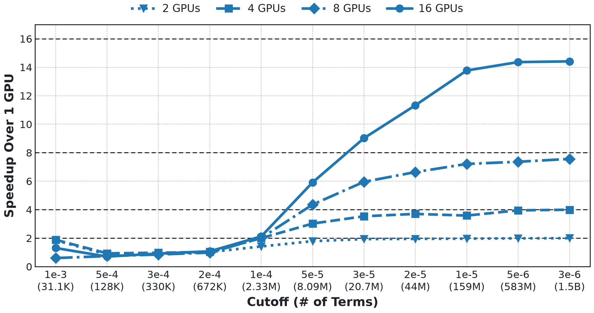</p>
<p align="center"><b>그림 26.</b> 문제 크기에 따른 GPU 수의 이득(kicked Ising, SectorQ).</p>

**그림 설명.** 세로는 같은 문제에서 GPU 1장의 SectorQ 시간을 2, 4, 8, 16 GPU의 시간으로 나눈 값이다. 가로축은 cutoff이고 괄호는 구간 경계의 항 수와 그 크기이다. 파선은 이상적인 값 2, 4, 8, 16이다. 항이 수백만 개인 왼쪽에서는 선들이 1–2 근처에 모여 있고, 1억 개를 넘는 오른쪽에서 파선에 가까워진다.

<!-- g:gain -->
| 회로 | cutoff | 구간 경계의 항 수 | 구간 안 최대 항 수 | GPU 1장 | 16 GPU | 1장 대비 |
|---|---|---:|---:|---:|---:|---:|
| Kicked Ising | 1e-3 | 3.1만 | 37만 | 0.50초 | 0.39초 | 1.3배 |
| Kicked Ising | 1e-4 | 233만 | 2,253만 | 1.72초 | 0.81초 | 2.1배 |
| Kicked Ising | 3e-5 | 2,067만 | 2.1억 | 18.6초 | 2.06초 | 9.0배 |
| Kicked Ising | 1e-5 | 1.6억 | 14억 | 168초 | 12.2초 | 14배 |
| Kicked Ising | 3e-6 | 15억 | 126억 | 1,741초 | 121초 | 14배 |
| TFIM heavy-hex | 1e-3 | 4.4만 | 31만 | 0.64초 | 0.61초 | 1.1배 |
| TFIM heavy-hex | 1e-4 | 316만 | 2,123만 | 1.95초 | 1.26초 | 1.5배 |
| TFIM heavy-hex | 3e-5 | 3,166만 | 1.8억 | 21.1초 | 2.60초 | 8.1배 |
| TFIM heavy-hex | 1e-5 | 2.5억 | 14억 | 187초 | 14.8초 | 13배 |
| TFIM heavy-hex | 3e-6 | 26억 | 126억 | 1,858초 | 131초 | 14배 |
| 잡음 있는 kicked Ising | 1e-3 | 2.2만 | 21만 | 0.56초 | 0.66초 | 0.8배 |
| 잡음 있는 kicked Ising | 1e-4 | 135만 | 1,371만 | 1.93초 | 1.42초 | 1.4배 |
| 잡음 있는 kicked Ising | 3e-5 | 1,034만 | 9,482만 | 16.1초 | 2.08초 | 7.7배 |
| 잡음 있는 kicked Ising | 1e-5 | 7,241만 | 5.2억 | 116초 | 9.14초 | 13배 |
| 잡음 있는 kicked Ising | 3e-6 | 6.1억 | 50억 | 1,074초 | 72.2초 | 15배 |
<!-- /g:gain -->

1억 항이 넘는 설정은 16 GPU에서 13–15배 빨라지고, 수백만 항의 설정은 1.4–2.1배에 그친다. sector를 나누어도 각 sector는 구간의 gate를 모두 적용해야 하고, 연산 하나에는 항 수와 무관한 고정 비용이 있다. 작은 설정은 이 고정 비용이 시간의 대부분이다. 또 항 수는 1에서 시작하므로 처음 구간들은 나눌 만큼의 항이 없다. 남는 바닥은 rotation 2,540개를 호출 하나씩으로 적용하는 시간(약 0.4초)이다(4.11절). 같은 작은 설정에서 cuPauliProp 분산 모드는 GPU를 늘릴수록 느려진다(kicked Ising cutoff 1e-4: 1 GPU 1.83초, 16 GPU 28.3초).

#### 32–512 GPU

**요지.** 큰 문제 세 가지는 256 GPU에서 GPU 1장의 79–130배 빨라지고, kicked Ising은 512 GPU에서 242배이다. cuPauliProp 기본 모드와의 차이는 GPU가 늘수록 벌어져 256 GPU에서 13–23배, 512 GPU에서 27배이다. GPU를 늘리면 더 큰 문제까지 간다. kicked Ising의 cutoff 사다리에서 16 GPU는 구간 경계의 항 119억 개(1e-6), 32 GPU는 233억 개(7e-7)가 끝이고 그다음 단계에서 host memory가 부족하다. 64 GPU는 443억 개(cutoff 5e-7), 128 GPU와 256 GPU는 1,175억 개(cutoff 3e-7), 512 GPU는 2,573억 개(cutoff 2e-7, 구간 안에서 최대 2조 4,574억 개)까지 끝냈다. cuPauliProp 기본 모드는 512 GPU에서 32억 개가 끝이다. 64 GPU와 128 GPU는 그 아래 단계(3e-7과 2e-7)가 host memory에 들어가지 않으며, 256, 512 GPU의 더 낮은 cutoff는 아직 재지 않았다.

32, 64, 128, 256 GPU(8–64 노드)에서 SectorQ와 cuPauliProp 분산 모드의 두 가지를 재었다(`jobs/e15_scaling.sh`, GPU 수마다 job 하나, 40 GB 노드에서 GPU당 36 GB). 512 GPU(128 노드)는 규모 캠페인의 job 하나에서 kicked Ising 회로의 SectorQ와 cuPauliProp 기본 모드를 재었다(`jobs/s_scale.sh`). 1–16 GPU의 값은 4.3절의 것이다.

<p align="center">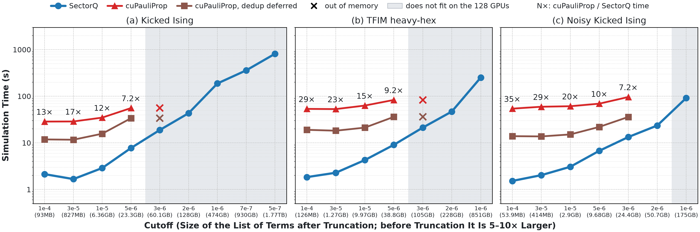</p>
<p align="center"><b>그림 27.</b> 128 GPU에서 세 회로의 cutoff에 따른 실행 시간.</p>

**그림 설명.** 패널 하나가 회로 하나이다. 가로축은 cutoff이고 괄호는 그 cutoff에서 구간 경계의 항 수이다. 세로는 실행 시간이며 로그 축이다. cuPauliProp 점 위의 숫자는 기본 모드의 시간이 SectorQ의 몇 배인지이다. 회색은 구간 안에서 가장 커졌을 때의 목록 전체가 GPU 128장에 들어가지 않는 cutoff이다. cuPauliProp은 목록 전체를 GPU에 두므로 그곳에서는 끝내지 못한다. 선은 그 구현이 끝낸 마지막 cutoff에서 끝난다. noise를 넣은 kicked Ising의 cuPauliProp은 cutoff 3e-6까지만 실행하였다.

<!-- g:large -->
**Strong scaling.** 같은 문제를 GPU 수만 바꾸어 실행한 SectorQ의 시간이다. 괄호는 1 GPU 대비이다.

| 문제 | 1 GPU | 4 GPU | 16 GPU | 32 GPU | 64 GPU | 128 GPU | 256 GPU | 512 GPU |
|---|---:|---:|---:|---:|---:|---:|---:|---:|
| Kicked Ising, cutoff 3e-6 (15억 항) | 1,741초 | 436초 (4.0배) | 121초 (14배) | 62.2초 (28배) | 33.2초 (52배) | 17.6초 (99배) | 13.4초 (130배) | 7.21초 (242배)† |
| TFIM heavy-hex, cutoff 5e-6 (9.7억 항) | 699초 | 180초 (3.9배) | 51.1초 (14배) | 28.2초 (25배) | 15.1초 (46배) | 9.04초 (77배) | 6.21초 (113배) |  |
| 잡음 있는 kicked Ising, cutoff 5e-6 (2.4억 항) | 418초 | 110초 (3.8배) | 29.1초 (14배) | 15.6초 (27배) | 9.28초 (45배) | 6.80초 (61배) | 5.30초 (79배) |  |
| Kicked Ising, cutoff 1e-5 (1.6억 항) | 168초 | 46.7초 (3.6배) | 12.2초 (14배) | 6.54초 (26배) | 4.06초 (41배) | 3.07초 (55배) | 3.00초 (56배) | 2.91초 (58배) |
| TFIM heavy-hex, cutoff 1e-5 (2.5억 항) | 187초 | 48.2초 (3.9배) | 14.8초 (13배) | 8.78초 (21배) | 5.61초 (33배) | 4.35초 (43배) | 3.82초 (49배) |  |
| 잡음 있는 kicked Ising, cutoff 1e-5 (7,241만 항) | 116초 | 31.7초 (3.7배) | 9.14초 (13배) | 5.08초 (23배) | 3.45초 (34배) | 3.11초 (37배) | 3.43초 (34배) |  |

**Weak scaling (큰 부하).** GPU 수에 맞추어 cutoff를 낮춘 SectorQ의 실행 시간이다. 괄호는 GPU 한 장이 1초에 처리한 항 수를 1 GPU와 비교한 것이다.

| 회로 | 1 GPU | 4 GPU | 16 GPU | 32 GPU | 64 GPU | 128 GPU | 256 GPU | 512 GPU |
|---|---:|---:|---:|---:|---:|---:|---:|---:|
| cutoff | 2e-5 | 1e-5 | 4.8e-6 | 3.4e-6 | 2.3e-6 | 1.6e-6 | 1.15e-6 | 8e-7 |
| Kicked Ising | 40.9초 (100%) | 46.7초 (82%) | 48.8초 (80%) | 49.5초 (76%) | 54.6초 (73%) | 76.2초 (53%) | 147초 (26%) |  |
| TFIM heavy-hex | 46.6초 (100%) | 48.2초 (91%) | 54.8초 (82%) | 57.3초 (76%) | 64.6초 (72%) | 70.3초 (66%) | 105초 (42%) |  |
| 잡음 있는 kicked Ising | 32.7초 (100%) | 31.7초 (91%) | 30.9초 (88%) | 29.9초 (85%) | 32.1초 (80%) | 32.3초 (77%) | 37.6초 (60%) |  |

**cuPauliProp 분산 모드와의 비교 (cutoff 1e-5, 같은 노드).** 괄호는 SectorQ 대비이다.

| 회로 | GPU 수 | SectorQ | cuPauliProp dedup 미룸 | cuPauliProp 기본 |
|---|---:|---:|---:|---:|
| Kicked Ising | 16 | 12.2초 | 48.8초 (4.0배) | 54.3초 (4.5배) |
|  | 32 | 6.54초 | 25.8초 (3.9배) | 47.8초 (7.3배) |
|  | 64 | 4.06초 | 18.7초 (4.6배) | 46.7초 (12배) |
|  | 128 | 3.07초 | 15.7초 (5.1배) | 34.8초 (11배) |
|  | 256 | 3.00초 | 12.0초 (4.0배) | 39.1초 (13배) |
|  | 512 | 2.91초 |  | 78.2초 (27배) |
| TFIM heavy-hex | 16 | 14.8초 | 56.9초 (3.8배) | 71.3초 (4.8배) |
|  | 32 | 8.78초 | 27.8초 (3.2배) | 69.6초 (7.9배) |
|  | 64 | 5.61초 | 24.2초 (4.3배) | 86.8초 (15배) |
|  | 128 | 4.35초 | 21.2초 (4.9배) | 63.0초 (14배) |
|  | 256 | 3.82초 | 18.2초 (4.8배) | 72.8초 (19배) |
| 잡음 있는 kicked Ising | 16 | 9.14초 | 21.5초 (2.3배) | 63.9초 (7.0배) |
|  | 32 | 5.08초 | 17.7초 (3.5배) | 71.9초 (14배) |
|  | 64 | 3.45초 | 15.9초 (4.6배) | 86.7초 (25배) |
|  | 128 | 3.11초 | 15.2초 (4.9배) | 61.0초 (20배) |
|  | 256 | 3.43초 | 15.1초 (4.4배) | 77.9초 (23배) |

**cuPauliProp 기본 모드가 끝낸 가장 큰 문제에서의 비교 (같은 노드).** GPU 수마다 기본 모드가 끝낸 가장 작은 cutoff에서 세 방식의 시간이다. 괄호는 SectorQ 대비이다. 마지막 열은 기본 모드가 그 아래 cutoff에서 어떻게 되었는지이다.

| 회로 | GPU 수 | cutoff (구간 경계의 항 수) | SectorQ | cuPauliProp dedup 미룸 | cuPauliProp 기본 | 기본 모드의 그 아래 cutoff |
|---|---:|---|---:|---:|---:|---|
| Kicked Ising | 32 | 1e-5 (1.6억) | 6.54초 | 25.8초 (3.9배) | 47.8초 (7.3배) | 5e-6: 메모리 부족 |
|  | 64 | 5e-6 (5.8억) | 12.6초 | 메모리 부족 | 73.4초 (5.8배) | 3e-6: 메모리 부족 |
|  | 128 | 5e-6 (5.8억) | 7.59초 | 33.7초 (4.4배) | 55.7초 (7.3배) | 3e-6: 메모리 부족 |
|  | 256 | 3e-6 (15억) | 13.4초 | 메모리 부족 | 78.4초 (5.9배) | 2e-6: 메모리 부족 |
|  | 512 | 2e-6 (32억) | 16.5초† |  | 132초 (8.0배) | 1e-6: 메모리 부족 |
| TFIM heavy-hex | 32 | 1e-5 (2.5억) | 8.78초 | 27.8초 (3.2배) | 69.6초 (7.9배) | 5e-6: 메모리 부족 |
|  | 64 | 1e-5 (2.5억) | 5.61초 | 24.2초 (4.3배) | 86.8초 (15배) | 5e-6: 아직 돌지 않음 |
|  | 128 | 5e-6 (9.7억) | 9.04초 | 36.0초 (4.0배) | 83.1초 (9.2배) | 3e-6: 메모리 부족 |
|  | 256 | 3e-6 (26억) | 11.4초 | 45.5초 (4.0배) | 117초 (10배) | 목록에 없음 |
| 잡음 있는 kicked Ising | 32 | 5e-6 (2.4억) | 15.6초 | 메모리 부족 | 91.1초 (5.8배) | 3e-6: 메모리 부족 |
|  | 64 | 1e-5 (7,241만) | 3.45초 | 15.9초 (4.6배) | 86.7초 (25배) | 5e-6: 아직 돌지 않음 |
|  | 128 | 3e-6 (6.1억) | 13.3초 | 35.9초 (2.7배) | 96.1초 (7.2배) | 목록에 없음 |
|  | 256 | 3e-6 (6.1억) | 8.74초 | 26.0초 (3.0배) | 93.9초 (11배) | 목록에 없음 |

† 512 GPU에서 기본 설정으로 재지 않은 문제는 sector 수의 상한을 올린 실행의 값이다(상한 4,096개와 chunk 65,536항, 없으면 상한 1,024개).
<!-- /g:large -->

<p align="center">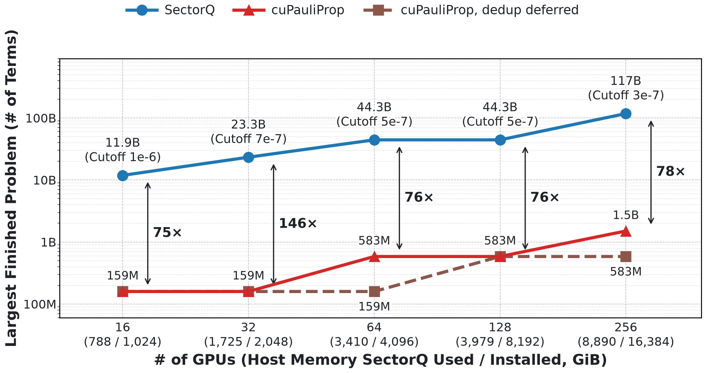</p>
<p align="center"><b>그림 28.</b> GPU 수별로 끝낸 가장 큰 문제(kicked Ising, 16–512 GPU).</p>

**그림 설명.** 가로축은 GPU 수이고 괄호는 SectorQ가 쓴 host memory와 설치된 양(GiB)이다. 세로는 각 방식이 끝낸 가장 큰 문제의 구간 경계 항 수이며 로그 축이다. 128 GPU의 SectorQ 실행(cutoff 3e-7)은 2,504초(41.7분)가 걸렸고, 나머지 실행은 모두 40분 안에 끝났다. 화살표의 배수는 SectorQ가 끝낸 항 수를 cuPauliProp 기본 모드가 끝낸 항 수로 나눈 값이다(두 측정값으로 계산한 값).

**GPU 수별 도달 범위 (kicked Ising).** GPU 수마다 SectorQ가 끝낸 가장 큰 문제와 그때 쓴 host memory, 그리고 cuPauliProp의 두 모드가 끝낸 가장 큰 문제이다. "그다음"은 그 아래 cutoff에서 일어난 일이다.

<!-- g:reach_big -->
| GPU 수 | host memory | SectorQ가 끝낸 가장 작은 cutoff | 구간 경계의 항 수 (크기) | 구간 안 최대 항 수 | 시간 | 쓴 host memory | 그다음 cutoff | cuPauliProp 기본이 끝낸 가장 작은 cutoff와 그다음 | dedup을 미룬 방식이 끝낸 가장 작은 cutoff와 그다음 |
|---:|---:|---|---:|---:|---:|---:|---|---|---|
| 16 | 1,024 GiB | 1e-6 | 119억 (474GB) | 1,001억 | 1,518초 | 525 GiB (51%) | 7e-7: 메모리 부족 | 1e-5 (1.6억). 5e-6: 메모리 부족 | 1e-5 (1.6억). 5e-6: 메모리 부족 |
| 32 | 2,048 GiB | 7e-7 | 233억 (930GB) | 2,023억 | 1,549초 | 1,725 GiB (84%) | 5e-7: 메모리 부족 | 1e-5 (1.6억). 5e-6: 메모리 부족 | 1e-5 (1.6억). 5e-6: 메모리 부족 |
| 64 | 4,096 GiB | 5e-7 | 443억 (1.77TB) | 3,943억 | 1,704초 | 3,410 GiB (83%) | 3e-7: host memory에 들어가지 않음(계산) | 5e-6 (5.8억). 3e-6: 메모리 부족 | 1e-5 (1.6억). 5e-6: 메모리 부족 |
| 128 | 8,192 GiB | 3e-7 | 1,175억 (4.7TB) | 10,919억 | 2,504초 | 5,204 GiB (64%) | 2e-7: host memory에 들어가지 않음(계산) | 5e-6 (5.8억). 3e-6: 메모리 부족 | 5e-6 (5.8억). 3e-6: 메모리 부족 |
| 256 | 16,384 GiB | 3e-7 | 1,175억 (4.7TB) | 10,919억 | 1,318초 | 8,890 GiB (54%) | 2e-7: 아직 돌지 않음 | 3e-6 (15억). 2e-6: 메모리 부족 | 5e-6 (5.8억). 3e-6: 메모리 부족 |
| 512 | 32,768 GiB | 2e-7 | 2,573억 (10.3TB) | 24,574억 | 1,716초 | 20,400 GiB (62%) | 1.5e-7: 아직 돌지 않음 | 2e-6 (32억). 1e-6: 메모리 부족 |  |
<!-- /g:reach_big -->

**결과와 이유.**

- **Strong scaling.** 큰 문제 세 가지는 1 GPU에서 64 GPU로 45–52배, 128 GPU로 61–99배, 256 GPU로 79–130배 빨라진다(kicked Ising cutoff 3e-6: 1,741초 → 33.2초 → 17.6초 → 13.4초). 512 GPU에서는 kicked Ising cutoff 3e-6이 7.21초로 242배가 된다(sector 상한 4,096개). 작은 문제(cutoff 1e-5)는 128 GPU의 37–55배에서 멈추고 256 GPU에서 더 줄지 않는다(3.0–3.8초). kicked Ising은 128 / 256 / 512 GPU에서 3.07 / 3.00 / 2.91초이다. 256 GPU에서는 구간 경계의 항이 GPU당 62만 개(1.59억 / 256)로 줄어, 위의 작은 문제와 같은 상태가 된다.
- **Weak scaling.** 일의 양을 GPU 수만큼 늘린 실행에서 GPU 한 장의 처리율은 64 GPU에서 1 GPU의 72–80%, 128 GPU에서 53–77%, 256 GPU에서 26–60%이다(그림 20의 오른쪽 열). kicked Ising이 128 GPU에서 53%, 256 GPU에서 26%로 떨어지는 것은 구간당 sector 수의 상한 때문이다. 기본값 256개로는 sector가 GPU 버퍼에 들어가지 않아 다시 나뉜다(128 GPU에서 3,146번). 상한을 1,024개로 올리면(`--gmax 10`) 128 GPU는 76.2초가 61.7초(65%)가 되고 256 GPU는 147초가 76.5초(50%)가 된다.
- **128 GPU의 세 회로(그림 27).** 기본 모드의 시간은 그림의 모든 점에서 SectorQ의 7.2–42배이고 dedup을 미룬 방식은 2.7–11배이다. 기본 모드가 끝낸 가장 큰 설정(kicked Ising과 TFIM의 cutoff 5e-6, noise를 넣은 kicked Ising의 3e-6)에서는 7.2–9.2배와 2.7–4.4배이다. 그 아래에서 SectorQ는 kicked Ising을 cutoff 3e-7(1,175억 항)까지, TFIM과 noise를 넣은 kicked Ising을 1e-6(213억 항, 43.7억 항)까지 끝낸다.
- **cuPauliProp과의 차이는 GPU가 늘수록 벌어진다.** cutoff 1e-5에서 기본 모드 대비 SectorQ의 배수는 16 GPU의 4.5–7.0배에서 32 GPU의 7.3–14배, 64 GPU의 12–25배, 128 GPU의 11–20배, 256 GPU의 13–23배가 된다. 512 GPU의 kicked Ising에서는 27배이다(78.2초 대 2.91초). 기본 모드의 시간은 GPU를 늘려도 조금만 줄어들고 512 GPU에서는 늘어난다(kicked Ising, 16–512 GPU: 54.3 / 47.8 / 46.7 / 34.8 / 39.1 / 78.2초). dedup을 미룬 방식과의 차이는 32–256 GPU에서 3.2–5.1배이다.
- **cuPauliProp은 kicked Ising cutoff 3e-6을 64 GPU와 128 GPU로도 끝내지 못한다.** 64 GPU에서는 938번째 연산에서 GPU당 9,522만 항으로, 128 GPU에서는 1,084번째 연산에서 GPU당 9,832만 항으로 메모리가 부족해진다. 256 GPU에서는 기본 모드가 이 문제를 78.4초에 끝낸다. SectorQ는 같은 문제를 64 GPU로 33.2초, 128 GPU로 17.6초, 256 GPU로 13.4초에 끝내고(256 GPU에서 기본 모드의 시간은 SectorQ의 5.9배이다) GPU 1장으로도 1,741초에 끝낸다. 512 GPU에서는 기본 모드가 110초, SectorQ가 7.21초로 15배이다.
- **같은 큰 문제의 시간.** kicked Ising cutoff 1e-6(구간 경계에서 119억 항, 구간 안에서 최대 1,001억 항)은 16 GPU로 1,518초, 32 GPU로 586초, 64 GPU로 305초, 128 GPU로 174초, 256 GPU로 93.3초, 512 GPU로 49.1초이다(sector 상한은 32 GPU와 64 GPU에서 1,024개, 128 GPU 이상에서 4,096개). 그 아래의 cutoff 7e-7은 32 / 64 / 128 / 256 / 512 GPU로 1,549 / 753 / 317 / 189 / 93.5초이고, 5e-7은 64 / 128 / 256 / 512 GPU로 1,704 / 634 / 355 / 259초, 3e-7은 128 / 256 / 512 GPU로 2,504 / 1,318 / 712초이다. 이 세 문제에서는 GPU 수가 두 배가 될 때마다 시간이 1.7–2.7배 줄어들며, 5e-7의 256 GPU에서 512 GPU만 1.4배이다.
- **GPU를 늘리면 더 큰 문제까지 간다.** 16 GPU는 cutoff 1e-6(구간 경계의 항 119억)이 끝이고 7e-7에서 host memory가 부족하다. 32 GPU는 7e-7(233억 항, 구간 안에서 최대 2,023억 항)을 1,549초에 끝내고 5e-7에서 host memory가 부족하다. 64 GPU는 5e-7(443억 항, 구간 안에서 최대 3,943억 항)을 1,704초에, 128 GPU는 같은 문제를 634초에 끝낸다. 128 GPU는 3e-7(1,175억 항, 4.7 TB. 구간 안에서 최대 1조 919억 항)을 2,504초에, 256 GPU는 같은 문제를 1,318초에 끝낸다. 128 GPU의 이 실행만 40분을 넘는다(41.7분). 한계까지 cutoff를 낮추는 SectorQ 실행에는 2시간의 제한을 두었고, 나머지는 모두 40분 안에 끝났다. cuPauliProp의 실행은 제한이 40분이며, 시간 제한에 걸린 것은 없고 모두 메모리 부족으로 끝났다. 128 GPU에서 그다음 cutoff인 2e-7은 구간 경계의 항만 9,585 GiB여서(512 GPU에서 잰 2,573억 항으로 계산한 값) host memory 8,192 GiB에 들어가지 않는다. 이 사다리에서 128 GPU의 한계는 3e-7이다. 64 GPU도 그다음 cutoff인 3e-7의 항(4,376 GiB)이 host memory 4,096 GiB에 들어가지 않는다. 512 GPU는 2e-7(2,573억 항, 10.3 TB. 구간 안에서 최대 2조 4,574억 항)을 1,716초에 끝낸다. host memory가 찰 때까지 잰 16, 32, 64 GPU에서 끝낸 항 수는 119억, 233억, 443억으로, 노드가 두 배가 될 때마다 약 두 배가 된다. SectorQ가 담는 항 수를 host memory가 정하기 때문이다(3.4절).
- **host memory의 사용량.** kicked Ising에서 16 GPU의 cutoff 1e-6은 1,024 GiB 가운데 525 GiB(51%)를 쓰고 그다음 cutoff인 7e-7은 메모리가 부족하다. 32 GPU가 2,048 GiB 가운데 1,725 GiB(84%), 64 GPU가 4,096 GiB 가운데 3,410 GiB(83%)를 썼다. 128 GPU의 cutoff 3e-7은 64%(8,192 GiB 가운데 5,204 GiB), 256 GPU의 3e-7은 54%, 512 GPU의 2e-7은 62%(32,768 GiB 가운데 20,400 GiB)를 쓴다. 128 GPU는 그다음 단계(2e-7)가 들어가지 않고, 256 GPU와 512 GPU에는 아직 여유가 있으며 그 아래 cutoff는 아직 재지 않았다. 쓰는 host memory는 구간 경계의 교환이 정한다. 교환은 라운드로 나누어 한다(`exchangeBuckets`). 한 라운드는 보내는 노드와 sector의 쌍마다 chunk 하나를 나르고, 라운드가 끝나면 보낸 chunk를 반납한다. 이 교환에서 쓴 host memory는 구간 경계의 항 크기의 1.19배이다(16 GPU의 cutoff 1e-6: 항 442 GiB에 525 GiB, 128 GPU의 cutoff 3e-7: 항 4,376 GiB에 5,204 GiB). 그래서 16 GPU의 그다음 단계인 7e-7(항 867 GiB)은 1,024 GiB에 들어가지 않는다. 같은 16 GPU에서 TFIM heavy-hex의 cutoff 1e-6(213억 항, 793 GiB)은 851 GiB로 끝난다. 32 GPU와 64 GPU의 위 값은 받을 chunk를 모두 잡아 둔 뒤에 보낸 chunk를 반납하는 교환으로 잰 것이며, 구간 경계의 항 크기의 2.0배와 2.1배이다. 그 교환에서는 노드가 자기 출력 전체와 받을 항을 한때 함께 가지기 때문이다. 이 둘은 라운드 교환으로 다시 재는 중이다. 같은 문제에서 노드가 늘면 host memory 사용량도 늘어난다(cutoff 3e-6: 1 노드 60 GiB, 64 노드 449 GiB). 덜 찬 chunk가 노드와 sector의 쌍마다 생기기 때문이다.
- **cuPauliProp은 GPU를 늘려도 닿는 범위가 조금만 늘어난다(그림 28).** 기본 모드는 16 GPU와 32 GPU에서 cutoff 1e-5(1.6억 항), 64 GPU와 128 GPU에서 5e-6(5.8억 항), 256 GPU에서 3e-6(15억 항), 512 GPU에서 2e-6(32억 항)이 끝이고 그 아래에서 메모리가 부족하다. dedup을 미룬 방식은 16–64 GPU에서 1e-5, 128 GPU와 256 GPU에서 5e-6이 끝이다(512 GPU는 재지 않았다). 512 GPU에서 SectorQ가 끝낸 항 수(2,573억)는 기본 모드(32억)의 80배이다(두 측정값으로 계산한 값). 16 GPU에서는 75배(119억 대 1.6억), 32 GPU에서는 146배(233억 대 1.6억), 64 GPU에서는 76배(443억 대 5.8억), 128 GPU에서는 202배(1,175억 대 5.8억), 256 GPU에서는 78배(1,175억 대 15억)이다.
- **기본 모드가 끝낸 가장 큰 문제에서도 SectorQ가 빠르다.** 32–256 GPU에서 GPU 수마다 기본 모드가 끝낸 가장 작은 cutoff를 고르면(위의 표), 기본 모드의 시간은 SectorQ의 5.8–25배이다. dedup을 미룬 방식은 열두 설정 가운데 셋에서 메모리가 부족하고, 나머지에서 SectorQ의 2.7–4.6배이다. 512 GPU의 kicked Ising(cutoff 2e-6)에서는 기본 모드가 132초, SectorQ가 16.5초로 8.0배이다.
- **값의 변화.** kicked Ising의 기대값은 cutoff 1e-6, 7e-7, 5e-7, 3e-7, 2e-7에서 0.3217, 0.3256, 0.3265, 0.3226, 0.3153이다. 1e-6 아래에서 값이 0.011 안에서 오르내리며 단조롭지 않다. 수렴했다고 할 수 없다(4.5절, 5절). 32–512 GPU의 값은 같은 cutoff에서 서로 같다.
- **sector 수의 상한.** 상한을 1,024개로 올린 실행은 64 GPU에서 기본값(256개)보다 느리다(kicked Ising cutoff 3e-6: 35.9초 대 33.2초, weak scaling 실행: 58.7초 대 54.6초). 128 GPU와 256 GPU에서는 문제에 따라 다르다. cutoff 3e-6은 느려지고(128 GPU 21.1초 대 17.6초, 256 GPU 14.3초 대 13.4초) 문제가 더 큰 weak scaling 실행은 빨라진다(128 GPU 61.7초 대 76.2초, 256 GPU 76.5초 대 147초). 가장 큰 문제(cutoff 1e-6)에서는 상한을 올린 쪽이 빠르다. 32 GPU는 586초(1,024개) 대 828초(256개), 64 GPU는 305초 대 463초이다. 128 GPU는 174초(4,096개, chunk 65,536항)와 162초(1,024개) 대 263초(256개)이고, 256 GPU는 93.3초 대 95.6초 대 160초이다. 512 GPU에서는 cutoff 3e-6이 7.21초(4,096개, chunk 65,536항) 대 10.4초(1,024개)이고 1e-6이 49.1초 대 47.1초이다. 작은 문제는 반대이다. 512 GPU의 cutoff 1e-5는 기본 상한에서 2.91초이고 상한을 1,024개로 올리면 6.33초가 된다. sector의 조각마다 고정 크기 chunk(262,144항)를 하나씩 잡으므로 chunk 수가 노드 수와 sector 수의 곱으로 늘어나고(이 실행에서 2,619 GiB), 그것을 만드는 데 노드당 3.0초가 든다. 같은 상한에서 chunk를 65,536항으로 줄이면 2.33초이다. 상한과 chunk 크기를 GPU 수와 문제 크기에 맞추어 정하는 규칙은 아직 없다.

### 4.5 exact 값과의 대조

**요지.** exact 값을 아는 30-qubit 회로의 4 step에서 cutoff 1e-7까지 끝낸 구현은 SectorQ뿐이며 오차는 0.00007이다. 오차는 cutoff에 따라 단조롭게 줄지 않으므로, cutoff를 낮추어 가며 값이 모이는지 보아야 한다.

5×6 정사각 격자 TFIM(30 qubit, θ=0.2π, ZZ −0.3π, 가운데 qubit의 Z)의 exact 값을 cuStateVec 상태 벡터로 구하였다(`analysis/exact_sv.py`). 이 스크립트는 3×3과 4×3 격자에서 truncation 없는 Pauli propagation과 12자리까지 일치한다.

이 회로를 깊이 4 step과 6 step에서 cutoff 1e-3–1e-7로 모든 구현에 돌려 exact 값과의 오차와 시간을 재었다(실행당 20분). truncation 규칙이 같은 구현은 같은 cutoff에서 같은 값을 내므로 오차가 같고 시간만 다르다. MonoProp은 규칙이 달라 오차를 따로 적었다.

<p align="center">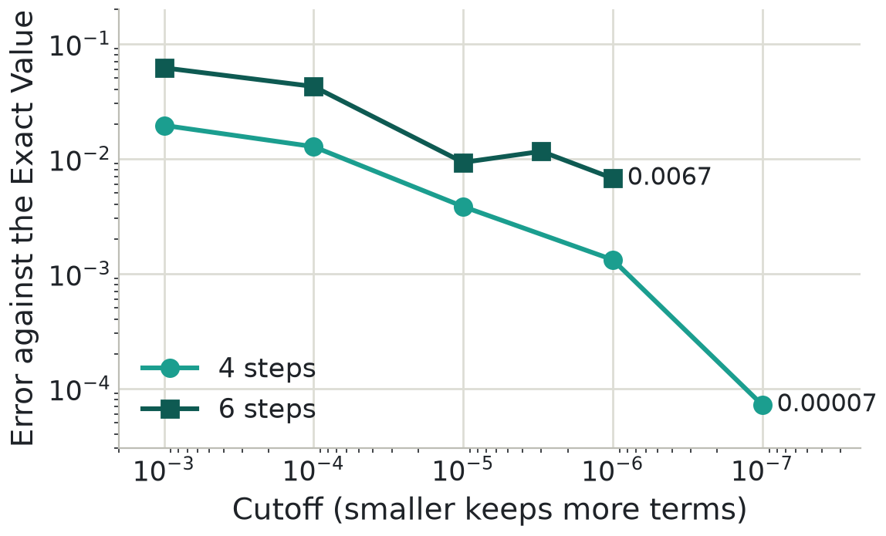</p>
<p align="center"><b>그림 29.</b> exact 값을 아는 30-qubit TFIM에서 cutoff에 따른 실행 시간.</p>

**그림 설명.** 왼쪽은 4 step, 오른쪽은 6 step이다. 가로축은 cutoff이고 괄호는 그 cutoff에서 exact 값과의 오차이다. truncation 규칙이 같은 구현은 같은 cutoff에서 같은 값을 내므로 오차가 하나이다(MonoProp은 규칙이 달라 제외). 세로는 실행 시간이며 로그 축이다. 선은 그 구현이 끝낸 마지막 cutoff에서 끝난다. 오른쪽으로 갈수록 더 낮은 cutoff의 답이고, 그 답을 내는 데 든 시간을 구현별로 읽는다.

<!-- g:acc -->
**4 step** (exact 0.802867).

| 구현 | 자원 | 1e-3 | 3e-4 | 1e-4 | 3e-5 | 1e-5 | 3e-6 | 1e-6 | 3e-7 | 1e-7 |
|---|---|---:|---:|---:|---:|---:|---:|---:|---:|---:|
| 오차 (아래 일곱 줄 공통) |  | 1.9e-2 | 5.9e-3 | 1.3e-2 | 1.0e-2 | 3.8e-3 | 4.8e-4 | 1.3e-3 | 3.5e-4 | 7.2e-5 |
| **SectorQ** | 16 GPU | 0.19초 | 0.17초 | 0.19초 | 0.27초 | 0.35초 | 0.64초 | 3.35초 | 17.9초 | 29.2초 |
| **SectorQ** | 4 GPU | 0.09초 | 0.13초 | 0.17초 | 0.24초 | 0.58초 | 4.94초 | 10.4초 | 55.2초 | 126초 |
| **SectorQ** | GPU 1장 | 0.08초 | 0.09초 | 0.15초 | 0.34초 | 2.75초 | 12.2초 | 52.9초 | 204초 | 494초 |
| cuPauliProp | GPU 1장 | 0.07초 | 0.10초 | 0.12초 | 0.33초 | 메모리 부족 | – | – | – | – |
| SPD | GPU 1장 | 1.83초 | 0.75초 | 1.28초 | 1.74초 | 1.98초 | 메모리 부족 | – | – | – |
| ORQA (재현) | 4 노드 | 1.98초 | 1.18초 | 1.36초 | 2.56초 | 7.35초 | 25.9초 | 71.7초 | 메모리 부족 | – |
| PauliPropagation.jl | 64 thread | 2.84초 | 3.23초 | 4.66초 | 10.2초 | 27.4초 | 131초 | 메모리 부족 | – | – |
| MonoProp (자체 truncation) | 4 노드 | 0.02초 (오차 2.5e-2) | 0.02초 (오차 3.0e-2) | 0.06초 (오차 2.4e-3) | 0.18초 (오차 7.3e-3) | 0.84초 (오차 5.1e-3) | 4.22초 (오차 1.2e-3) | 16.0초 (오차 1.4e-3) | 57.0초 (오차 4.5e-4) | 메모리 부족 |
| MonoProp (자체 truncation) | 1 노드 | 0.01초 (오차 2.5e-2) | 0.03초 (오차 3.0e-2) | 0.13초 (오차 2.4e-3) | 0.80초 (오차 7.3e-3) | 3.74초 (오차 5.1e-3) | 18.4초 (오차 1.2e-3) | 67.0초 (오차 1.4e-3) | 메모리 부족 | – |

**6 step** (exact 0.790133).

| 구현 | 자원 | 1e-3 | 3e-4 | 1e-4 | 3e-5 | 1e-5 | 3e-6 | 1e-6 | 3e-7 | 1e-7 |
|---|---|---:|---:|---:|---:|---:|---:|---:|---:|---:|
| 오차 (아래 일곱 줄 공통) |  | 6.2e-2 | 3.1e-2 | 4.2e-2 | 6.2e-3 | 9.3e-3 | 1.2e-2 | 6.7e-3 |  |  |
| **SectorQ** | 16 GPU | 0.66초 | 0.24초 | 0.39초 | 0.78초 | 3.10초 | 21.8초 | 254초 | 시간 초과 | – |
| **SectorQ** | 4 GPU | 0.12초 | 0.21초 | 0.33초 | 1.47초 | 10.3초 | 70.4초 | 메모리 부족 | – | – |
| **SectorQ** | GPU 1장 | 0.10초 | 0.20초 | 0.53초 | 5.00초 | 36.6초 | 261초 | 시간 초과 | – | – |
| cuPauliProp | GPU 1장 | 0.10초 | 0.15초 | 0.51초 | 메모리 부족 | – | – | – | – | – |
| SPD | GPU 1장 | 0.92초 | 0.68초 | 1.42초 | 3.57초 | 메모리 부족 | – | – | – | – |
| ORQA (재현) | 4 노드 | 2.60초 | 1.91초 | 3.63초 | 22.0초 | 153초 | 메모리 부족 | – | – | – |
| PauliPropagation.jl | 64 thread | 3.24초 | 5.03초 | 12.4초 | 90.3초 | 메모리 부족 | – | – | – | – |
| MonoProp (자체 truncation) | 4 노드 | 0.03초 (오차 4.8e-2) | 0.06초 (오차 3.3e-2) | 0.24초 (오차 3.2e-2) | 2.42초 (오차 1.7e-3) | 20.8초 (오차 1.6e-2) | 메모리 부족 | – | – | – |
| MonoProp (자체 truncation) | 1 노드 | 0.03초 (오차 4.8e-2) | 0.13초 (오차 3.3e-2) | 0.90초 (오차 3.2e-2) | 10.7초 (오차 1.7e-3) | 90.0초 (오차 1.6e-2) | 메모리 부족 | – | – | – |
<!-- /g:acc -->

**결과와 이유.**

- **4 step.** cutoff 1e-7까지 끝낸 구현은 SectorQ뿐이며 오차는 0.00007이다(16 GPU 29.2초, 4 GPU 126초, GPU 1장 494초). 다른 구현이 메모리 부족 전에 닿은 가장 작은 오차는 MonoProp 0.00045(4 노드, 57.0초), ORQA 재현과 PauliPropagation.jl 0.00048(cutoff 3e-6), SPD 0.0038, cuPauliProp 단일 GPU 0.0059이다(cutoff 3e-4. 끝낸 가장 작은 cutoff 3e-5에서는 0.010). 같은 cutoff 1e-6에서 SectorQ는 16 GPU로 3.35초, ORQA 재현은 4 노드로 71.7초이다(21배).
- **오차는 cutoff에 단조가 아니다.** 4 step의 오차는 cutoff 3e-6에서 0.00048, 1e-6에서 0.0013, 3e-7에서 0.00035이다. cutoff 하나의 값으로 오차를 가늠할 수 없으며 cutoff를 낮추어 가며 값이 모이는지 보아야 한다.
- **6 step.** 어느 구현도 오차 0.001 아래로 가지 못하였다. SectorQ는 cutoff 1e-6까지 끝냈고(16 GPU 254초) 오차는 0.0067이다. 가장 작은 오차는 MonoProp의 0.0017(cutoff 3e-5, 2.42초)이며 그 다음 cutoff에서 0.016으로 다시 커진다. 같은 truncation 규칙의 구현은 0.0062가 가장 작다. 8 step은 cutoff 1e-3과 1e-4에서 오차가 0.008과 0.124로, 이 범위에서 줄어들지 않는다(exact 0.698035).

30 qubit은 상태 벡터가 17초에 끝나는 크기이다. 이 실험의 목적은 참값에 대한 정확도와 그 정확도에 드는 시간을 재는 것이다. 아래는 낮은 cutoff에서 SectorQ가 다룬 항 수이다(4 GPU).

<!-- g:exact -->
| 깊이 | exact | cutoff | SectorQ의 값 (4 GPU) | 오차 | 구간 경계의 항 수 | 구간 안 최대 항 수 | 시간 |
|---|---|---|---|---:|---:|---:|---:|
| 4 step | 0.802867 | 1e-6 | 0.801551429518 | 0.00132 | 1.3억 | 47억 | 10.4초 |
| 4 step | 0.802867 | 1e-7 | 0.802795344445 | 0.00007 | 5.6억 | 312억 | 126초 |
| 6 step | 0.790133 | 1e-5 | 0.780881001464 | 0.00925 | 2.6억 | 40억 | 10.3초 |
| 6 step | 0.790133 | 3e-6 | 0.778587986317 | 0.01155 | 21억 | 349억 | 70.4초 |
| 6 step | 0.790133 | 1e-6 | 메모리 부족 |  |  |  |  |
<!-- /g:exact -->

4 step의 cutoff 1e-7은 구간 안에서 최대 312억 항을 다루며 4 GPU로 126초가 걸린다. 6 step의 cutoff 1e-6은 한 노드의 host memory에 들어가지 않으며 16 GPU로는 254초에 끝난다.

**Kicked Ising의 각도별 수렴.** 본 sweep의 kicked Ising(θ=π/4)은 측정한 cutoff 범위에서 값이 수렴하지 않는다(5절). 그래서 같은 회로(20 step, Z_62)의 rotation 각도를 0.05π–0.45π의 여덟 값으로 바꾸어 cutoff에 따른 기대값을 SectorQ(GPU 1장과 16 GPU)와 cuPauliProp(GPU 1장과 16 GPU 분산 기본)으로 재었다. 이 묶음의 제한은 실행당 20분이다.

<!-- g:conv -->
**기대값.** SectorQ의 값이다(16 GPU, 16 GPU의 값이 없으면 GPU 1장).

| rotation 각도 | 1e-3 | 3e-4 | 1e-4 | 3e-5 | 1e-5 | 3e-6 | 1e-6 |
|---|---:|---:|---:|---:|---:|---:|---:|
| 0.05π | +0.98749 | +0.98740 | +0.98738 | +0.98737 | +0.98725 | +0.98729 | +0.98725 |
| 0.1π | +0.89711 | +0.90121 | +0.90210 | +0.90597 | +0.90961 | +0.91005 | +0.90992 |
| 0.15π | +0.81175 | +0.80455 | +0.78671 | +0.76855 | +0.77176 | +0.79088 | +0.80914 |
| 0.2π | +0.47179 | +0.37618 | +0.38253 | +0.48024 | +0.58349 | +0.66986 | +0.69565 |
| 0.3π | +0.03384 | +0.03380 | +0.03416 | +0.03540 | +0.03570 | +0.03814 | 시간 초과 |
| 0.35π | +0.00000 | +0.00000 | +0.00067 | +0.00070 | +0.00076 | +0.00080 | 시간 초과 |
| 0.4π | +0.00000 | +0.00000 | +0.00000 | +0.00000 | +0.00000 | +0.00000 | 시간 초과 |
| 0.45π | +0.00000 | +0.00000 | +0.00000 | +0.00000 | +0.00000 | 시간 초과 | – |

**끝낸 가장 작은 cutoff**(괄호는 그 실행의 시간).

| rotation 각도 | SectorQ, GPU 1장 | SectorQ, 16 GPU | cuPauliProp, GPU 1장 | cuPauliProp 분산 기본, 16 GPU |
|---|---:|---:|---:|---:|
| 0.05π | 1e-6 (0.25초) | 1e-6 (0.85초) | 1e-6 (0.23초) | 1e-6 (25.1초) |
| 0.1π | 1e-6 (2.27초) | 1e-6 (0.79초) | 1e-6 (2.30초) | 1e-6 (25.2초) |
| 0.15π | 1e-6 (108초) | 1e-6 (8.33초) | 1e-5 (3.00초) | 1e-6 (43.9초) |
| 0.2π | 3e-6 (407초) | 1e-6 (236초) | 3e-5 (5.52초) | 1e-5 (31.2초) |
| 0.3π | 1e-5 (298초) | 3e-6 (247초) | 3e-4 (0.45초) | 3e-5 (28.3초) |
| 0.35π | 1e-5 (596초) | 3e-6 (490초) | 3e-4 (0.47초) | 1e-4 (26.7초) |
| 0.4π | 1e-5 (731초) | 3e-6 (776초) | 3e-4 (0.62초) | 1e-4 (23.9초) |
| 0.45π | 3e-5 (282초) | 1e-5 (176초) | 3e-4 (1.96초) | 1e-4 (27.6초) |
<!-- /g:conv -->

**결과와 이유.**

- **수렴하는 각도.** cutoff 1e-5 아래에서 0.05π는 값의 차이가 0.0001보다 작고(0.9873), 0.1π는 0.0005보다 작다(0.910).
- **수렴하지 않는 각도.** 0.15π와 0.2π는 cutoff 1e-6까지 값이 계속 움직인다. 0.2π는 0.47에서 0.38로 내려갔다가 0.70까지 올라간다. 0.3π와 0.35π는 값이 작고 cutoff를 낮출수록 조금씩 커진다.
- **0.4π와 0.45π.** 끝낸 모든 cutoff에서 값이 소수 다섯째 자리까지 0이다.
- **두 구현의 값.** SectorQ와 cuPauliProp은 둘 다 끝낸 모든 설정에서 값이 같다. 차이는 닿는 cutoff에 있다. 0.2π에서 cuPauliProp은 GPU 1장으로 3e-5, 16 GPU로 1e-5까지 끝내고 SectorQ는 GPU 1장으로 3e-6, 16 GPU로 1e-6까지 끝낸다.

이 결과는 Pauli propagation이라는 방법의 성질이며 SectorQ가 바꾸는 것이 아니다. SectorQ는 같은 cutoff의 답을 더 낮은 cutoff까지 낼 뿐이고, 그 답이 참값에 가까운지는 회로에 달려 있다(5절).

### 4.6 시간 분해

**요지.** 큰 문제에서 SectorQ의 시간은 대부분 gate 적용이다(16 GPU에서 69–89%). sector가 구간 동안 서로 독립이어서 gate 적용에 조율 비용이 없기 때문이다. 같은 설정의 cuPauliProp 기본 모드는 시간의 40–46%를 MPI 호출 안에서 보내고, GPU는 20–32%만 일한다.

<p align="center">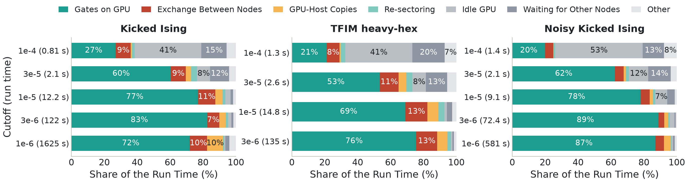</p>
<p align="center"><b>그림 30.</b> 16 GPU에서 SectorQ의 실행 시간 구성.</p>

**그림 설명.** 막대 하나가 실행 하나이며, 실행 시간을 비율로 나눈 것이다. 묶음 하나가 회로 하나이다. 세로는 cutoff(괄호는 실행 시간)이며 아래로 갈수록 문제가 크다. 초록은 gate 적용(worker가 라이브러리 호출 안에 있던 시간), 빨강은 노드 사이의 교환, 주황은 GPU와 host 사이의 복사, 옅은 초록은 sector 재분할, 회색 계열은 쉬는 GPU와 다른 노드를 기다린 시간이다. 문제가 커질수록 초록이 길어진다.

SectorQ의 시간을 문제 크기와 GPU 수에 따라 나누었다. GPU worker 전체에 대해 더한 시간(gate 적용, 복사, 분할, GPU 대기)은 worker 수로 나누었다.

<!-- g:parts -->
| 회로 | cutoff | 구간 경계의 항 수 | GPU | 전체 | gate 적용 | 노드 사이 교환 | GPU↔host 복사 | 분할 | GPU 대기 | 다른 노드 대기 | 그 밖 |
|---|---|---:|---:|---:|---:|---:|---:|---:|---:|---:|---:|
| Kicked Ising | 1e-4 | 233만 | 4 | 0.86초 | 66% | 없음 | 3% | 3% | 17% | 없음 | 10% |
| Kicked Ising | 1e-4 | 233만 | 16 | 0.81초 | 27% | 9% | 1% | 2% | 41% | 15% | 6% |
| Kicked Ising | 3e-5 | 2,067만 | 4 | 5.25초 | 81% | 없음 | 5% | 3% | 8% | 없음 | 3% |
| Kicked Ising | 3e-5 | 2,067만 | 16 | 2.06초 | 60% | 9% | 3% | 4% | 8% | 12% | 4% |
| Kicked Ising | 1e-5 | 1.6억 | 4 | 46.7초 | 85% | 없음 | 4% | 2% | 6% | 없음 | 3% |
| Kicked Ising | 1e-5 | 1.6억 | 16 | 12.2초 | 77% | 11% | 4% | 2% | 3% | 2% | 2% |
| Kicked Ising | 3e-6 | 15억 | 4 | 436초 | 92% | 없음 | 5% | 1% | 1% | 없음 | 1% |
| Kicked Ising | 3e-6 | 15억 | 16 | 121초 | 83% | 5% | 4% | 1% | 2% | 3% | 1% |
| Kicked Ising | 1e-6 | 119억 | 16 | 1,518초 | 77% | 3% | 11% | 1% | 1% | 2% | 5% |
| TFIM heavy-hex | 1e-4 | 316만 | 4 | 1.25초 | 51% | 없음 | 4% | 4% | 26% | 없음 | 15% |
| TFIM heavy-hex | 1e-4 | 316만 | 16 | 1.26초 | 21% | 8% | 1% | 3% | 41% | 20% | 7% |
| TFIM heavy-hex | 3e-5 | 3,166만 | 4 | 5.86초 | 80% | 없음 | 8% | 5% | 4% | 없음 | 4% |
| TFIM heavy-hex | 3e-5 | 3,166만 | 16 | 2.60초 | 53% | 11% | 5% | 4% | 8% | 13% | 6% |
| TFIM heavy-hex | 1e-5 | 2.5억 | 4 | 48.2초 | 84% | 없음 | 9% | 4% | 1% | 없음 | 3% |
| TFIM heavy-hex | 1e-5 | 2.5억 | 16 | 14.8초 | 69% | 13% | 7% | 4% | 1% | 3% | 3% |
| TFIM heavy-hex | 3e-6 | 26억 | 4 | 467초 | 87% | 없음 | 8% | 2% | 1% | 없음 | 2% |
| TFIM heavy-hex | 3e-6 | 26억 | 16 | 131초 | 78% | 10% | 7% | 2% | 1% | 1% | 1% |
| TFIM heavy-hex | 1e-6 | 213억 | 16 | 1,489초 | 76% | 7% | 10% | 1% | 1% | 2% | 3% |
| 잡음 있는 kicked Ising | 1e-4 | 135만 | 4 | 2.51초 | 26% | 없음 | 0% | 1% | 39% | 없음 | 33% |
| 잡음 있는 kicked Ising | 1e-4 | 135만 | 16 | 1.42초 | 20% | 5% | 0% | 1% | 53% | 13% | 8% |
| 잡음 있는 kicked Ising | 3e-5 | 1,034만 | 4 | 4.81초 | 79% | 없음 | 3% | 1% | 15% | 없음 | 3% |
| 잡음 있는 kicked Ising | 3e-5 | 1,034만 | 16 | 2.08초 | 62% | 5% | 1% | 2% | 12% | 14% | 4% |
| 잡음 있는 kicked Ising | 1e-5 | 7,241만 | 4 | 31.7초 | 89% | 없음 | 2% | 1% | 6% | 없음 | 1% |
| 잡음 있는 kicked Ising | 1e-5 | 7,241만 | 16 | 9.14초 | 78% | 6% | 2% | 1% | 7% | 5% | 1% |
| 잡음 있는 kicked Ising | 3e-6 | 6.1억 | 4 | 272초 | 94% | 없음 | 3% | 1% | 1% | 없음 | 1% |
| 잡음 있는 kicked Ising | 3e-6 | 6.1억 | 16 | 72.2초 | 89% | 3% | 2% | 1% | 3% | 1% | 1% |
| 잡음 있는 kicked Ising | 1e-6 | 44억 | 4 | 2,189초 | 92% | 없음 | 4% | 1% | 0% | 없음 | 3% |
| 잡음 있는 kicked Ising | 1e-6 | 44억 | 16 | 567초 | 89% | 3% | 4% | 1% | 1% | 1% | 1% |
<!-- /g:parts -->

**결과와 이유.**

- **큰 문제에서는 gate 적용이 시간의 대부분이다.** 1억 항이 넘는 설정에서 gate 적용은 4 GPU(한 노드)일 때 84–94%, 16 GPU일 때 69–89%이다. 이 부분은 cuPauliProp의 단일 GPU 연산이다. 이 연산을 그대로 쓰는 한 SectorQ가 더 줄일 수 있는 몫은 나머지 6–31%이다.
- **노드를 넘으면 교환이 더해진다.** 16 GPU에서 구간 경계의 교환은 3–13%이다. 구간이 많은 TFIM(45개)에서 가장 크다. 한 노드 안에서는 교환이 없다.
- **작은 문제에서는 GPU가 기다린다.** cutoff 1e-4(135만–316만 항)에서는 16 GPU의 gate 적용이 20–27%이고 GPU 대기가 41–53%이다. 항이 적은 초반 구간에는 나눌 만큼의 항이 없고, 연산마다의 고정 비용이 항 수와 무관하기 때문이다(4.4절).
- **host를 거치는 비용은 작다.** GPU와 host 사이의 복사는 11% 이하, 분할은 5% 이하이다. 복사가 가장 큰 것은 가장 큰 실행(kicked Ising cutoff 1e-6, 119억 항)의 11%이다.

<p align="center">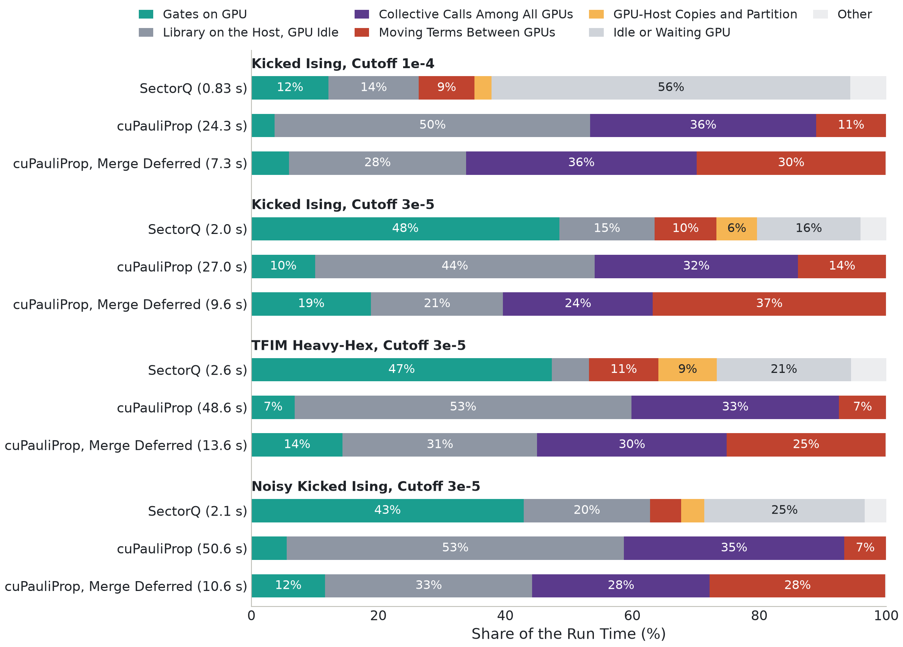</p>
<p align="center"><b>그림 31.</b> 16 GPU에서 큰 설정(cutoff 1e-5)의 실행 시간 구성: SectorQ와 cuPauliProp 분산 모드.</p>

**그림 설명.** 묶음 하나가 회로 하나이고, 제목의 괄호는 구간 경계의 항 수와 그 크기이다. 막대는 방식별 실행 하나를 비율로 나눈 것이며 이름 옆의 괄호는 실행 시간이다. cuPauliProp은 rank 평균이다. 초록은 GPU가 gate를 적용한 시간(Gates on GPU), 회색은 라이브러리 안에 있으나 GPU가 쉰 시간(Library on the Host), 보라는 모든 GPU가 참여하는 호출, 빨강은 항을 GPU 사이로 옮긴 시간, 주황은 GPU와 host 사이의 복사와 분할이다. 세 방식 모두 라이브러리 호출 안의 시간을 nvidia-smi 표본 사용률로 GPU가 일한 부분과 나머지로 나누었다.

**세 방식의 시간 분해.** 같은 16 GPU에서 세 방식의 시간이 어디로 가는지 재었다. 그림 31는 cuPauliProp 분산 모드가 16 GPU로 끝내는 가장 큰 설정(cutoff 1e-5)의 두 회로이고, 아래 표에는 잡음 있는 회로와 더 작은 설정(cutoff 3e-5, 1e-4)이 함께 있다. MPI 호출의 시간은 MPI plugin을 감싼 계측판이 호출마다 잰다(`src/plugin/prof_mpi.c`). GPU 사용률은 nvidia-smi로 0.2초마다 표본한 값의 평균이다. 그림에서는 라이브러리 호출 안에서 MPI 밖에 있는 시간을 이 사용률로 GPU가 일한 부분과 나머지(host 쪽 작업)로 나누었고, SectorQ의 라이브러리 호출 시간도 같은 규칙으로 나누었다. dedup을 미룬 방식은 cutoff 1e-5의 kicked Ising과 TFIM에서 3개 연산마다 dedup을 한 번 더 해야 메모리에 들어가며, 그 설정으로 재었다.

<!-- g:base_parts -->
| 회로 | cutoff | 방식 | 전체 | GPU 사용률 (nvidia-smi 표본) | 라이브러리 호출 안의 시간 (gate 적용) | 통신 (MPI 호출 안의 시간, SectorQ는 노드 사이 교환) | 연산당 allgather (rank당) | 보낸 양 |
|---|---|---|---:|---:|---:|---:|---:|---:|
| Kicked Ising | 1e-5 | SectorQ | 12.1초 | 78% | 77% | 9% | 없음 | 45.2 GB (전체) |
| Kicked Ising | 1e-5 | cuPauliProp 기본 | 53.7초 | 32% |  | 46% (collective 19%) | 22.1회 | 108.3 GB (rank당) |
| Kicked Ising | 1e-5 | cuPauliProp dedup 미룸 | 50.1초 | 49% |  | 42% (collective 12%) | 8.6회 | 113.1 GB (rank당) |
| Kicked Ising | 3e-5 | SectorQ | 1.93초 | 52% | 64% | 8% | 없음 | 5.6 GB (전체) |
| Kicked Ising | 3e-5 | cuPauliProp 기본 | 27.0초 | 10% |  | 46% (collective 32%) | 22.1회 | 12.0 GB (rank당) |
| Kicked Ising | 3e-5 | cuPauliProp dedup 미룸 | 9.59초 | 19% |  | 60% (collective 24%) | 3.9회 | 14.4 GB (rank당) |
| Kicked Ising | 1e-4 | SectorQ | 0.82초 | 11% | 27% | 10% | 없음 | 0.6 GB (전체) |
| Kicked Ising | 1e-4 | cuPauliProp 기본 | 24.3초 | 4% |  | 47% (collective 36%) | 22.1회 | 1.1 GB (rank당) |
| Kicked Ising | 1e-4 | cuPauliProp dedup 미룸 | 7.27초 | 6% |  | 66% (collective 36%) | 3.9회 | 1.2 GB (rank당) |
| TFIM heavy-hex | 1e-5 | SectorQ | 14.7초 | 72% | 70% | 13% | 없음 | 79.0 GB (전체) |
| TFIM heavy-hex | 1e-5 | cuPauliProp 기본 | 73.0초 | 26% |  | 40% (collective 22%) | 22.1회 | 91.8 GB (rank당) |
| TFIM heavy-hex | 1e-5 | cuPauliProp dedup 미룸 | 58.9초 | 45% |  | 37% (collective 15%) | 8.6회 | 94.8 GB (rank당) |
| TFIM heavy-hex | 3e-5 | SectorQ | 2.62초 | 46% | 53% | 11% | 없음 | 9.7 GB (전체) |
| TFIM heavy-hex | 3e-5 | cuPauliProp 기본 | 48.6초 | 7% |  | 40% (collective 33%) | 22.1회 | 9.9 GB (rank당) |
| TFIM heavy-hex | 3e-5 | cuPauliProp dedup 미룸 | 13.6초 | 14% |  | 55% (collective 30%) | 3.8회 | 11.4 GB (rank당) |
| TFIM heavy-hex | 1e-4 | SectorQ | 1.26초 | 12% | 21% | 9% | 없음 | 1.0 GB (전체) |
| TFIM heavy-hex | 1e-4 | cuPauliProp 기본 | 46.8초 | 3% |  | 42% (collective 34%) | 22.1회 | 0.9 GB (rank당) |
| TFIM heavy-hex | 1e-4 | cuPauliProp dedup 미룸 | 10.6초 | 5% |  | 55% (collective 31%) | 3.8회 | 1.0 GB (rank당) |
| 잡음 있는 kicked Ising | 1e-5 | SectorQ | 9.04초 | 74% | 79% | 5% | 없음 | 17.1 GB (전체) |
| 잡음 있는 kicked Ising | 1e-5 | cuPauliProp 기본 | 64.0초 | 20% |  | 40% (collective 26%) | 15.4회 | 57.3 GB (rank당) |
| 잡음 있는 kicked Ising | 1e-5 | cuPauliProp dedup 미룸 | 21.9초 | 33% |  | 51% (collective 15%) | 2.2회 | 49.5 GB (rank당) |
| 잡음 있는 kicked Ising | 3e-5 | SectorQ | 2.04초 | 44% | 64% | 5% | 없음 | 2.3 GB (전체) |
| 잡음 있는 kicked Ising | 3e-5 | cuPauliProp 기본 | 50.6초 | 6% |  | 41% (collective 35%) | 15.4회 | 7.0 GB (rank당) |
| 잡음 있는 kicked Ising | 3e-5 | cuPauliProp dedup 미룸 | 10.6초 | 12% |  | 56% (collective 28%) | 2.2회 | 6.0 GB (rank당) |
| 잡음 있는 kicked Ising | 1e-4 | SectorQ | 1.42초 | 11% | 20% | 5% | 없음 | 0.3 GB (전체) |
| 잡음 있는 kicked Ising | 1e-4 | cuPauliProp 기본 | 47.8초 | 3% |  | 41% (collective 35%) | 15.4회 | 0.7 GB (rank당) |
| 잡음 있는 kicked Ising | 1e-4 | cuPauliProp dedup 미룸 | 8.87초 | 5% |  | 55% (collective 29%) | 2.2회 | 0.6 GB (rank당) |
<!-- /g:base_parts -->

**결과와 이유.**

- **큰 설정에서 SectorQ의 GPU는 실행 시간의 72–78%를 일한다.** 같은 설정의 cuPauliProp은 기본 모드가 20–32%, dedup을 미룬 방식이 33–49%이다. SectorQ의 실행 시간은 기본 모드의 4.4–7.1배, dedup을 미룬 방식의 2.4–4.1배 짧다(kicked Ising: 12.1초, 53.7초, 50.1초).
- **기본 모드는 시간의 40–46%를 MPI 호출 안에서 보낸다.** 모든 rank가 참여하는 collective 호출이 19–26%이고 나머지는 항을 옮기는 시간이다. allgather는 연산마다 rank당 22.1번(잡음 있는 회로는 15.4번)이며 항 수와 무관하다. rank 하나가 보내는 양은 57–108 GB이다.
- **dedup을 미루면 GPU가 일하는 몫이 33–49%로 늘지만 MPI 안의 시간은 37–51%로 남는다.** allgather는 연산당 2.2–8.6번으로 줄어든다. 전체 시간은 kicked Ising에서 53.7초가 50.1초가 되는 데 그친다.
- **SectorQ에서 항이 노드를 옮기는 것은 구간 경계의 교환뿐이다.** 실행 시간의 6–14%이고, 실행 전체에서 노드 사이로 보내는 양은 17–79 GB이다. kicked Ising cutoff 1e-5에서 cuPauliProp 기본 모드는 16 rank가 모두 1,733 GB를 보내고 SectorQ는 45 GB를 보낸다. GPU 밖으로 내보내는 양을 모두 합쳐도 60 GB이다(cuPauliProp이 SectorQ의 29배, 3.3절).
- **작은 설정에서는 세 방식 모두 GPU가 덜 일한다.** cutoff 3e-5에서 GPU 사용률은 SectorQ 43–48%, 기본 모드 6–10%, dedup을 미룬 방식 12–19%이다. cutoff 1e-4는 SectorQ도 11–12%이다. 이 크기의 SectorQ 실행은 1–3초로 짧아 표본이 GPU당 4–13개이며, 표본 사용률이 라이브러리 호출 안의 시간(cutoff 3e-5에서 53–64%)보다 낮게 나온다. 큰 설정에서는 둘이 일치한다(표의 두 열).

2 GPU와 4 GPU의 같은 분해는 `python3 analysis/campaign_g.py`가 출력하는 표에 있다. 잡음 있는 kicked Ising의 가장 작은 설정(cutoff 1e-4, 2–4 GPU)에서는 worker가 다음 구간의 행을 기다린 시간이 29–30%이다. 이 회로는 구간이 525 연산으로 길어 행을 고르는 데 약 2초가 들고, 실행 전체가 2.5초여서 그 몫이 크게 보인다. cutoff 3e-5(4.9초)에서는 기다린 시간이 0.1초이다.

초반 구간에 sector를 하나만 두면 32 GPU의 10.4초 가운데 2.5초가 그 구간이다. 그동안 GPU 한 장만 일하고 31장이 기다린다. 초반부터 노드마다 sector를 하나씩 주면 이 구간은 0.4초가 된다(4.7절).

### 4.7 설계 요소별 측정

**요지.** 설계 요소를 하나씩 재었다. 조절 값(sector의 목표 크기, GPU당 sector 수, 허용한 GPU memory)을 기본값 주변에서 바꾸어도 실행 시간은 조금만 달라진다. 요소를 하나씩 더했을 때의 시간은 1.5절의 그림 6에 있다.

| 요소 | 측정 | 결과 |
|---|---|---|
| Clifford frame | kicked Ising, 단일 GPU | gate 5,420 → 2,540개, 2.92 → 1.64초, 답 동일 |
| 실행 중에 고른 행 | 16분할의 최대/평균 | 고정 bit 1.4–4.9배, 고른 행 1.00–1.01배 |
| 구간을 truncation 직후에서 끝내기 | 재분배 때 옮기는 항 | XXZ에서 2.8배 감소 |
| 고정(pinned) chunk 풀 | GPU→host 복사 속도 | 새 vector 1.1 GB/s, 미리 쓴 pageable 11 GB/s, 고정 22–25 GB/s. 고정하는 데 1.6 GB/s가 들어 한 번만 고정한다 |
| sector 통째 교환 | 0.55 GB 재분배 | 1.2–1.4초 → 0.06–0.09초 |
| GPU당 sector 수 1 / 2 / 4 / 8 | kicked Ising cutoff 1e-5, 16 GPU | 12.3 / 12.2 / 12.6 / 13.6초. 기본값 2 (아래 표) |
| 초반부터 노드마다 sector 하나 (`--early-per-node`) | 같은 노드에서 켬과 끔 (`logs/pp_e9-59483080.out`) | Kicked Ising cutoff 1e-5: 32 GPU 10.4 → 8.1초, 16 GPU 16.6 → 14.2초. 잡음 있는 kicked Ising 32 GPU 10.0 → 7.1초. 2,250만 항 설정은 1.31 → 1.37초로 같다. XXZ, QAOA, ansatz 같은 아주 작은 회로는 0.1–0.2초 늘어난다 |
| 전원 통신 횟수 | 2,250만 항 설정, 4 GPU, GPU당 | 엔진 208회(프로토타입 51회). cuPauliProp은 allgather 119,785회 |
| 이동 데이터 (프로토타입) | 같은 설정, 4 GPU | 0.57 GB. cuPauliProp은 20.3 GB |

구간을 어디에서 끝내는지가 재분배 비용을 정한다. 아래는 연산마다의 항 수를 기록하여(`--profile`) 계산한 것이다(`analysis/rekey_timing.py`).

| 회로 | 고정 규칙이 옮긴 항 / 근처의 가장 좋은 지점 | 구간 안 최대 항 수 / 경계 항 수 |
|---|---|---|
| Kicked Ising, 잡음 있는 kicked Ising, ansatz | 1.07–1.14배 | 2.9–7.3배 |
| TFIM (heavy-hex, 정사각) | 1.28–1.38배 | 2.9–4.0배 |
| XXZ | 3.40배 | 5.5배 |
| QAOA | 4.32배 | 35.9배 |

오른쪽 열은 sector를 하나씩 처리할 때 GPU가 동시에 담지 않아도 되는 양이다.

**조절 값.** sector의 목표 크기, GPU당 sector 수, 허용한 GPU memory를 바꾸어 재었다.

<p align="center">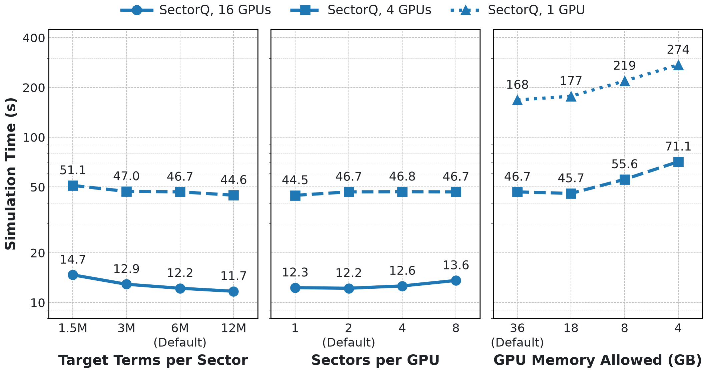</p>
<p align="center"><b>그림 32.</b> 조절 값에 따른 실행 시간(kicked Ising cutoff 1e-5).</p>

**그림 설명.** 패널 셋이며 세로는 실행 시간(로그 축)이다. (a) sector당 목표 항 수, (b) GPU당 sector 수, (c) SectorQ에 허용한 GPU memory이다. 실선은 16 GPU, 파선은 4 GPU, 점선은 GPU 1장이고 점 위의 숫자는 초이다. 기본값은 가로축에 표시하였다. 세 패널 모두 선이 거의 평평하다.

**sector의 목표 크기와 GPU당 sector 수.** 1–16 GPU 측정에서 두 매개변수를 바꾸어 재었다.

<!-- g:params -->
| 회로 (cutoff 1e-5) | GPU | 기본 설정 | sector당 목표 항 수 (기본의 1/4, 1/2, 2배) | GPU당 sector 수 (기본 2) |
|---|---:|---:|---|---|
| Kicked Ising | 4 | 46.7초 | 1.5M: 51.1초 / 3M: 47.0초 / 12M: 44.6초 | 1: 44.5초 / 4: 46.8초 / 8: 46.7초 |
| Kicked Ising | 16 | 12.2초 | 1.5M: 14.7초 / 3M: 12.9초 / 12M: 11.7초 | 1: 12.3초 / 4: 12.6초 / 8: 13.6초 |
| TFIM heavy-hex | 4 | 48.2초 | 1M: 60.6초 / 2M: 53.4초 / 8M: 43.7초 | 1: 48.4초 / 4: 48.1초 / 8: 48.8초 |
| TFIM heavy-hex | 16 | 14.8초 | 1M: 17.6초 / 2M: 15.9초 / 8M: 14.0초 | 1: 15.1초 / 4: 14.9초 / 8: 15.4초 |
| 잡음 있는 kicked Ising | 4 | 31.7초 | 1.5M: 38.0초 / 3M: 32.9초 / 12M: 30.7초 | 1: 32.0초 / 4: 32.3초 / 8: 34.1초 |
| 잡음 있는 kicked Ising | 16 | 9.14초 | 1.5M: 11.1초 / 3M: 9.64초 / 12M: 8.96초 | 1: 8.79초 / 4: 9.91초 / 8: 12.3초 |
<!-- /g:params -->

목표 항 수를 기본의 1/4로 줄이면 9–26% 느려지고, 2배로 늘리면 2–9% 빨라진다. sector가 클수록 연산 호출 수가 줄기 때문이다. 목표가 크면 구간 안에서 GPU 버퍼를 넘는 sector가 생기므로(3.4절) 기본값은 버퍼의 20분의 1 근처에 둔다. GPU당 sector 수는 1–4에서 차이가 9% 안이고, 8에서는 16 GPU일 때 4–35% 느려진다.

**GPU memory를 줄인 실행.** SectorQ가 쓰는 GPU memory를 36 GB에서 4 GB까지 줄여 같은 문제를 실행하였다. 기대값은 같다.

<!-- g:vram -->
| 회로 (cutoff 1e-5) | GPU | 36 GB (기본) | 18 GB | 8 GB | 4 GB |
|---|---:|---:|---:|---:|---:|
| Kicked Ising | 1 | 168초 | 177초 | 219초 | 274초 |
| Kicked Ising | 4 | 46.7초 | 45.7초 | 55.6초 | 71.1초 |
| TFIM heavy-hex | 1 | 187초 | 186초 | 191초 | 210초 |
| TFIM heavy-hex | 4 | 48.2초 | 48.1초 | 49.1초 | 54.2초 |
| 잡음 있는 kicked Ising | 1 | 116초 | 120초 | 132초 | 159초 |
| 잡음 있는 kicked Ising | 4 | 31.7초 | 31.2초 | 34.7초 | 40.6초 |
<!-- /g:vram -->

GPU memory를 절반(18 GB)으로 줄여도 시간은 −2%에서 +6% 사이이다. 9분의 1(4 GB)로 줄이면 12–64% 늘어난다. GPU에 들어가지 않는 sector를 구간 안에서 더 자주 나누기 때문이다. cuPauliProp은 kicked Ising과 TFIM의 이 설정을 36 GB의 GPU 8장으로도 끝내지 못한다(4.4절).

### 4.8 Checkpoint와 검산

**요지.** 구간 경계의 checkpoint에서 재개한 실행은 끊지 않은 실행과 같은 값을 낸다. 보존 parity 검산은 19.9억 번의 검사에서 위반이 0건이고, 그 시간은 전체의 1% 미만이다.

- 한 노드에서 checkpoint를 쓰고 다른 sector 구성으로 재개하면 기대값이 0.153108187591로 같다. 119만 항의 checkpoint는 48 MB이다.
- 4 노드에서 쓰고 4 노드에서 재개하였다. 1.09억 항을 저장하였고 재개한 뒤의 기대값이 같다.
- 보존 parity 검산은 kicked Ising cutoff 1e-5 실행에서 항을 19.9억 번 검사하여 위반이 0건이다. 검사 시간은 전체의 1% 미만이다. 잡음 있는 kicked Ising에서는 보존 parity 8개로 5.7억 번 검사하여 위반이 0건이다.

1–16 GPU 측정에서 kicked Ising cutoff 1e-5를 12번째 구간 뒤의 checkpoint에서 멈추고, 그 파일에서 재개하였다. 재개한 실행의 기대값은 끊지 않은 실행과 같다.

<!-- g:ckpt -->
| GPU | 끊지 않은 실행 | checkpoint 지점 | 재개한 뒤의 시간 | 끊지 않은 실행의 기대값 | 재개한 실행의 기대값 |  |
|---:|---:|---|---:|---|---|---|
| 4 | 46.7초 | 연산 1652, 1.1억 항 | 23.7초 | 0.228607441423 | 0.228607441423 | 같음 |
| 16 | 12.2초 | 연산 1652, 1.1억 항 | 5.29초 | 0.228607441423 | 0.228607441423 | 같음 |
<!-- /g:ckpt -->

### 4.9 데이터로 기각한 설계

**요지.** 시도하였으나 측정에서 이득이 없어 기본 동작에서 뺀 설계이다. 공통된 이유는 둘이다. 재분배는 횟수보다 시점(항이 가장 적을 때)이 중요하고, 조각을 host로 한 번 더 거치게 하는 변형은 그 비용이 이득보다 크다.

| 시도 | 결과 |
|---|---|
| 합치지 않는 독립 chunk | 4개 0.1675, 16개 0.189 (정답 0.1531). 답이 틀린다 |
| 재분배 때 덜 움직이는 행 고르기 | 탐색해도 항의 60–91%가 움직인다 |
| 구간을 coset 기준으로 최대한 늘리기 (`--window coset`) | kicked Ising에서 구간이 20개에서 17개로 줄지만 구간 끝이 항 수가 가장 많은 지점에 걸려 2.6배 느리다. 재분배 횟수보다 시점이 중요하다 |
| Pilot sector로 구간 끝 정하기 (`--pilot 1`) | 작은 설정에서 17–26% 빠르고, 16 GPU의 큰 설정에서 2–10% 느리다. 기본에서 뺐다 |
| 교환을 계산과 겹치기 (`--stream 1`) | 16.2초 대 15.9초. sector의 출력이 구간 끝에 몰려 이득이 없다 |
| 아무 일도 하지 않는 gate 건너뛰기 | 이득이 없다 |
| 앞 구간이 오래 걸리면 그때부터 잘게 나누기 | 초반의 성장이 너무 빨라 늦게 반응한다(32 GPU 10.8 → 10.2초). 2,250만 항 설정은 1.3 → 2.0초로 느려진다. 코드에서 뺐다 (`logs/pp_e8-59482607.out`) |
| 노드 안에서 큰 sector를 반으로 나누어 쉬는 GPU에 주기 (`--share-above`) | 32 GPU 8.8초 대 8.1초(끔), 한 노드 4 GPU 48.3초 대 48.1초. 나눈 조각이 host를 거치는 비용이 이득보다 크다. 기본에서 껐다 |
| 성장률 상한을 올려 sector 수를 미리 늘리기 (`--growth-cap 64`) | sector가 256개까지 늘어 chunk를 고정하는 비용이 커진다. 32 GPU 12.2초 대 11.0초 |
| GPU 한 장에 들어가면 항상 sector 하나로 두기 | QAOA cutoff 1e-4, GPU 1장: 5.41초 대 4.26초(목표 크기대로 나눔). cuPauliProp의 연산은 sector가 클수록 항당 시간이 늘어, 들어가더라도 목표 크기로 나누는 쪽이 빠르다. 목표 크기 아래일 때만 하나로 둔다 (`logs/u3`) |
| 구간이 도는 동안 필요할 chunk를 예측해 `cudaHostAlloc`으로 미리 만들기 | `cudaHostAlloc`이 도는 동안 같은 GPU의 복사와 연산이 밀린다. kicked Ising cutoff 3e-5, GPU 1장의 host → GPU 복사가 0.29초에서 1.60초로 늘고, 16 GPU에서는 GPU 연산 시간의 합이 3–17% 늘었다. 예측이 크면 쓰지 않을 chunk까지 만든다. chunk를 만드는 방법을 바꾸고, 지난 교환에서 모자랐던 만큼만 미리 만든다 (`logs/u2`, `logs/u4`) |
| sector 안에서 dedup을 truncation 직전까지 미루기 (`--defer-dedup k`) | 한 노드 4 GPU, kicked Ising cutoff 1e-5: 미루지 않으면 48.6초, 간격 10이면 50.3초, 간격 3이면 70.8초. TFIM 52.5초 대 52.7초. 답은 같다. cuPauliProp의 gate 적용은 dedup을 포함해도 이미 빠르고, 미루면 들고 있는 항만 늘어난다. dedup을 미룬 cuPauliProp이 빨라지는 것은 전역 dedup이 줄어서이며 계산이 줄어서가 아니다 |

### 4.10 초기 프로토타입의 측정

**요지.** SectorQ 이전에 기능을 하나씩 따로 구현하여 잰 값이며 기록으로 둔다.

SectorQ 이전에 기능별 프로토타입(`src/proto/lo_*`)으로 잰 값이다. 최종 수치는 4.2–4.4절을 쓴다.

| 프로토타입 | 측정 | 결과 |
|---|---|---|
| `lo_mpi` (rank마다 GPU 하나, MPI 재분배) | 2,250만 항 설정, Clifford frame을 양쪽에 적용 | 4 GPU 2.29초 대 17.1초, 16 GPU 2.39초 대 41.2초 |
| | 원래 회로 | 4 GPU 2.43초 대 32.9초, 16 GPU 3.29초 대 71.2초 |
| | 14억 항 설정, 16 GPU | 11.8초 (sector가 GPU에 머무름) |
| `lo_ooc` (GPU 1장 out-of-core) | 14억 항 설정 | 1 GPU 212초, host memory 7 GiB |
| | GPU memory의 2%만 쓰는 실행 | 분할 61회, 기대값 동일 |
| `lo_pool` (한 노드, sector task) | 14억 항 설정 1 / 2 / 4 GPU | 212 / 116 / 64초 |
| | cutoff 3e-6 설정 | 한 노드 4 GPU 676초, 4 노드 16 GPU 221초. 기대값 0.289217470624 일치 |
| `lo_virtual` (한 GPU 안의 가상 rank) | θ=0.15π, cutoff 1e-5 | 0.771759253455 일치 |

### 4.11 Sector 관리 비용

**요지.** sector를 나누고, host에 두고, 노드 사이에 옮기는 일은 통신을 구간 경계로 모으는 값이다. GPU 1장에 들어가는 문제에서 이 비용은 cuPauliProp 단일 GPU 대비 1–2%이다. 16 GPU의 교환에서는 전송 자체보다 받을 메모리를 준비하는 시간이 컸고, 그래서 chunk를 미리 만들어 둔다.

측정은 같은 노드들에서 설정마다 1회 하였다(`logs/u1`, `logs/u2`, `logs/u6`, `logs/h1`). 기대값은 모든 실행에서 같다.

**GPU 한 장.** 항 수가 sector의 목표 크기 아래이면 SectorQ는 sector 하나를 GPU에 그대로 두고 host를 거치지 않는다(3.2절). 이때 SectorQ와 cuPauliProp 단일 GPU는 같은 연산을 같은 순서로 호출한다.

| 회로, cutoff | SectorQ, GPU 1장 | cuPauliProp 단일 GPU |
|---|---:|---:|
| kicked Ising, 1e-4 | 1.72초 | 1.71초 |
| TFIM heavy-hex, 1e-4 | 1.92초 | 1.89초 |
| noisy kicked Ising, 1e-4 | 1.95초 | 1.91초 |
| TFIM 11×11, 1e-4 | 1.62초 | – |
| XXZ 8×8, 1e-4 | 2.67초 | – |
| QAOA n=100, 1e-4 | 4.26초 | – |
| ansatz n=100, 1e-5 | 13.4초 | 메모리 부족 |
| kicked Ising, 3e-5 | 18.3초 | 메모리 부족 |
| kicked Ising, 1e-5 | 166.9초 | 메모리 부족 |

- **한 장에 들어가는 설정에서 두 실행의 차이는 1–2%이다.** sector가 하나이면 나누기도 host 왕복도 없기 때문이다. GPU마다 sector를 둘 이상 두는 규칙을 GPU 1장에도 그대로 적용하면 kicked Ising, TFIM heavy-hex, noisy kicked Ising의 cutoff 1e-4가 2.31, 2.91, 4.39초가 걸린다.
- **한 장에 들어가지 않는 설정은 SectorQ만 끝낸다.** 이 설정의 시간은 약 90%가 cuPauliProp의 연산이어서, 관리 비용을 더 줄여도 시간이 더 줄지 않는다. 연산이 더 빠른 단일 GPU 구현(SPD)은 kicked Ising cutoff 3e-5를 7.3초에 끝내고, 그다음 cutoff에서 메모리가 부족하다.

**여러 노드: 교환 시간의 구성.** 구간 경계의 교환을 나누어 재었다. 도착하는 항을 받을 고정(pinned) chunk를 교환할 때 `cudaHostAlloc`으로 만들면, 교환 시간의 49–86%가 chunk를 만드는 데 든다. 메모리를 고정하는 속도가 2 GB/s이고 그동안 노드의 GPU가 모두 기다린다. 전송 자체는 전체 실행 시간의 2–8%이다(kicked Ising 3e-6에서 노드당 24 GB/s).

| 설정 (16 GPU) | 교환할 때 chunk를 만드는 방식: 교환, 노드당 | 그중 새 chunk 만들기 | 그중 전송 | chunk를 미리 만드는 방식(채택): 교환, 노드당 |
|---|---:|---:|---:|---:|
| kicked Ising, 1e-5 | 2.97초 | 2.06초 | 0.79초 | 1.42초 |
| ansatz n=100, 1e-6 | 10.10초 | 7.68초 | 1.92초 | 3.43초 |
| noisy kicked Ising, 5e-6 | 2.58초 | 1.48초 | 0.95초 | 1.61초 |
| QAOA n=100, 1e-6 | 8.94초 | 7.66초 | 0.67초 | 2.81초 |
| TFIM heavy-hex, 5e-6 | 14.32초 | 8.80초 | 4.62초 | 6.71초 |
| kicked Ising, 3e-6 | 17.49초 | 8.49초 | 5.16초 | 9.58초 |

SectorQ는 chunk를 16개씩 묶어 만든다. 일반 메모리를 받아 한 번 쓴 뒤 CUDA에 등록하며 이 방법은 7 GB/s이다(3.4절). 교환에서 chunk가 모자랐으면 다음 구간이 도는 동안 그만큼을 미리 만든다. GPU worker가 출력을 내릴 때 새 chunk를 기다리는 시간도 같이 준다. 전체 실행 시간은 다음과 같다.

| 설정 (16 GPU) | 교환할 때 chunk를 만드는 방식 | chunk를 미리 만드는 방식(채택) | 앞의 것 / 뒤의 것 |
|---|---:|---:|---:|
| kicked Ising, 1e-5 | 15.3초 | 12.8초 | 1.20배 |
| ansatz n=100, 1e-6 | 25.7초 | 18.5초 | 1.39배 |
| noisy kicked Ising, 5e-6 | 32.1초 | 30.2초 | 1.06배 |
| QAOA n=100, 1e-6 | 42.1초 | 31.9초 | 1.32배 |
| TFIM heavy-hex, 5e-6 | 62.3초 | 53.5초 | 1.17배 |
| kicked Ising, 3e-6 | 133.5초 | 120.0초 | 1.11배 |

그 값으로 host memory를 더 쓴다(가장 바쁜 노드에서 kicked Ising 3e-6이 26 GiB에서 33 GiB, QAOA가 22 GiB에서 33 GiB). 묶음으로 만들고 미리 만든 chunk의 몫이다.

**행 고르기를 구간 계산과 겹치기.** 다음 구간의 행을 구간 사이에 고르면 그 0.3–0.4초 동안 모든 GPU가 선다. 항 수와 무관한 비용이라 작은 문제에서 비중이 크다(16 GPU, 233만 항에서 1.04초 가운데 0.27초). 그래서 SectorQ는 구간이 시작할 때 표본만 뜨고, GPU가 구간을 계산하는 동안 main thread가 행을 고른다(3.1절). 또 앞 구간이 0.5초보다 짧으면 GPU마다 sector를 하나만 준다. sector 하나는 구간마다 연산 호출의 고정 비용(연산당 약 0.15 ms)을 내기 때문이다. 같은 노드에서 두 방식을 차례로 잰 값이다(`logs/h1/`).

| 회로 (항 수) | GPU 1장 | 16 GPU, 구간 사이에 고름 | 16 GPU, 구간 계산과 겹침(채택) | GPU 1장 대비 16 GPU | 4 GPU, 구간 사이 → 겹침 |
|---|---:|---:|---:|---|---|
| kicked Ising (3만) | 0.50초 | 0.38초 | 0.38초 | 같음 | 0.26 → 0.27초 |
| kicked Ising (233만) | 1.72초 | 1.07초 | 0.82초 | 1.6배 → 2.1배 | 1.17 → 0.88초 |
| kicked Ising (809만) | 6.42초 | 1.61초 | 1.10초 | 4.0배 → 5.9배 | 2.62 → 2.22초 |
| noisy kicked Ising (1,030만) | 16.1초 | 3.16초 | 2.03초 | 5.1배 → 7.9배 | 7.38 → 4.82초 |
| kicked Ising (2,070만) | 18.6초 | 2.65초 | 1.96초 | 7.0배 → 9.5배 | 5.63 → 5.18초 |
| TFIM heavy-hex (3,170만) | 21.1초 | 3.64초 | 2.54초 | 5.8배 → 8.3배 | 6.65 → 5.82초 |
| kicked Ising (1.6억) | 167.5초 | 12.65초 | 12.16초 | 13.2배 → 13.8배 | 44.1 → 44.6초 |

- **이득은 작은 문제에서 크다.** 233만–3,170만 항에서 16 GPU의 시간이 1.07–3.64초에서 0.82–2.54초가 된다. 1.6억 항에서는 12.65초가 12.16초가 되어 차이가 4%이다. 행을 고르는 0.3–0.4초가 실행 시간에서 차지하는 몫이 문제가 클수록 작기 때문이다.
- **남는 바닥은 rotation 2,540개를 호출 하나씩으로 적용하는 시간이다(약 0.4초).** cuPauliProp 0.5.0은 rotation을 묶어 호출할 수 없다. 작은 문제를 노드에 늦게 나누는 변형(`--min-bucket-early 30000`)은 큰 크기에서 12.2초가 13.8초로 느려져 쓰지 않는다.

**noise channel 묶음.** 연속된 noise channel은 항을 늘리지도 합치지도 않으므로 최대 10개를 한 번의 호출로 적용한다(3.8절). noisy kicked Ising에서 SectorQ의 4 GPU cutoff 1e-5는 묶지 않으면 35.1초, 묶으면 33.2초이다. 같은 호출을 쓴 cuPauliProp은 4 GPU cutoff 1e-4의 기본 모드가 34.4초에서 33.9초가 된다. 평가에서는 두 쪽 모두 묶은 호출을 쓴다.

### 4.12 실행 시간의 변동성

**요지.** 같은 설정을 10회씩 실행하였다. 기대값은 10회가 모두 같다. 16 GPU에서 실행 시간은 SectorQ가 1.4–7.2%(0.04–0.20초), cuPauliProp 기본 모드가 2.9–9.1%(1.6–2.8초) 달라진다. 할당이 바뀌면 cuPauliProp의 여러 노드 실행은 5–21% 달라졌고 SectorQ는 6% 안에서 같았다.

다른 절의 측정은 설정마다 1회이다. 여기서는 그 값이 얼마나 흔들리는지를 대표 회로인 kicked Ising에서 재었다. 두 묶음이다. 하나는 16 GPU에서 문제 크기를 바꾼 것(cutoff 1e-4–1e-5, 두 방식이 모두 끝내는 크기)이고, 다른 하나는 cutoff 3e-5를 GPU 수를 바꾸어 실행한 것이다. 비교 대상은 주 기준선인 cuPauliProp 분산 모드(기본)이다. 160건을 4 노드 할당 하나에서 실행하였고(`jobs/g_var_items.py`), 회차마다 모든 설정을 한 번씩 돌려 두 방식이 같은 노드에서 번갈아 실행되게 하였다.

<p align="center">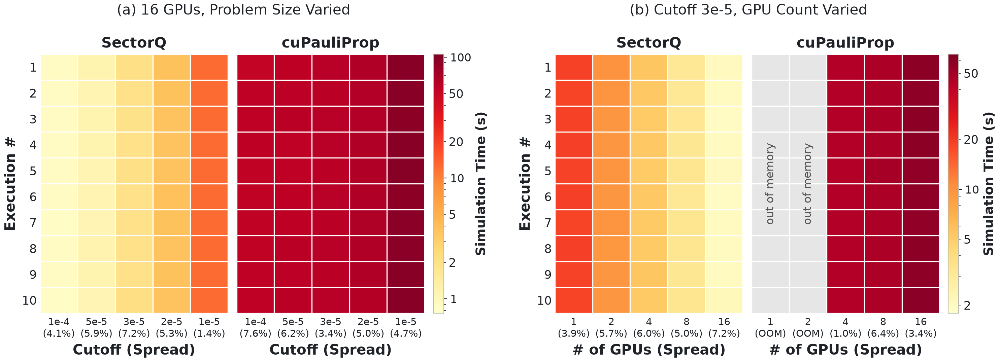</p>
<p align="center"><b>그림 33.</b> 같은 설정을 10회 실행한 시간.</p>

**그림 설명.** 칸 하나가 실행 하나이다. 세로는 실행 회차(1–10)이고 색은 실행 시간이며 로그 눈금이다. (a)는 16 GPU에서 문제 크기(cutoff)를 바꾼 것이고, (b)는 cutoff 3e-5를 GPU 수를 바꾸어 실행한 것이다. 가로축의 괄호는 그 열의 변동 폭, 곧 10회의 (최대 − 최소) / 평균이다. 한 열의 색이 위아래로 고르면 실행마다 시간이 같다는 뜻이다. 회색은 cuPauliProp이 메모리 부족으로 실행하지 못하는 설정이다.

<!-- g:var -->
**문제 크기별 (kicked Ising, 16 GPU, 설정마다 10회).** 변동 폭은 (최대 − 최소) / 평균이고, 평균의 비는 cuPauliProp의 평균을 SectorQ의 평균으로 나눈 값이다.

| cutoff (구간 경계의 항 수) | SectorQ 평균 | 최소–최대 | 변동 폭 | cuPauliProp 기본 평균 | 최소–최대 | 변동 폭 | 평균의 비 |
|---|---:|---:|---:|---:|---:|---:|---:|
| 1e-4 (233만) | 0.86초 | 0.84–0.88초 | 4.1% | 30.1초 | 28.6–31.2초 | 8.6% | 35배 |
| 5e-5 (809만) | 1.12초 | 1.08–1.15초 | 5.9% | 30.9초 | 29.1–32.0초 | 9.1% | 28배 |
| 3e-5 (2,067만) | 2.03초 | 1.99–2.14초 | 7.2% | 32.9초 | 31.4–33.8초 | 7.1% | 16배 |
| 2e-5 (4,396만) | 3.70초 | 3.63–3.83초 | 5.3% | 35.8초 | 34.2–36.5초 | 6.5% | 9.7배 |
| 1e-5 (1.6억) | 12.3초 | 12.2–12.4초 | 1.4% | 57.1초 | 56.1–57.7초 | 2.9% | 4.6배 |

**GPU 수별 (kicked Ising, cutoff 3e-5, 설정마다 10회).** 변동 폭은 (최대 − 최소) / 평균이고, 평균의 비는 cuPauliProp의 평균을 SectorQ의 평균으로 나눈 값이다.

| GPU 수 | SectorQ 평균 | 최소–최대 | 변동 폭 | cuPauliProp 기본 평균 | 최소–최대 | 변동 폭 | 평균의 비 |
|---|---:|---:|---:|---:|---:|---:|---:|
| 1 | 18.7초 | 18.4–19.1초 | 3.9% | 메모리 부족 |  |  |  |
| 2 | 9.71초 | 9.51–10.1초 | 5.7% | 메모리 부족 |  |  |  |
| 4 | 5.29초 | 5.13–5.45초 | 6.0% | 23.8초 | 23.2–27.2초 | 16.9% | 4.5배 |
| 8 | 3.23초 | 3.13–3.29초 | 5.0% | 27.5초 | 27.1–28.3초 | 4.3% | 8.5배 |
| 16 | 2.03초 | 1.99–2.14초 | 7.2% | 32.9초 | 31.4–33.8초 | 7.1% | 16배 |

기대값은 모든 설정에서 10회가 12자리까지 같다.
<!-- /g:var -->

**결과와 이유.**

- **답은 반복해도 같다.** 모든 설정에서 10회의 기대값이 12자리까지 같다. sector 안에서 합치고 자른 결과가 전체를 합치고 자른 결과와 같으므로(3.2절), 답이 실행마다의 분할이나 처리 순서에 의존하지 않는다.
- **SectorQ의 변동은 초로 0.04–0.73초이다.** 16 GPU에서 1.4–7.2%, 1–8 GPU에서 3.9–6.0%이다. 표준편차는 평균의 0.4–1.9%이다. 실행이 0.9–19초로 짧아 비율이 크게 보이며, 가장 큰 문제(cutoff 1e-5, 12.3초)에서 1.4%로 가장 작다.
- **cuPauliProp의 변동은 16 GPU에서 2.9–9.1%(1.6–2.8초)이다.** 표준편차는 평균의 1.0–2.9%이다. 두 방식의 변동은 같은 정도이며, 다섯 크기 가운데 넷에서 SectorQ 쪽의 값(평균 대비 표준편차)이 더 작다.
- **한 번의 느린 실행.** cuPauliProp 4 GPU의 16.9%는 27.2초가 한 번 나와서이다. 나머지 9회는 23.2–23.5초(1.3%)이다. 그 실행이 돈 노드에서는 SectorQ도 다른 노드보다 2–3% 느렸다(GPU 1장: 19.0초 대 18.4–18.6초). 한 노드 실행은 네 노드에 나뉘어 돌았으므로 이 변동에는 노드의 차이가 들어 있다. 같은 노드 안에서 SectorQ의 변동 폭은 GPU 1장 1.1%, 2장 2.5%이다.
- **할당이 바뀌면 cuPauliProp의 시간이 더 달라진다.** 본 측정(다른 날, 다른 노드에서 1회)과 비교하면 SectorQ의 평균은 0.98–1.06배이다. cuPauliProp은 한 노드(4 GPU)에서 1.02배, 두 노드(8 GPU)에서 1.12배, 네 노드(16 GPU)에서 1.05–1.21배이다. cuPauliProp은 시간의 40–46%를 노드 사이의 MPI 호출에서 보내므로(4.6절) 노드의 배치에 따라 시간이 달라지는 것으로 보인다. 이 원인은 따로 재지 않았다.
- **본문의 배수는 이 측정의 평균으로 다시 계산해도 같거나 더 크다.** 16 GPU에서 cuPauliProp 기본 모드의 시간은 SectorQ의 35, 28, 16, 9.7, 4.6배이다(cutoff 1e-4, 5e-5, 3e-5, 2e-5, 1e-5). 1회 측정으로 적은 값(그림 22)은 35, 24, 13, 8.5, 4.5배이다.

## 5. 한계

**요지.** SectorQ의 이득은 문제가 GPU 한 장보다 클 때 난다. 작은 문제, GPU 1장 안의 비교, 특정 조건의 두 구현(SPD, MonoProp)과의 비교에서는 SectorQ가 더 빠르지 않다. 128 GPU 이상에서 메모리를 채우는 문제는 아직 재지 않았다.

- 측정은 512 GPU까지이며, 512 GPU는 kicked Ising 회로 하나이다. kicked Ising에서 16 GPU는 cutoff 1e-6(host memory의 51%)이 끝이고 그다음 단계는 들어가지 않는다. 32, 64 GPU에서는 host memory의 84%, 83%를 쓰는 문제까지 재었다(cutoff 7e-7, 5e-7). 128, 256, 512 GPU에서 잰 가장 큰 문제(cutoff 3e-7, 3e-7, 2e-7)는 64%, 54%, 62%를 쓰며, 이 GPU 수에서 용량을 채우는 문제는 아직 재지 않았다(4.4절). 구간당 sector 수의 상한(256개)과 chunk 크기는 GPU 수와 문제 크기에 맞추어 정해야 하는데 그 규칙이 아직 없다.
- qubit 수는 1,024까지이다. cuPauliProp 라이브러리가 1,056 qubit부터 연산과 expansion을 만들지 않으며, SectorQ는 gate 적용에 그 연산을 쓴다(4.4절).
- 가장 강한 기준선(dedup을 미룬 cuPauliProp)과의 속도 차이는 16 GPU가 있어야 들어가는 설정에서 2.2–4.6배, 32–256 GPU의 cutoff 1e-5에서 3.2–5.1배이다. 1,024 qubit의 전체 자화(cutoff 1e-3)에서는 1.4배이다. 이 기준선은 GPU가 늘어 메모리가 넉넉해질수록 dedup을 더 미룰 수 있다. SectorQ의 gate 적용은 cuPauliProp의 단일 GPU 연산이므로 그 시간이 하한이다(4.6절).
- GPU 1장 안에서는 다른 연산을 쓰는 SPD가 더 빠른 설정이 있다(kicked Ising cutoff 3e-5에서 최대 2.9배, 4.2절. 전체 자화의 256–529 qubit에서 3.6–4.2배, 4.4절). SectorQ는 연산 자체를 바꾸지 않는다. 제자리 rotation kernel(3.7절 성질 6)은 구현하지 않았다. GPU 한 장이 한 번에 다루는 항 수(40 GB에 약 1억)도 cuPauliProp의 연산이 정한다.
- 2초 안에 끝나는 작은 설정에서는 CPU 구현인 MonoProp이 SectorQ보다 빠르다(4.2–4.3절). SectorQ는 rotation마다 연산을 한 번씩 호출하며 그 고정 비용이 약 0.4초이다(4.11절).
- 작은 문제는 GPU를 늘려도 덜 빨라진다(수백만 항에서 16 GPU가 1.4–2.1배, 4.4절). 한 GPU를 넘는 문제도 작으면 일찍 포화한다(cutoff 1e-5는 32 GPU에서 64 GPU로 1.5–1.6배, 64 GPU에서 128 GPU로 1.1–1.3배, 4.4절). 그 뒤로는 줄지 않는다(kicked Ising cutoff 1e-5: 128 / 256 / 512 GPU에서 3.07 / 3.00 / 2.91초). 이런 문제는 512 GPU가 필요 없는 문제이다. sector 상한을 올린 설정을 이런 문제에 그대로 쓰면 512 GPU에서 6.33초로 늘어난다(4.4절). SectorQ는 항 수가 sector 목표보다 적은 동안 GPU 하나만 쓴다.
- 구간이 도는 동안에는 항이 노드 사이를 오가지 않지만 구간이 바뀔 때마다 모든 항이 노드 사이를 이동한다. 통신이 없는 방식이 아니라 항의 교환을 구간 경계로 모으는 방식이다. 구간이 도는 동안에도 다음 구간의 행을 정하는 표본과 행은 노드 사이를 오간다.
- 노드 사이의 교환은 16 GPU에서 실행 시간의 3–13%이고(4.6절), GPU가 늘수록 비중이 커진다(kicked Ising cutoff 3e-6: 16 GPU 5%, 32 GPU 10%, 64 GPU 12%. TFIM의 weak scaling 실행은 64 GPU에서 21%). weak scaling의 처리율이 16 GPU에서 80–88%, 64 GPU에서 72–80%로 떨어지는 주된 이유이다. 128 GPU의 53–77%와 256 GPU의 26–60%에는 sector 수의 상한이 함께 들어 있다(4.4절). 노드마다 thread 하나가 보내고 그동안 GPU는 쉰다.
- 16 GPU에서 SectorQ가 닿는 범위는 4 노드의 host memory가 정한다. kicked Ising cutoff 1e-6은 525 GiB로, 같은 cutoff의 TFIM heavy-hex는 851 GiB로 끝냈고, kicked Ising의 그다음 cutoff(7e-7)는 들어가지 않는다(4.4절). 1–4 GPU에서는 40분의 시간 제한이 먼저 걸린다.
- kicked Ising(θ=π/4, 20 step)의 값은 cutoff 1e-4, 1e-5, 3e-6, 1e-6에서 0.153, 0.229, 0.289, 0.322이고, 32–512 GPU로 잰 7e-7, 5e-7, 3e-7, 2e-7에서 0.3256, 0.3265, 0.3226, 0.3153이다. 1e-6 아래에서 값이 0.011 안에서 오르내리며 수렴하지 않았다. 참값으로의 수렴은 exact 값을 아는 30 qubit 회로에서만 보였다. rotation 각도를 바꾼 실험에서는 0.05π와 0.1π만 수렴하였다(4.5절). 30 qubit의 6 step도 끝낸 cutoff 범위에서 오차가 0.006 아래로 내려가지 않았다. 이 회로에서 주장하는 것은 같은 cutoff에서 같은 답을 더 빠르게, 더 적은 GPU로, 더 낮은 cutoff까지 낸다는 것이다.
- 변동성 측정(4.12절)을 제외한 모든 측정은 1회이다. 대표 설정을 10회 반복하면 16 GPU에서 SectorQ의 시간은 1.4–7.2%, cuPauliProp 기본 모드는 2.9–9.1% 달라진다. 할당이 바뀌면 cuPauliProp의 여러 노드 실행은 5–21% 달라졌다. 반복 측정은 kicked Ising의 1–16 GPU에만 있고, 32 GPU 이상과 다른 회로에는 없다. 1–16 GPU 측정은 모두 40 GB 노드에서 하였다. 그 밖의 측정에는 40 GB 노드와 80 GB 노드(36 GB로 제한)의 결과가 섞여 있고, 같은 설정의 시간이 노드 종류에 따라 최대 8% 다르다.
- ORQA는 저자 코드가 공개되어 있지 않아 논문을 따라 재현한 것과 비교하였다. 재현본의 속도가 저자의 구현과 같다는 보장이 없다.
- MonoProp은 truncation 규칙이 달라 같은 cutoff의 비교가 같은 정확도의 비교가 아니다. 회로 7종에서는 같은 오차에서도 비교하였으나 오차의 기준이 exact 값이 아니라 SectorQ의 가장 작은 cutoff 값이다(4.3절). exact 값을 기준으로 한 비교는 30 qubit 회로에만 있으며, 그 6 step에서는 MonoProp의 가장 작은 오차(0.0017)가 SectorQ(0.0062)보다 작다(4.5절). OBP는 회로 전체의 기대값을 내지 않아 비교에서 뺐다.
- cuPauliProp과의 비교는 v0.5.0 하나에 대한 것이다. 라이브러리 내부가 공개되어 있지 않으므로 원인 분석은 MPI plugin 계측과 GPU 사용률 표본에 근거한다. dedup을 미룬 기준선은 이 연구가 구성한 것이며 NVIDIA가 제공한 설정이 아니다.
- 관측량은 QAOA의 edge 합과 qubit 수 실험의 전체 자화를 제외하면 Z 하나이다.
- coset 하나에 항이 몰리는 회로는 고르게 나눌 수 없다(3.7절 성질 3). 측정한 회로에서는 나타나지 않았다.

## 6. 구성물과 재현

### 6.1 파일 구성

| 파일 | 역할 |
|---|---|
| `build.sh` | 전부 빌드한다 (PrgEnv-gnu, cray-mpich, cudatoolkit) |
| `env/` | cuQuantum 26.09 (cuPauliProp 0.5.0)의 Python 환경. 저장소에 포함되지 않는다 |
| `src/engine/pp_engine.cpp` | SectorQ과 기준 모드 |
| `src/engine/circuit.hpp` | 회로 7종, Clifford frame, 연산의 bit 변환 |
| `src/engine/gf2.hpp` | GF(2) 소거, 유효한 행의 공간 |
| `src/proto/shuffle.cu` | 행 계산과 분할 kernel |
| `src/proto/lo_mpi.cpp`, `lo_ooc.cpp`, `lo_pool.cpp`, `lo_virtual.cpp` | 초기 프로토타입(4.10절) |
| `src/plugin/prof_mpi.c` | cuPauliProp MPI plugin의 계측판 |
| `src/plugin/orig_mpi.c`, `src/driver/ibm_eagle.hpp` | NVIDIA cuQuantum(BSD-3-Clause)에서 가져온 것이며 원래 저작권 표기를 그대로 둔다 |
| `src/driver/ki_prof.cpp`, `ki_split.cpp` | cuPauliProp의 gate별 계측(단일, 분산), 단일 GPU 단계 분해 |
| `analysis/exact_sv.py` | 30 qubit 회로의 exact 값 (cuStateVec) |
| `analysis/rekey_timing.py` | 재분배 시점 분석 |
| `analysis/scaling_table.py` | 확장성 실험(`e12`, `e13`)의 실행별 표: 시간, 일의 양, GPU당 처리율, 교환, 행 선택 시간 |
| `analysis/campaign_g.py` | 1–16 GPU 측정(캠페인 g)의 진행 상황과 모든 표 |
| `analysis/readme_g.py` | 이 문서의 4절 표를 캠페인 g의 기록에서 만든다. `--write`는 `<!-- g:이름 -->` 사이를 새 값으로 바꾼다 |
| `jobs/g_items.py`, `g_ext_items.py`, `g_conv_items.py` | 캠페인 g의 실행 목록(SectorQ와 cuPauliProp, 외부 구현, 각도별 수렴)을 만든다 |
| `jobs/g_var_items.py` | 변동성 측정의 실행 목록: kicked Ising의 대표 설정을 10회씩 반복한다(4.12절) |
| `jobs/g_size_items.py`, `g_wide_items.py` | 회로 크기와 정확도의 실행 목록: exact 값과의 대조(30 qubit), qubit 수(한 자리 관측량과 전체 자화, 36–1,024 qubit), 깊이(4–60 step). 외부 구현이 읽는 연산 목록은 `results/f_ext/ir/`에 있다 |
| `jobs/g_run.py`, `g_drive.py`, `g_loop.sh`, `g_chain.sh` | 목록의 실행을 할당 안에서 차례로 돌리고, 할당이 끝나면 다시 받아 이어 간다 |
| `jobs/g_ext.py`, `g_ext_impl.py` | 외부 구현 하나를 실행한다(연산 목록 변환, 제한 시간, 상태 기록) |
| `analysis/summarize.py`, `ownership.py`, `balance_rows.py` | cuPauliProp 계측 요약, 행의 균형 |
| `jobs/` | 실험 스크립트(6.3절) |
| `logs/` | 실험의 원시 로그 |
| `figures/` | 이 문서의 그림. 설계 그림(그림 11, 12, 14, 16)은 `figures/v2/`에 있으며 `figures/build_v2.sh`가 TikZ 소스(`figures/src/design2_*.tex`, 스타일 `tikz_style2.tex`)로 만든다. 같은 그림의 앞선 판(`figures/design_*.png`, 소스 `figures/src/design_*.tex`)은 `figures/build.sh`가 만든다. `figures/build.sh`는 `make_eval_figures.py`도 실행한다. `make_eval_figures.py --g`는 캠페인 g의 기록과 32–256 GPU의 로그에서 평가 그림(`eval_*.png`)을 그린다 |
| `figures/deck/` | 개념 그림과 발표용 그림. 개념 그림은 TikZ 소스 `figures/src/deck_*.tex`를 `figures/build_deck.sh`로 만든다(그림 1, 3, 4, 5, 7, 8, 10, 13, 17, 18). 자료 그림(그림 2, 6, 15, 26, 32)과 평가 그림의 발표용 판(`d_*.png`, 이 문서의 그림 27과 28)은 `figures/make_deck_figures.py`가 같은 기록에서 그린다 |

`bin/`, `results/`(gate별 원자료 약 480 MB), `third_party/`는 저장소에 포함되지 않는다. 원자료는 Perlmutter의 `/pscratch/sd/s/sgkim/kcj/pauliprop/results`에 있다.

### 6.2 빌드

```bash
# Perlmutter 로그인 노드의 기본 환경 (PrgEnv-gnu, cray-mpich, cudatoolkit)
python -m venv env && env/bin/pip install cuquantum-python-cu13==26.9.0 cupy-cuda13x matplotlib   # cupauliprop-cu13 0.5.0 포함
./build.sh                      # bin/pp_engine, 프로토타입, 계측 plugin과 driver
figures/build.sh                # 그림 (texlive module 필요)
```

thrust 코드는 `-gencode arch=compute_80,code=sm_80`로 빌드한다. 실행할 때는 `jobs/env.sh`가 Cray MPICH와 libfabric의 경로를 `LD_LIBRARY_PATH`에 넣는다.

### 6.3 실험과 로그

| 스크립트 | 측정 내용 | 로그 | 절 |
|---|---|---|---|
| `jobs/prof_1node.sh` | cuPauliProp 분산 모드, 1 노드 1–4 GPU | `logs/pp_prof1-59470347.out` | 2.4 |
| `jobs/prof_1node_b.sh` | 전역 dedup 간격 조정, perf, 용량 | `logs/pp_prof2-59470887.out` | 2.4 |
| `jobs/prof_4node.sh` | cuPauliProp 분산 모드, 8과 16 GPU | `logs/pp_prof4n-59470888.out` | 2.4 |
| `jobs/lo_4node.sh`, `lo_frame_4node.sh` | MPI 프로토타입, Clifford frame | `logs/pp_lo-59471256.out`, `pp_lofr-59472166.out` | 4.10 |
| `jobs/ooc_1gpu.sh`, `pool_1node.sh` | GPU 1장 out-of-core, 한 노드 sector task | `logs/pp_ooc-59472272.out`, `pp_pool-59472385.out` | 4.10 |
| `jobs/engine_4node.sh` | SectorQ 첫 판, 1 / 2 / 4 노드 | `logs/pp_engine-59474122.out` | 4.1 |
| `jobs/e2a_ki.sh` | kicked Ising 노드 수별, 4 노드 checkpoint와 재개 | `logs/pp_e2a-59475513.out` | 4.8 |
| `jobs/e2b_circuits.sh` | 회로 7종의 큰 설정, exact 값 대조 | `logs/pp_e2b-59475514.out` | 4.1, 4.5 |
| `jobs/e3_baseline.sh` | SectorQ 대 cuPauliProp 분산(기본), 회로 7종 | `logs/pp_e3-59475516.out` | 4.2 |
| `jobs/inter_run1.sh`–`inter_run3.sh` | SectorQ 설정 실험(GPU당 sector 수, pilot, 교환 겹치기) | `logs/inter_run1.out`–`inter_run3.out` | 4.7, 4.9 |
| `jobs/inter_run4.sh` | 최종 SectorQ: GPU 수별, cutoff별, cuPauliProp 분산(기본)과의 비교 | `logs/inter_run4.out` | 4.2, 4.3, 4.6 |
| `jobs/inter_run5.sh`, `inter_run6.sh` | dedup을 미룬 cuPauliProp, SectorQ 1과 2 GPU, 같은 노드에서의 재측정 | `logs/inter_run5.out`, `inter_run6.out` | 4.2, 4.3 |
| `jobs/e4_32gpu.sh` | 32 GPU(8 노드)와 16 GPU, SectorQ와 두 기준선 | `logs/pp_e4-59481070.out` | 4.3 |
| `jobs/e5_defer.sh` | sector 안에서 dedup 미루기 | `logs/pp_e5-59481309.out` | 4.9 |
| `jobs/e6_overhead.sh`, `e7_early.sh` | 노드별 시간 계측, 초반 구간을 일찍 나누기 | `logs/pp_e6-59481492.out`, `pp_e7-59482484.out` | 4.6 |
| `jobs/e8_busy.sh` | 앞 구간 시간을 보고 나누는 규칙(기각), 같은 노드의 두 기준선 | `logs/pp_e8-59482607.out` | 4.9 |
| `jobs/e9_share.sh` | 초반부터 노드마다 sector 하나, 노드 안에서 sector 나누기 | `logs/pp_e9-59483080.out` | 4.7, 4.9 |
| `jobs/e11_trace.sh` | 구간별 기록(`--trace`): 연산 범위, 유효한 행, sector 수, 항 수 | `logs/pp_e11-59488608.out` | 3.1 |
| `jobs/e10_final.sh` | 최종 설정의 SectorQ와 두 기준선(16과 32 GPU), GPU 수별, 회로 7종 | `logs/pp_e10-59483161.out` | 4.2, 4.3, 4.6 |
| `jobs/e12_scaling.sh` | 4–128 GPU, GPU 수마다 job 하나. cuPauliProp 두 모드(16–128 GPU), cutoff 3e-6의 cuPauliProp(64와 128 GPU), SectorQ cutoff 1e-6(128 GPU) | `logs/pp_e12_g4-59491670.out`, `g8-59491668`, `g16-59491638`, `g32-59491640`, `g64-59491662`, `g128-59491663` | 표에 쓰지 않음 (앞선 측정) |
| `jobs/e13_scaling.sh` | SectorQ의 strong scaling과 weak scaling(4–128 GPU), sector 수 상한과 chunk 크기의 변형, cutoff 1e-6(128 GPU) | `logs/pp_e13_g4-59520491.out`, `g8-59520488`, `g16-59520479`, `g32-59520481`, `g64-59520484`, `g128-59520486` | 표에 쓰지 않음 (앞선 측정) |

| `jobs/e15_scaling.sh` | 32, 64, 128, 256 GPU의 SectorQ(strong과 weak scaling)와 같은 노드의 cuPauliProp 두 모드, GPU 수마다 job 하나 | `logs/pp_e15_g32-59629132.out`, `g64-59629133`, `g128-59629134`, `g256-59629135` | 4.4 |
| `jobs/u1_validate.sh` | GPU 1장의 자동 선택(첫 판)과 noise 묶음 호출: 새 binary와 캠페인 f의 binary(`bin/pp_engine_f`), 단일 GPU 기준과 cuPauliProp 분산 모드 | `logs/u1/` | 4.11 |
| `jobs/u2_exchange.sh` | 16 GPU에서 교환 시간의 분해(`bin/pp_engine_u2`), chunk를 예측해 미리 만든 판(`pp_engine_u3`, 기각) | `logs/u2/` | 4.9, 4.11 |
| `jobs/u6_drive.sh` | 최종 판(`bin/pp_engine_u6`): 16 GPU, GPU 1장, kicked Ising 1e-5의 GPU 1장. `logs/u3`, `logs/u4`는 기각한 GPU 1장 규칙의 기록이다 | `logs/u6/` | 4.11 |
| `jobs/u7_breakdown.sh` | 16 GPU의 시간 분해: SectorQ와 cuPauliProp 분산 모드(기본, dedup을 미룬 방식). cuPauliProp은 MPI 계측판과 호출별 timer, 모든 실행에 GPU 사용률 표본(`jobs/smi_sample.sh`). `bin/pp_engine_u7` = `bin/pp_engine` | `logs/u7/` | 3.3, 4.6 |
| 캠페인 g (`queue_g/todo*.jsonl`, `jobs/g_loop.sh`) | 1–16 GPU의 모든 측정: SectorQ, cuPauliProp(단일 GPU, 분산 기본, dedup을 미룬 방식, 원래 회로), 외부 구현 일곱 가지. 회로 7종의 cutoff sweep, strong과 weak scaling, 시간 분해, GPU memory를 줄인 실행, 설계 매개변수, checkpoint, exact 값 대조, 각도별 수렴. interactive 할당(4 노드) 둘에서 차례로 실행 | 실행 기록 `queue_g/done/`, 로그 `logs/g/`, 외부 구현의 결과 `results/g_ext/` | 4.1–4.8, 4.11 |
| 규모 캠페인 (`queue_s/todo_s.jsonl`, `jobs/s_items.py`, `jobs/s_scale.sh`, `jobs/s_run.py`) | 32–512 GPU: GPU 수마다 batch job이 목록을 위에서부터 실행한다. SectorQ의 cutoff sweep과 host memory의 한계까지 내려가는 사다리(sector 상한 1,024개 또는 4,096개), weak scaling, cuPauliProp 두 모드, 같은 노드의 CPU 구현. 시간 안에 못 들어간 실행은 남아서 같은 스크립트의 다음 job이 이어 받는다 | 실행 기록 `queue_s/done/`, 실행마다의 로그 `logs/s/`, job 로그 `logs/pp_s_g*-*.out` | 4.4 |
| 캠페인 g의 큐 맨 앞 항목 (`queue_g/todo_00h1.jsonl`, `jobs/g_ext_impl.py`의 `launch_engine`) | 행 고르기를 구간 계산과 겹친 binary(`bin/pp_engine_h`)와 행을 구간 사이에 고르는 binary(`bin/pp_engine_g0`)를 같은 노드에서 차례로: 4와 16 GPU, 일곱 설정, 변형 셋. 엔진의 MPI 호출 수(`bin/libmpi_shim.so`) | `logs/h1/` | 3.1, 3.3, 4.11 |

작업은 `sbatch jobs/*.sh`로 낸다(`-A m5320_g -C gpu -q debug`). `e5`–`e10`은 측정 당시의 시험용 binary(`bin/pp_engine_dd*`)를 가리킨다. 최종 소스로 빌드한 SectorQ로 다시 돌리려면 `PP_BIN=bin/pp_engine`을 준다. `e8`의 `--busy-window`는 기각하여 최종 소스에 없다. `inter_run*.sh`는 interactive 할당 안에서 `PP_JOB=<할당 번호> bash jobs/inter_runN.sh`로 실행한다.

4.1–4.3절, 4.4절의 1–16 GPU 부분, 4.5–4.8절과 4.12절의 표와 평가 그림(그림 19–31)은 캠페인 g의 값이다(그림 20과 그림 25의 32–256 GPU는 `e15`, 그림 25의 cutoff 1e-6 이하와 512 GPU는 규모 캠페인). 위 표에서 이 절들을 가리키는 앞선 스크립트(`inter_run4`–`inter_run6`, `e3`, `e4`, `e10`)의 값은 이 문서의 표에 더 쓰지 않는다. 4.9–4.11절은 그 로그의 값 그대로이다. `e12`와 `e13`(4–128 GPU의 앞선 측정)의 값은 이 문서의 표에 더 쓰지 않는다. 캠페인 g의 실행 기록(`queue_g/done/`)과 로그(`logs/g/`)는 아직 저장소에 넣지 않았으며 Perlmutter의 작업 디렉터리에 있다. 전체 표는 `python3 analysis/campaign_g.py`로, 이 문서의 표는 `python3 analysis/readme_g.py`로 다시 만든다.

`e12`와 `e13`은 같은 스크립트를 노드 수만 바꾸어 낸다(`sbatch -N <노드 수> -J pp_e13_g<GPU 수> jobs/e13_scaling.sh`, 16 노드부터는 `-q regular`). `e12`의 SectorQ 실행 시간은 쓰지 않는다. 그 판(`bin/pp_engine_scal`)은 행을 고르는 표본을 노드마다 20만 개씩 모아, 그 단계가 1 노드 0.4초에서 32 노드 15–45초로 늘었다. `e13`은 표본을 전체 20만 개로 되돌린 현재 소스(`bin/pp_engine_scal2`)로 다시 잰 것이다. `e12`의 cuPauliProp 실행과 기대값은 영향을 받지 않는다. 전체 표는 `python3 analysis/scaling_table.py`로 본다.

## 7. 사용법

```bash
# 단일 GPU 기준 (sector 하나, cuPauliProp 연산 그대로)
bin/pp_engine --circuit tfim_sq --lx 11 --ly 11 --steps 10 --coef 1e-4 --mode ref
# 한 노드 4 GPU
bin/pp_engine --circuit tfim_sq --lx 11 --ly 11 --steps 10 --coef 1e-5 --gpus 4 --target 4000000
# 4 노드 (노드마다 프로세스 하나)
srun -N 4 -n 4 --ntasks-per-node=1 -c 128 --gpus-per-node=4 \
  bin/pp_engine --circuit ki_lab --coef 1e-5 --gpus 4 --target 6000000
# 같은 연산 목록을 cuPauliProp 분산 모드로 (rank마다 GPU 하나), 기본과 dedup을 미룬 것
srun -N 4 -n 16 --ntasks-per-node=4 --gpus-per-node=4 bin/pp_engine --mode cupp --circuit ki_lab --coef 1e-5
srun -N 4 -n 16 --ntasks-per-node=4 --gpus-per-node=4 bin/pp_engine --mode cupp --cupp-tuned 1 --circuit ki_lab --coef 1e-4
# 1,024 qubit 격자의 전체 자화 (4 노드, 노드마다 프로세스 하나)
srun -N 4 -n 4 --ntasks-per-node=1 --gpus-per-node=4 -c 128 --cpu-bind=none \
  bin/pp_engine --circuit tfim_sq --lx 32 --ly 32 --theta 0.2 --phi -0.3 --steps 10 --coef 1e-3 --obs-all 1 --gpus 4 --target 4000000
```

| 옵션 | 뜻 | 기본 |
|---|---|---|
| `--circuit` | `ki`, `ki_lab`, `tfim_hh`, `tfim_sq`, `xxz`, `qaoa`, `hea`, `ki_noisy` | `ki` |
| `--obs-all` | 1이면 관측량을 모든 qubit의 Z의 합(전체 자화)으로 둔다. 0이면 회로가 정한 관측량(대부분 Z 하나) | 0 |
| `--mode` | `engine`, `ref`(sector 하나와 GPU 하나), `cupp`(cuPauliProp 분산 모드) | `engine` |
| `--coef`, `--weight`, `--trunc-every` | cutoff, weight truncation(0은 끔), truncation 간격 | 1e-4, 0, 10 |
| `--gpus` | 노드당 GPU 수 | 1 |
| `--target` | 구간이 시작될 때 sector 하나의 항 수. 구간 안에서 약 10배로 늘어나므로 GPU 버퍼의 20분의 1 정도로 둔다 | 4,000,000 |
| `--per-gpu` | GPU당 최소 sector 수 | 2 |
| `--gmax`, `--chunk` | 구간당 sector 수의 상한(2^gmax개, gmax는 12까지), host chunk 하나의 항 수 | 8, 262,144 |
| `--min-bucket`, `--early-per-node`, `--min-bucket-early` | sector의 최소 항 수, 초반에 노드마다 줄 sector 수, 그때의 최소 항 수 | 200,000, 1, 2,000 |
| `--frame` | Clifford gate를 데이터에 적용하지 않는다 | 1 |
| `--snap`, `--pilot` | 구간을 truncation 직후에서 끝낸다, pilot sector로 구간 끝을 정한다 | 1, 0 |
| `--verify` | 보존 parity 검산 | 1 |
| `--ckpt-window k --ckpt-file f [--stop-at-ckpt 1]`, `--resume f` | k번째 구간 뒤에 checkpoint를 쓴다, 재개한다 | 없음 |
| `--profile f`, `--trace 1` | 연산마다의 항 수를 파일로 쓴다, 구간마다 한 줄씩 기록한다 | 없음, 0 |
| `--vram-frac` | GPU memory 가운데 쓸 비율 | 0.9 |
| `--defer-dedup k`, `--share-above k`, `--growth-cap x` | 기각한 설계를 다시 재는 옵션(4.9절) | 0, 0, 8 |
| `--cupp-tuned 1`, `--cupp-dedup-every k` | `--mode cupp`에서 연산을 rank 안에서만 적용하고 전역 dedup은 truncation 직전에만, 그리고 k개 연산마다 수행한다 | 0, 0 |

interactive 할당 안에서는 `jobs/inter.sh`를 source한 뒤 `eng <노드 수> <제한 시간> <옵션...>`, `cupp <노드 수> <제한 시간> <옵션...>`으로 실행한다.

실행할 때 주의할 점은 다음과 같다.

- `--gpus-per-task=1`로 GPU를 rank별로 격리하면 Cray MPICH의 GPU 전송이 멈춘다. `--gpus-per-node=4`로 모든 GPU가 보이게 한다.
- debug 큐는 사용자당 동시 2개이다.
- cuPauliProp은 최근 세 버전 모두 correctness 수정이 있었다. 새 설정은 작은 회로에서 답을 먼저 대조한다.

## 8. 논문 계획

논문은 "측정으로 찾은 원인 → 원리 하나 → 그 원리에서 나오는 기능"의 순서로 쓴다. state-vector 시뮬레이터 논문의 구성(분할 설계 → 속도 → 확장성)을 따르지 않는다. 비교 축은 qubit 수가 아니라 항 수(cutoff)와 GPU 수이다.

| 논문의 절 | 내용 | 이 문서 |
|---|---|---|
| 1. 서론 | 고전 시뮬레이션의 필요, 항 수가 정확도를 정한다, 나누기 어려운 세 가지 이유, 관찰과 규칙, 결과 | 1절, 그림 1–6 |
| 2. 배경 | 100 qubit 이상의 고전 시뮬레이션, Pauli propagation의 연산, 분산이 어려운 이유 | 2.1–2.3절, 그림 7–8 |
| 3. 지금 방식의 해부 | cuPauliProp 분산 모드의 측정 | 2.4절, 그림 9 |
| 4. 원리 | 런타임 sector 재구성, 보장과 한계(정리와 증명 스케치) | 3.1–3.2절, 3.7절, 그림 11–13 |
| 5. 설계 | 통신을 구간 경계로 모으기, sector 단위 실행, Clifford frame, checkpoint | 3.3–3.6절, 그림 14–17 |
| 6. 평가 | 답의 일치, 단일 노드 성능(다른 구현과의 비교), 다중 노드 확장성(weak, strong), 여러 회로, 회로 크기(qubit 수와 깊이), scale-out, 정확도, 시간 분해, 변동성 | 4절, 그림 18–31 |
| 7. 관련 연구 | Pauli propagation 계열, state-vector 계열, database의 분할 실행 | 2.5절, 그림 10 |
| 8. 한계 | | 5절 |

| 순서 | 남은 실험 | 받치는 주장 |
|---|---|---|
| 1 | 32–512 GPU에서 메모리 한계까지의 sweep (32 GPU는 한계인 cutoff 7e-7까지, 64 GPU는 5e-7, 128, 256 GPU는 3e-7, 512 GPU는 2e-7까지 끝났다. 64 GPU는 5e-7, 128 GPU는 3e-7이 한계이고, 256, 512 GPU의 그 아래 cutoff는 아직 재지 않았다) | 규모. 128, 256, 512 GPU에서 끝낸 가장 큰 문제는 host memory의 54–64%만 쓴다. 기본 모드와의 차이는 GPU가 늘수록 벌어진다(16 GPU 4.5–7.0배, 32 GPU 7.3–14배, 64 GPU 12–25배, 128 GPU 11–20배, 256 GPU 13–23배, 512 GPU 27배, 4.4절) |
| 2 | 노드 사이 교환을 여러 thread로, sector가 GPU에 들어가면 host로 내리지 않기 | 남은 비용. 교환의 비중은 GPU 수와 함께 커진다(64 GPU에서 21–33%, 4.4절) |
| 3 | 제자리 rotation kernel | GPU당 항 수(약 7배는 추정치이다) |
| 4 | 회로 7종의 논문용 크기와 관측량 확정(IBM 실험의 weight-10, weight-17, 자화). XXZ, QAOA, ansatz는 지금의 큰 설정도 1–3초에 끝난다 | 일반성 |
| 5 | ORQA 방식의 기준선 | 비교 |
| 6 | kicked Ising의 수렴 곡선(cutoff 1e-6 이하), 수렴이 쉬운 θ | 정확도 |
| 7 | 32 GPU 이상과 다른 회로의 반복 측정, 노드 종류 통일 (kicked Ising의 1–16 GPU는 10회 반복을 재었다, 4.12절) | 신뢰도 |

- 이름: **SectorQ** (2026-10-07 확정). sector는 보존량의 값으로 나뉘어 서로 섞이지 않는 구역이다. 검토한 다른 이름은 ORBIT-Q, Decouple, Modal, Syndrome, Coset, Walsh, Confine, Cleave, ScalePauli이다.
- 제목(작업 제목): *SectorQ: Scalable Pauli Propagation with Communication-Avoiding Parity Sectors*. 다른 후보: *SectorQ: Communication-Avoiding Pauli Propagation for Scalable Quantum Circuit Simulation*, *SectorQ: Scalable Pauli Propagation via Conserved-Parity Sectors*
- 제목에 쓰는 말: "communication-free"는 쓰지 않는다(구간 경계에서 교환한다). "Highly Scalable"은 64 GPU 이상의 측정이 있어야 쓴다.
- 학회: SC'27이 1순위이다(마감은 보통 4월 초이며 공지를 확인해야 한다). 규모 실험과 수렴 곡선이 필요하다. 해부의 비중을 키우면 SIGMETRICS도 맞는다.
- 연구실의 계보에서는 ScaleQsim(state vector), SWIFTN(tensor network)에 이은 세 번째 방법(operator 공간)이다.
